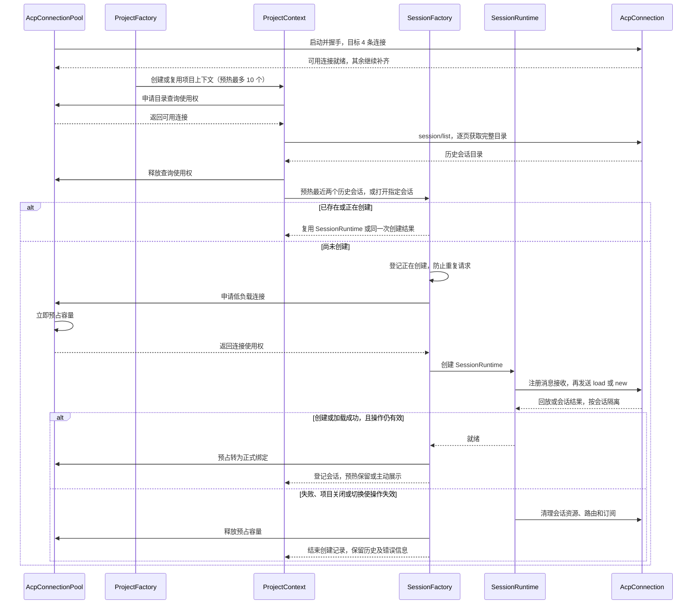
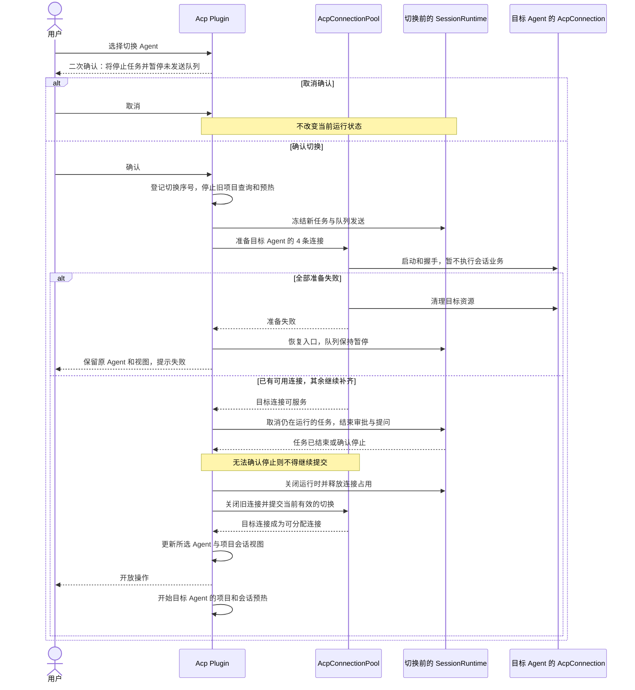
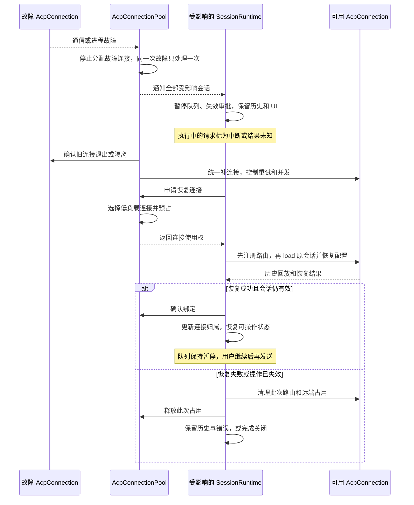
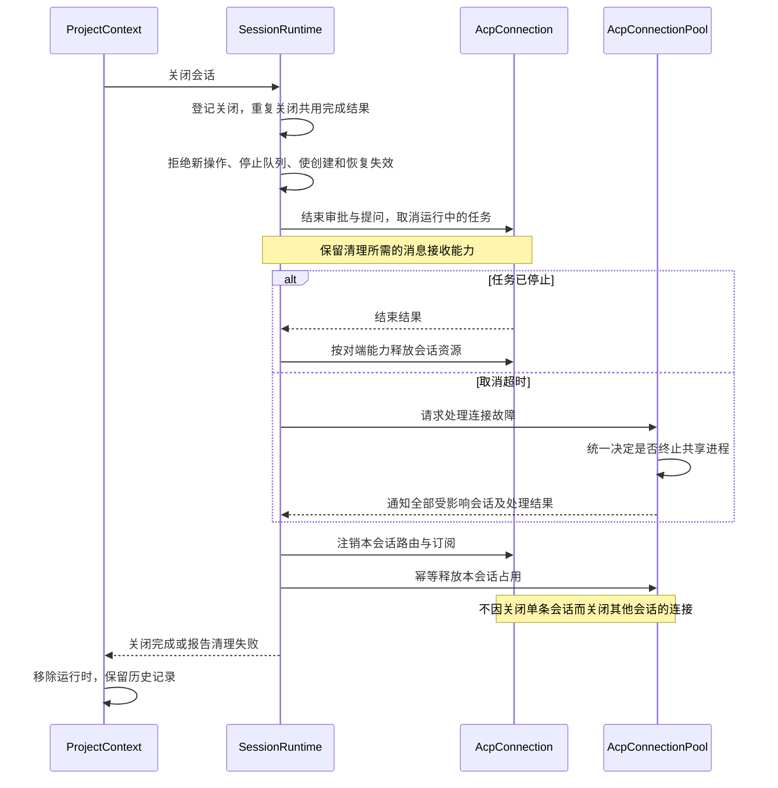
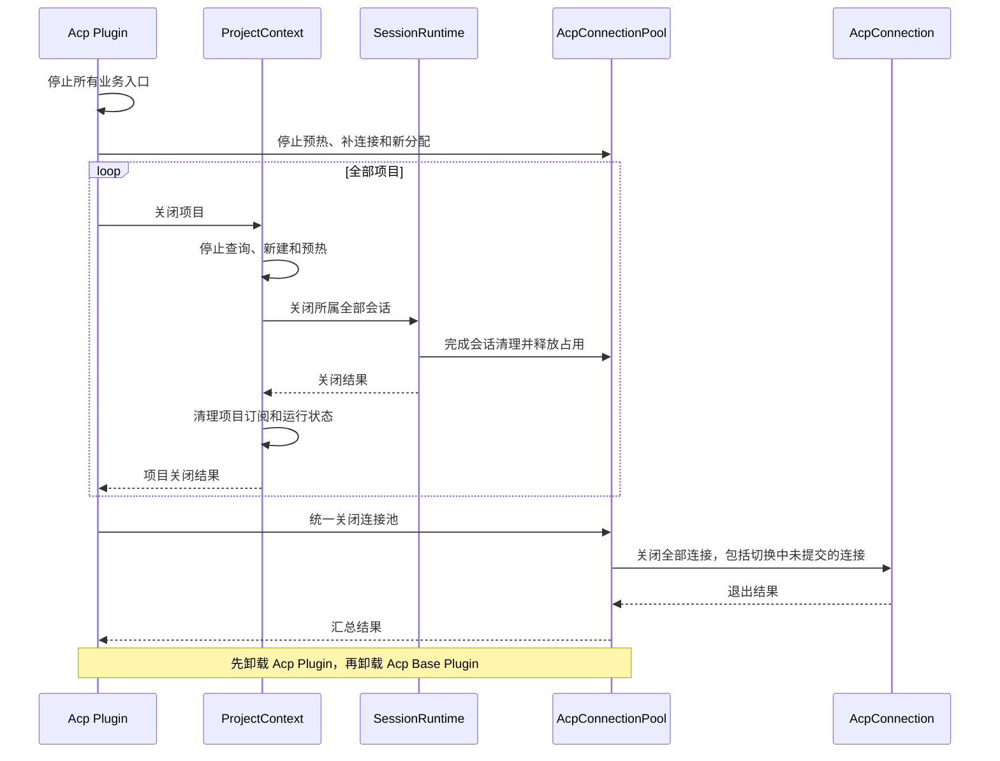

# ACP Runtime 设计方案

本文记录已确认的目标架构，作为后续实现依据，不代表当前代码已经完成改造。Agent 适配器与方言机制参见 [ACP 架构说明](./acp-architecture.md)。

当前完成情况和待办以文末「当前剩余项核对」为准；各阶段实施记录保留当时状态，不代表当前仍存在相同缺口。

## 一、两个插件

| 插件 | 包含对象 | 职责 |
| --- | --- | --- |
| Acp Base Plugin | AcpConnectionPool、AcpConnection | 连接预热、通信、分配、并发容量控制、故障检测和连接回收 |
| Acp Plugin | ProjectFactory、ProjectContext、SessionFactory、SessionRuntime | 项目与会话的创建、管理，以及对话、审批、队列、取消和恢复 |

依赖方向为 Acp Plugin → Acp Base Plugin。无需为每个项目或会话单独定义插件，但项目和会话仍有独立生命周期。

### 对象职责

- **AcpConnectionPool**：全局统一管理当前所选 Agent 的连接，负责创建、预热、分配、回收，以及切换 Agent 时的连接准备和清理。
- **AcpConnection**：承载多个会话，负责连接级通信、握手结果、请求关联、按会话路由消息，以及连接上的并发容量控制。
- **ProjectFactory**：创建 ProjectContext，不重复维护项目运行状态。
- **ProjectContext**：管理一个项目的信息、历史会话目录和所属 SessionRuntime；项目可以没有会话。
- **SessionFactory**：为指定 ProjectContext 创建 SessionRuntime，包括新建会话、加载历史和预热历史会话；避免为同一历史会话重复创建运行时。
- **SessionRuntime**：管理一条会话的消息、模型和模式状态、审批、队列、取消与恢复，使用分配到的 AcpConnection。

历史会话目录是数据，不为目录里的每条记录都创建 SessionRuntime。关闭单条会话不销毁 ProjectContext；关闭项目时统一关闭其所属 SessionRuntime。

## 二、三层预热

### 1. 连接预热

- 为当前 Agent 固定预热 4 个 AcpConnection。
- 4 个指健康连接的总目标数量，已承载会话的连接也计入，不额外保留 4 个空闲连接。
- 连接完成启动和握手后才可分配；故障后由 AcpConnectionPool 补齐。
- 部分连接失败时，已准备好的连接可以服务用户，其余连接按 1、3、10 秒进行最多三次自动补充；耗尽后保留错误，显式 warm 可重新开始一轮。切换目标仍须四条全部就绪，不能以部分成功提交。

### 2. 项目预热

- 按当前 Agent 下用户创建的项目进行预热，最多选择 10 个项目，优先最近使用的项目。
- 对选中的每个项目执行 `session/list`，处理分页，获取完整历史会话目录。
- 10 个是预热上限，不是用户可创建或打开项目的上限；其他项目按用户操作加载。
- 限制同时进行的查询数量，用户主动操作优先于后台预热。

### 3. 会话预热

- 对选中的每个项目，优先加载最近使用的两个历史会话。
- 有两个及以上历史会话时加载两个，只有一个时加载一个，没有历史会话时不加载。
- 通过 `session/load` 加载历史，不创建空白会话填充数量。
- 最多预热 20 个历史会话，分布在 4 个 AcpConnection 上；用户主动打开的会话不受此数量限制。
- 用户打开已预热会话时直接复用 SessionRuntime；正在预热时复用同一次加载，不重复调用 `session/load`。
- 不维持“始终有两个未使用会话”的库存，不在接管后自动补足，也不因关闭项目而立即重新预热。
- 不支持历史加载或加载失败时保留会话目录，不阻塞其他项目和用户操作。

## 三、连接分配与并发

SessionRuntime 首次创建时，包括为加载历史而创建时，由 AcpConnectionPool 选择当前负载较低的 AcpConnection。

1. 只选择健康、就绪且与当前 Agent 配置兼容的连接。
2. 优先选择正在运行的请求较少的连接；相同时选择已绑定会话较少的连接。
3. 选择后立即预占容量，再异步创建或加载会话，避免并发申请都选择同一连接。
4. 创建或加载失败时释放预占容量；释放操作必须幂等。
5. 分配后保持会话的连接归属，不为了均衡动态迁移；连接故障恢复时可以重新分配。

在负载相当、连续分配 5 个会话的情况下，4 条连接的会话分布应为 `1、1、1、2`。这保证创建时尽量均衡，不保证任意时刻正在执行的会话也严格保持该分布。

已绑定会话数与正在执行的请求数分别统计。每条会话的消息队列归 SessionRuntime，连接整体的并发容量归 AcpConnection 管理。多会话支持不代表无限并发。

## 四、切换 Agent

同一时间只使用一种 Agent 执行业务。允许切换期间暂时存在切换前后的连接，以便提前准备和失败回退。

- AcpConnectionPool 负责为切换后选中的 Agent 准备连接，并清理切换前的连接。
- 用户切换 Agent 必须二次确认；确认内容明确说明将停止当前任务、暂停未发送队列并切换 Agent。取消确认不改变当前运行状态。
- Acp Plugin 负责冻结切换前会话的新任务入口和自动发送队列，处理正在执行的任务，更新项目会话视图。
- 切换前的任务结束或取消并确认停止后，才允许切换后选中的 Agent 执行业务。
- 准备失败时保留原有连接和视图，恢复原有入口。
- 连续切换时，仅最后一次切换的准备结果可以生效；过期结果不能覆盖当前状态。
- 停止切换前的项目查询和历史会话预热。迟到结果不能写入当前视图，已经创建成功的资源仍需清理。
- 项目本身保持稳定，历史会话保留所属 Agent 身份，不能把一个 Agent 的历史会话直接交给另一个 Agent 加载。

AcpConnectionPool 不直接操作项目和会话的业务 Store。切换期间可能暂时存在两组各 4 条连接，应将这一峰值纳入资源预算。

## 五、取消、恢复和资源清理

- SessionRuntime 只取消或关闭自己的会话，不能直接终止共享连接对应的进程。
- 必须强制终止进程时，由 AcpConnectionPool 统一处理，并通知该 AcpConnection 上的全部 SessionRuntime。
- 连接故障由 AcpConnectionPool 统一补充连接，避免每条会话分别启动进程；各 SessionRuntime 恢复自己的历史和配置。
- 恢复保留本地会话和 UI 身份，隔离旧连接迟到的事件；历史回放与新消息分别处理。
- 结果未知的 Prompt 不自动重发，避免重复执行操作。
- 关闭单条会话或项目只释放其自身对连接的使用关系，不关闭其他会话仍在使用的共享连接。
- 关闭流程依次停止新操作、停止队列、处理运行任务和挂起审批、释放会话使用关系、清理订阅；应用退出时最后关闭连接池。
- Acp Plugin 完成项目和会话清理后，再卸载 Acp Base Plugin。创建失败、重复关闭、预热中退出均须正确回收资源。

## 六、四个生命周期流程

以下为目标设计时序，不代表当前实现。图中调用名为职责描述，不限定最终 API 命名。Acp Plugin 编排业务，Acp Base Plugin 管理连接资源；不增加架构对象。

### 1. 创建与预热

先准备连接，再查询项目目录，最后加载历史会话。用户打开与后台预热走同一次创建过程。



图外约束：

- 每个项目历史数量为 0/1/2 个及以上时，分别预热 0/1/2 个；不创建空白会话填充，不持续补足库存。
- SessionFactory 按 Agent、项目和历史会话 ID 复用创建；用户打开正在预热的会话只提高优先级。不同主动新建会话不能合并。
- `session/load` 发送前准备回放路由；`session/new` 返回 ID 前的事件有界暂存，绑定后再交给对应 SessionRuntime。
- 查询和创建失败都要归还占用。远端已成功但本地操作失效时仍需清理远端资源，不能杀掉其他会话共享的连接。

### 2. 切换 Agent

二次确认后先准备目标连接，再停止旧任务；确认旧任务停止后才提交切换并启动目标 Agent 的项目和会话预热。



图外约束：

- 每次切换都二次确认。准备阶段仅最后一次已确认的切换可以进入提交；取消后续确认不影响已进行的切换。若后续确认发生在提交已经开始之后，先完成这次不可拆分的提交，再执行最新请求，中间不开放业务入口。过期准备结果清理，不覆盖当前视图。
- 提交期间业务入口保持关闭，避免所选 Agent、视图与连接不一致。项目本身保留，历史不能跨 Agent 加载。
- 取消超时由 Pool 处理连接级终止并通知全部受影响会话；无法确认旧任务停止时，切换保持未完成。
- 准备失败可恢复旧入口，但已取消的任务不能恢复执行进度，结果未知的消息不自动重发。提交后的单项目加载失败不回滚整个切换。
- 应用退出优先于切换，统一清理新旧连接。切换期间资源峰值可能为 8 条连接。

### 3. 故障恢复

Pool 统一处理故障和补连接，各 SessionRuntime 恢复自己的历史；不会由每条会话分别启动进程。



图外约束：

- 同一 SessionRuntime 同时只恢复一次；恢复有并发限制，用户正在打开的会话优先。连接补充采用有界重试和退避。
- 无法确认旧任务停止时，不在新连接重复执行任务；结果未知的 Prompt 永不自动重发。
- 不支持历史加载或历史不可用时结束自动恢复，保留查看历史和主动新建入口。单会话失败不关闭其他会话的连接。
- 关闭会话、关闭项目和切换 Agent 优先于恢复。每个异步返回都检查操作是否仍有效；迟到结果只清理，不重新激活会话。
- 路由校验连接与本次恢复的有效性，旧消息和旧审批答复不能污染恢复后的会话；历史回放不能作为新回复重复追加。

### 4. 关闭与销毁

先停止会话业务，再释放会话占用。关闭会话与销毁共享连接是不同操作。



项目和应用的整体退出顺序：



图外约束：

- 单独关闭项目只执行其子会话清理，不停止全局连接池，也不影响其他项目共享的连接。
- 清理必须有超时且幂等；某项失败仍继续清理其他资源，汇总失败，不虚报成功。退出或切换中的会话不自动恢复。
- 远端资源释放未确认时，不能把本地移除等同于远端释放。连接层记录未确认资源，暂停向问题连接分配，在其他会话结束后回收连接。
- 迟到的创建、加载、恢复结果由原操作负责清理；关闭运行时不删除 Agent 的历史记录。

## 七、目录结构与职责

以下为重构完成后的主要目录结构（2026-11-09）。两个插件划分运行时职责，不要求所有适配、UI 和公共数据代码都放入插件目录。

```text
desktop/src/
├── agents/                         # 独立的 Agent 适配能力，不是第三个插件
│   ├── registry.ts                 # Agent 注册和解析
│   ├── builtins.ts                 # 内置 Agent 注册清单
│   ├── types.ts                    # 各类适配能力的契约
│   ├── icode/                      # ICode 启动、方言、历史、设置、Skills 适配
│   └── codeagent/                  # CodeAgent 对应的适配实现
├── runtime/
│   ├── bootstrap.ts                # 创建根上下文，装配插件并注入 Agent 能力
│   ├── services.ts                 # Service 名称与注入类型，不放业务逻辑
│   ├── mainRuntime.ts              # 主窗口单例及完整宿主装配
│   ├── acpBase/
│   │   ├── plugin.ts               # 注册 acpBase，绑定插件生命周期
│   │   ├── service.ts              # 连接资源 Service 的公共接口
│   │   ├── RequestScheduler.ts     # 每连接额度、前台优先与后台并发限制
│   │   ├── AcpConnectionPool.ts     # 预热、分配、切换准备、补充及回收
│   │   ├── AcpConnection.ts         # 单连接生命周期、多会话路由和容量控制
│   │   └── protocol/               # 底层通信与协议实现
│   │       ├── JsonRpcConnection.ts # 请求响应匹配、超时、反向请求处理
│   │       ├── session.ts          # 连接拥有的协议会话通道
│   │       ├── framing.ts          # 字节流分帧、消息大小及格式检查
│   │       ├── types.ts            # 协议消息类型
│   │       ├── parse.ts            # 协议字段解析与数据校验
│   │       ├── errors.ts           # 协议与通信错误
│   │       └── transport/          # Tauri、Node、内存传输及进程操作
│   └── acp/
│       ├── plugin.ts               # 注册 acp，分派业务命令及管理插件生命周期
│       ├── service.ts              # 对外业务接口与内部宿主装配契约
│       ├── runtimeHost.ts          # 工作区/设置订阅、切换编排与视图发布装配
│       ├── ProjectFactory.ts       # 创建、复用 ProjectContext
│       ├── ProjectContext.ts       # 历史目录、会话归属及项目关闭
│       ├── SessionFactory.ts       # 创建去重、预热接管和失败回收
│       └── SessionRuntime.ts       # 消息、队列、交互、配置、恢复及关闭
├── core/                           # 无插件依赖的通用数据定义与宿主契约
├── stores/                         # UI 状态及持久化
└── ui/                             # 通过 acp Service 发起业务操作
```

### Acp Base Plugin 内部关系

```text
AcpConnectionPool
    │ 管理连接预热、选择、分配和回收
    ▼
AcpConnection
    │ 管理单连接，承载会话并分发消息
    ▼
protocol/
    │ 发送、接收、关联和解析消息
    ▼
Agent 进程
```

- AcpConnectionPool 决定使用哪条连接、何时补连接，不实现协议收发。
- AcpConnection 管理连接生命周期、握手结果、会话归属、消息路由与并发容量，调用 protocol 完成通信。
- protocol 是内部实现，不是独立插件或 Service。它不管理项目、会话队列或 UI 状态，也不决定连接分配策略。
- Transport 提供进程操作机制，何时关闭或强制终止由上层连接管理决定。
- 原 `src/acp/connection.ts` 已迁为 `protocol/JsonRpcConnection.ts`，避免与 AcpConnection 混淆。
- 消息内容、配置及用量等纯协议解析可继续放在 protocol 的辅助文件中，目录树未逐一展开。

### agents 保持独立

现有 agents 不仅包含连接配置和方言，还包含历史读取、设置迁移、路径探测和 Skills 安装，不能整体搬入 acpBase。

| Agent 适配能力 | 使用方 |
| --- | --- |
| 启动命令、可执行文件解析、启动准备 | Acp Base Plugin |
| 私有消息翻译、权限字段归一化 | AcpConnection 的协议处理，通过注入使用 |
| 本地历史目录及归档读取 | 项目和会话业务；不能取代权威的 session/list |
| 设置默认值、迁移、路径探测 | 设置功能及连接配置 |
| Skills 扫描和安装 | Skills 管理功能 |

装配时按需提供能力，不让连接池负责整个 AgentAdapter 包含的全部功能。通用协议实现不直接导入具体 Agent；方言输出统一事件或请求，业务交给 SessionRuntime，不直接操作 UI Store。方言中有状态的实现也必须隔离不同会话，并支持清理。

### 现有 acp 代码按职责拆分

- JSON-RPC、分帧、Transport 和协议解析迁入 acpBase/protocol。
- 现有 session.ts 中的连接通信、握手和路由归 AcpConnection；会话运行状态和生命周期编排归 SessionRuntime，不保留另一套并行的生命周期管理。
- elicitation、configOptions、usage、runtimeSnapshot 等文件不能机械整文件搬迁：协议解析归 protocol；UI 和 Store 使用的通用类型、纯校验逻辑按实际依赖抽取到公共模块。
- 放入 core 的内容必须保持通用且无插件依赖，不能把依赖协议 SDK 或运行时实现的代码直接搬入 core。
- 原 src/acp 目录已移除，调用方统一使用迁移后的模块，不保留兼容转导出。

### Service 与状态边界

- Acp Base Plugin 提供 acpBase，供 Acp Plugin 使用；连接池可以直接实现该接口，不额外增加管理对象。
- Acp Plugin 提供 acp，供 UI 和应用入口发起项目、会话、切换及生命周期操作。
- 连接层保留准备、提交和撤销切换能力，以便 Acp Plugin 在中间协调旧会话停止；UI 不直接调用这些连接层步骤。
- UI 通过现有 Store 读取和订阅业务状态，不再提供重复的通用 getSnapshot/subscribe 接口。
- 连接故障采用明确的内部通知，送达受影响的 SessionRuntime；只保留一条通知路径，不同时通过多种订阅重复触发恢复。

## 八、实施前置条件与验证

当前 AcpSession 将连接通信和单条会话状态放在一起，只有一个 `sessionId`。实现共享连接前必须拆开连接级状态和会话级状态，不能让多个 SessionRuntime 直接共享当前 AcpSession 实例。

实施时至少验证以下场景：

- 4 条连接上的均衡分配，以及并发创建失败后的容量归还。
- 项目超过 10 个、历史列表分页、历史会话数量为 0/1/2/更多。
- 用户打开已预热或正在预热的会话时不重复加载。
- 部分预热失败、连续切换 Agent、切换期间的迟到结果。
- 共享连接上取消单条会话、取消超时、连接崩溃与全部受影响会话的恢复。
- 恢复期间关闭会话、关闭项目，以及应用退出时仍在预热。

具体并发额度、请求超时和重试间隔在实现时确定；这些参数不改变本文的对象职责和生命周期约束。

## 九、重构实施约束与分阶段计划

### 已确认的执行规则

- 每条 ICode 连接的请求额度暂设为 5，CodeAgent 为 3。`session/list`、`session/new`、`session/load`、`session/prompt` 共用额度，不是分别计算，也不是绑定会话数量上限。
- 每条连接后台预热最多占 1 个额度；排队中的用户主动操作优先于尚未开始的后台预热，已执行的预热不强行取消。
- 取消通知、审批答复等控制消息绕过普通请求额度，避免运行中的 Prompt 等待审批时阻塞控制流。
- 预热历史会话保留至对应会话或项目关闭、Agent 切换或应用退出；首版不自动回收闲置会话。20 个是预热上限，不是应用会话总上限。
- 发送、取消、重试、队列调度统一迁入 SessionRuntime。Store 保留状态、更新函数与持久化；过渡方法只转调用，不允许两套队列同时消费。
- Cordis 仅由主窗口 bootstrap 启动一次，诊断窗口不安装业务插件；两个 Service 实例保持稳定，切换 Agent 只变更内部连接。
- 过渡期允许新旧代码共存，但同一应用实例只使用一套资源管理路径。

### 分阶段交付

1. 记录测试基线，拆分连接通信与会话状态，验证单连接多会话、额度控制、审批隔离、取消及故障边界。首阶段不大规模搬目录。
2. 引入 Cordis 和两个稳定 Service，验证依赖装配、主窗口唯一启动和显式异步退出。
3. 迁移 ProjectContext、SessionRuntime 和 Factory，接通原有 UI 与 Store，消除重复业务控制。
4. 启用四连接分配、三层预热、Agent 切换与恢复，删除旧实现及临时兼容入口。

每阶段保持可运行。最终验收包含现有功能回归及真实 Agent 的跨项目共享、五会话分配、取消隔离、连接故障恢复、切换与退出无残留进程。使用临时项目验证工作目录和配置隔离；模拟测试不能替代真实验收，未完成的真实验证必须明确记录。

### 第一阶段实施记录（2026-11-07）

已新增 runtime/acpBase/AcpConnection.ts 和 RequestScheduler.ts，提供共享连接、一次握手、会话路由、请求额度与预热优先级。现有 AcpSession 通过可注入连接接口保留独立会话状态，作为迁移期兼容实现；尚未完成最终 SessionRuntime 迁移。共享会话通过 closeSession 释放，禁止直接 close/kill 共享进程。

请求超时或远端会话状态无法确认时停止新的普通请求准入，仍允许必要控制消息；预热接管可提升尚未执行请求的优先级。AgentAdapter 已声明 ICode=5、CodeAgent=3 的额度，后续装配需把该值传给连接构造函数。

验证记录：

- 修改前类型检查通过；全量 1423 项中 1422 项通过，1 项 TerminalPanel 超时，单独重跑该文件 11 项全部通过。
- 修改后全量 1440 项全部通过；后续局部修正后，共享连接、限流及原会话测试 43 项通过，类型检查及改动代码 lint 通过。
- 真实 ICode 0.32.1：单连接在两个临时项目中并发完成对话，历史目录和事件隔离，关闭一个会话后另一个仍可查询，最终进程退出。空白新会话在首轮对话前未出现在目录，冒烟脚本对启用 Prompt 的运行验证持久化目录。
- 真实 CodeAgent 未验收：当前 PATH 及常用用户安装目录没有发现可执行入口。尚未实测跨项目模型/配置隔离、真实故障恢复和运行中取消隔离，这些不以模拟测试替代。

复现实机冒烟：通过环境变量 ACP_SHARED_EXE 指定可执行文件，ACP_SHARED_CAPACITY 指定额度；ACP_SHARED_PROMPTS=1 时执行真实模型对话。运行 `npx tsx scripts/acp-shared-smoke.ts`，工作目录为 desktop。脚本创建临时项目，不使用真实工作项目。

本阶段未安装 Cordis、未替换 UI 的旧运行路径、未实现四连接 Pool；这些按后续阶段交付。

### 第二阶段实施记录（2026-11-07）

已锁定 Cordis `4.0.0-rc.12`，由 runtime/bootstrap.ts 创建根上下文，依次注册 AcpBasePlugin 和依赖 acpBase 的 AcpPlugin。runtime/services.ts 声明注入类型；mainRuntime.ts 提供主窗口单例入口，主入口 appMain.tsx 显式启动。诊断窗口不导入该入口。

主窗口 React 中的预热订阅改经 acp Service，使用引用计数和幂等释放避免重复订阅；安装尚未结束时已卸载的组件不会迟到订阅。App 的确认退出入口改经 shutdownDesktopRuntime，显式等待业务关闭、连接资源关闭和根上下文释放；重复关闭共用同一个 Promise，失败仍继续后续清理并汇总报告。原有应用退出总预算与最终关闭窗口机制保留。

此阶段 Service 的能力是迁移期子集：

- acpBase：创建并持有第一阶段的共享连接、统一关闭已持有连接；尚不是四连接 Pool，不主动预热。
- acp：管理预热订阅与业务退出，暂经 AcpRuntimeHost 转调现有 realRuntime。旧运行时仍是现有业务连接的唯一管理路径。
- bootstrap 负责先等待 acp.shutdown，再等待 acpBase.shutdown，最后释放 Cordis 根上下文；不依赖隐含卸载顺序实现业务收尾。

验证：全量测试 1444 项通过；随后新增主窗口单例和取消挂载测试，生命周期测试共 5 项通过；生产构建、类型检查及本阶段代码 lint 通过。尚未进行原生 Desktop 窗口的人工退出验收，不能以模拟测试替代进程级验收。

下一阶段迁移 ProjectContext、SessionRuntime 与 Factory，逐步移除 AcpRuntimeHost 兼容入口，再接入四连接 Pool 和完整预热策略。当前没有提前声明未实现的切换/分配 Service 接口。

### 第三阶段实施记录（2026-11-07）

已接入四个业务对象：

- ProjectFactory 统一复用项目上下文，项目身份不因 Agent 改变；ProjectContext 持有所属会话和按 Agent 区分的历史目录，并管理项目关闭。
- SessionFactory 创建实际 SessionRuntime；按 Agent、规范化项目路径和历史会话 ID 合并在途历史打开请求，失败后允许重试；不同主动新建操作不合并。
- SessionRuntime 接管原 RealRuntime 的资源状态，并保证关闭工作只执行一次。发送、取消、重试、排队、出队及恢复后的行为实现迁入 SessionRuntime.ts，Store 保留数据、归约、持久化与兼容转调用，只有一套队列消费者。
- 恢复成功不自动重发结果未知的 Prompt，也不自动恢复队列；用户显式重试或继续队列才执行后续请求。相关旧行为测试已更新。

原 ui/realRuntime.ts 的编排实现迁至 runtime/acp/runtimeHost.ts，旧路径只保留兼容导出。新建与历史打开 UI 已通过 acp Service；Service 还提供按明确会话归属发送、取消、重试、继续队列、关闭会话和关闭项目的操作。项目关闭等待已经进入打开队列的工作收尾，并在关闭期间拒绝新的打开请求。

当前仍保留 runtimeHost 与 AcpRuntimeHost 装配契约：视图聚焦、协议创建与恢复编排尚未全部拆到最终对象方法。连接仍使用原有独占连接与待命路径，没有提前启用第一阶段共享连接或四连接 Pool。后续接入 Pool 时需替换这些连接调用、迁移剩余配置/绑定操作并移除兼容导出；本阶段不能视为完整目标架构已实现。

已增加 Factory、项目关闭、单一队列消费者及真实 Service 到现有运行时的集成测试。原生 Desktop 交互与真实 Agent 的整套新业务流程尚待后续阶段验收。

本阶段最终验证：全量 1450 / 1450 项通过，生产构建（含 TypeScript 检查）及改动代码 lint 通过。

### 第四阶段进展：连接池基础（2026-11-09）

已新增 AcpConnectionPool，由 Acp Base Plugin 持有并负责退出清理。连接工厂返回已完成握手的 AcpConnection，工厂负责握手失败时清理尚未交给 Pool 的资源。

- warm 合并并发预热请求，只补足四条健康连接，已占用连接也计入四条。部分启动失败保留成功连接，下次只补缺额；不可用连接先确认终止，再补充。
- createSession 在创建时同步占用连接，优先选择运行请求更少、其次绑定会话更少的连接；不迁移已有会话。五个空闲会话分配为 1/1/1/2。
- release 只关闭指定会话，不终止共享进程；promote 提升同一会话尚未执行的后台请求优先级。
- shutdown 拒绝新分配，等待在途预热并关闭迟到连接。插件先等待 Pool 退出，再清理剩余独立连接，避免重复关闭。

本次仅完成连接池基础及 Service 资源归属。runtimeHost 仍使用旧连接路径；尚未启用四连接运行、项目和会话预热、Agent 切换及 Pool 集中恢复。当前补充连接由 warm 显式触发，尚无自动故障补充流程。createPool 是迁移期装配接口，不代表允许同时启用多个 Agent。

接入前必须替换 runtimeHost 中全部会话级 close/kill 和恢复调用，不能只替换创建入口，否则会违反共享连接的关闭隔离约束。后续仍按已确认的两插件设计推进，不增加新的业务对象。

验证：连接池、共享连接、请求调度及 Cordis 生命周期共 29 项测试通过；TypeScript 检查通过。本次未进行原生窗口和真实 Agent 的连接池验收。

### 第四阶段进展：连接池故障与切换（2026-11-09）

在以上基础上，Pool 已支持连接不可用通知和自动补充：异常退出或远端状态未知时，先确认旧连接终止，再补足四条。多个会话同时发现同一连接故障时，共用一次终止与补充操作。补充启动失败后保留错误，停止自动循环重试，可通过 warm 显式重试。Pool 不发送历史 Prompt，也不主动恢复业务队列。

共享会话现在保留 Agent 配置的取消超时策略，但超时终止由 Pool 执行。普通取消获得响应时不影响其他会话；取消持续无响应时终止整条连接，并通知所有受影响会话。未受影响的连接继续保留。单会话仍禁止直接 kill 共享进程。

Pool 的切换准备、提交和撤销接口已实现：

- prepareSwitch 预热目标 Agent 的四条连接，旧连接保持可用；准备失败关闭目标连接并保留旧连接。
- 新准备操作使旧准备结果失效，清理旧候选后才启动下一批，避免连续切换累积候选进程。
- commitSwitch 只接受最新且已准备完成的操作，确认全部旧连接终止后接管目标连接。无法确认旧进程停止时拒绝提交，不向目标连接分配业务会话。
- abortSwitch 清理指定候选，应用退出等待在途准备并清理新旧连接。切换不替换 Cordis Service 实例。
- 冻结入口、取消旧任务以及用户二次确认仍由 Acp Plugin 和 UI 编排，Pool 不替代这部分业务责任。

上述接口尚未接到 runtimeHost 和设置 UI，因此不是完整 Agent 切换功能已上线。剩余工作仍包括旧业务连接调用迁移、最多十项目的全量列表预热、每项目最多两个历史会话预加载、前台接管，以及业务恢复接入。此前“无自动故障补充”的记录仅描述上一批实现，本批已补齐连接层自动补充。

验证：全量 1466 项中 1465 项通过，TerminalPanel 一项超时；单独复测该文件及修改后的连接池、共享连接和生命周期测试，共 40 项通过。TypeScript 与相关代码 lint 通过。尚未进行真实 Agent 或原生窗口的本批流程验收。

### 第四阶段进展：主窗口业务接入（2026-11-09）

主窗口 appMain 在 Cordis 就绪后安装 acpBase，再由 App 启动预热。实际业务创建、关闭与恢复已使用共享 Pool；无项目时也预热四条连接。进程启动描述不绑定某个项目，项目路径通过各自 session/new、session/load 和 session/list 传递。ICode 使用每连接 5 个请求额度，CodeAgent 使用 3 个，未声明额度的其他 Agent 保守使用 1 个。

- 项目预热取已知项目中的前十个，包含当前选中、打开、固定和最近项目；session/list 读取所有分页。列表查询结束即释放其临时会话通道，不占用已加载会话的分配计数。
- 每个项目按更新时间选择最近两个历史会话预加载；没有历史则不创建空会话。首次预热后不持续补足；切换 Agent 后重新执行该 Agent 的预热。
- 共享模式的会话打开不再经过全局串行打开队列，普通请求由每连接调度器限流。历史打开按 Agent、项目、会话 ID 合并；用户接管在途预热时复用 SessionRuntime、提升已排队请求优先级，完成后按当前焦点意图展示。
- 显式关闭会话只释放自己的通道；关闭应答无法确认时由 Pool 处理连接级终止并通知所有受影响会话。故障后，同连接的各会话分别 load 恢复，不自动重发 Prompt，队列保持暂停。强制退出先由 Pool 终止进程，再清理业务状态。
- 设置页通过 acp.switchAgent 切换，并要求二次确认。准备期间冻结新消息与队列发送，失败恢复旧入口、队列仍暂停；目标就绪后停止旧任务并提交，再更新设置和项目目录。删除当前自定义 Agent 也先确认并切换到默认 Agent；可执行路径变更后可通过“应用到当前连接”确认重新装配。

新增 pooledRuntime 集成测试使用实际 JSON-RPC、AcpSession、连接池及业务 Store，仅替换进程 Transport。覆盖五会话分配、会话关闭隔离、无项目预热、十项目全分页、两历史会话预载、前台接管、目标准备失败、成功切换及同连接多会话故障恢复。设置页测试更新为确认后才改变选择，并验证取消确认不改变当前 Agent。

验证记录：

- 全量 1474 / 1474 项通过；后续切换失败状态提示与设置控件调整经过相关测试复测。类型检查、改动代码 lint 与生产构建通过。
- 真实 ICode：四条连接创建五个会话，分配 1/1/1/2，关闭一个会话后同连接的其他会话仍可查询，最终所有进程退出。本次未发送模型 Prompt。
- 复现实机连接池冒烟：设置 ACP_SHARED_EXE 和 ACP_SHARED_CAPACITY 后，在 desktop 运行 `npx tsx scripts/acp-pool-smoke.ts`。
- 真实 CodeAgent、原生窗口内完整切换交互、真实连接故障与运行中取消的端到端验收尚未完成。

剩余结构清理：runtimeHost 仍承担迁移期业务编排，ui/realRuntime 保留兼容导出；未安装 acpBase 的旧调用仍可使用原连接路径。主窗口已使用新路径，但尚未删除兼容实现，也未完成 protocol 目录迁移，不能把本批视为所有重构工作已结束。

### 第四阶段进展：协议目录与公共类型收敛（2026-11-09）

已迁移底层协议实现至 `runtime/acpBase/protocol`，原位置不保留转导出：

- 原 `acp/connection.ts` 改为 `protocol/JsonRpcConnection.ts`，类和构造参数类型分别命名为 JsonRpcConnection、JsonRpcConnectionOptions，与管理共享会话的 AcpConnection 区分。
- framing、types、parse、errors、content、toolLocations、configOptions 及三种 Transport 实现迁入 protocol；生产代码、测试替身、开发桥和冒烟脚本均已更新引用。
- AgentUsageReport 和 RuntimeSnapshot 分别迁入 `core/agentUsage.ts`、`core/runtimeSnapshot.ts`，保持无协议 SDK 和运行时依赖。
- SessionConfigOption 类型抽取到 `core/sessionConfiguration.ts`，wire 解析留在 `protocol/configOptions.ts`。
- 表单公共类型、默认值及输入校验抽取到 `core/elicitation.ts`；依赖 SDK 的 wire 请求校验留在 `protocol/elicitation.ts`，UI 不再通过同一个文件加载 SDK 校验代码。

已删除 `ui/realRuntime.ts` 兼容转导出，所有实际调用和测试 mock 指向 `runtime/acp/runtimeHost.ts`。这只表示旧模块路径已删除，不表示 UI 的所有操作都已经经过最终 Service 接口。依赖边界测试已把整个 runtime 纳入通用代码检查；agents 仍独立，协议层不直接导入具体 Agent。

`src/acp` 当前仅保留 session.ts、mock 测试对端及说明文档。session.ts 的独立连接兼容构造、runtimeHost 的旧运行分支和剩余业务编排仍需收敛，不能把文件迁移等同于生命周期重构完成。后续不再需要进行 protocol 目录搬迁或删除 ui/realRuntime 转导出。

验证：全量 1474 / 1474 项通过，主项目及 Node TypeScript 检查通过，生产构建通过；完整 src/tests 及相关脚本 lint 为 0 错误、23 条 UI 相关警告。开发服务器主入口返回成功，桌面进程仍在运行。本批未重复执行真实 Agent 冒烟，未扩大上批真实 ICode 的验收范围。

### 第四阶段进展：SessionRuntime 生命周期归属（2026-11-09）

会话关闭、停止恢复和完整恢复流程已移入 SessionRuntime。runtimeHost 只提供连接准备、资源释放、视图绑定和应用是否正在关闭/切换等装配回调，不再保留第二份恢复或会话销毁算法。原 RealRuntime 类型别名也已移除。

- close 立即阻止新消息和队列发送，幂等复用清理任务；停止恢复、释放候选与当前会话、清理订阅、解除持久化目标及清理本地视图均由 SessionRuntime 管理。一个步骤失败仍执行后续步骤，最终返回 AggregateError。
- stopRecovery 使恢复操作失效、唤醒重试等待并通过资源释放回调处理候选会话，修复了旧入口直接对共享会话调用 kill 的遗漏。
- recover 保留原 Store、消息与草稿，协调连接替换、历史 load 和配置恢复；关闭或切换优先，迟到结果只清理。恢复成功不重发结果未知的 Prompt，队列仍暂停。
- acp Service 新增按 SessionTarget 调用的 recoverSession、stopRecovery。UI 的重连、停止重试及连接失败后的重新打开改经 Service；删除依赖全局当前会话的 reconnectActiveSession、stopActiveRecovery 入口。
- 重连确认同时绑定 Agent、项目与会话，切换其中任一项使确认失效；迟到错误不写入另一条会话的界面。提示明确说明共享连接上的任务会停止、未完成消息不会自动重发。
- 应用退出使用 allSettled 等待各项目和待用资源收尾，即使某个会话失败仍关闭 Pool；待用资源清理失败也汇总报告，避免提前中断或吞掉错误。

验证：全量 1478 / 1478 项通过；最后的 this 引用与 UI 错误归属调整后，相关 101 项复测通过。TypeScript 和生产构建通过，改动范围 lint 为 0 错误，保留 SessionView 中原有的一条 Hook 依赖警告。新增覆盖清理失败后的继续收尾、幂等关闭、停止恢复使用资源释放入口，以及 Agent 改变时撤销确认。开发窗口仍在运行。

尚未完成的兼容清理：runtimeHost 中未安装 acpBase 时的独占连接分支、session.ts 的独立连接生命周期，以及项目列表待用资源的最终归属。它们仍需连同现有测试和调用方迁移；本批没有通过删除测试或把旧实现复制到测试目录来绕过这些工作。真实 CodeAgent 和原生窗口完整交互验收仍待完成。


### 第四阶段进展：主运行链路统一使用 Pool（2026-11-09）

已删除 runtimeHost 中未安装 acpBase 时的独占连接分支。启动必须先安装 acpBase；打开、列表查询、恢复和释放都使用 AcpConnectionPool，不再由 SessionRuntime 直接关闭或强杀共享进程。

- 所有项目共享当前 Agent 的四条连接，进程启动不绑定项目 cwd；项目路径通过 session/list、session/new、session/load 传入。项目列表查询完成即释放查询会话，首次打开使用新的会话通道，复用 Pool 和项目目录缓存。
- 移除按旧独占模式串行打开和接管待用进程的分支。会话通道的释放与共享连接的终止分别交给 Pool 处理；停止共享进程失败时，不创建替代进程。
- 项目历史缓存使用 ProjectContext 保存的原始 SessionInfo，避免把界面兜底标题当成 Agent 原生标题；载入历史失败时也保留项目列表，便于重试。
- 连接预热的 AggregateError 保留底层启动原因。一次打开遇到预热失败即报告失败，避免在同一次操作中隐式再次尝试启动；用户显式重试仍可补足四条连接。
- 76 项原运行时装配测试现已安装真实 acpBase/Pool，脚本化 AcpSession 仅模拟业务事件；真实协议路由由独立共享连接及 pooledRuntime 测试覆盖。旧多 Agent 同时运行假设改为确认后的切换、准备失败保留旧 Agent、切换期间拒绝重入及迟到结果隔离，未删除测试来绕过迁移。

验证：全量 1478 / 1478 项通过，最后的类型及 lint 调整后相关 103 项复测通过；主项目及 Node 类型检查、生产构建通过。改动范围 lint 为 0 错误、0 警告；全仓 lint 中原有的 23 条 UI 警告未在本批处理。开发窗口仍在运行。本批没有扩大真实 Agent 的验收范围。

剩余结构工作：项目目录查询缓存仍由 ui/standbyConnections 承载，需收进 ProjectFactory/ProjectContext；runtimeHost 与 UI 的部分直接调用仍需按 Service 边界收敛。src/acp/session.ts 的独立构造仍被诊断和冒烟脚本使用，后续迁移需保留这些调用的资源归属，不能直接删除。真实 CodeAgent 和原生窗口完整交互验收仍待完成。


### 第四阶段进展：项目目录准备归属（2026-11-09）

已删除 ui/standbyConnections.ts，其职责分别归入已有对象，没有新增架构对象：

- ProjectContext 按 Agent 保存目录准备结果和在途任务，负责失效、迟到结果释放以及清理错误汇总；关闭项目同时等待目录准备和工作会话收尾。
- ProjectFactory 管理跨项目准备队列，最多并行两个项目，支持用户点击的项目优先；项目路径身份仍按 pathKey 统一。
- runtimeHost 通过 ProjectFactory.prepare 查询目录，切换 Agent、刷新目录、离开项目和应用退出使用对应的失效或清理入口。
- 删除旧的 take/接管待用连接机制。查询会话完成后已释放，缓存没有可转移给工作会话的独占进程。
- 原三项 StandbyConnections 测试迁为 ProjectFactory 测试；新增项目关闭等待迟到准备、关闭一项目不影响其他项目、失效结果不能覆盖新结果、清理失败仍继续释放等覆盖。

验证：全量 1480 / 1480 项通过，主项目与 Node 类型检查、生产构建通过，改动范围 lint 为 0 错误、0 警告。项目准备的五项测试在最后队列清理调整后复测通过。

### 第四阶段进展：部分可用与连续切换（2026-11-09）

- Pool 新增 ensureAvailable：允许业务使用已有健康连接，首次预热部分启动失败不再使整个打开操作失败。warm 仍要求补齐四条，用于显式重试和切换目标准备；并发调用复用在途补充，不额外启动四条空闲连接。
- 启动或补充失败后按 1、3、10 秒最多自动重试三次，成功清除错误和重试计数；耗尽停止自动循环，显式 warm 重置重试预算。退出取消定时器，迟到创建的连接仍回收。无法确认旧进程终止时不会启动替代进程。
- switchRuntimeAgent 接受新的已确认请求，使旧准备失效；清理旧候选后才继续最新目标。已进入提交的操作先完整结束，然后执行最新确认，期间持续冻结入口与队列；旧请求的 finally 不会提前解冻。
- 设置页确认后关闭弹窗并显示准备状态，允许再次选择和确认；取消后续弹窗不影响先前操作。异步成功、错误及删除旧自定义 Agent 的回调均绑定确认序号，旧请求不能影响新请求的界面。
- 退出拒绝新切换并等待在途切换收尾，强制退出立即启动 Pool 终止。最新准备失败时保留当前 Agent 和会话，恢复入口但队列仍暂停。
- 修复恢复流程中残留的独占连接假设：Pool 无法确认旧进程终止时直接停止该会话恢复，不能通过释放会话通道“证明”进程已停止，再把同一历史会话加载到其他健康连接。

验证：全量 1488 / 1488 项通过，TypeScript 与生产构建通过。新增覆盖部分预热成功后的真实协议会话打开、三次退避上限与退出取消、最新准备失败、提交期间再次确认、普通及强制退出时清理迟到连接，以及 UI 二次确认取消和迟到错误隔离。本批未扩大真实 Agent 的验收范围。

### 第四阶段进展：UI 操作统一经 Service（2026-11-09）

- 项目列表查询及重试、会话改名、草稿准备、已打开会话聚焦、历史打开和 AAW 目标打开改经 acp Service。公开的 OpenSessionOptions/Result 由 service.ts 定义，不再从 runtimeHost 反向提取公共类型。
- 发送、排队、取消、重试、继续/清空/删除队列、模型及模式切换，统一由 UI 捕获项目/Agent/会话身份后调用 Service。SessionTarget 支持 sessionId=null 的未转正草稿；首条消息转正后，旧的 null 身份不能再次命中该会话。
- 审批、问答决策通过 Service 到达所属 SessionRuntime；表单使用全局唯一请求 ID，经 Service 回传，保留请求级（尚无会话）表单的能力。编辑答案、分页、选择焦点等本地展示动作仍由 Store 管理。
- useSessionCommands 绑定当前渲染所属身份。迟到回调不改成操作新聚焦会话，错误也只写回仍属于原身份的界面。已关闭或归属不符的目标由 Service 拒绝。
- 主窗口在 Service 就绪并安装 acpBase 后渲染，保证同步草稿和聚焦操作可用。应用更新通过 closeProjects 清理业务资源，保留 Service 本身，以便安装失败后仍可重新打开项目；最终退出仍使用完整 shutdown。
- 历史打开合并为一次 openSession，不再先打开再调用第二个切换入口。为请求增加 shouldFocus，迟到加载不会抢回后续选择的焦点。
- UI 层仅保留 hasRunningSessions、busyRuntimeSessionIds、runtimeDebugSnapshot 三项既有只读查询；没有增加重复的通用状态订阅接口。新增 AST 边界测试，禁止重新导入 runtimeHost 业务操作或通过 Store 分派协议/会话命令。

验证：全量 1496 / 1496 项通过，TypeScript 和生产构建通过。此阶段只统一 UI 业务入口；内部实现的归属继续在下阶段收拢。

### 第四阶段进展：项目数据与会话创建职责（2026-11-09）

- ProjectContext 负责 session/list 的全量分页、项目路径过滤、按会话 ID 去重、30 秒总期限及重复游标保护。完整查询成功后才替换原始历史缓存；失效、关闭或被更新查询超越的结果不提交。
- ProjectFactory / ProjectContext 的准备缓存现在只保存 SessionInfo 数据，不再保存临时 SessionRuntime。项目查询直接借用 Pool 通道，在 finally 中释放，不构造消息、审批或运行状态 Store，也不挂会话视图订阅。关闭仍等待在途查询完成资源释放，释放失败汇总报告。
- 项目列表不支持或查询失败时保留已有历史，已连接 Agent 仍可新建会话；连接准备失败则阻止本次打开。查询级表单由 ProjectContext 身份归属的全局请求队列承接，不需要创建工作会话。
- SessionFactory 负责 session/new 的在途去重与 session/load 的归档、图片和协议历史回放。关闭或连接替换前后都会检查新建请求的归属，迟到结果不能转正草稿；失败后允许显式重试。历史回放失败仍清空失败回放，保留既有错误提示和重试语义。
- 模型、模式变更的请求、代次保护、失败回滚和 pending 状态清理移入 SessionRuntime 的命令实现；Store 保留兼容转调用及视图状态存储，不再维护另一份变更算法。

验证：全量 1505 / 1505 项通过，主项目及 Node 类型检查、生产构建通过，改动范围 lint 为 0 错误、0 警告。新增覆盖完整分页提交、旧查询不能覆盖新结果、关闭及失效后的迟到页面、分页总期限、新建去重与关闭/替换连接竞态，以及项目查询不构造 SessionRuntime。没有扩大真实 Agent 或原生窗口的验收结论。

### 第四阶段进展：预热归属与诊断资源（2026-11-09）

- 每项目的历史会话预热状态由 ProjectContext 管理：并发调用复用同一任务，按更新时间选择最多两条，空项目不新建，完成后不补热。切换使旧任务失效，关闭项目等待已发出的加载全部结束；一项失败不会提前跳过另一项的收尾。
- ProjectFactory 统一去重并选择最多十个预热项目；runtimeHost 保留工作区/设置订阅和连接池装配，不再独立保存 warmedProjects 集合。
- 诊断页的连接测试与完整探查、acp-smoke 脚本改为显式持有 AcpConnection。会话释放使用 closeSession，进程关闭/强杀只调用连接所有者；诊断会报告无法确认进程清理的错误。生产代码与脚本中仅 AcpConnection 构造 AcpSession。
- 修复 CLI 导入宿主模块时缺少 Vite import.meta.env 导致脚本无法启动的问题；非 Vite 环境保留原内存宿主选择，真实 Agent 进程仍由脚本显式创建的 NodeStdioTransport 承载。

验证：全量 1512 / 1512 项通过；最后宿主环境判断调整后，宿主/诊断相关 18 项复测通过。类型检查、生产构建及改动范围 lint 通过。真实 iCode 0.32.1 在独立临时项目完成 initialize、session/new、session/list、session/close，连接进程退出码 0，脚本退出码 0（约 8.8 秒）。本次没有发送 Prompt，也未据此宣称真实 CodeAgent、故障恢复或完整原生窗口验收完成。

### 第四阶段进展：移除独占会话兼容生命周期（2026-11-09）

- 移除 AcpSession 独立 Transport 构造和 close/kill；构造必须由 AcpConnection 注入协议通道及释放回调。取消超时只通知连接所有者，不再有会话强杀进程的回退分支。AcpConnection 在确认进程退出后释放 Transport 订阅资源。
- 会话 wire 请求、响应守卫、配置确认和方言通知转译移入 acpBase/protocol/session.ts。它是连接内部的协议通道，不是新增的业务架构对象；业务会话的创建、恢复、消息队列和销毁仍属于既定 Factory/SessionRuntime。原 src/acp 不保留转导出；echo-agent 测试对端移至 tests/helpers。
- 协议和 Agent 测试改由真实 AcpConnection 创建通道，测试辅助文件只分配连接并做收尾，没有复制旧独占生命周期。原“在一个会话句柄上换 sessionId”的用例改为分配新的通道；连接请求超时后隔离的恢复用例改用替换连接，保留原隔离、历史和配置断言。
- 迁移覆盖发现并修复初始化表单路由缺口：JSON-RPC 在途请求记录所属通道，尚无 sessionId 的反向请求按 requestId 路由到正确通道；冲突归属拒绝，不能回落到任意会话。未支持的反向请求保持标准 method-not-found，不能归属的表单取消/拒绝且不弹到其他会话。
- 断线通过 AcpClosedError 唤醒调度器，保留“结果未知”的业务语义，不把连接中断误标成普通可重试失败。

验证：全量 1513 / 1513 项通过，类型检查、生产构建通过。全仓 lint 发现的两项新增类型导入错误已修复，相关范围复查通过；原有 23 条 UI 警告未在此阶段扩展处理。真实 ICode 共享连接冒烟通过：同连接两个项目创建各自会话，关闭其一后另一通道仍能查询，最后退出码 0。本次未发送 Prompt，项目持久化列表隔离仍以先前有 Prompt 的记录及后续完整验收为准。

### 第四阶段收尾：会话职责与装配契约（2026-11-09）

- SessionFactory 负责草稿首次发送的创建与归属检查；SessionRuntime 负责绑定、草稿身份转正、注解迁移、配置状态、日志及会话打开。runtimeHost 只在这些入口之间装配工作区、目录和视图发布，不再保留另一套草稿转正算法。
- 审批与问题回答的 resolver、重复请求替换、提交、取消、挂起和清理统一归 SessionRuntime。approvalStore 保留视图状态、用户尚未提交的选择以及纯格式转换；模型/模式变更也已由 SessionRuntime 执行。
- AcpRuntimeHost 保留为插件内部装配契约，不是第三个插件或对外 Service。所有方法改为必需，删除迁移期的可选入口与“功能尚未接入”回退；主窗口必须完整提供实现。测试中的局部宿主使用显式辅助函数，未配置操作一旦调用即失败。
- 修复首次启动自动发现可执行文件路径的竞态：当前 Agent 的启动参数变化、且尚无工作会话时，通过既有串行切换流程替换未使用的四条连接；已有会话时仍要求显式切换确认。新增回归覆盖旧连接关闭、新连接准备以及首次新建成功。
- 清理迁移后残留的空 src/acp/mock、src/acp/transport、src/acp 目录，更新当前代码/README 路径以及边界测试扫描范围；没有保留转导出或复制旧实现。复查 src、tests 无其他空目录。

### 原生窗口与真实 ICode 验收（2026-11-09）

在隔离 WebView 配置与两个临时项目中启动真实 Tauri 窗口，用户完成企业认证后，通过该窗口的 WebView 调试连接操作界面和读取运行状态。发送、取消、模型选择、切换确认和退出确认使用真实 UI；并行后台发送、补足会话与排队使用同一窗口的 acp Service。进程故障通过终止该测试实例所属的 ICode 进程注入。未操作用户原有开发实例。

| 场景 | 实际结果 |
| --- | --- |
| 首次发送 | 新建会话成功，ICode 返回指定文本；验证了自动路径发现后的首次创建。 |
| 跨项目并发与取消 | 两项目同时运行；从 UI 停止项目 B 后，B 为 cancelled，项目 A 继续完成指定回复。 |
| 模型隔离 | B 从 hw-deepseek-v4.1-flash 切换至 glm-5.3-flash 并收到确认；A 的模型保持不变。 |
| 真实故障与恢复 | A 运行且队列有一条消息时，终止测试实例的四个 ICode 进程；自动补足四连接，两个项目恢复原会话 ID 和各自模型。A 保留 unknown 结果，队列暂停，未自动重发。 |
| 五会话分配 | 在四连接上打开五个会话，用每个会话的配置请求日志核对 connectionId，实际归属为 1、1、1、2。 |
| 切换二次确认 | 取消确认保留当前五会话；确认切换后旧 SessionRuntime 全部 disposed，目标 Agent 四连接就绪并加载历史。 |
| 带任务与队列切换 | 运行中并带一条排队消息时立即确认切换，旧运行时销毁，排队消息没有进入已发送消息。使用同一已安装 ICode 的独立自定义 Agent 身份验证切换，不等同于验证 CodeAgent。 |
| 带任务退出 | 运行且有排队消息时点击关闭，出现“中断并关闭”确认；确认后测试窗口和四个 ICode 进程全部退出。原开发窗口仍运行。 |

真实 CodeAgent 验收已按用户明确要求取消：本机没有可执行文件。CodeAgent 的单连接并发上限 3、协议与路由仍由自动化测试覆盖，不能把上述 ICode 结果视为 CodeAgent 实测。原生验收未扩展到所有 Agent 扩展工具、审批交互及模式组合。

### 当前完成状态（2026-11-09）

两插件、三层预热、四连接目标、并发额度与负载分配、十项目上限、历史会话预热、Service 入口、创建/切换/恢复/销毁职责、协议迁移及残存空目录清理均已完成。此前阶段记录中的“待迁移”“未验收”是当时状态，以本节为准。

最终验证：全量 **1514 / 1514** 项测试通过（`.acp-completion-final.json`）；主项目与 Node TypeScript 检查、生产构建通过；runtime、审批 Store、相关测试的 lint 为 0 错误、0 警告。构建仍提示既有的大 chunk 与静态/动态混合导入，不影响构建通过。改动留在工作区，未自动提交。
