# Desktop 完整插件依赖图

这是已对齐的目标架构，不是当前代码依赖扫描结果。15 个插件逐个展开，Rust 为插件外宿主。ICode / CodeAgent 是 agents 的内部模块，不额外计为插件。

- 箭头指向被依赖或被注册的服务，不表示启动顺序或事件流向。
- 实线表示必需服务依赖。虚线标签区分启动注入、可选业务接入、UI 注册、界面调用、界面订阅、健康检查注册、安装退出调用、关闭参与者注册和导航检查注册。
- 全图共 **82 条边**，包括 43 条必需服务依赖、5 条启动注入、9 条可选业务接入、10 条 UI 注册、5 条界面调用、1 条界面订阅、1 条健康检查注册、1 条探查会话工厂注册、1 条安装退出调用、5 条关闭参与者注册和 1 条导航检查注册。
- 同一对插件间的不同关系保留为独立边，例如 updates → workbench 的 UI 注册和安装退出调用。
- UI 和关闭参与者由子模块/装配层注册，不将其变为业务核心的强制依赖。documents → project 的关闭注册与 project → documents 的可选上下文接入，不代表核心服务循环注入。
- 公共基础依赖逐条绘制，不合并节点、不省略公共连线。通过中间插件形成的间接依赖不新增为直接边。
- UI 注册边由各插件公开入口装配的 UI Fiber 建立。独立诊断窗口使用基础服务和 Diagnostics 的视图入口。

```mermaid
flowchart TB
  subgraph plugins["Cordis 插件 · 目标架构"]
    host["host<br/>宿主桥接"]
    configuration["configuration<br/>配置"]
    diagnostics["diagnostics<br/>诊断"]
    workbench["workbench<br/>工作台"]
    agents["agents<br/>Agent 管理及 ICode / CodeAgent 增强"]
    acpConnection["acpConnection<br/>ACP 连接"]
    acpRuntime["acpRuntime<br/>ACP 运行时"]
    project["project<br/>项目 / 会话 / 对话 / 审批 / 表单"]
    documents["documents<br/>文件与文档"]
    git["git<br/>Git"]
    terminal["terminal<br/>终端"]
    workflow["workflow<br/>AAW 工作流"]
    skills["skills<br/>技能"]
    account["account<br/>账户"]
    updates["updates<br/>更新"]
  end
  rust["Rust / Tauri<br/>非插件"]

  %% 必需服务依赖，每条直接依赖单独列出
  host --> rust
  configuration --> host
  diagnostics --> host
  diagnostics --> configuration
  workbench --> host
  workbench --> configuration
  workbench -. "启动注入日志入口" .-> diagnostics
  host -. "启动注入日志入口" .-> diagnostics
  workbench -. "启动注入历史布局规则" .-> documents
  workbench -. "启动注入历史布局规则" .-> git
  workbench -. "启动注入历史布局规则" .-> workflow
  agents --> host
  agents --> configuration
  agents --> diagnostics
  agents --> acpConnection
  acpConnection --> host
  acpConnection --> diagnostics
  acpRuntime --> acpConnection
  acpRuntime --> agents
  acpRuntime --> diagnostics
  project --> acpRuntime
  project --> agents
  project --> configuration
  project --> diagnostics
  project --> host
  documents --> host
  documents --> configuration
  documents --> diagnostics
  git --> host
  git --> configuration
  git --> diagnostics
  terminal --> host
  terminal --> configuration
  terminal --> diagnostics
  workflow --> host
  workflow --> agents
  workflow --> acpRuntime
  workflow --> project
  workflow --> configuration
  workflow --> diagnostics
  skills --> host
  skills --> agents
  skills --> configuration
  skills --> diagnostics
  account --> host
  account --> configuration
  account --> diagnostics
  updates --> host
  updates --> configuration
  updates --> diagnostics

  %% 可选业务能力
  project -. "可选：技能候选" .-> skills
  project -. "可选：技能设置视图" .-> skills
  project -. "可选：文档上下文与导航" .-> documents
  project -. "可选：审阅上下文" .-> git
  project -. "可选：工作流进度" .-> workflow
  documents -. "可选：文件状态" .-> git
  git -. "可选：工作区活动刷新" .-> project

  %% UI 子模块注册：不构成核心服务的强制依赖
  diagnostics -. "UI 注册" .-> workbench
  agents -. "UI 注册" .-> workbench
  project -. "UI 注册" .-> workbench
  documents -. "UI 注册" .-> workbench
  git -. "UI 注册" .-> workbench
  terminal -. "UI 注册" .-> workbench
  workflow -. "UI 注册" .-> workbench
  skills -. "UI 注册" .-> workbench
  account -. "UI 注册" .-> workbench
  updates -. "UI 注册" .-> workbench
  agents -. "设置页读取项目上下文并请求切换 Agent" .-> project
  project -. "注册标题区与新建会话入口" .-> workbench
  documents -. "登记文件路径解析" .-> workbench
  documents -. "可选：批注会话及工作区活动" .-> project
  project -. "使用当前工作台导航" .-> workbench
  project -. "订阅视图打开" .-> workbench
  workflow -. "注册工作区健康检查" .-> project
  acpRuntime -. "注册探查会话工厂" .-> agents

  %% 条件调用及关闭参与者注册
  updates -. "安装前请求退出" .-> workbench
  project -. "登记退出检查与收尾" .-> workbench
  documents -. "登记退出检查与收尾" .-> workbench
  documents -. "登记未保存导航检查" .-> workbench
  terminal -. "登记退出检查与收尾" .-> workbench
  documents -. "登记项目关闭处理" .-> project
  terminal -. "登记项目关闭处理" .-> project

  classDef base fill:#e8f0fe,stroke:#3565a8,color:#172b4d
  classDef runtime fill:#e2f5ee,stroke:#218763,color:#123d2e
  classDef product fill:#fff1d6,stroke:#a97116,color:#51380e
  classDef external fill:#eeeeee,stroke:#666666,color:#222222
  class host,configuration,diagnostics,workbench base
  class agents,acpConnection,acpRuntime runtime
  class project,documents,git,terminal,workflow,skills,account,updates product
  class rust external
```

## 边清单核对

| 来源 | 必需依赖目标 | 可选接入目标 | UI 注册目标 | 界面调用、能力注册与条件调用 |
| --- | --- | --- | --- | --- |
| host | rust | — | — | 由启动装配传入 Diagnostics 的日志入口 |
| configuration | host | — | — | — |
| diagnostics | host、configuration | — | workbench（帮助菜单） | — |
| workbench | host、configuration | — | — | 启动时注入 Diagnostics 日志入口和 Documents、Git、Workflow 的历史布局规则 |
| agents | host、configuration、diagnostics、acpConnection | — | workbench（Agent 设置、关于页展示项） | project（设置页读取探查路径并请求切换 Agent） |
| acpConnection | host、diagnostics（提交当前根的 ACP 原文） | — | — | — |
| acpRuntime | acpConnection、agents、diagnostics | — | — | agents（注册探查会话工厂） |
| project | acpRuntime、agents、configuration、diagnostics（含会话打开诊断）、host | skills（技能候选、技能设置视图）、documents（批注、文件候选、文件树和本地链接）、git、workflow | workbench（项目视图、标题区、新建会话入口、退出提示详情、启动等待条件） | workbench（使用当前工作台导航、订阅视图打开、登记退出检查与收尾） |
| documents | host、configuration、diagnostics | git、project（订阅工作区活动、读写批注草稿、从批注打开或新建会话） | workbench（文件视图及入口） | workbench（登记路径解析、退出检查与收尾、未保存导航检查），project（登记项目关闭处理） |
| git | host、configuration、diagnostics | project（订阅工作区活动） | workbench（审查视图及入口） | — |
| terminal | host、configuration、diagnostics | — | workbench（底部面板及入口） | workbench（登记退出检查与收尾），project（登记项目关闭处理） |
| workflow | host（acpProcess tracker 进程面、workflowEngine 引擎 IPC）、project（收养和打开节点会话、工作区状态、会话活动感知）、agents（节点 Agent 身份与配置）、acpRuntime（按 Agent 配置独立的节点会话连接池）、configuration、diagnostics | — | workbench（右栏面板和入口） | project（注册工作区健康检查） |
| skills | host、agents、configuration、diagnostics | — | workbench（恢复默认设置） | — |
| account | host、configuration、diagnostics | — | workbench（访问门槛、侧栏身份和菜单） | — |
| updates | host、configuration、diagnostics | — | workbench（设置、顶栏指示、窗口弹层） | workbench（安装前请求退出） |

配置注册、诊断记录等能力已包含在对应必需依赖中，不重复计边。待后续明确的其他关闭参与者不凭空补入本图。

ACP 运行时沿既有服务依赖使用连接错误，Project 使用运行时公开面收到的错误。Host 的传输写入错误经连接层和运行时传递，三个层级共用同一个构造器。Agents 增强以类型依赖接收运行时的方言契约，运行时以 Cordis 服务注入使用 Agents 的启动和探查能力。

连接层在写入和解析 JSON-RPC 行的边界提交 ACP 原文。Diagnostics 持有当前根的写入口和原文队列，独立诊断窗口通过原生读取接口读取已落盘内容。

启动装配为每个 Cordis 根先创建 Diagnostics 日志缓冲，再把写入口交给 Host。Diagnostics 装载后从同一缓冲回收启动记录。Workbench 在装配时拿到同一日志工厂，其他有日志的插件通过声明的 Diagnostics 依赖取得日志器。

Project 通过 Agents 的启动配置订阅响应所选 Agent、执行路径与启动描述的变化。Skills 通过 Agent 选择订阅更新技能来源。设置和探查界面从只读快照渲染，写入走 Agents 命令。

Project 工具设置通过可选 Skills UI Fiber 接入源目录和安装器视图。Skills 向 Workbench 登记恢复默认设置的命令。

Git 管理审阅筛选和展开请求，Workbench 保存标签布局。Updates 的界面注册只传入退出检查和请求退出两个能力，沿图中的安装退出边调用 Workbench。

Documents 向 Workbench 登记路径解析并返回可打开的标签引用。文件、目录和旧 Diff 标签的展示由 Documents 和 Git 的面板注册提供。Project 会话页通过可选 Documents Fiber 取得文件候选、资源 URL、批注跳转和查找快捷键判定。Documents 文件树通过可选 Git、Project Fiber 取得 Git 状态、工作区活动和批注会话。可选服务撤销时，原视图保持挂载并回退到空能力。

Workflow 的脚本来源由可选 Skills Fiber 注入。Workflow UI Fiber 通过 Project 装配会话候选、当前会话身份和定向发送。Project 通过可选 Workflow UI 接入进度、斜杠入口、总览和时间线。Workbench 接收右栏面板与启动入口的注册。

[插件职责与边界](cordis-plugin-architecture.md) · [原始 Mermaid 图源](cordis-plugin-dependencies.mmd)
