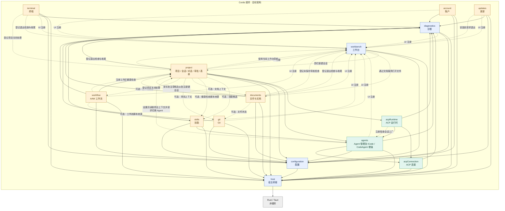

# Desktop 完整插件依赖图

这是已对齐的目标架构，不是当前代码依赖扫描结果。15 个插件逐个展开，Rust 为插件外宿主。ICode / CodeAgent 是 agents 的内部模块，不额外计为插件。

- 箭头指向被依赖或被注册的服务，不表示启动顺序或事件流向。
- 实线表示必需服务依赖。虚线标签区分可选业务接入、UI 注册、界面调用、健康检查注册、安装退出调用、关闭参与者注册和导航检查注册。
- 全图共 **74 条边**，包括 43 条必需服务依赖、7 条可选业务接入、10 条 UI 注册、5 条界面调用、1 条健康检查注册、1 条探查会话工厂注册、1 条安装退出调用、5 条关闭参与者注册和 1 条导航检查注册。
- 同一对插件间的不同关系保留为独立边，例如 updates → workbench 的 UI 注册和安装退出调用。
- UI 和关闭参与者由子模块/装配层注册，不将其变为业务核心的强制依赖。documents → project 的关闭注册与 project → documents 的可选上下文接入，不代表核心服务循环注入。
- 公共基础依赖逐条绘制，不合并节点、不省略公共连线。通过中间插件形成的间接依赖不新增为直接边。

## 边清单核对

| 来源 | 必需依赖目标 | 可选接入目标 | UI 注册目标 | 界面调用、能力注册与条件调用 |
| --- | --- | --- | --- | --- |
| host | rust | — | — | — |
| configuration | host | — | — | — |
| diagnostics | host、configuration | — | workbench | — |
| workbench | host、configuration | — | — | project（顶栏新建会话），documents（打开文件） |
| agents | host、configuration、diagnostics、acpConnection | — | workbench | project（设置页读取探查路径并请求切换 Agent） |
| acpConnection | host、diagnostics | — | — | — |
| acpRuntime | acpConnection、agents、diagnostics | — | — | agents（注册探查会话工厂） |
| project | acpRuntime、agents、configuration、diagnostics、host | skills、documents、git、workflow | workbench | workbench（使用当前工作台导航、登记退出检查与收尾） |
| documents | host、configuration、diagnostics | — | workbench | workbench（登记退出检查与收尾、未保存导航检查），project（读写批注草稿、从批注新建会话、登记项目关闭处理） |
| git | host、configuration、diagnostics | — | workbench | — |
| terminal | host、configuration、diagnostics | — | workbench | workbench（登记退出检查与收尾）；project（登记项目关闭处理） |
| workflow | host、project、configuration、diagnostics | skills | workbench | project（注册工作区健康检查） |
| skills | host、agents、configuration、diagnostics | — | workbench | — |
| account | host、configuration、diagnostics | — | workbench | — |
| updates | host、configuration、diagnostics | — | workbench | workbench（安装前请求退出） |

配置注册、诊断记录等能力已包含在对应必需依赖中，不重复计边。待后续明确的其他关闭参与者不凭空补入本图。

[插件职责与边界](cordis-plugin-architecture.md) · [原始 Mermaid 图源](cordis-plugin-dependencies.mmd)
