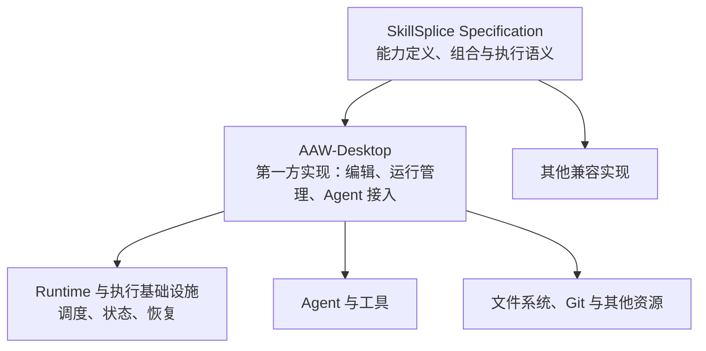

# 000 SkillSplice 概览

> 状态：架构基线。本文定义目标模型和边界，不代表协议规范、运行时或第一方平台已经实现。具体格式、接口和一致性要求以后续规范为准。

## 定位

SkillSplice 是面向 AI 复杂任务的声明式能力协议。它将执行流程、知识与对外契约封装为可复用的 **Unit**，支持将多个 Unit 递归组合成新的 Unit，并规定兼容实现应遵守的组合和执行原则。

关键步骤、依赖关系和完成条件由流程定义显式表达，交由 Runtime 控制；Agent 负责其执行范围内的理解、判断和操作。协议不绑定特定 Agent、工作流引擎或存储方式。

SkillSplice 的目标是让声明过的流程约束得到执行，而不是保证 AI 生成的内容必然正确。验收方式可能使用程序、AI 或人工判断，其结论的可靠性取决于实际验收方法和证据。

## 系统边界

| 部分 | 职责 |
|---|---|
| SkillSplice Specification | 定义能力、组合、执行约束与验收的协议语义。 |
| AAW-Desktop | 作为第一方实现，提供定义编辑、运行管理、资源绑定和 Agent 接入；也可以管理跨多轮、多次运行的工作项。 |
| Runtime 与基础设施 | 执行流程约束，管理运行状态、调度和恢复；具体引擎与存储由实现选择。 |
| Agent、工具与资源 | 按执行上下文完成具体工作，提供所需工作环境与产物存储。 |

协议规定兼容实现必须遵守什么，本身不承担实际调度、文件存储或 Agent 管理。长期工作项与一次流程运行是不同的生命周期；一个工作项可以关联多次运行，具体工作管理属于宿主职责。

## 阅读顺序

1. [概览](000-overview.md)：定位、设计原则与系统边界。
2. [核心模型](001-model.md)：Unit 及其组合、身份、模板和资源。
3. [执行语义](002-execution.md)：调度、验收、失败恢复和产物。
4. [示例与验证](003-validation.md)：task-dev、PoC 和参考项目。
5. [PoC 设计](004-poc-design.md)：现有控制边界、执行场景与验收方式。
6. [task-dev 测试需求](005-task-dev-test-case.md)：OpsCopilot 代码任务和功能用例。
7. [PoC 验证结果](006-poc-results.md)：受控场景、真实任务及未完成事项。
8. [PoC 技术验证工作指导](007-poc-work-guide.md)：完整 task-dev 翻译、Runtime 接入 iCode 和端到端验收的交接任务。
9. [PoC 进展与结果](008-poc-results.md)：真实运行、证据和未完成事项。
10. [第二阶段结果报告](009-phase2-results.md)：AAW 全链翻译及自然需求实测。
11. [Desktop 集成迭代计划](010-desktop-integration-plan.md)：真实定义与运行观察、模板编辑及运行控制的分阶段交付。
12. [Runtime v2 实现与验证](011-runtime-v2.md)：独立运行时包、动态数据、确认恢复和有界循环的实现与边界。
13. [dev 轻量链翻译](012-dev-design-translation.md)：从需求进入到设计门禁的 v2 流程、数据传递及待审阅问题。
14. [ACP、Skill 副本与产物](013-acp-unit-artifacts.md)：ACP 交互、可编辑 Unit 副本、本地产物和循环出口。
15. [dev-design 三方对照](014-dev-design-three-way-comparison.md)：原 Skill、SkillSplice 定义与阅读副本的内容及执行差异。
16. [可维护定义与 Unit 边界](015-authoring-and-unit-boundaries.md)：人工维护目录、Unit 粒度、问题池与 ACP 边界，以及 dev-design 已确认结构。
17. [dev-design 适配与验证](016-dev-design-adapter-validation.md)：真实 ACP、问题池、独立检查与有界修正的证据和未完成事项。
18. [dev 设计与测试设计移植对照](017-dev-migration-audit.md)：原 Skill、可维护 Unit、宿主能力和验证状态。
19. [AAW dev 工作流翻译草案](018-dev-workflow-draft.md)：完整可维护流程、Unit 边界、交接与尚未接入的执行能力。
20. [dev 工作流小改动实测](019-dev-workflow-small-run.md)：真实 ACP 运行、显式恢复、模拟 CodeCheck 与交付结果。
21. [ZCode 调度核心与 ACP 移植验证](020-zcode-acp-engine-probe.md)：隔离移植、ACP 通信、会话复用与恢复边界。
22. [ZCode 工作流引擎移植与验证](021-zcode-acp-runtime.md)：编译、独立进程、ACP、SQLite 记录与恢复的当前实现。
