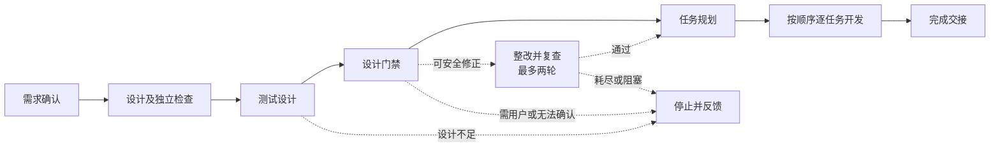
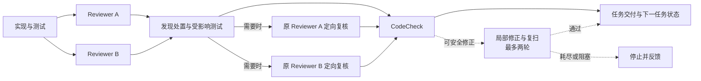

# 018 AAW dev 工作流翻译草案

> 状态：供结构和边界 review 的定义草案。已编译成 Runtime v2 定义；隔离小任务经显式恢复，在模拟 CodeCheck 条件下完成交付；正式 CodeCheck 尚未验证，详见 [019](019-dev-workflow-small-run.md)。

## 维护入口

- [dev 工作流可维护源](../../skillsplice/aaw-dev/dev-workflow-splice/SPLICE.md)：实际流程、Unit 和引用知识。
- [编译后的 Runtime 定义](../../skillsplice/aaw-dev/dev-workflow-splice-compiled/aaw-dev-workflow.json)：由上述源生成。
- [dev 设计与测试设计来源对照](017-dev-migration-audit.md)：原 Skill 职责与当前适配状态。

本草案包含当时的 dev-design 和 dev-test-design 定义副本，作为整条链的可编译源码。它与原来的两个单独源码目录目前不会自动同步；审阅和调优本链时以本目录为准，尚需确定复用和单一维护来源的机制，不能假设任一副本的修改自动传播到其他目录。

## 主线与边界

箭头表示当前定义的调度和数据交接，不表示真实宿主已执行。测试设计发现缺口时停止并反馈；当前定义没有自动回流设计并重新执行测试设计的闭环。门禁复查使用整改动作返回的新设计和测试设计引用；不是始终重复审阅初始版本。

### 逐任务开发

两路语义评审是并行动作；定向复核仅在处置结果要求时执行。两个复核节点表达原 Reviewer 的角色和复核边界，但尚无宿主机制证明它们能恢复同一 Agent 身份或会话，不能把同角色自动等同于同一个 Reviewer。CodeCheck 修复不应改变业务、接口、数据兼容、安全或已确认设计；需取舍的修改停止并交用户决定。

## 为什么这样拆

| 边界 | 拆分理由 | 留在 Agent 动作内部的工作 |
|---|---|---|
| 设计与独立检查 | 长设计中容易遗漏完成条件；独立视角检查产物和证据 | 查找项目资料、问题池操作、分批取证、用户问答和设计推导 |
| 测试设计与设计门禁 | 测试目标或设计与测试的对应关系易被弱化；门禁必须能阻止未闭环结果继续 | 各类测试用例分析、查找测试框架、逐条核对的内部工作方法 |
| 任务规划与逐任务执行 | 下游需要明确任务顺序、边界与责任用例；执行过程需逐任务停止和交接 | 规划时理解设计、选择合适任务粒度、检查项目上下文 |
| 实现、独立评审、处置重验 | 长任务中评审和重验容易被跳过；两路 Reviewer 需要独立观察和结果 | 同一动作内部的具体读写、分析和测试步骤 |
| CodeCheck 与交付 | 真实扫描、整改复扫和交付是可独立判定的完成条件 | 扫描结果解释、明确安全问题的处理方法 |

首次检查、整改轮次等组合 Unit 只表达调度，不是额外 Agent。设计和测试设计的架构资料、既有成果、项目测试组织等由相应 Agent 在可访问环境内按指令查找；不因为出现一类资料就新增 Unit 或专用输入。

## 关键交接

| 交接 | 要传递的实际内容 |
|---|---|
| 需求确认 → 设计 | 已确认需求的内容或引用。 |
| 设计 → 测试设计 | 已通过设计内部检查的设计版本引用。 |
| 设计、测试设计 → 门禁 | 两个具体版本及需求；整改后门禁审查新版本。 |
| 门禁 → 任务规划 | 通过门禁的设计与测试设计版本。 |
| 任务规划 → 逐任务开发 | 计划版本、回填阶段的测试设计版本、首个任务和顺序状态；任务必须有范围和责任用例。 |
| 单任务 → 下一任务 | 完成证据、更新后的计划和测试设计引用、是否结束及下一任务；有未完成任务时不能跳过。 |
| 逐任务开发 → 最终交接 | 全部任务的交付记录、实际验证、残余风险和候选提交信息。 |

门禁 `pass` 才可进入规划；`revise` 仅限所有问题可安全自动修正；`needs_user` 和 `unknown` 不得通过。上限耗尽须保留末轮结果。任务循环上限 1000、门禁和 CodeCheck 自动修正上限各 2，是当前草案的显式配置，供 review；不是宣称这些数字已获产品确认。

## 当前实现边界

- 已完成端到端可编辑定义、知识拆分、调用绑定和 Runtime v2 格式编译；随后已用真实 Agent 执行隔离小任务，结果见 [019](019-dev-workflow-small-run.md)。
- [隔离实测宿主](../../skillsplice/aaw-dev/dev_workflow_runtime.py)已接入大部分执行器和验收器；任务与最终交付在模拟 CodeCheck 条件下完成，正式 CodeCheck、自动修复和原 Reviewer 会话恢复尚未完成验证。该宿主目前有小任务专用文件范围、测试命令及交互策略，不能当作 Desktop 正式通用宿主。编译通过只表示格式和静态调用约束成立。
- 仓库当前 [CodeCheck 入口](../../../skills/code-check/scripts/codecheck.py)明确为临时程序，固定输出通过并标记 `mock-codecheck`，不是实际扫描能力。必须接入真实扫描器并验证结果来源；缺失时应停止，不能用它报告真实通过。
- 问题池真实 MCP 与 ACP 已有设计阶段接入；新链尚未完成统一会话和资源接线。用户提问可在 ACP 动作内发生，但 ACP 中断后的原会话恢复及检查结束后 `needs_user` 的恢复尚未实现。
- 数据装配、任务的状态与版本传递、门禁整改后双产物一致性、原 Reviewer 定向复核的身份保证，均为实现和后续 review 的重点。不得仅凭定义中的字段名声称这些能力已经实现。
