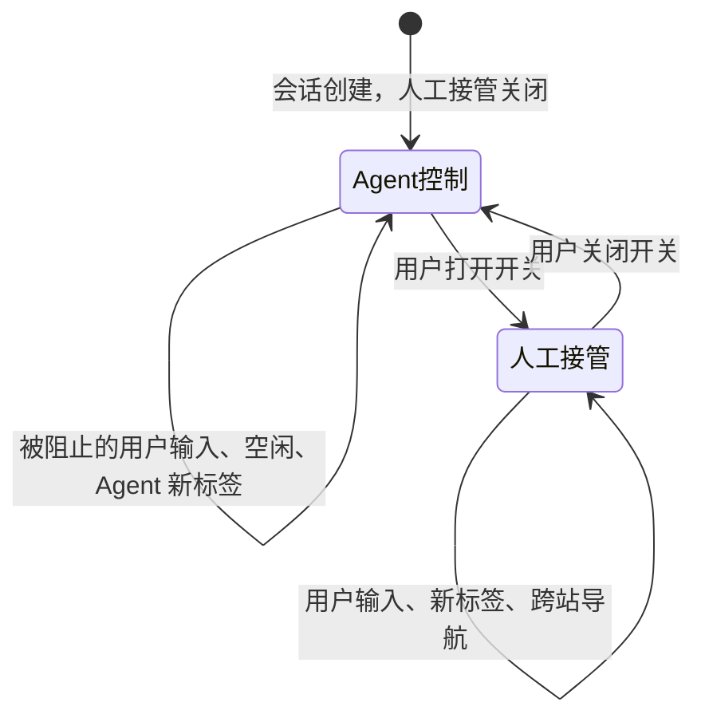
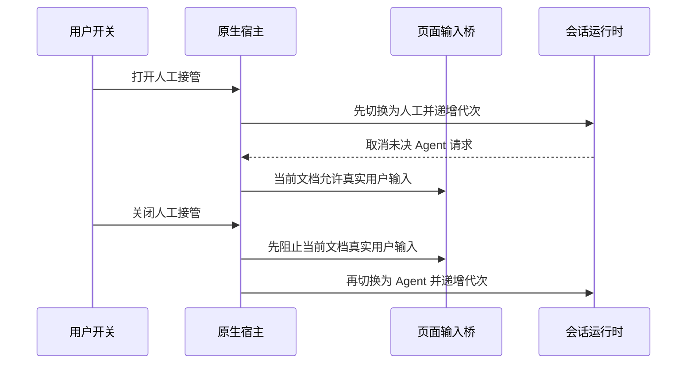

# 012 显式人工接管开关整改与测试设计

## 文档控制

| 项目       | 内容                                                                    |
| ---------- | ----------------------------------------------------------------------- |
| 文档编号   | AAW-DSK-BR-FIX-012                                                      |
| 关联问题单 | 012                                                                     |
| 版本       | 1.0                                                                     |
| 状态       | 技术方案已获用户统一批准；进入 P1，基线修订待复审                       |
| 日期       | 2026-11-13                                                              |
| 适用模块   | Browser 核心运行时、原生宿主、Browser MCP、BrowserPanel、测试与基线文档 |

## 修订记录

| 版本 | 日期       | 修订原因                         | 修订内容                                                   | 修订人         |
| ---- | ---------- | -------------------------------- | ---------------------------------------------------------- | -------------- |
| 1.0  | 2026-11-13 | 旧自动接管模型与用户明确决策冲突 | 冻结会话级显式开关、输入阻止、控件矩阵、切换代次和测试断言 | AAW 开发 Agent |

## 1. 背景与目标

旧模型把网页输入同时视为操作和授权切换信号，并要求 Agent 重新申请普通控制授权。012 要求控制权只能由用户显式开关改变，不做输入自动接管、空闲自动交还或 Agent 自动切换。

目标是让同一顶层会话内的所有标签共享一个明确的人工接管状态：开启时仅用户可操作，关闭时仅 Agent 可操作；全局 Agent 总开关和高风险审批继续保持独立边界。

## 2. 范围与约束

### 2.1 范围内

- 会话级人工接管状态及其全部标签投影。
- 新建标签继承、会话隔离、崩溃恢复和控制代次。
- 真实用户页面输入阻止，以及地址、标签等宿主操作的服务端校验。
- 普通控制申请契约调整、高风险审批独立性和 UI 开关。
- 需求、功能设计、详设、测试设计和真实验收证据。

### 2.2 范围外

- 不修改 iCode，不增加 Agent 类型适配器。
- 不改变全局 Agent 总开关的默认关闭和撤销语义。
- 不改变跨会话标签、站点数据、MCP 端点和高风险审批的既有边界。
- 不引入空闲计时、用户行为猜测或自动交还。

## 3. 控制模型

### 3.1 状态所有权

人工接管状态归属于 `BrowserSpace`，每个非关闭标签的 `ControlLease` 是同一状态的标签级投影。会话没有标签时仍保存开关状态；新建标签继承该状态。不同会话的状态、代次和请求互不影响。

### 3.2 状态迁移

每次真实开关切换都递增会话代次和所有非关闭标签的控制代次。开启人工接管时取消当前会话未决 Agent 请求；两个方向都使未决或未消费的普通及高风险审批失效，防止旧授权跨代次使用。已完成请求不被改写，迟到完成不能重新变为成功。

### 3.3 普通与高风险权限

- `browser_request_control` 只读确认当前会话是否允许 Agent，不再创建普通控制审批，也不改变开关或代次。
- `browser_handoff` 不再允许 Agent 把控制权切给用户；需要用户操作开关，返回明确错误。
- 提交、脚本、上传等高风险动作在 Agent 控制可用后仍需独立审批。
- 人工接管开启时，所有 Agent 页面动作和 Agent 新建标签均返回 `CONTROL_NOT_GRANTED`。

## 4. 输入与宿主控件矩阵

| 操作                                   | 人工接管开启 | 人工接管关闭     | 说明                                           |
| -------------------------------------- | ------------ | ---------------- | ---------------------------------------------- |
| 页面点击、输入、滚动、键盘、触摸、拖放 | 允许         | 阻止真实用户事件 | 页面捕获阶段阻止默认行为和继续传播             |
| Agent 脚本产生的合成事件               | 拒绝         | 允许             | 合成事件不冒充真实用户输入                     |
| 地址导航、前进、后退、刷新、停止加载   | 允许         | 拒绝并禁用       | UI 与原生公开入口双重校验                      |
| 用户新建、关闭标签                     | 允许         | 拒绝并禁用       | 新标签继承会话状态                             |
| Agent 新建、关闭及页面动作             | 拒绝         | 允许             | 全局 Agent 总开关仍须开启                      |
| 元素拾取                               | 允许         | 禁用             | 避免拾取点击与 Agent 动作竞争                  |
| 人工接管开关                           | 允许         | 允许             | 唯一用户侧控制权切换入口                       |
| 停止 Agent 动作                        | 允许         | 允许             | 紧急安全控件，不改变开关                       |
| 证据、缩放、数据管理                   | 允许         | 允许             | 证据与缩放不改变页面业务状态；清理仍需独立确认 |
| 审批、下载和对话框决定                 | 允许         | 允许             | 决定只作用于原会话、原代次和原动作             |

## 5. 原生输入阻止与故障关闭

### 5.1 页面桥

页面初始化桥默认处于阻止真实用户输入的状态，避免导航或脚本同步空档放行。桥只拦截 `isTrusted` 的真实用户事件；Agent 通过公开 MCP 产生的合成事件走既有控制校验，不触发用户接管。

同步时序如下：

打开人工接管时先剥夺 Agent 权限，再允许页面输入；关闭时先阻止页面输入，再允许 Agent。任一步失败都不会形成“用户和 Agent 同时允许”的窗口。新文档默认阻止，宿主在页面加载事件中按当前会话状态再次同步。

### 5.2 服务端校验

UI 禁用不是权限边界。用户创建、导航和关闭等 Tauri 入口必须校验人工接管；Agent MCP 在创建、导航、动作和等待前必须校验 Agent 控制。会话关闭等生命周期内部回收复用无业务权限的内部关闭函数，不借用用户权限，也不削弱会话归属检查。

## 6. 公共契约与代码组织

- `BrowserSpace` 和快照增加 `manualTakeover` 布尔值，来源为会话运行时。
- BrowserHost 增加会话级 `setManualTakeover`，返回目标会话的真实快照。
- 核心运行时负责状态、继承、代次和请求取消；原生宿主负责输入桥和入口校验；MCP 只做协议适配；UI 只投影公开快照。
- 依赖方向保持 `UI → Host 公共契约 → 原生宿主 → 核心模型/运行时`，MCP 复用宿主公共能力，不反向依赖 UI 或 ACP。
- 不新增控制管理器、插件适配层或持久化框架；现有 `BrowserSpace`、`ControlLease` 和 Host 已足够承载本需求。

## 7. 异常与兼容性

- 非当前会话、已关闭标签和未知状态继续 fail-closed。
- 桥同步失败返回显式错误，不静默降级；状态顺序保证不会双向放行。
- 普通控制审批不再生成，历史审批记录无需迁移；切换后旧审批失效。
- `manualTakeover` 是新增必填快照字段，属于 012 已批准的主项目内部契约修订；不声称对既有未更新消费者保持源码兼容，所有项目内构造和测试夹具同步更新。

## 8. 测试设计

### 8.1 自动化用例

| 用例编号   | 层级   | 测试场景                             | 测试前提                                       | 测试步骤                                                      | 测试预期结果                                                                             | 断言代码（断什么/由什么直出）                                                                                         |
| ---------- | ------ | ------------------------------------ | ---------------------------------------------- | ------------------------------------------------------------- | ---------------------------------------------------------------------------------------- | --------------------------------------------------------------------------------------------------------------------- |
| TD-012-U01 | [单元] | 新会话默认 Agent 控制                | 空运行时并创建会话                             | 1. 创建空间 2. 创建标签                                       | `manualTakeover=false`，标签为 Agent                                                     | `assert_eq!(space.manual_takeover,false)`；`assert_eq!(tab.control.controller,Controller::Agent)`，均来自公开创建返回 |
| TD-012-U02 | [单元] | 打开开关作用于全部标签并取消未决动作 | 会话 A 两个标签、一个未决请求；会话 B 一个请求 | 1. A 打开人工接管                                             | A 全部 User、代次增加、A 请求 cancelled；B 不变                                          | 直接断言 `set_manual_takeover` 返回空间的字段及 `runtime.requests` 状态                                               |
| TD-012-U03 | [单元] | 新标签继承并显式交还                 | A 已打开人工接管                               | 1. 新建标签 2. 关闭开关 3. 创建 Agent 请求                    | 新标签先为 User，交还后全部 Agent，请求可创建且无审批 ID                                 | 直接断言公开创建/切换返回和 `begin_request` 返回状态                                                                  |
| TD-012-U04 | [单元] | 网页输入不再自动切换                 | A 有未决 Agent 请求                            | 1. 调用旧用户输入路径或检查其已移除 2. 读取快照               | 不改为 User、不取消请求、不增加控制代次                                                  | 静态守卫断言公开源中无 `runtime.user_input` 和 `user-takeover`；运行时快照字段直接断言                                |
| TD-012-U05 | [单元] | 崩溃不改变开关所有权                 | A 分别为人工或 Agent 控制                      | 1. 崩溃标签 2. 恢复标签                                       | 控制者保持会话开关，页面代次递增，旧请求失效                                             | 直接断言 `crash_tab`、`recover_tab` 返回值和请求状态                                                                  |
| TD-012-U06 | [单元] | 用户与 Agent 来源的服务端校验        | 同一会话分别处于两种开关状态                   | 1. 按来源调用控制断言                                         | 仅匹配来源获准，不匹配返回 `CONTROL_NOT_GRANTED`                                         | `assert_eq!(assert_control_for_source(...).unwrap_err(),"CONTROL_NOT_GRANTED")`，异常由公开断言函数直出               |
| TD-012-U07 | [单元] | 输入桥默认阻止且区分真实与合成事件   | 生成页面初始化桥                               | 1. 检查默认状态、可信事件判断和阻止调用 2. 检查无自动接管消息 | 默认阻止；只拦截 trusted；包含 preventDefault/stopImmediatePropagation；无 user-takeover | 直接断言 `control_bridge_script` 返回字符串包含/不包含指定契约片段                                                    |
| TD-012-U08 | [单元] | MCP 普通控制申请不生成审批           | Agent 控制会话和工具参数                       | 1. 调用 request_control 2. 切换人工后再次调用                 | Agent 状态只读返回当前标签；人工状态返回控制错误；无 approvalId                          | 真实 MCP 原始响应直接断言 `structuredContent.control.controller` 与 `error.message`，并断言审批快照为空               |
| TD-012-U09 | [单元] | UI 控件矩阵                          | BrowserPanel 有活动标签，Host 返回真实切换快照 | 1. 渲染关闭状态 2. 打开开关 3. 关闭开关                       | 关闭时导航和拾取禁用，停止/证据/数据可用；开启后导航可用；开关 aria 状态与返回一致       | Testing Library 直接断言 `role=switch` 的 `aria-checked`、控件 `disabled` 及 `setManualTakeover` 调用参数             |
| TD-012-U10 | [单元] | 切换失败不伪造状态                   | Host 拒绝切换                                  | 1. 点击开关                                                   | 显示错误，开关保持原状态                                                                 | 直接断言拒绝错误进入 `role=alert`，`aria-checked` 不变                                                                |
| TD-012-B01 | [黑盒] | 原生宿主入口不接受越权用户操作       | 真实 AAW，Agent 控制                           | 1. 从公开 Tauri 入口调用用户导航/新建 2. 调用 MCP 页面动作    | 用户入口返回控制错误；Agent 动作成功；随后人工状态反转                                   | 只断言原始 Tauri/MCP 响应和页面公开结果，不导入业务源码                                                               |
| TD-012-B02 | [黑盒] | 普通控制申请与高风险审批分离         | 真实 AAW，Agent 控制                           | 1. request_control 2. execute_script 3. 打开人工接管后重试    | 普通申请无审批；脚本仍需审批；人工状态 Agent 被拒绝                                      | 原始 MCP `error.message`、审批快照和结构化结果直接断言                                                                |

### 8.2 手工用例

| 用例编号   | 层级   | 测试场景                           | 测试前提             | 测试步骤                                                            | 测试预期结果                                                       | 工具覆盖                                                                  |
| ---------- | ------ | ---------------------------------- | -------------------- | ------------------------------------------------------------------- | ------------------------------------------------------------------ | ------------------------------------------------------------------------- |
| TD-012-M01 | [手工] | Agent 控制时真实用户点击和输入无效 | 本地验证页，开关关闭 | 1. 点击页面按钮并尝试输入、滚动、键盘 2. 读取开关和页面结果         | 页面无用户副作用，开关始终关闭；Agent 后续点击成功                 | CDP 可派发受信模型有限，需 DeskPilot/KimiCU 真实输入；外部 MCP 验证 Agent |
| TD-012-M02 | [手工] | 打开开关后用户操作与 Agent 拒绝    | 同页打开人工接管     | 1. 用户点击、输入和导航 2. 外部 MCP 点击                            | 用户结果生效；MCP 返回 `CONTROL_NOT_GRANTED`；开关不自动关闭       | 桌面工具 + 外部 MCP                                                       |
| TD-012-M03 | [手工] | 切换取消未决动作且普通交还无审批   | Agent 发起 30 秒等待 | 1. 打开人工接管 2. 检查等待取消 3. 关闭开关 4. 再执行 Agent 动作    | 等待 cancelled；交还后无普通审批，Agent 动作成功；高风险审批仍独立 | 外部 MCP + 截图                                                           |
| TD-012-M04 | [手工] | 多标签、多会话和新标签继承         | A 两标签、B 一标签   | 1. A 打开开关并新建标签 2. A/B 往返 3. 检查各快照                   | A 全部人工且新标签继承；B 始终 Agent；无跨会话变化                 | 快照与截图                                                                |
| TD-012-M05 | [手工] | 宿主控件与可访问性                 | 两种开关状态         | 1. 检查按钮禁用、开关名称和状态 2. 键盘切换 3. 使用证据、数据和停止 | 控件矩阵符合第 4 节，状态有文本且不只靠颜色                        | 桌面工具与 DOM 外表面                                                     |

## 9. 交叉面清单

| 触及对象                             | 其他写入者、读取者与超时点                       | 覆盖用例           | 或豁免理由 |
| ------------------------------------ | ------------------------------------------------ | ------------------ | ---------- |
| `BrowserSpace.manualTakeover`        | 会话创建、显式切换、快照、新标签和 UI            | U01～U03、M04      | 无         |
| `ControlLease.controller/generation` | 崩溃恢复、MCP 控制校验、审批代次和迟到结果       | U02、U05、U08、M03 | 无         |
| `BrowserRequest.status`              | 轮次取消、显式停止、会话关闭、控制切换和完成竞态 | U02、M03           | 无         |
| 页面初始化桥                         | 页面加载、跨站导航、开关同步、真实与合成事件     | U04、U07、M01、M02 | 无         |
| 用户 Tauri 入口                      | UI、直接公开调用、生命周期内部回收               | U06、B01           | 无         |
| Browser MCP                          | 普通申请、高风险审批、全局 Agent 开关和人工开关  | U08、B02、M03      | 无         |
| BrowserPanel                         | 会话切换、活动标签切换、失败切换、审批和证据区域 | U09、U10、M05      | 无         |
| 全局 Agent 总开关                    | 端点撤销、请求取消和人工开关独立状态             | B01、M03           | 无         |

## 10. 文档同步与完成定义

需求 C-14、C-21 及派生功能/详设中关于自动接管、重新普通审批和无接管按钮的内容必须标记由 012 取代，并补充本节状态机和控件矩阵。修订后的基线标记待复审，不由 Agent 自行恢复基线状态。

完成要求：P1 有效红色、P2 逐用例核对、P3 受影响及全量测试通过；真实用户输入、Agent 正反路径、取消竞态、多标签多会话和 UI 控件矩阵均有外表面证据。任何未执行项必须保留为未验证，不能写成通过。
