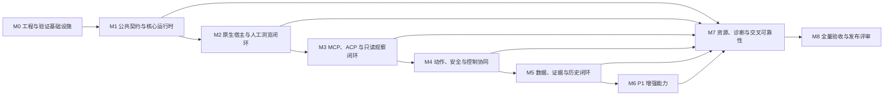

# AAW Desktop 内嵌浏览器开发计划

## 文档控制

| 项目 | 内容 |
|---|---|
| 文档编号 | AAW-DSK-BR-PLAN-001 |
| 版本 | 1.3 |
| 状态 | 待评审 |
| 最近更新 | 2026-11-13 |
| 需求基线 | `内嵌浏览器需求分析.md` 1.5 |
| 功能设计基线 | `功能设计/00功能设计总览.md` 及 01～05 |
| 详设与测试基线 | `详细设计/00详细设计总览与契约索引.md` 及 01～09 配套测试设计 |
| 基线提交 | `5683ad3 docs(desktop): baseline embedded browser design` |
| 计划范围 | 已基线的 P0/P1 功能；P2 页面录制不在本计划内 |
| 执行约束 | 本计划经人类批准后才能开始编码；基线文档变更必须另行批准 |

## 修订记录

| 版本 | 日期 | 修订原因 | 修订内容 |
|---|---|---|---|
| 1.1 | 2026-11-12 | 移除子 Agent 独立身份和选择性取消工作，改为会话级共享及真实工具分发验证 | 调整交付目标、M1/M3 实施任务和风险验证；测试门禁与既有验收范围不缩减。 |
| 1.2 | 2026-11-13 | 明确通用被动开放，消除逐 Agent 适配倾向 | M3 只验证运行时实际允许的主子共享，不主动修改 Agent 配置或增加专用工具分发。 |
| 1.3 | 2026-11-13 | 问题单 012 及需求 1.5 改为显式人工接管 | 交付会话级开关、输入阻止、代次迁移和控件矩阵，不再实施自动接管及普通控制重复审批。 |

## 1. 计划目的

将内嵌浏览器从设计基线推进为可发布能力，在不破坏既有 AAW 工作流、会话、权限和诊断边界的前提下，完成原生页面、Browser MCP、ACP 可信身份、界面、数据、安全和证据闭环。

本计划同时定义开发顺序、测试先行方式、里程碑门禁、验证证据和基线变更纪律。任何里程碑都不能以“主路径可用”替代既定测试设计与交叉场景验收。

## 2. 交付目标与边界

### 2.1 交付目标

1. 用户可以在 AAW 内完成标签、导航、弹窗、缩放、崩溃恢复和数据管理。
2. Agent 可以通过每会话独立 Browser MCP 端点观察和操作真实页面。
3. 同会话主、子 Agent 平权共享浏览器资源；不同顶层会话和窗口之间保持可信身份和资源隔离。
4. 用户通过会话级人工接管开关显式取得和交还控制权；输入与空闲不自动切换，取消、超时、重连和迟到结果具有一致语义。
5. 高风险动作、文件、脚本、坐标和站点权限遵守审批与 fail-closed 规则。
6. 截图、历史、诊断、资源预算和测试证据可审查、可追踪。
7. P0/P1 基线用例全部得到明确执行结果，阻断问题为零。

### 2.2 不在本计划内

- P2 页面录制及完整视频编辑器。
- 通用 Playwright API 兼容层。
- 独立 Node 浏览器运行时或 ZCode Runtime。
- macOS/Linux 的未验证原生实现承诺。
- 企业内网代理的自动化替代验收；该部分按基线由人工执行。
- 与浏览器无关的既有缺陷和重构。

## 3. 执行原则与硬门禁

### 3.1 每个里程碑的三阶段循环

| 阶段 | 必须完成 | 通过条件 |
|---|---|---|
| P1：测试代码 | 按基线编写测试；业务实现只允许空壳和占位抛出 | 测试可编译；新用例红色精确落在未实现行为；旧用例不误伤 |
| P2：测试核对 | 逐用例核对公开入口、参数、断言直接出处、五要素和交叉面清单 | 不一致项为零；发现测试错误先登记，产品缺陷另立问题单 |
| P3：业务实现 | 按详设实现，不私改流程，不新增静默降级 | 新用例全绿；相关旧用例全绿；真实桌面路径与证据完成 |

单次实现验证失败最多进行三轮实现排查。三轮后仍失败则停止该里程碑并汇报，不得修改测试迁就实现。

### 3.2 全程约束

- 先红后绿，禁止先写业务逻辑后补测试。
- 黑盒不引用业务源码；集成零 Mock 且断言真实数据层；装配不得标记为 integration；单元只断言函数返回值或异常。
- 断言在测试设计阶段已经冻结，开发时不得重新解释预期。
- 安全与身份未覆盖路径一律拒绝或显式报错。
- 不顺手修改相邻模块；发现相邻问题只记录、上报。
- 不通过删减用例、缩短两小时稳定性测试或降低断言强度换取进度。
- 基线文档如需变化，先提交变更原因、影响范围和测试影响，经人类批准后执行。

## 4. 总体开发顺序

核心状态与身份必须先于 Agent 工具实现，真实原生页面必须先于界面“成功状态”实现。预算、日志和错误契约从早期里程碑接入，不在最后补造。

## 5. 里程碑总表

工作量为单人工作日估算，仅用于安排和审核，不构成压缩测试或省略场景的依据。

| 里程碑 | 主要交付 | 依赖 | 主要设计与测试输入 | 估算 |
|---|---|---|---|---|
| M0 | 模块边界、公共测试客户端、真实测试站点、证据记录与故障入口 | 基线批准、本计划批准 | DD-00、TD-00；DD-09、TD-09 | 2～3 人日 |
| M1 | BrowserSpace、Tab、代次、控制权、请求生命周期和依赖规则 | M0 | DD-00/01；TD-00/01 | 4～5 人日 |
| M2 | 真实 WebView2、人工浏览、布局、导航、弹窗、崩溃和回收 | M1 | DD-02/08；TD-02/08 | 6～8 人日 |
| M3 | Browser MCP、每会话 ACP 端点、可信身份、快照和只读工具 | M2 | DD-03/04/05；TD-03/04/05 | 5～7 人日 |
| M4 | 页面动作、用户接管、取消、审批、站点权限和对话框 | M3 | DD-01/04/05/06；对应 TD | 6～8 人日 |
| M5 | 数据分区管理、分层清理、证据文件、历史与恢复边界 | M2、M4 | DD-03/07/08；对应 TD | 5～7 人日 |
| M6 | 标签恢复、自由视口、元素拾取、页面上下文、面板显隐、文件和高权限增强 | M5 | 基线中全部 AC-101～AC-109 设计 | 6～8 人日 |
| M7 | 完整预算、诊断、性能、更新/重连/超时等交叉可靠性 | M1～M6 对应能力 | DD-09 及全部交叉面清单 | 5～7 人日 |
| M8 | 全量回归、手工验收、两小时稳定性、发布证据和评审 | M7 | 全部 323 条用例及 AC | 4～5 人日 |
| 合计 | 完整 P0/P1 交付 | — | — | 38～50 人日 |

## 6. 里程碑详细计划

### 6.1 M0：工程与验证基础设施

**实施内容**

- 按 DD-00 确定公共契约、原生宿主、运行时、MCP、ACP、UI 和诊断的代码归属。
- 建立本地测试站点，覆盖导航、frame、表单、弹窗、对话框、崩溃、存储、下载、慢加载和动作计数。
- 建立独立外部 ACP/MCP 测试客户端、公开文件/数据库读取器、进程采集和证据记录入口。
- 故障只能通过公开测试入口或真实原生行为产生；不得用直接修改内部对象冒充场景。
- 为运行时协作用例建立 Assembly 命名和标记约束，为真实数据层用例建立 Integration 约束。

**测试与退出**

- 完成 TD-00-I02、I03、U01～U07 所需测试基础设施。
- P1 验证测试客户端能够编译并因空壳能力失败；P2 核对公开入口和断言出处；P3 只实现基础设施，不提前实现浏览器业务。
- 依赖图无循环，测试站点和证据目录可用，运行时产物进入忽略规则。

### 6.2 M1：公共契约与核心运行时

**实施内容**

- 建立 BrowserSpace、Tab、BrowserCommand、BrowserResult、BrowserEvent 和公共错误契约。
- 实现浏览器/标签/控制代次、状态机、请求终态、去重、取消和迟到事件规则。
- 实现归属校验、控制租约、顶层会话空间共享和基础资源预占接口。
- 建立唯一权威状态与只读投影，禁止 UI/MCP 各自维护第二份权威状态。

**测试与退出**

- 执行 TD-00、TD-01 全部相关用例；运行时协作用例按 Assembly 执行，不虚构持久化集成。
- 覆盖非法转换、旧代次、重复请求、关闭与创建竞态、完成与取消竞态。
- 全量单元与装配用例通过，既有桌面测试无误伤。

### 6.3 M2：原生宿主与人工浏览闭环

**实施内容**

- 接入真实子 WebView2、动态 CDP 发现和会话数据目录，不扫描或接管外部浏览器。
- 实现标签、地址栏、前进/后退/刷新/停止、异常状态和导航历史。
- 实现窗口/右栏/DPI 自适应、页面缩放、显隐、弹窗和原生对话框。
- 实现崩溃换代、恢复、正常/强制回收、多窗口同工作区隔离。
- 按已基线高保真实现界面，不设置“用户接管”按钮。

**测试与退出**

- 执行 TD-02 全部用例及 TD-08 的布局、地址、投影和可访问性用例。
- 使用 DeskPilot 完成真实窗口操作、截图和 OCR；原生模态无法绑定的项目由人工执行。
- 验证真实页面尺寸、CDP 目标、进程回收、多窗口隔离和 WebView2 数据目录。
- 人工浏览不得创建隐藏 Agent，不得发送未授权 Agent 提示。

### 6.4 M3：MCP、ACP 与只读观察闭环

**实施内容**

- 实现 HTTP MCP 生命周期、工具发现、参数校验、公共错误和有效能力文档。
- 在 ACP 会话创建、恢复、切换和关闭时注册唯一端点；身份来自端点注册表而非模型参数或共享连接。
- 被动开放通用 Browser MCP，验证运行时实际允许的主子共享、顶层轮次关联、连接代次和主动取消基础链路；不建立子 Agent 身份注册表，不主动适配或修改任何 Agent 的主子配置。
- 实现有界语义快照、Locator、framePath、跨源降级、页面状态和只读工具。
- 接入图片能力协商；不支持图片的 Agent 必须诚实反馈。

**测试与退出**

- 执行 TD-03 的协议/只读部分、TD-04 全部身份与重连用例、TD-05 的快照与定位用例。
- 外部客户端验证未知方法、伪造身份、双会话、共享连接、重连和迟到响应。
- 真实 Agent 完成“打开页面—读取—截图—展示证据”闭环，无私有旁路。

### 6.5 M4：动作、安全与控制协同

**实施内容**

- 实现点击、输入、按键、滚动、勾选、下拉、等待和后置验证。
- 实现可执行性、稳定性、遮挡、焦点、坐标重读和旧快照失效。
- 实现真实用户输入自动接管、按标签/轮次/会话取消和副作用分类。
- 实现 URL 准入、L0～L3 风险分类、审批、权限撤销、提示注入防护和统一对话框。
- 所有旁路入口共享同一权限和身份校验，不允许通过脚本、坐标或弹窗降低风险等级。

**测试与退出**

- 执行 TD-01、TD-04、TD-05、TD-06 的动作、安全、取消和控制权用例。
- 验证多匹配不点首项、宿主不抢输入、取消不虚假回滚、高风险未批准无副作用。
- 使用真实页面证据判断动作是否执行，不把“已执行”冒充“业务成功”。

### 6.6 M5：数据、证据与历史闭环

**实施内容**

- 完善分区注册、持久化、共享、隔离、目录占用和历史分区维护。
- 实现缓存/站点/会话/工作区/全量清理、二次确认、取消、部分失败和结果核验。
- 实现截图证据文件、实时图片、历史引用、删除/过期/损坏状态和路径边界。
- 保证清理不影响 `.sdd/`、AAW 设置和范围外工作区。
- 完成站点数据清理与权限恢复/撤销交叉语义。

**测试与退出**

- 执行 TD-07 全部用例及 TD-03/08 的证据、文件和历史用例。
- 集成测试直接读取 WebView2 数据、权限记录、证据文件、历史记录和持久化任务记录。
- 任何“请求即成功”、范围外删除、秘密进入历史或普通日志均为阻断失败。

### 6.7 M6：P1 增强能力

**实施内容**

- 标签 URL 与显示偏好恢复，不恢复 DOM、草稿、审批或控制租约。
- 自由 CSS 视口、预览缩放及其与页面缩放/DPI 的分离。
- 元素拾取器、当前页面上下文和 Agent 显示/隐藏既有面板。
- 文件上传、受控下载、控制台/网络最小读取、受限脚本和坐标操作。
- 新能力复用既有命令、权限、身份和证据边界，不建立通用脚本旁路。

**测试与退出**

- 执行 AC-101～AC-109 对应的全部手工、黑盒、集成、装配和单元用例。
- 覆盖缩放×DPI×frame、旧证据、旧批准、文件更换、发送失败和后台显隐。
- 所有 P1 用例有真实结果；不能以 P0 通过替代 P1 验收。

### 6.8 M7：资源、诊断与交叉可靠性

**实施内容**

- 完成会话/窗口/全局预算、请求背压、预占释放、截图串行和采样未知语义。
- 完成操作 ID 关联、性能分解、日志脱敏、诊断导出和环境自检。
- 完成应用更新×活动操作、主窗口刷新×ACP、客户端超时×迟到结果、诊断故障×截图证据等交叉场景。
- 对十份交叉面清单逐行执行覆盖确认，所有豁免必须有基线理由。

**测试与退出**

- 执行 TD-09 及所有跨模块组合用例。
- 资源、诊断和更新故障不得产生静默降级、重复释放、空图片或失控等待。
- 性能与资源结果包含样本量、环境和原始证据，未知不得填零。

### 6.9 M8：全量验收与发布评审

**实施内容**

- 执行全部 69 个手工用例和 254 个非手工用例；数量变化只能来自经批准的基线变更。
- 执行完整两小时稳定性，不以加速循环替代。
- 执行全量现有桌面回归、构建和真实 ACP/MCP 闭环。
- 汇总每个 AC 的步骤、断言、实际结果和证据；未执行、失败或无证据均不得通过门禁。
- 企业内网和其他未覆盖环境明确标注，由人工按基线验收，不在发布说明中夸大能力。

**退出结果**

- 发布评审包包含测试汇总、失败/豁免清单、截图、日志、性能、资源、稳定性和构建证据。
- 阻断安全、隔离、权限、取消、回收、数据和历史展示问题为零。
- 是否发布由人类决策，本计划不授权自动推送或发布。

## 7. 测试执行与证据矩阵

| 维度 | 驱动方式 | 断言位置 | 主要证据 |
|---|---|---|---|
| 手工 | DeskPilot 优先；系统原生限制由人工完成 | 可观察界面、真实页面、进程和文件 | 截图、OCR、操作记录、人工结论 |
| 黑盒 | 外部 ACP/MCP、系统界面、公开文件和数据库 | 响应正文、退出码、页面事实、外部产物 | 原始协议记录、文件、数据库和进程事实 |
| 集成 | 公共入口，零 Mock，真实链路直达数据层 | 落库记录、落盘文件、持久化数据 | 实际数据目录、证据文件、权限/任务/历史记录 |
| 装配 | 真实公共入口和部件，无 integration 标记 | 运行时、页面、响应和订阅事实 | 状态快照、页面记录、连接与请求轨迹 |
| 单元 | 公开纯函数、方法和状态转换，可 Mock | 返回值和异常 | 函数输出与错误 |

每次执行保存环境、版本、用例编号、操作 ID、实际结果、断言输出和证据路径。禁止只保留“通过”文字。

## 8. 标准验证命令与实盘要求

### 8.1 每个里程碑

在 `desktop/` 执行：

- `npm run typecheck`
- `npm run lint`
- `npm run format:check`
- `npm test`
- `npm run build`

在 `desktop/src-tauri/` 执行：

- `cargo fmt --check`
- `cargo check`
- `cargo test`
- `cargo clippy --all-targets -- -D warnings`

涉及真实 ACP 的里程碑执行 `npm run acp:smoke`，并完成真实桌面路径。上述命令若因基线以外既有问题失败，应保留日志并区分既有失败与本次回归，不得直接忽略。

### 8.2 推送或发布前

- 重跑上述全部桌面命令、全部测试维度、两小时稳定性和真实界面验收。
- 按根仓 CI 配置执行同款命令，包括既定的 `pip install pytest-randomly && python -m pytest tests -q --tb=short --run-integration --ignore=tests/test_benchmark_iss8.py`；若仓库流程调整，以当期 CI 配置为准并保留证据。
- 本地默认跳过集成不等于 CI 通过，必须在推送前实际执行集成范围。
- 未经人类明确许可，不执行推送、发布或对外发送。

## 9. 基线与变更控制

1. 设计基线提交为 `5683ad3`，之后所有设计文档均受变更控制。
2. 实现发现设计不完整时，不得直接修改文档或代码继续推进；先登记问题、根因证据、建议改法和测试影响。
3. 人类批准后才能修改基线；变更后重新执行受影响的 P1/P2/P3 和交叉面核对。
4. 测试确实写错需要放宽时，先登记被放宽后不再探测的行为；若掩盖产品缺陷，先另立问题单。
5. 计划变更不影响基线审批要求；不得以赶进度为由自行缩小 P0/P1 范围。

## 10. 主要风险与应对

| 风险 | 早期信号 | 应对 |
|---|---|---|
| WebView2 异步事件与逻辑状态不一致 | 迟到 Ready、关闭后复活、旧代次动作 | M1/M2 优先验证代次与竞态，不延后到收尾 |
| 共享 MCP 连接导致身份混淆 | 相同配置复用连接、模型参数自报身份 | M3 以端点注册表为唯一身份来源，执行双会话及同会话主子并发实测 |
| UI 与运行时形成双权威 | 按钮本地改状态、后台抢前台 | M1 建立只读投影，M2/M8 验证真实原生事实 |
| 高权限工具形成旁路 | 脚本、坐标或弹窗降低风险等级 | M4/M6 统一权限入口，覆盖所有替代入口 |
| 测试层级虚标 | 使用真 HTTP 就称为集成、断言只在内存 | M0 固化 Assembly/Integration 规则，P2 逐用例核对 |
| 交叉组合遗漏 | 主路径绿但更新、重连、超时组合失败 | 十份交叉面清单逐行验收，TD-00-U07 阻断缺项 |
| 证据与诊断影响业务 | 日志失败导致空图片或动作失败 | M5/M7 分离业务与诊断结果，使用真实文件断言 |
| 既有回归被局部绿掩盖 | 只跑新增测试 | 每个里程碑跑相关旧用例，M8 跑全量套件 |

## 11. 汇报与审核机制

每个里程碑提交以下审核包：

- P1：通过/失败数量、新用例红色分布、旧用例无误伤证据。
- P2：逐用例核对表和交叉面清单逐行确认，不一致项数量。
- P3：实现轮次、全量测试结果、构建结果和失败处理记录。
- 实盘：操作步骤、DeskPilot/人工截图、协议记录、文件/数据库证据和计时。
- 范围：已解决问题、遗留问题、相邻问题和是否需要基线变更。

里程碑未满足退出门禁时不进入下一依赖阶段。可以在不共享可变实现文件的前提下开展独立准备工作，但不得以此绕过先后依赖或评审门禁。

## 12. 批准后的第一步

人类批准本计划后，从 M0 的 P1 开始：只建立测试基础设施和空壳公共入口，使首批架构、追踪和验证体系用例按预期变红；随后执行 P2 核对，经核对无差异后才实现 M0 业务支撑能力。

在获得本计划批准之前，不编写或修改产品实现与测试实现代码。
