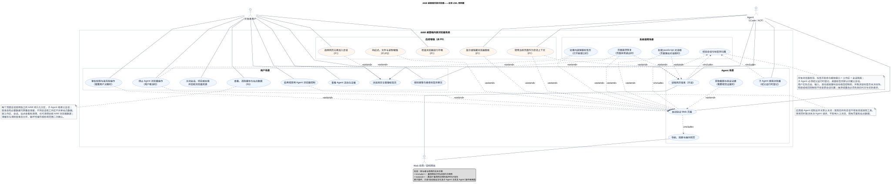
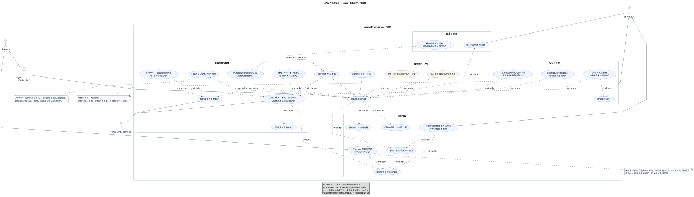

# AAW 桌面端内嵌浏览器需求分析与规格说明书

## 文档控制

| 项目 | 内容 |
|---|---|
| 文档编号 | AAW-DSK-BR-RS-001 |
| 版本 | 1.6 |
| 状态 | 待复审（032 默认策略修订） |
| 最近更新 | 2026-11-19 |
| 产品范围 | AAW Desktop 内嵌浏览器及 Agent Browser Use |
| 参考实现 | ZCode Browser Use，参考提交 `a9fe401eede6e6e5e01be9048679c206fe6f02d9` |
| AAW 基线 | `fac0bc57cf9689adf59d5db61d545ed256ebdb73` |
| 评审重点 | 产品范围、P0/P1 优先级、会话归属、安全策略、首发平台及验收标准 |

## 修订记录

| 版本 | 日期 | 修订原因 | 修订内容 |
|---|---|---|---|
| 1.3 | 2026-11-12 | 产品决策调整为以顶层 ACP 会话作为浏览器授权、归属和审计边界，避免为无必要的子 Agent 身份隔离引入运行时耦合 | 同会话主、子 Agent 平权共享浏览器；删除子 Agent 强制登记、结束失效和选择性取消要求；保留跨会话隔离、总开关和高风险审批。 |
| 1.4 | 2026-11-13 | 人类明确 AAW 不主动适配任何 Agent，避免逐 Agent 工具分发 | 改为通用被动开放；运行时允许子 Agent 调用即按同会话处理，不支持时不增加专用分支。 |
| 1.5 | 2026-11-13 | 问题单 012：用户明确否决输入自动接管、空闲交还和普通控制重复审批 | 改为会话级显式人工接管开关；用户与 Agent 操作互斥，新标签继承，切换处理代次和未决动作，高风险审批保持独立。 |
| 1.6 | 2026-11-19 | 问题单 032：用户明确默认允许 Agent 操作浏览器 | 总开关改为默认允许；保留主动关闭即撤销；已有缺工具会话必须经确认真实重连，不得静默降级到系统浏览器。 |

本文按需求规格说明书组织，定义“为什么做、做什么、不做什么、如何判定完成”。技术架构、接口字段和平台实现方案应在本文评审通过后进入详细设计，不在本文提前冻结。

---

## 1. 目的

为 AAW 桌面端建设自主可控的内嵌浏览器能力，使用户能够在工作台内访问网页，并允许当前会话中的 Agent 在用户授权和会话隔离边界内观察、操作同一浏览器。

本文用于：

1. 统一产品、桌面端、Agent、测试和安全相关人员对目标能力的理解。
2. 形成可追踪、可验收的需求基线候选。
3. 识别 Tauri 宿主、Agent 工具链接入、会话隔离和浏览器生命周期等关键风险。
4. 作为后续架构设计、任务拆分、测试设计和发布评审的输入。

## 2. 背景与问题陈述

AAW 桌面端已经具备项目、会话、Agent 对话、权限审批、工具调用展示、项目右栏和诊断能力，但缺少内嵌浏览器。因此在以下场景中仍需依赖外部工具：

- Agent 完成 Web 功能开发后，无法在当前工作台内打开本地应用并验证页面。
- Agent 无法基于真实 DOM、页面状态和截图执行连续浏览器操作。
- 用户无法把正在查看的网页明确交给当前 Agent 会话继续处理。
- 浏览器操作过程无法复用 AAW 的会话归属、权限审批、工具卡片和诊断链路。

ZCode 已提供业界可参考的完整实践：Electron `<webview>` 承载内嵌页面，CDP 执行浏览器控制，统一 Browser/Tab 对象模型面向 Agent，并通过会话级标签页隔离、DOM-first 观察、动作超时与取消、结构化错误及资源回收形成闭环。

AAW 不复制其 Electron 宿主，而是参考其产品行为和控制边界，建设适用于 Tauri + ACP 架构的自主内嵌浏览器。

## 3. 产品目标与成功标准

### 3.1 产品目标

| 编号 | 目标 |
|---|---|
| G-01 | 用户无需离开 AAW 桌面端即可打开、浏览和管理网页标签页。 |
| G-02 | 当前会话的 Agent 能真实控制内嵌浏览器，完成导航、页面观察、表单操作、点击和截图。 |
| G-03 | 用户与 Agent 可以在明确授权和归属规则下接续操作同一标签页。 |
| G-04 | 浏览器状态按窗口、工作区和会话隔离，不串项目、不串对话、不抢占用户前台。 |
| G-05 | 浏览器操作纳入 AAW 的权限、工具展示、日志和诊断体系。 |
| G-06 | 浏览器异常、取消、关闭和应用退出均有确定、可验证的生命周期行为。 |

### 3.2 业务成功标准

1. Agent 在 AAW 内完成一次真实 Web 验收闭环：打开本地应用 → 读取 DOM → 定位元素 → 输入与点击 → 验证结果 → 获取截图证据。
2. 用户可以在同一界面查看 Agent 正在操作的页面，并在任务结束后继续手动使用。
3. 两个同项目会话同时使用浏览器时，任何一方都不能枚举或控制另一方未分享的标签页。
4. 页面崩溃、Agent 取消、会话切换和应用退出不会造成跨会话误操作或遗留失控浏览器进程。
5. 所有 P0 验收用例通过真实桌面浏览器链路验证，不以纯 Mock 测试代替。

## 4. 范围

### 4.1 P0：首发必须交付

- 桌面工作台内嵌浏览器页面，而非仅打开系统浏览器。
- 地址栏、前进、后退、刷新、停止、关闭及加载/错误状态。
- 多标签页创建、切换、关闭和稳定身份。
- 用户手动浏览、Agent 只读查询及 Agent 自动控制。
- Agent 导航、DOM 观察、严格元素定位、常用输入与点击、等待和截图。
- 有效能力与操作文档的发现和读取。
- 弹窗页面的内部标签页路由，以及 JavaScript 对话框的读取和处理。
- 用户标签页向当前会话 Agent 的显式授权接管。
- Agent 浏览器控制的启用/禁用；禁用后保留人工浏览。
- 同会话主、子 Agent 的浏览器平权共享策略及顶层会话标签页归属。
- 窗口、工作区、会话和标签页归属隔离。
- 前后台切换、崩溃恢复、取消、超时、关闭和进程回收。
- URL 协议限制、高风险动作权限、站点权限和敏感信息保护。
- 每个顶层 Agent 会话独立的 AAW 持久化数据分区，以及缓存和站点数据的查看与清除。
- 当前默认 iCode Agent 的真实端到端可用性。
- ACP 工具状态、截图结果和诊断日志的现有界面集成。

### 4.2 P1：首发后增强

- 自由尺寸视口、响应式验证和预览缩放。
- 文件上传、受控下载、下载对象及产物管理。
- 浏览器控制台和网络错误的最小必要读取。
- 跨应用重启的标签页 URL 与显示偏好恢复。
- 当前页面上下文随用户消息提供给 Agent，以及浏览器面板的显隐控制。
- 选择网页元素加入会话，复用 AAW 的引用和草稿机制。
- 浏览器运行环境自检。
- 受限页面脚本 `evaluate` 能力。
- Canvas、自绘控件等 DOM 无法表达场景的坐标操作。
- macOS、Linux 正式支持和平台验收矩阵。

### 4.3 P2：远期可选

- 页面操作录制与 WebM 产物。
- 更多 ACP Agent 的深度适配和差异化能力展示。
- 更完整的页面内容、历史记录或调试能力。

### 4.4 明确非目标

P0 不包含：

- 将 AAW 桌面端迁移到 Electron。
- Chrome 扩展、接管用户外部 Chrome 或扫描本机任意 CDP 端口。
- 手机 Web、浏览器 Web 版或远程端独立浏览器运行时。
- 完整 Chrome 替代品，包括书签、密码管理、账号同步和扩展商店。
- 完整 Playwright API、非受限原始 CDP 或任意 Node.js 执行面。
- 绕过验证码、反自动化机制或目标网站安全控制。
- 浏览器内核自研。
- 用系统外部浏览器窗口代替内嵌浏览器交付目标。
- 自动监听用户点击并识别目标元素；元素信息只通过 P1 的用户显式元素拾取器提供。

## 5. 干系人与用户角色

| 角色 | 核心诉求 | 主要风险 |
|---|---|---|
| 开发者用户 | 在工作台内查看网页、让 Agent 验证 Web 功能、保留上下文 | 页面被误操作、上下文切换打断 |
| Agent | 获取可观察页面状态、稳定定位元素、执行动作并获得明确结果 | 页面歧义、超时、目标漂移、伪造成功 |
| AAW 工作流使用者 | 将浏览器验证纳入任务实现和测试证据 | 证据与会话或任务脱节 |
| 测试人员 | 用真实页面覆盖导航、交互、隔离、崩溃和恢复 | 只有接口测试，没有真实浏览器证据 |
| 安全与运维人员 | 控制权限、敏感信息和进程生命周期 | 页面提示注入、密钥泄漏、孤儿进程 |
| 桌面端维护者 | 保持 Tauri 薄壳、ACP 和 UI 分层，支持后续平台扩展 | 浏览器状态出现多个权威源 |

## 6. 术语

| 术语 | 定义 |
|---|---|
| 内嵌浏览器 / IAB | 在 AAW 桌面工作台内部展示和管理网页的浏览器能力。 |
| Browser Use | Agent 通过受控工具观察和操作内嵌浏览器的能力。 |
| 标签页 / Tab | 具有稳定 ID、页面状态、归属和生命周期的逻辑浏览器标签。 |
| 受控标签页 | 当前会话 Agent 获得控制权的标签页。 |
| 用户标签页 | 当前归属会话中未被 Agent 控制的标签页；其他会话不可见。 |
| 接管 / Claim | 用户明确授权当前会话 Agent 控制指定用户标签页。 |
| 移交 / Handoff | Agent 释放标签页控制权，保留页面并归还原会话的用户标签页集合。 |
| 轮次 / Turn | 一次 Agent 任务执行过程；轮次结束不等于标签页关闭。 |
| 代次 / Generation | 浏览器或页面运行实例的单调递增标识，用于拒绝旧连接和迟到命令。 |
| DOM-first | 优先使用语义 DOM/ARIA 快照观察页面，仅在视觉证据必要时使用截图。 |
| 工作区身份 | 优先使用 `workspaceIdentity`，缺失时使用 `workspacePath`，用于隔离而非文件操作。 |

## 7. 现状约束与架构边界

### 7.1 必须复用的现有能力

- 桌面宿主：Tauri 2 + Rust；业务逻辑不得无条件沉入 Rust 薄壳。
- 前端：React + TypeScript strict + Zustand。
- Agent 通信：ACP；工具调用、权限审批和结构化提问沿用现有会话机制。
- 工作台入口：项目右栏，复用其项目切换、会话目标校验和迟到响应失效规则。
- 工作流状态：`.sdd/` 与 AAW CLI 仍是唯一权威；浏览器不得建立第二套工作流状态。
- 诊断：复用操作 ID、日志过滤、脱敏、保留和导出机制。

### 7.2 必须新增的能力边界

- 浏览器运行时及其原生页面承载。
- 浏览器统一控制契约和真实能力发现。
- Agent 可调用的浏览器工具入口。
- 标签页归属、控制权和代次管理。
- 浏览器事件到 AAW UI、ACP 工具卡片和诊断日志的投影。

### 7.3 状态所有权要求

1. 浏览器原生运行时是页面实例、标签页身份、归属、代次和运行请求的唯一权威。
2. UI 只保存展示投影和用户偏好，不复制第二套可写页面生命周期。
3. Agent 只表达浏览器操作意图，不直接持有原生页面或进程。
4. `.sdd/` 只记录工作流及必要证据引用，不保存浏览器实时状态。
5. 项目、会话或运行时切换后，旧请求和旧事件不得修改新上下文。

## 8. ZCode 参考分析

| ZCode 实践 | 可借鉴内容 | AAW 的处理原则 |
|---|---|---|
| Electron `<webview>` + `webContents.debugger` + CDP | 页面展示与控制分离、真实 CDP 行为验证 | 作为行为参考；Electron API 不直接移植到 Tauri。 |
| 内置 `node_repl` MCP + `agent.browsers` | Agent 工具入口、Browser/Tab 对象模型、能力文档 | 建设 AAW 自有工具入口，不依赖 ZCode Runtime。 |
| Backend-neutral BrowserCommand | 统一导航、观察、动作和结果语义 | 保留契约思想，按 AAW 会话与 ACP 边界重新定义。 |
| DOM snapshot → locator → action | 降低截图和 Token 消耗，提高定位可靠性 | 作为 P0 核心操作范式。 |
| 严格 Locator 与 actionability | 防止多匹配、遮挡、动画和目标漂移导致误操作 | 作为 P0 正确性门槛。 |
| window/workspace/session/tab scope | 防止跨项目、跨会话标签泄漏 | 作为 P0 强制安全边界。 |
| Ready/Attach、Generation、Turn/Session cleanup | 处理异步创建、崩溃、取消和迟到事件 | 作为 P0 生命周期基线。 |
| 用户标签页显式 Claim | 用户与 Agent 接续操作同一页面 | P0 保留显式授权，不允许隐式接管。 |
| 后台标签页不抢占前台 | 保护用户当前工作上下文 | P0 强制要求。 |
| 自由尺寸、录制、完整调试能力 | 高级 Web 验证能力 | 分别进入 P1/P2，不阻塞首发闭环。 |

参考结论：ZCode 的价值主要在于**完整产品行为、隔离和生命周期语义**，而不是其 Electron 源码可直接复用。

## 9. 总体业务规则

1. 浏览器同时服务用户和 Agent，但二者不是隐式同等权限；Agent 控制用户标签页必须经过显式接管。
2. 标签页归属至少由 `windowId + workspaceKey + sessionId` 决定；运行时增加 `browserId + browserGeneration`。
3. 释放控制权不改变原始会话归属，不得将标签页发布给其他会话。
4. 轮次结束只结束本轮未决请求，不自动关闭页面。
5. 用户显式关闭是终止标签页的权威动作；迟到的创建、显示或恢复事件不得复活已关闭标签页。
6. Agent 后台创建或操作标签页时，只在来源会话处于前台时更新可见面板；不得切换用户当前项目或会话。
7. 页面内容是未经信任的输入，只能作为页面事实，不得视为系统指令或授权依据。
8. 未实现能力必须隐藏或明确返回不支持，不得暴露必然失败的假能力。
9. Agent 浏览器控制使用应用级总开关且默认允许；禁用后所有会话不得发现或调用浏览器工具，既有未决 Agent 请求必须取消，人工页面和站点数据保留。开启开关不等于获得标签页接管权或高风险动作授权。
10. 同一顶层会话中的主 Agent 和子 Agent 平权共享浏览器访问权限、标签页和站点数据；子 Agent 不需要额外身份登记，其结束不关闭页面、不撤销会话端点，也不影响其他同会话调用。浏览器授权和审计只承诺到顶层会话，不承诺子 Agent 级取消或身份归因。
11. 当前页面上下文和元素引用只提供有界页面事实，不构成接管授权；不得携带 Cookie、密码或敏感表单值。
12. 浏览器站点数据按顶层 Agent 会话使用独立的 AAW 持久化分区，允许登录态及必要站点数据跨重启保留；用户与当前会话的主、子 Agent 平权共享该分区，不同会话和工作区不得读取或修改彼此的数据。用户必须能够按工作区、会话和站点查看数据，并按站点、会话、工作区或全部 AAW 浏览器数据清除缓存或全部站点数据，包括历史会话遗留数据；不得隐式读取、共享或导入外部浏览器及其他会话的数据。
13. 打开 Browser 前必须选择或创建顶层会话上下文，但不得因此启动 Agent；人工标签页和站点数据归属该会话，不提供工作区共享、全局共享或无会话临时空间。
14. 同一会话同时只允许一个主动控制方，控制归属仅由显式人工接管开关改变。开启时取消该会话未决 Agent 动作并允许用户操作；关闭时允许 Agent 操作并阻止用户页面输入和宿主导航；网页输入和空闲不改变状态，新标签继承，其他会话不受影响。
15. 浏览器动作按实际副作用分级授权，普通编辑与最终提交分离；高风险动作按具体动作、目标和数据范围确认，超时、来源不明或效果无法确定时不得按成功处理。
16. P0 应用重启后不恢复标签页；P1 仅恢复标签 URL 和显示偏好，不恢复完整页面运行态。

## 10. 功能需求

优先级定义：P0 为首发阻断项；P1 为下一迭代；P2 为远期可选。

### 10.1 内嵌浏览器界面与人工操作

| 编号 | 需求 | 优先级 | 验收摘要 |
|---|---|---|---|
| FR-UI-001 | 在项目右栏提供 Browser 固定入口和可关闭内容标签，复用右栏开合、宽度及项目切换规则；打开前必须选择或创建顶层会话上下文，但不得启动 Agent。 | P0 | 无明确会话时先完成选择或创建；打开面板不启动 Agent；切换项目或会话时不显示其他归属页面。 |
| FR-UI-002 | 提供地址栏、前进、后退、刷新、停止和关闭；非法 URL 给出可见错误。 | P0 | 所有按钮状态与真实页面状态一致。 |
| FR-UI-003 | 支持多标签页新建、激活、关闭，显示标题、favicon、加载状态和 Agent 活动状态。 | P0 | 每个标签页使用稳定 ID；关闭后不可被迟到事件恢复。 |
| FR-UI-004 | 页面展示加载、空白、网络错误、崩溃、恢复和不支持状态，不允许无说明白屏。 | P0 | 各状态均可通过真实场景触发并有下一步动作。 |
| FR-UI-005 | 网页弹窗和 `target=_blank` 默认路由到同归属的内部标签页；外部协议不得启动任意程序。 | P0 | 新页面归属与来源标签一致，用户可看见并关闭。 |
| FR-UI-006 | 浏览器标签页在普通会话切换时保留逻辑状态；后台页面可按资源预算挂起，返回时可恢复。 | P0 | A→B→A 后只看到 A 的页面，稳定标签 ID 不变。 |
| FR-UI-007 | 支持自由尺寸视口、宽高输入、拖拽和适应窗口预览。 | P1 | 预览缩放不改变 Agent 读取的真实 CSS 视口。 |
| FR-UI-008 | 支持页面操作录制及产物展示。 | P2 | 单独评审后验收。 |
| FR-UI-009 | 支持从页面选择元素并加入当前会话，提供 role、文本、selector、XPath、位置及有界样式摘要。 | P1 | 支持 Esc 取消、草稿隔离和发送失败保留；不采集密码、Cookie 或敏感输入值。 |
| FR-UI-010 | 提供“工作区 → 会话 → 站点”分层数据管理，查看数据类型、占用范围和保存状态；支持按站点、会话、工作区及全部 AAW 浏览器数据清理，包括历史会话遗留数据；清缓存与清除登录态、站点存储分开，破坏性清理按影响范围二次确认。 | P0 | 每层只展示其管辖范围内的数据；清缓存保留登录数据；清全部数据严格按所选范围执行，不影响范围外数据，失败不得虚报成功。 |
| FR-UI-011 | P1 按会话恢复重启前的标签 URL 和显示偏好；P0 不恢复标签页。 | P1 | 恢复仅限声明的 URL 与显示偏好，不恢复 DOM、脚本、滚动位置、表单草稿或页面任务；站点数据仍遵守会话隔离。 |

### 10.2 Agent 浏览器发现与页面操作

| 编号 | 需求 | 优先级 | 验收摘要 |
|---|---|---|---|
| FR-AGT-001 | 当前默认 iCode Agent 必须通过受支持的工具机制真实调用浏览器，不要求用户另起外部测试服务。 | P0 | 从真实对话发起导航、DOM 读取、点击和截图成功。 |
| FR-AGT-002 | Agent 可发现当前可用浏览器；只返回已完成初始化且真实可达的实例，包含稳定 ID 和代次。 | P0 | 未就绪或已失效实例不出现在可用列表。 |
| FR-AGT-003 | 支持新建、枚举、选择、激活、复用和关闭受控标签页。 | P0 | 多标签页按稳定 ID/已验证 URL 选择，不按数组位置猜测。 |
| FR-AGT-004 | 支持导航、前进、后退、刷新、URL/标题/页面状态读取。 | P0 | 结果反映最终已提交页面，不以请求发出冒充成功。 |
| FR-AGT-005 | 提供有界语义 DOM/ARIA 快照作为默认观察方式，覆盖主文档、open shadow root 和同源 iframe；跨源 frame 可明确降级。 | P0 | 快照不返回整页 HTML；单个 frame 失败不拖垮全部观察。 |
| FR-AGT-006 | 提供 CSS、role、text、label、placeholder、test-id 等严格 Locator 构造和查询。 | P0 | 零匹配返回未找到；多匹配不得自动选择第一个。 |
| FR-AGT-007 | 支持点击、双击、输入、填充、按键、滚动、勾选和下拉选择。 | P0 | 动作校验唯一性、可见性、可用性、必要稳定性及遮挡；结果可由页面证据验证。 |
| FR-AGT-008 | 浏览器输入必须作用于目标页面及目标 frame，不得因 AAW 输入框重新聚焦而写入宿主界面。 | P0 | 宿主输入框抢焦后，文本仍只进入已验证网页目标或明确失败。 |
| FR-AGT-009 | 支持视口截图和必要的元素截图，截图可作为 Agent 图片结果及可追踪产物。 | P0 | 图片同时满足模型预算和原始产物留存；失败不生成空文件。 |
| FR-AGT-010 | 支持 URL、加载状态、元素状态和固定时长的可取消等待。 | P0 | 等待有明确预算；超时后给出刷新观察并重建目标的恢复提示。 |
| FR-AGT-011 | 支持用户标签页枚举和显式 Claim，以及 Agent 标签页 Handoff/Deliverable。 | P0 | 接管前后归属不变；其他会话始终不可枚举该页面。 |
| FR-AGT-012 | 按真实运行时能力裁剪 Agent 可见 API 和文档；绑定浏览器后应读取该实例的有效能力与操作文档。 | P0 | 不支持能力不出现在有效工具说明中；文档、对象图和真实后端一致。 |
| FR-AGT-016 | 支持只读网页信息查询，只读任务不得被要求执行点击、输入或其他状态变更动作。 | P0 | 导航、状态读取和 DOM 快照可独立完成，不经过页面交互用例。 |
| FR-AGT-017 | 支持读取和处理 JavaScript `alert`、`confirm`、`prompt`、`beforeunload` 对话框。 | P0 | 可读取类型和文本，接受、取消或输入 prompt；无对话框时返回明确空态。 |
| FR-AGT-018 | 同一顶层会话的主、子 Agent 平权共享浏览器访问权限、MCP 端点、标签页和站点数据；AAW 被动开放通用接口，不主动适配任何 Agent 的主子配置。 | P0 | 运行时允许子 Agent 使用同会话 MCP 时，主子可读写同一页面；跨会话访问被拒绝；子 Agent 结束不关闭页面或撤销会话端点；运行时不支持时不产生专门适配分支。 |
| FR-AGT-013 | 提供受限 `evaluate`，并纳入独立高风险权限策略。 | P1 | 不得以该能力绕过既有动作审批。 |
| FR-AGT-014 | 提供坐标操作作为 Canvas 和自绘控件的视觉兜底。 | P1 | 坐标动作必须有最近截图证据，不替代 DOM-first。 |
| FR-AGT-015 | 提供文件上传、受控下载、控制台和网络错误读取。上传授权必须绑定具体文件、目标站点和动作；下载展示来源、目标和存储位置。 | P1 | 本地文件外发逐动作确认；下载不得自动执行；控制台和网络读取不得暴露 Cookie、凭据或完整敏感载荷。 |
| FR-AGT-019 | 支持按任务需要显示或隐藏当前会话的既有浏览器面板。 | P1 | 显隐不创建、恢复或关闭标签页；后台会话不得抢占用户前台。 |
| FR-AGT-020 | 同一会话实施单一主动控制方，提供显式“人工接管”开关。开启时仅允许用户操作并拒绝 Agent；关闭时仅允许 Agent 操作并阻止用户页面输入和宿主导航。 | P0 | 开关作用于会话全部标签并由新标签继承；网页输入和空闲不改变状态；开启时取消未决 Agent 动作，双向切换递增控制代次并使旧审批失效；其他会话不受影响，高风险审批保持独立。 |

### 10.3 会话、ACP 与 AAW 集成

| 编号 | 需求 | 优先级 | 验收摘要 |
|---|---|---|---|
| FR-INT-001 | 所有浏览器发现和命令都携带可信的窗口、工作区、会话和请求上下文。 | P0 | 缺失必要归属时 fail closed，不退化为全局浏览器。 |
| FR-INT-002 | 后台会话操作不得抢占用户当前右栏、项目或会话。 | P0 | 后台操作只更新来源会话投影，返回来源会话后可查看。 |
| FR-INT-003 | 浏览器工具调用复用 ACP 会话事件和权限交互，在消息流中展示动作、结果、失败和截图。 | P0 | 实时与历史恢复均不丢失工具状态；不得要求模型调用桌面私有命令。 |
| FR-INT-004 | 浏览器证据可被任务执行记录或测试证据引用，但不得直接修改 `.sdd/` 工作流状态。 | P0 | 证据可定位来源会话和页面；流程状态仍由 AAW CLI 推进。 |
| FR-INT-005 | Agent 类型切换或运行时重连后，旧浏览器绑定不得自动漂移到新实例。 | P0 | 旧绑定返回失效错误，Agent 可重新发现并绑定。 |
| FR-INT-006 | 其他 ACP Agent 按其实际工具能力显示可用或不可用，不写死 iCode 专属假成功。 | P0 | 不支持时给出明确原因，不影响用户手动浏览。 |
| FR-INT-007 | 提供应用级 Agent 浏览器控制总开关，默认允许；关闭后所有会话不得发现或调用浏览器工具，并取消既有未决 Agent 浏览器请求；人工页面和站点数据保留。 | P0 | 新会话和既有会话均不能使用浏览器工具；未决请求被取消；已有人工页面保持可用；重新开启不自动接管页面或授予高风险权限。 |
| FR-INT-008 | 用户发送消息时可携带当前会话浏览器的有界上下文，包括标签数量和脱敏后的当前 URL。 | P1 | 仅作为本轮环境事实，不写入原始用户正文，不构成接管授权；读取失败不阻断发送。 |
| FR-INT-009 | 提供浏览器运行环境自检，覆盖原生页面承载、控制通道和 Agent 工具可用性。 | P1 | 每项提供通过/失败及修复指引；自检失败不影响其他桌面功能。 |

### 10.4 安全与隐私

| 编号 | 需求 | 优先级 | 验收摘要 |
|---|---|---|---|
| FR-SEC-001 | 默认仅允许 `http`、`https` 和受控空白页；`file`、`javascript`、任意 `data` 及外部协议默认拒绝。 | P0 | 各协议有明确测试结果；拒绝不造成页面或宿主崩溃。 |
| FR-SEC-002 | 页面文本、快照、截图和 URL 均按不可信内容处理，网页不得授予权限或改变系统策略。 | P0 | 页面提示注入文本不能触发越权动作。 |
| FR-SEC-003 | 按实际副作用实施分级动作权限。普通编辑与最终提交分离；外发通信、登录、提交、删除、交易、权限变更及其他高影响动作必须按具体动作、目标站点和数据范围在动作时确认；P1 的本地文件上传、受限脚本和坐标操作继承同一规则。 | P0 | 审批展示真实目标与影响；超时、拒绝或来源不明时不得执行；拒绝后不得通过其他工具绕过；P1 能力交付时补充对应用例。 |
| FR-SEC-004 | 摄像头、麦克风、位置、通知等站点权限默认拒绝，并按站点和用户明确授权处理。 | P0 | 未授权站点不能获得权限；授权可查看和撤销。 |
| FR-SEC-005 | 默认不向模型或日志暴露 Cookie、存储、密码、完整表单值及 URL 中的凭据、查询和片段。 | P0 | 日志与工具元数据脱敏测试通过。 |
| FR-SEC-006 | 浏览器控制通道仅对本机授权运行时开放，不扫描或接管任意调试端口。 | P0 | 未授权进程不能调用控制通道。 |
| FR-SEC-007 | P0 不向模型开放非受限原始 CDP；高级动作必须使用受控命令契约。 | P0 | 模型工具清单中不存在原始 CDP 透传入口。 |
| FR-SEC-008 | 每个顶层 Agent 会话的站点数据必须保存在独立的 AAW 持久化分区，允许登录态和必要数据跨重启保留；用户与当前会话 Agent 共享，子 Agent 与主 Agent 平权共享顶层会话，并提供明确的数据范围告知、查看和清除能力。 | P0 | 重启后仅保留声明范围内的数据；不同会话及工作区的数据互不读写；清除操作真实生效；不得导入外部 Chrome 或其他会话的密码、Cookie、缓存及存储作为隐式初始化。 |

#### 高风险动作审批矩阵

| 级别 | 典型动作 | 默认授权规则 | 审批与结果要求 |
|---|---|---|---|
| L0：只读与普通导航 | 发现浏览器、读取状态、DOM/ARIA 快照、严格定位、截图、导航至允许的 `http/https` 页面 | 在 Agent 总开关已开启且标签页归属或接管有效时允许 | 不弹出高风险审批；仍执行协议限制、脱敏、超时和日志规则。 |
| L1：未提交的页面编辑 | 滚动、勾选、下拉选择、焦点切换、非敏感文本输入和表单草稿填充 | 在当前任务和标签页授权范围内允许 | 不得把填充草稿视为已提交；涉及密码、凭据、支付或敏感个人信息时升级到 L3。 |
| L2：产生外部或持久副作用 | 表单最终提交、登录/登出、发送内容、发布、删除、修改服务端数据、交易及站点权限变更 | 默认按具体动作、目标站点、数据范围和标签页逐次确认 | 审批前不得下发；拒绝或超时不得执行；请求已下发后取消时必须标记副作用不确定。 |
| L3：敏感数据与高权限能力 | 密码、凭据、支付信息、敏感个人信息输入或外发；P1 本地文件上传、受限脚本和坐标操作 | 默认拒绝，只有用户明确批准具体动作和数据范围后才可执行 | 不提供会话级永久放行；P1 能力仍受最近证据、目标和范围约束，不得绕过 L2/L3 审批。 |

无法确定副作用级别时按更高级别处理。页面文本、模型输出和工具参数均不能自行提升授权；C-04 的 MCP 代理审批只适用于用户明确授权的测试环境和任务范围，并保留完整审计记录。

### 10.5 生命周期、可靠性与错误

| 编号 | 需求 | 优先级 | 验收摘要 |
|---|---|---|---|
| FR-REL-001 | 页面崩溃或原生页面实例替换后保留逻辑标签身份，并可恢复到最后已提交 URL。 | P0 | 旧实例命令失效；恢复不会进入其他会话。 |
| FR-REL-002 | 浏览器或 Agent 重连后递增代次，旧代次请求、事件和绑定必须失效。 | P0 | 迟到响应不覆盖新页面状态。 |
| FR-REL-003 | 取消和超时必须区分“动作未下发”和“动作可能已发生”。 | P0 | 结果分别标记无副作用或副作用不确定，不虚假回滚成功。 |
| FR-REL-004 | 轮次结束取消本轮未决请求但保留标签页；会话结束释放控制权；显式关闭才终止标签页。 | P0 | 各路径均符合第 9 节规则。 |
| FR-REL-005 | 关闭项目、窗口或应用时回收属于 AAW 的页面、连接和进程，不产生孤儿运行时。 | P0 | 正常关闭、异常退出和强制终止均有验证。 |
| FR-REL-006 | 浏览器错误使用稳定分类，至少覆盖不可用、不支持、导航拒绝、未找到、歧义、超时、取消、失效和执行失败。 | P0 | 错误包含可执行恢复动作，不泄漏敏感内部信息。 |
| FR-REL-007 | 后台页面和运行请求必须有资源预算；达到预算时允许挂起或拒绝新页面并明确提示。 | P0 | 标签页数量增长不会导致无界进程、监听器或请求堆积。 |

## 11. 非功能需求

| 编号 | 类别 | 需求与验收指标 |
|---|---|---|
| NFR-PERF-001 | 本地交互性能 | 在参考机器且浏览器运行时已就绪时，面板显示、标签激活等本地 UI 命令 P95 不超过 300ms；网页网络时间不计入。 |
| NFR-PERF-002 | 操作预算 | 常规 DOM、Locator 和页面状态操作默认预算不超过 3s；导航、下载或显式等待使用独立预算，不允许无界等待。 |
| NFR-REL-001 | 稳定性 | 连续 2 小时执行标签页创建、导航、切换、截图和关闭后，无失控进程、明显监听器泄漏或旧请求回写。 |
| NFR-COMP-001 | 平台 | P0 正式支持 Windows 10/11 x64；宿主抽象不得阻止 macOS/Linux 后续实现，P1 完成其正式验收。 |
| NFR-COMP-002 | 页面兼容 | 至少覆盖普通站点、本地开发服务、SPA、表单、弹窗、open shadow root、同源 iframe 和跨源 iframe 降级。 |
| NFR-OBS-001 | 可观测性 | 日志包含操作 ID、请求 ID、会话 ID、标签 ID、代次、阶段、耗时和稳定错误码；不记录完整页面内容或敏感载荷。 |
| NFR-ACC-001 | 可访问性 | 地址栏、标签页、工具栏、审批和错误操作可键盘完成；活动动画遵守减少动态效果设置。 |
| NFR-MNT-001 | 可维护性 | 保持 UI、状态、Agent 适配、浏览器控制契约和原生宿主分层；不得以单一跨层巨型模块实现全部能力。 |
| NFR-TEST-001 | 可验证性 | 核心语义同时具备契约测试和真实浏览器 E2E；Mock 仅用于单元边界，不能作为完成证据。 |

## 12. 外部接口需求

### 12.1 用户界面接口

- 浏览器入口位于项目右栏，与 AAW、文件和 Git 入口并列。
- 项目总览或会话上下文中的浏览器操作必须遵守右栏现有“明确项目和会话目标”规则。
- 用户可以看到 Agent 活动、待审批动作、错误、截图和标签页归属。
- 用户可以停止当前 Agent 操作、接管页面或关闭标签页。

### 12.2 Agent 工具接口

- 提供浏览器发现、标签页管理、导航、观察、定位、动作、等待和截图的最小完整工具面。
- 工具结果使用结构化数据；图片使用受预算约束的图片结果及产物引用。
- 工具说明必须包含 DOM-first、不可信页面、目标选择、超时恢复和高风险动作规则。
- 不支持的能力不得出现在有效文档和对象图中。

### 12.3 ACP 与宿主接口

- ACP 负责 Agent 会话事件、权限和工具结果传输；浏览器原生运行时由桌面宿主拥有。
- 宿主接口必须支持取消、超时、代次校验、结构化错误和进程回收。
- 浏览器接口不得绕过现有工作区身份和会话目标校验。

### 12.4 产物接口

- 截图及后续下载/录制品必须具有可追踪来源、明确路径和保留策略。
- 产物不自动进入 Git 提交，不默认包含敏感页面内容。
- 工作流文档只保存必要引用，不复制浏览器实时状态。

## 13. 核心使用场景与验收标准

### 13.1 UML 用例图

总体图展示用户、Agent、目标网站与系统保障场景之间的边界：

Agent 子图以“使用内嵌浏览器”为公共基用例，展开目标准备、有效文档、页面观察、只读查询、自动验证、严格定位、交互、对话框、审批及异常扩展：

用例关系口径：

- **无向实线关联**：参与者触发或参与用例，不表示调用顺序。
- **`<<include>>`**：基用例主成功路径中必经的子用例。使用浏览器必须发现真实实例、读取有效文档、选择目标标签页并观察页面；自动验证必须执行页面交互，页面交互必须严格定位目标元素。
- **`<<extend>>`**：只有满足扩展用例注明的条件才发生。例如需要视觉证据时才截图，命中高风险动作时才进入用户审批，页面异常退出时才进入崩溃恢复。
- **`--|>` 泛化**：只读查询和自动验证继承“使用内嵌浏览器”的公共行为；只读查询不包含点击、输入等状态变更动作。子 Agent 是 Agent 的特化参与者，与主 Agent 平权遵守同一顶层会话的归属、权限和安全规则，不存在额外登记关系。
- **显式接管与交还**：人工接管是用户主动触发的权限用例，作用于会话全部标签并由新标签继承。打开时取消未决 Agent 动作并允许用户操作；关闭时允许 Agent 并阻止用户输入；网页输入和空闲不构成接管或交还条件，普通控制不重复审批，高风险动作仍进入独立审批。
- **对话框、等待、取消与超时**：对话框是浏览器使用的条件扩展；等待是导航或交互的异步扩展；取消或超时可发生在只读和自动验证中，必须明确副作用是否确定。
- **数据管理与后续扩展**：P0 数据管理在总体图中作为独立用户场景；当前页面上下文、面板显隐、元素拾取和环境自检属于 P1 协同扩展。

图源文件为同目录下对应的 `.puml` 文件，SVG 用于评审和缩放查看，PNG 用于不支持 SVG 的文档工具。

### 13.2 验收场景矩阵

| 验收编号 | 场景 | 操作与预期结果 | 覆盖需求 |
|---|---|---|---|
| AC-001 | 用户手动浏览 | 无会话时打开 Browser 需先选择或创建会话；随后输入合法 URL，执行前进/后退/刷新；页面、工具栏及数据归属该会话，不启动 Agent，其他会话不可见。 | FR-UI-001～004、FR-SEC-008 |
| AC-002 | Agent 验证本地 Web 应用 | 在真实 iCode 会话中要求验证页面；Agent 打开页面、读取 DOM、填写、点击、验证并截图。 | FR-AGT-001～010 |
| AC-003 | 多匹配与遮挡 | 页面存在重复按钮或被遮挡按钮；Agent 不得自动点击第一个，返回可恢复错误或等待明确状态。 | FR-AGT-006、FR-REL-006 |
| AC-004 | 弹窗与多标签页 | 点击 `target=_blank`；新页面进入同会话内部标签，Agent 能枚举并选择正确页面。 | FR-UI-005、FR-AGT-003 |
| AC-005 | 用户页面交给 Agent | 用户关闭人工接管后，当前会话全部标签交还 Agent，其他会话不可见；Agent 普通控制不再重复审批，高风险动作仍逐次审批；用户需要再次操作时必须先打开人工接管。 | FR-AGT-020、FR-SEC-002 |
| AC-006 | 同项目双会话隔离与切换 | 会话 A/B 分别打开页面并执行 A→B→A 切换；双方只能看到和操纵自己的页面，返回 A 后稳定标签 ID 和逻辑状态保持，释放控制权后仍不可交叉认领。 | FR-INT-001、FR-AGT-011、FR-UI-006 |
| AC-007 | 后台执行不抢占 | 会话 A 在前台时，会话 B 执行浏览器动作；A 的项目、会话和右栏不被切换。 | FR-INT-002 |
| AC-008 | 页面崩溃恢复 | 强制页面崩溃；保留稳定标签 ID，恢复最后已提交 URL，旧代次命令被拒绝。 | FR-REL-001、FR-REL-002 |
| AC-009 | 取消和超时 | 分别在动作下发前后取消；结果正确区分无副作用和副作用不确定，未决请求被清理。 | FR-REL-003 |
| AC-010 | 安全边界与分级审批 | 访问受限协议、页面提示注入、站点权限和敏感 URL；分别执行 L0～L3 动作，验证普通编辑不等于提交，高影响动作展示真实目标并逐次审批，拒绝、超时及来源不明均不执行，取消后不虚报无副作用。 | FR-SEC-001～007、FR-REL-003 |
| AC-011 | 关闭与进程回收 | 关闭会话、项目、窗口及应用；浏览器资源按规则保留或回收，无孤儿进程。 | FR-REL-004、FR-REL-005 |
| AC-012 | 工具卡片、截图历史与证据引用 | 浏览器动作和截图在实时消息及历史恢复中一致展示，失败状态不被隐藏；证据可被任务执行记录或测试证据引用并定位来源会话和页面，但不直接修改 `.sdd/` 工作流状态。 | FR-INT-003、FR-INT-004、FR-AGT-009 |
| AC-013 | 宿主输入焦点竞争 | Agent 点击网页输入框后，AAW 输入框重新取得焦点；随后网页输入不得进入 AAW 输入框。 | FR-AGT-008 |
| AC-014 | 长时运行 | 执行 NFR-REL-001 的 2 小时场景，检查内存、监听器、请求、进程和迟到事件。 | NFR-REL-001、FR-REL-007 |
| AC-015 | 只读网页查询 | Agent 打开页面并读取状态和 DOM 后即返回结果；全程无点击、输入或其他页面状态变更。 | FR-AGT-016、FR-AGT-004、FR-AGT-005 |
| AC-016 | JavaScript 对话框 | 分别触发 alert、confirm、prompt、beforeunload；Agent 能读取、接受、取消或输入文本，无对话框时返回空态。 | FR-AGT-017 |
| AC-017 | 禁用 Agent 浏览器控制 | 默认状态为关闭；开启后让既有会话产生未决请求，再关闭总开关；新旧会话均不能发现或调用工具，未决请求被取消，人工页面和站点数据保留；重新开启不自动接管页面或授予高风险权限。 | FR-INT-007 |
| AC-018 | 同会话主子 Agent 平权共享 | 真实子 Agent 获得会话浏览器工具并创建页面；主 Agent 读取同一页面；子 Agent 结束后主 Agent 继续操作；会话 B 尝试访问该页面。主子共享标签、数据和权限，子结束不影响会话；B 被拒绝；无工具时必须明确不支持。 | FR-AGT-018、FR-INT-001 |
| AC-019 | 有效能力与操作文档 | 绑定浏览器后读取有效文档；不支持能力不出现在文档和对象图中，后端行为与文档一致。 | FR-AGT-012 |
| AC-020 | 站点数据持久化与隔离 | 会话 A 产生登录态、Cookie、LocalStorage、IndexedDB 和缓存，重启后仅声明范围内的数据保留；同会话用户、主 Agent 及子 Agent 平权共享；会话 B 和其他工作区不能读取、修改或继承这些数据，也不得读取或导入外部 Chrome 数据。 | FR-SEC-008 |
| AC-021 | 浏览器数据管理 | 用户可按工作区、会话和站点查看数据；分别验证按站点、会话、工作区及全部 AAW 浏览器数据清理，包括历史会话遗留数据；清缓存保留登录数据，清全部数据经与影响范围匹配的二次确认后真实生效，范围外数据不变，失败不虚报成功。 | FR-UI-010、FR-SEC-008 |
| AC-022 | 显式人工接管与交还 | Agent 有未决动作时，用户打开人工接管；未决动作取消，当前会话全部标签归用户，Agent 新动作被拒绝。用户点击、输入、滚动、按键和空闲均不改变开关；用户关闭开关后 Agent 无需普通控制审批即可操作，用户页面输入被阻止，旧审批不能跨代次使用；A/B 会话互不影响。 | FR-AGT-020、FR-REL-003 |
| AC-023 | Agent 类型切换与运行时重连 | 在浏览器绑定有效时切换 Agent 类型或重连运行时；旧请求、事件和绑定全部失效，不得漂移到新实例，Agent 只能重新发现并绑定同一会话允许的浏览器。 | FR-INT-005、FR-REL-002 |
| AC-024 | 其他 ACP Agent 能力降级 | 使用支持 MCP 的其他 ACP Agent 可调用有效浏览器工具；不支持时明确显示不可用原因，不出现假成功，也不影响人工浏览和其他会话。 | FR-INT-006、FR-AGT-012 |

### 13.3 P1 增强验收场景

以下用例在对应 P1 能力交付时验收，不作为 P0 发布阻断项：

| 验收编号 | 场景 | 操作与预期结果 | 覆盖需求 |
|---|---|---|---|
| AC-101 | 当前页面上下文 | 用户在当前页面发起“检查这个页面”；Agent 获得有界页面事实但仍需按规则接管，原始用户正文不被改写。 | FR-INT-008 |
| AC-102 | 浏览器面板显隐 | Agent 显示或隐藏来源会话的既有面板；不创建、恢复或关闭标签页，后台会话不抢占前台。 | FR-AGT-019、FR-INT-002 |
| AC-103 | 网页元素加入会话 | 用户选择元素并加入当前会话，Esc 可取消；引用按会话隔离，发送失败保留，敏感输入不被采集。 | FR-UI-009 |
| AC-104 | 浏览器环境自检 | 分别模拟原生页面、控制通道和 Agent 工具不可用；自检给出对应失败及修复指引，不影响其他桌面功能。 | FR-INT-009 |
| AC-105 | 跨应用重启恢复 | P0 重启后不恢复标签页，站点数据按 C-10 保留；P1 恢复同会话标签 URL 和显示偏好，不恢复 DOM、脚本、滚动位置、表单草稿或页面任务。 | FR-UI-011、FR-SEC-008 |
| AC-106 | 自由尺寸与响应式验证 | 设置明确 CSS 视口并缩放预览；Agent 读取的真实视口与设置一致，预览缩放不改变页面布局尺寸。 | FR-UI-007 |
| AC-107 | 文件上传与受控下载 | 上传审批绑定具体文件、站点和动作；下载显示来源、目标和存储位置；拒绝或取消不得产生未说明的文件副作用，下载对象不自动执行。 | FR-AGT-015、FR-SEC-003 |
| AC-108 | 控制台和网络错误读取 | Agent 只读取任务所需的最小错误信息；结果不包含 Cookie、凭据或完整敏感载荷，失败时明确降级。 | FR-AGT-015、FR-SEC-005 |
| AC-109 | 受限脚本与坐标兜底 | 分别验证独立高风险授权、目标会话和最近页面证据；不得绕过既有审批，不得操作其他会话或已失效页面。 | FR-AGT-013、FR-AGT-014、FR-SEC-003 |

## 14. 建议交付切面

### M1：人工内嵌浏览闭环

交付内嵌页面、工具栏、多标签页、弹窗路由和基础错误状态。此阶段只证明人工浏览，不宣称 Agent Browser Use 完成。

### M2：Agent 自动化闭环

交付真实 iCode 工具入口、发现、有效文档、只读查询、导航、DOM 快照、Locator、常用动作、JavaScript 对话框、等待、截图和其他 ACP Agent 能力降级，通过 AC-002、AC-015、AC-016、AC-019、AC-024。

### M3：隔离、安全与生命周期收口

交付用户接管与优先控制、Agent 控制总开关、同会话主子 Agent 的被动共享与实际调用结果、双会话及站点数据隔离、后台行为、崩溃恢复、取消、代次、分级权限、分层数据管理和进程回收，通过 AC-005～AC-014、AC-017、AC-018、AC-020～AC-023。

### M4：发布验收

完成性能、长时运行、诊断、真实页面兼容、构建和回归验证。只有全部 P0 需求通过后才能宣称“AAW 内嵌浏览器首发完成”。

## 15. 风险与应对要求

| 风险 | 等级 | 影响 | 需求阶段应对 |
|---|---|---|---|
| Tauri 各平台页面承载和 CDP 能力差异 | 高 | 可能导致内嵌控制方案无法统一 | 详细设计前完成目标平台真实能力验证，不以 Web  Mock 代替。 |
| Agent 工具协议与 ACP 能力不一致 | 高 | 只有浏览器 UI，Agent 实际无法使用 | 以真实 iCode 全链路作为最早端到端验收。 |
| 跨会话标签页泄漏 | 高 | 隐私和误操作 | 归属与 fail-closed 作为 P0，不允许后续补隔离。 |
| 宿主与网页输入焦点竞争 | 高 | 文本写入错误应用 | 将 AC-013 设为发布阻断用例。 |
| 页面崩溃和迟到事件 | 高 | 状态错乱、旧命令操纵新页面 | 稳定标签 ID + 代次 + 请求级失效。 |
| 页面提示注入和权限绕过 | 高 | 越权动作和数据泄漏 | 页面不可信、动作时审批、禁止 raw CDP 绕过。 |
| 多标签页资源占用 | 中高 | 内存增长、进程残留 | 资源预算、后台挂起、长时测试。 |
| 追求完整浏览器导致范围失控 | 中 | 首发延期 | 严格执行非目标和 P0/P1/P2 分层。 |
| 参考代码许可证处理不完整 | 中 | 合规风险 | 若复制 ZCode 代码，按 Apache-2.0/MIT 保留声明、NOTICE 和修改记录。 |

## 16. 决策记录与设计参数

### 16.1 已确认决策

| 决策编号 | 日期 | 决策事项 | 已确认结论 |
|---|---|---|---|
| C-01 | 2026-11-06 | P0 平台范围 | Windows 10/11 x64 首发；macOS/Linux 进入 P1，设计保留跨平台扩展能力。 |
| C-02 | 2026-11-06 | Agent 工具入口 | 自建 AAW Browser MCP；ACP 承载会话、权限和结果展示；不引入 ZCode Runtime，agent-browser 仅作成功案例参考。 |
| C-03 | 2026-11-06 | 子 Agent 浏览器使用 | 原“强制登记和结束撤销”规则已被 C-22 取代；当前仅保留“允许子 Agent 在同会话使用浏览器”的历史范围。 |
| C-04 | 2026-11-06 | 测试授权与代理审批 | 在用户明确授权的环境和任务范围内，可通过 MCP 代用户执行审批；保留操作与审批记录，超范围动作不得执行。 |
| C-05 | 2026-11-06 | 验证环境范围 | 干净 Windows 环境验证暂缓；本机不覆盖企业内网，内网兼容性由用户后续手工测试。 |
| C-06 | 2026-11-10 | 浏览器会话与 Agent 身份隔离 | 采用共享浏览器运行时、每个顶层 Agent 会话独立的逻辑浏览器空间及 AAW 可信身份代理。禁止把模型自报的会话 ID、主/子角色或 `_meta` 作为授权依据；端点登记、轮次取消、重连和关闭均由 AAW 管理；同会话主子平权规则由 C-22 明确。 |
| C-07 | 2026-11-10 | JavaScript 对话框接管 | AAW 接管全部 `alert`、`confirm`、`prompt`、`beforeunload`，禁止 WebView2 默认接受。按类型及任务授权策略处理；已授权范围内允许 MCP 代理审批，未授权、来源不明或超时则拒绝或取消。 |
| C-08 | 2026-11-10 | 浏览器站点数据持久化 | 使用 AAW 自有持久化数据分区，允许登录态和必要站点数据跨重启保留；提供数据范围查看、清缓存及清全部数据能力。不得隐式读取或导入外部浏览器数据，破坏性清理必须二次确认并真实生效。 |
| C-09 | 2026-11-10 | Computer Use MCP 测试白名单 | 为当前 AAW 测试实例配置持续窗口绑定白名单，用于独立自动化验收；授权仅限该测试实例，不代表其他应用或生产环境默认放行。 |
| C-10 | 2026-11-10 | 站点数据隔离粒度 | 按顶层 Agent 会话隔离 Cookie、LocalStorage、IndexedDB、缓存及登录态等站点数据。用户与当前会话 Agent 共享该会话的数据空间，子 Agent 与主 Agent 平权共享顶层会话；不同会话和不同工作区不得读取或修改彼此的数据，登录态不得在会话间隐式共享。 |
| C-11 | 2026-11-10 | 浏览器数据管理范围 | 提供“工作区 → 会话 → 站点”分层数据管理，可查看数据类型、占用范围和保存状态；支持按站点、会话、工作区及全部 AAW 浏览器数据清理，包括历史会话遗留数据。清缓存与清除登录态、站点存储分开，破坏性操作按影响范围二次确认。 |
| C-12 | 2026-11-10 | 人工浏览的会话归属 | 打开 Browser 前必须选择或创建明确的顶层会话上下文，但不得因此启动 Agent。人工标签页及站点数据归属该会话；不引入工作区共享、全局共享或无会话临时浏览器空间。 |
| C-13 | 2026-11-10 | Agent 浏览器控制开关 | 使用应用级总开关，默认允许。关闭后所有会话不得发现或调用浏览器工具，并取消既有未决 Agent 浏览器请求；人工页面和站点数据保留。开启不代表获得用户标签页接管权或高风险动作授权。 |
| C-14 | 2026-11-13 | 用户与 Agent 的控制权冲突 | 同一会话同时只允许一个主动控制方，控制归属仅由显式人工接管开关改变。开启时取消该会话未决 Agent 动作并允许用户操作；关闭时允许 Agent 操作并阻止用户页面输入和宿主导航。网页输入、鼠标移动和空闲均不改变权限，其他会话不受影响。 |
| C-15 | 2026-11-10 | 高风险动作审批粒度 | 采用按实际副作用分级的动作时审批矩阵。只读和普通导航可在已授权浏览器空间内执行；普通页面编辑与最终提交分离；外发、登录、提交、删除、交易、权限变更及其他高影响动作按具体动作、目标站点和数据范围确认。超时或来源不明默认拒绝；仅在 C-04 的明确测试授权范围内允许 MCP 代理审批。 |
| C-16 | 2026-11-10 | 跨应用重启恢复 | P0 只保留 C-08～C-11 定义的站点数据及数据管理能力，不恢复标签页；P1 恢复标签 URL 和显示偏好，不承诺 DOM、脚本、滚动位置、表单草稿或页面任务等完整运行态。 |
| C-17 | 2026-11-10 | 文件上传与下载范围 | 文件上传和受控下载进入 P1。上传必须按具体文件、目标站点和动作明确授权；下载必须显示来源、目标和存储位置，不自动执行下载对象，也不得绕过高风险动作审批。 |
| C-18 | 2026-11-10 | 页面脚本与坐标操作范围 | 受限 `evaluate` 和坐标操作进入 P1，分别使用独立高风险权限和最近页面证据约束；不得成为绕过 P0 受控动作、站点隔离或审批策略的通道。 |
| C-19 | 2026-11-10 | 资源预算确定方式 | P0 必须提供标签页、后台活动、未决请求和运行资源的硬性上限，以及达到上限后的挂起或拒绝行为。具体数值由真实多 WebView 测量、长时试验和性能结果形成，在功能设计评审中冻结，不凭空设定，也不允许无预算上线。 |
| C-20 | 2026-11-11 | 用户元素识别范围 | 仅提供 P1 的用户显式元素拾取器，不自动监听、识别或上报用户的每次点击。元素拾取仍须遵守会话隔离、Esc 取消和敏感信息保护。 |
| C-21 | 2026-11-13 | 用户收回和交还控制权的方式 | 提供会话级人工接管开关，作用于全部标签并由新标签继承。用户必须先打开开关才能操作浏览器，关闭开关即交还 Agent；不做输入自动检测、空闲自动交还或普通控制重复审批，高风险动作审批保持独立。 |
| C-22 | 2026-11-12 | 主子 Agent 的会话级平权 | 顶层 ACP 会话是唯一浏览器授权、归属和审计边界；同会话主、子 Agent 平权共享 MCP 端点、标签页、站点数据及动作权限，不需要子 Agent 登记。子 Agent 结束不关闭页面或撤销会话端点；不提供子 Agent 级选择性取消和可信身份归因。AAW 被动开放通用接口，不主动适配、探测或修改任何 Agent 的主子配置；运行时允许子 Agent 调用即按同会话处理，不允许时也不增加专用分支。 |

C-06 的穿刺依据：iCode 和 OpenCode 的真实 MCP 调用均未携带会话身份；不同 iCode 会话在相同配置下可共享底层 MCP 连接。该决策不要求修改 ACP/MCP 标准，也不绑定特定 Agent。

C-12～C-19 是在用户授权下由需求分析代理按安全性、隔离性、行为一致性和可验收性形成，并已随需求基线获得确认的决策。

### 16.2 设计阶段待定量参数

产品范围不再保留 D-01～D-08 的重复待决策项。以下属于工程测量和设计评审内容，不作为未决产品范围：

| 参数 | 确定依据 | 冻结时点 |
|---|---|---|
| 标签页、后台页面、未决请求及内存预算 | 真实多 WebView 测量、压力试验和两小时稳定性结果 | 功能设计评审 |
| 性能参考机器及实测基线 | 本机与目标 Windows 环境的真实测量 | 测试设计评审 |
| 各站点兼容矩阵及具体测试账号 | 测试环境可用性和安全审查 | 测试设计评审 |

## 17. 完成定义（Definition of Done）

内嵌浏览器 P0 只有同时满足以下条件才可发布：

1. 所有 P0 需求均有实现、测试和验收证据，需求编号可追踪到测试用例。
2. AC-001～AC-024 全部通过真实桌面环境验证；AC-101～AC-109 在对应 P1 能力交付时验收。
3. iCode 真实会话完成只读查询和本地 Web 应用验收闭环，且不是通过外部浏览器或独立测试脚本替代。
4. 双会话隔离、同会话主子 Agent 的被动共享与实际调用结果、控制开关、JavaScript 对话框、页面提示注入、焦点竞争、崩溃恢复、取消副作用、站点数据和应用退出无发布阻断问题。
5. 工具 API、有效能力文档和实际实现一致，不存在公开但必然失败的能力。
6. 诊断日志可定位浏览器操作，且不包含敏感页面数据、凭据和完整协议载荷。
7. AAW Desktop 现有类型检查、Lint、前端测试、构建和 Rust 测试通过。
8. 发布说明明确支持平台、已支持能力和 P1/P2 限制，不使用“完整浏览器”或“完整 Playwright 兼容”等未经验证的表述。

## 18. 需求追踪与变更规则

- 每条需求使用本文稳定编号进入设计、任务和测试，不以标题简称代替。
- 修改 P0 范围、会话归属、安全规则或生命周期语义必须重新评审。
- 新增能力必须同时声明优先级、权限、取消、超时、错误、日志、资源回收和验收场景。
- 若实际平台能力无法满足 P0，应提交偏差说明并重新评审，不得以静默降级或外部浏览器替代后宣称完成。

## 附录 A：参考资料

### AAW

- `desktop/README.md`
- `desktop/docs/architecture.md`
- `desktop/docs/right-panel-v1.md`
- `desktop/docs/HANDBOOK.md`
- `docs/desktop-diagnostics.md`

### ZCode（参考提交见文档控制）

- `docs/browser-use/2026-07-10-browser-use-spec.md`
- `docs/browser-use/2026-07-08-webview-cdp-on-guest-pivot-spec.md`
- `docs/browser-use/2026-07-14-browser-tab-conversation-isolation-spec.md`
- `docs/browser-use/2026-07-15-responsive-browser-viewport-spec.md`
- `docs/browser-use/2026-07-16-subagent-browser-unavailable-spec.md`
- `docs/browser-use/2026-07-13-browser-settings-spec.md`
- `docs/ui/web-element-context.md`
- `apps/zcode-cli/packages/browser-use-plugin/README.md`
- `apps/zcode-cli/packages/browser-use-plugin/docs/overview.md`
- `apps/zcode-cli/packages/browser-use-plugin/docs/safety.md`
- `packages/ui/src/browser-use/UnifiedBrowserView.tsx`
- `packages/desktop/src/main/browserView/browserGuestManager.ts`
