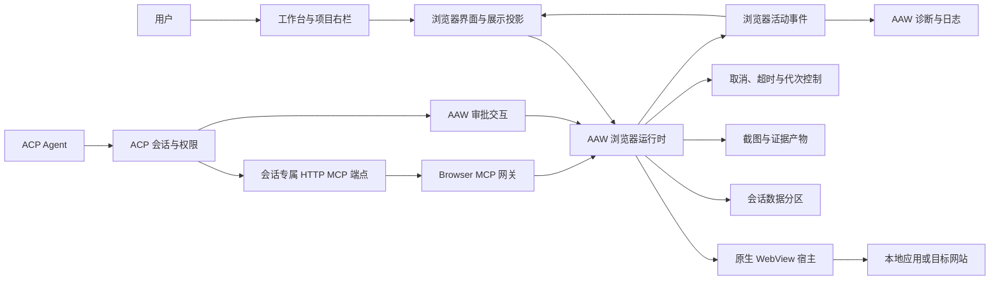
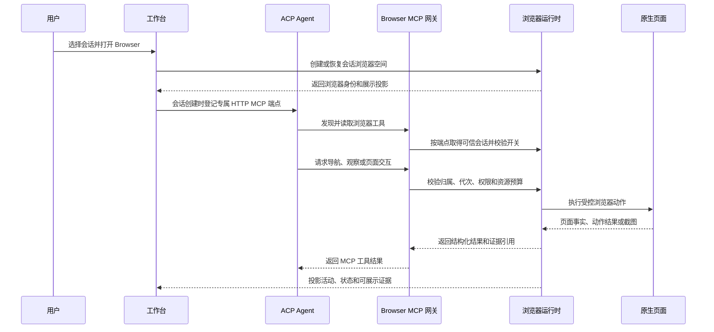

# AAW 桌面端内嵌浏览器功能设计总览

## 文档控制

| 项目 | 内容 |
|---|---|
| 文档编号 | AAW-DSK-BR-FD-000 |
| 版本 | 1.3 |
| 状态 | 待复审 |
| 最近更新 | 2026-11-13 |
| 需求基线 | `desktop/docs/内嵌浏览器/内嵌浏览器需求分析.md` 1.5 |
| 技术证据 | `audit/spikes/20261106-browser-mcp/穿刺报告.md`，SP-01～SP-47 |
| 设计范围 | AAW Desktop 内嵌浏览器、Agent Browser Use、权限、数据与验收 |
| 首发平台 | Windows 10/11 x64 |

## 修订记录

| 版本 | 日期 | 修订原因 | 修订内容 |
|---|---|---|---|
| 1.1 | 2026-11-12 | 需求基线调整为顶层会话级浏览器授权与审计 | 明确同会话主、子 Agent 平权共享浏览器空间和站点数据，跨会话隔离规则保持不变。 |
| 1.2 | 2026-11-13 | 跟踪通用被动开放的需求 1.4 | 明确 AAW 不主动适配 Agent 主子配置，浏览器核心保持 Agent 中立。 |
| 1.3 | 2026-11-13 | 问题单 012 及需求 1.5 改为显式控制模型 | 控制冲突由会话级人工接管开关处理，取消未决动作并隔离用户与 Agent 输入。 |

## 1. 目的

本设计把已基线的需求转换为可实施、可验证的功能方案，明确模块职责、状态所有权、接口边界、关键流程、异常行为和验收追踪。本文是全套设计入口，不替代各专题文档的详细约束。

本文不定义具体源码实现，不使用伪代码。流程、状态转换和算法意图统一使用 Mermaid 与文字表达。

## 2. 设计输入与约束

### 2.1 已基线的产品约束

- P0 同时交付人工浏览和 Agent 浏览器操作，不接受只有界面或只有工具的局部闭环。
- 浏览器必须位于项目右栏；打开前必须有明确会话，但不得因此启动 Agent。
- 每个顶层会话拥有独立浏览器逻辑空间和站点数据分区；同会话主、子 Agent 平权共享，不建立父子身份隔离。
- 自建 AAW Browser MCP，不引入 ZCode Runtime，不集成 agent-browser 作为运行依赖。
- 用户控制权高于 Agent；高风险动作按副作用分级审批。
- 人工页面、Agent 页面、历史数据和证据均需有明确归属、清理与恢复规则。

### 2.2 现有架构约束

- 保留 Tauri 2、React、TypeScript strict、Zustand 和 Cordis 插件体系。
- 保留 ACP 标准会话、权限请求、工具卡片和 Agent 方言边界；浏览器不得要求模型调用桌面私有命令。
- 复用右栏的开合、宽度、项目切换和迟到响应失效机制，但 Browser 增加会话级归属，不改变文件、Git、AAW 的既有共享规则。
- 复用诊断操作 ID、日志过滤、导出和进程回收机制；浏览器不得建立第二套工作流状态。
- 原生浏览器模块可以持有页面与运行时状态，但不得把工作流、会话草稿或产品偏好无边界沉入 Rust。

### 2.3 已证实的平台事实

- 多子 WebView 使用 Tauri `unstable` 能力；动态创建必须经异步命令，避免主线程死锁。
- 每个会话数据目录通过动态 CDP 端口独立发现控制端点。
- 弹窗、导航和权限存在宿主回调；`javascript:` 不经过导航回调，必须在 AAW 命令入口拒绝。
- iCode 的 ACP 不接受客户端下发 stdio MCP 配置，但接受 HTTP MCP；真实调用的 `_meta` 不提供可信身份。
- ACP 取消不会自动传播到 MCP，AAW 必须主动取消运行时请求。
- 当前 AAW 工具内容组件没有图片渲染能力，需要补齐。
- alert/confirm/prompt 与 beforeunload 的平台行为不同，不得用同一假设处理。

## 3. 设计目标与非目标

### 3.1 设计目标

1. 建立单一浏览器权威运行时，所有界面和 Agent 操作使用同一标签页身份与代次。
2. 在不信任模型自报身份的前提下，实现可验证的会话路由和跨会话隔离。
3. 让用户能观察、停止和接管 Agent 页面操作，并获得真实结果或明确的不确定性。
4. 把权限、站点数据、截图证据和资源回收作为完整产品能力，而非开发附加项。
5. 使每项 P0 需求都能映射到设计模块和验收场景。

### 3.2 非目标

- 不设计完整 Chrome 替代品、扩展体系、密码管理或账号同步。
- 不开放原始 CDP、任意脚本执行或外部浏览器接管。
- 不设计绕过验证码、反自动化机制或网站安全控制的能力。
- 不在 P0 承诺跨应用标签恢复、文件传输、受限脚本和坐标操作；这些按基线进入 P1。

## 4. 总体功能架构

### 4.1 模块职责

| 模块 | 负责 | 不负责 |
|---|---|---|
| 浏览器界面 | 地址栏、标签、状态、人工操作、接管、数据管理与证据展示 | 直接持有原生页面句柄或自行推断页面生命周期 |
| 前端浏览器插件 | 展示投影、用户偏好、ACP/界面事件适配、会话目标校验 | 建立第二套可写标签状态 |
| Browser MCP 网关 | HTTP MCP 协议、会话端点、可信身份、工具契约、调用准入 | 信任模型提交的会话 ID 或自行提升权限 |
| 浏览器运行时 | 浏览器空间、标签页、控制权、代次、请求、取消、超时和资源的唯一权威 | 修改 `.sdd/` 工作流或替代 ACP 会话管理 |
| 原生 WebView 宿主 | 子页面创建、尺寸、显隐、导航、权限、对话框、数据目录和进程回收 | 产品审批文案、会话草稿和工作流状态 |
| 证据与诊断 | 截图产物、操作关联、脱敏元数据、保留与清理 | 默认把完整页面内容写入普通日志 |
| ACP 会话层 | Agent 生命周期、标准工具事件和权限交互 | 直接操作原生 WebView |

### 4.2 状态所有权

| 状态 | 唯一权威 | 其他模块持有形式 |
|---|---|---|
| 页面实例、标签身份、归属和代次 | 浏览器运行时 | UI 只读投影；Agent 使用稳定引用 |
| 当前窗口、项目和会话选择 | 现有工作台状态 | 浏览器只读取并校验 |
| Agent 轮次和 ACP 会话 | 现有 ACP 运行时 | 浏览器保存关联，不复制状态机 |
| 用户偏好和右栏展示状态 | 现有设置及右栏状态 | 运行时只读取必要约束 |
| 登录态和站点存储 | 对应会话的 WebView2 数据分区 | 数据管理页只保存分类与统计元数据 |
| 工作流状态 | AAW CLI 与 `.sdd/` | 浏览器只提供证据引用 |
| 截图及产物元数据 | AAW 证据存储 | 会话历史只保存产物引用和展示信息 |

## 5. 核心身份与对象模型

| 对象 | 必要身份 | 说明 |
|---|---|---|
| 浏览器空间 | 窗口、工作区、顶层会话、浏览器 ID、浏览器代次 | 每个会话独立；共享原生运行时进程不等于共享空间 |
| 标签页 | 浏览器空间、稳定标签 ID、标签代次 | 原生页面替换后保留逻辑标签 ID，旧代次失效 |
| 控制权 | 标签 ID、控制方、授权来源、有效代次 | 同一时刻只有用户或 Agent 一个主动控制方 |
| 调用请求 | 请求 ID、会话、轮次、标签、代次、动作、状态 | 支持准入、执行、取消、超时和迟到结果失效 |
| MCP 身份 | 不透明端点令牌、会话、浏览器 ID、连接代次 | 由 AAW 创建和保管，不来自模型输入 |
| 数据分区 | 工作区、会话、分区 ID、保存状态 | 不保存 Cookie 或表单正文作为目录元数据 |
| 证据 | 产物 ID、会话、标签、操作、创建时间、保留状态 | 产物不自动进入 Git |

## 6. 主业务闭环

该闭环同时适用于只读查询和自动验证。只读查询不得被强制经过交互步骤；高风险动作在执行前还必须通过安全专题定义的动作时审批。

## 7. 接口族设计

| 接口族 | 调用方 | 提供方 | 主要语义 |
|---|---|---|---|
| 浏览器界面命令 | 右栏和设置界面 | 前端浏览器插件 | 打开、导航、标签管理、接管、停止、数据管理 |
| 原生宿主命令与事件 | 浏览器运行时 | Tauri 原生宿主 | 子页面、尺寸、显隐、导航、权限、对话框、清理、回收 |
| Browser MCP | ACP Agent | AAW Browser MCP 网关 | 发现、文档、标签、观察、定位、动作、等待、截图 |
| 运行时控制 | ACP 会话层和界面 | 浏览器运行时 | 开关、轮次取消、用户接管、代次失效、资源控制 |
| 证据接口 | 浏览器运行时、会话投影 | 证据存储与诊断 | 保存、引用、展示、保留、清理和脱敏 |
| 能力协商 | AAW 与 ACP Agent | Agent 适配层 | HTTP MCP 支持、图片支持、历史恢复和不可用原因 |

所有接口必须具有明确的归属、代次、超时、取消、错误和日志语义。未实现能力不得出现在有效工具文档中。

## 8. 关键设计决策

| 设计决策 | 方案 | 依据 |
|---|---|---|
| 浏览器运行时位置 | 在 Tauri 原生侧建立职责独立的浏览器运行时模块，前端通过明确契约访问 | 避免额外 Node 运行时，满足原生页面权威和进程回收要求 |
| MCP 传输 | 本机动态端口 HTTP MCP，每会话独立不透明端点 | iCode ACP 已验证支持；端点身份不依赖模型 |
| 页面承载 | 每会话独立数据目录下的子 WebView，共享 AAW 管理的原生运行时 | 同时满足嵌入、隔离、持久化和资源控制 |
| 观察方式 | DOM/ARIA 优先，截图作为证据和必要视觉补充 | 降低 Token 消耗并提高定位可靠性 |
| 控制冲突 | 用户通过会话级人工接管开关显式分配权限；开启时取消未决 Agent 动作，关闭时阻止用户输入并允许 Agent | 权限来源唯一、可预测，避免双写和输入误切换 |
| 取消语义 | AAW 按会话、轮次和请求主动取消，区分未下发与副作用不确定 | ACP 取消不会自动进入 MCP |
| 图片历史 | 会话保存产物引用，原生证据存储保存图片，不在普通快照堆叠 Base64 | 避免 localStorage 容量和隐私风险 |
| 资源预算 | 以实测为起点设置会话和全局硬上限，详细数值见可靠性专题 | 16 标签突发和两小时循环已有基线 |

## 9. 已知难点的设计收口

| 穿刺发现 | 功能设计处理 | 专题 |
|---|---|---|
| 原生对话框行为不一致 | 原生对话框适配层统一接管，插件覆盖不得替代浏览器对话框策略 | 原生宿主、安全 |
| 截图只有 JSON 文本 | 增加图片内容展示、产物引用和历史恢复，不把 Base64 当普通文本 | 界面与证据 |
| `javascript:` 绕过导航事件 | 命令解析、地址栏和 Agent 工具统一协议准入 | 安全 |
| 工作区清理部分失败 | 按会话拆分任务，逐项结果和整体部分成功语义 | 安全与数据 |
| 权限已保存后不再触发事件 | 数据分区保存权限结果，界面提供查看和撤销 | 安全 |
| 额外标签增加资源占用 | 会话与全局双层预算，超限拒绝或挂起，不虚报回收 | 可靠性 |

## 10. 非功能设计指标

| 类别 | 设计指标 |
|---|---|
| 本地交互 | 运行时就绪后，面板显示和标签激活等本地 UI 命令 P95 不超过 300ms |
| 页面操作 | 常规 DOM、定位和状态操作默认预算不超过 3s；导航和显式等待单独计时 |
| 隔离 | 跨会话发现、控制、站点数据和证据均默认拒绝 |
| 稳定性 | 两小时创建、导航、切换、截图和关闭无失败、无未配对标签和失控进程 |
| 可观测性 | 操作 ID 串联界面、MCP、运行时和原生事件，不记录敏感正文 |
| 可访问性 | 地址栏、标签、审批、接管和错误操作支持键盘及减少动态效果 |
| 可维护性 | 界面、运行时、MCP、原生宿主和证据边界独立，禁止跨层巨型模块 |

## 11. 专题文档与实施顺序

| 文档 | 主要内容 | 依赖 |
|---|---|---|
| `01原生宿主与标签页生命周期设计.md` | 页面承载、标签、代次、弹窗、对话框、崩溃和回收 | 总览 |
| `02BrowserMCP与Agent集成设计.md` | 工具面、身份、文档、取消、ACP 和 Agent 能力 | 总览、原生宿主 |
| `03安全权限与数据管理设计.md` | 协议、动作审批、站点权限、数据分区和清理 | 总览、原生宿主 |
| `04界面交互与证据展示设计.md` | 右栏、控制冲突、状态反馈、截图和历史 | 总览、原生宿主、安全 |
| `05可靠性资源与测试设计.md` | 预算、错误、诊断、性能、稳定性和测试矩阵 | 全部专题 |

建议实施仍按 M1～M4 进行，但接口契约和安全边界必须在 M1 前形成，不得后期补隔离。

## 12. 需求追踪总表

| 需求域 | 设计文档 | 主要验收 |
|---|---|---|
| 人工界面与多标签 | 01、04 | AC-001、AC-004、AC-006 |
| Agent 页面操作 | 02、01 | AC-002、AC-003、AC-015、AC-016、AC-019 |
| 会话与 ACP 集成 | 02、04 | AC-005～AC-007、AC-017、AC-023、AC-024 |
| 安全与数据 | 03、01、04 | AC-010、AC-020、AC-021 |
| 生命周期与焦点 | 01、02、04 | AC-008、AC-009、AC-011、AC-013、AC-022 |
| 资源与发布验证 | 05 | AC-014 及全部 P0 回归 |
| P1 增强 | 各专题预留接口 | AC-101～AC-109 |

## 13. 评审检查表

1. 所有状态是否只有一个权威来源。
2. 是否每条浏览器请求都能由 AAW 映射到可信会话。
3. 是否所有异步操作都有取消、超时、代次和迟到结果规则。
4. 是否用户始终可以停止和接管页面。
5. 是否站点数据、截图和日志都有明确的保留与清理边界。
6. 是否所有 P0 需求都能映射到专题设计和真实验收。
7. 是否不存在依赖 iCode 私有字段才能完成的核心浏览器能力。
8. 是否没有以 Mock、外部浏览器或独立脚本冒充产品闭环。
