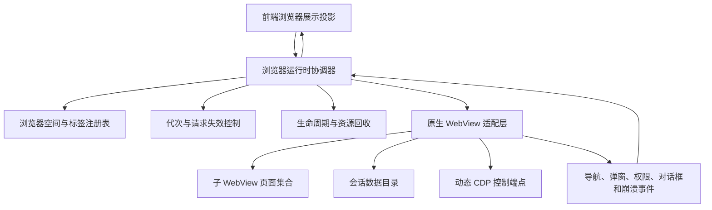
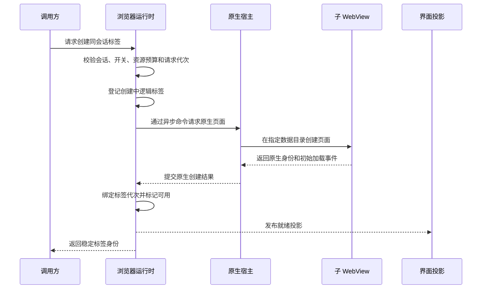
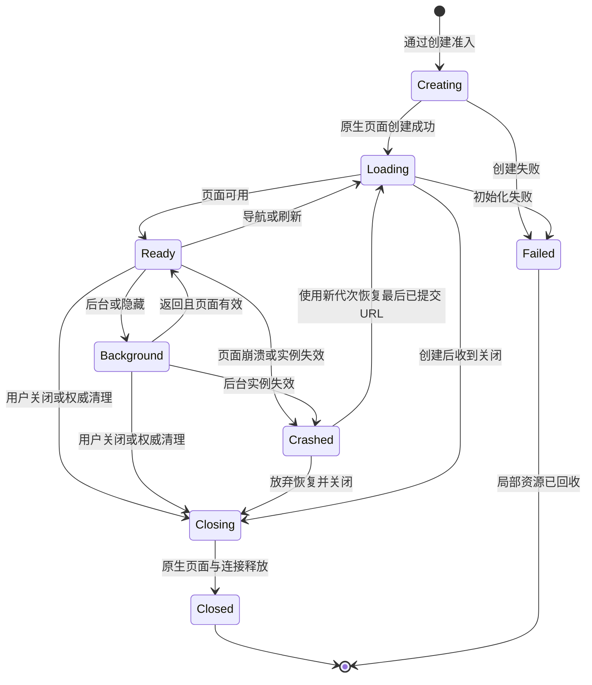
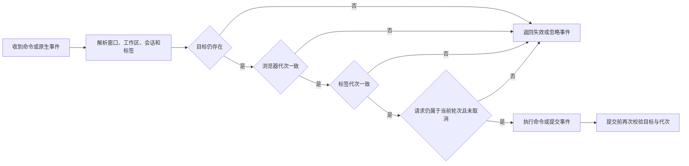
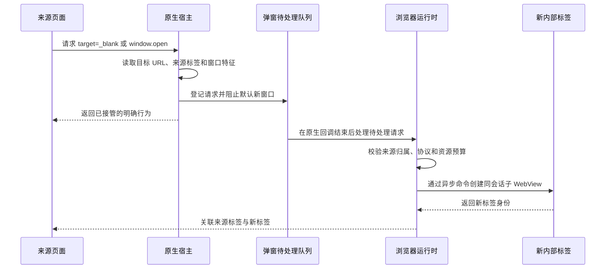
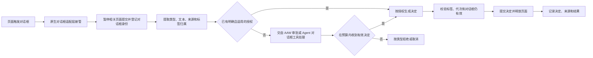
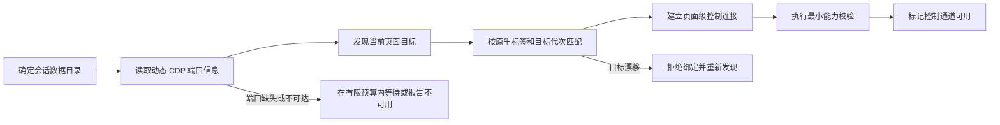

# 原生宿主与标签页生命周期功能设计

## 文档控制

| 项目 | 内容 |
|---|---|
| 文档编号 | AAW-DSK-BR-FD-001 |
| 版本 | 1.0 |
| 状态 | 已基线 |
| 最近更新 | 2026-11-11 |
| 上游文档 | `00功能设计总览.md`、需求基线 1.0 |
| 证据基础 | 穿刺 SP-13～SP-29、SP-35～SP-39、SP-43～SP-47 |

## 1. 目的与范围

本文定义 Tauri + WebView2 下真实内嵌页面的承载、标签页身份、控制权关联、弹窗、对话框、崩溃恢复、关闭和进程回收。目标是让界面、Agent 和清理逻辑面对同一个原生页面事实，不出现多个互相竞争的生命周期权威。

范围包括 P0 的人工与 Agent 页面、会话级数据目录、动态 CDP 控制通道和原生事件。P1 的自由视口、文件传输和跨重启标签恢复只预留扩展点，不进入 P0 实现范围。

## 2. 设计原则

1. 原生运行时持有真实页面，前端只保存投影。
2. 稳定标签 ID 与原生页面实例分离；实例替换必须递增标签代次。
3. 所有异步创建和关闭都允许迟到事件，但迟到事件不得复活已关闭标签。
4. 弹窗和对话框默认处于 AAW 控制之下，不使用 WebView2 隐式默认行为。
5. 子页面不得触发主窗口 ACP 连接回收，也不得绕过主窗口的会话归属。
6. 原生创建、关闭和清理操作必须可从真实桌面环境重复验证。

## 3. 模块划分

| 模块 | 职责 |
|---|---|
| 浏览器运行时协调器 | 接收界面、MCP 和清理请求，组织合法状态转换 |
| 空间与标签注册表 | 保存浏览器空间、稳定标签 ID、归属、当前代次和最后已提交 URL |
| 代次与请求控制 | 拒绝旧浏览器、旧页面、旧轮次和已关闭目标的请求与事件 |
| 生命周期与回收 | 创建、显隐、崩溃、关闭、会话结束、窗口退出和强制终止 |
| 原生 WebView 适配层 | 调用 Tauri/WebView2 能力并返回真实结果，不伪造状态 |
| 动态 CDP 发现 | 从对应会话数据目录读取动态端口，绑定当前原生页面并校验代次 |

## 4. 浏览器空间与标签模型

| 对象 | 必要属性 | 生命周期规则 |
|---|---|---|
| 浏览器空间 | 窗口、工作区、顶层会话、浏览器 ID、浏览器代次、数据分区 | 会话建立时创建；应用退出回收；P0 重启不恢复标签 |
| 逻辑标签 | 稳定标签 ID、当前标签代次、控制方、可见状态、最后已提交 URL | 关闭为终态；崩溃不直接删除逻辑标签 |
| 原生页面 | 原生标签、CDP 目标、进程关联、实际 URL、加载状态 | 可被崩溃或重建替换；不得脱离逻辑标签独立存在 |
| 页面请求 | 请求 ID、轮次、目标标签、目标代次、执行状态 | 只允许在目标代次有效时执行或提交结果 |
| 数据目录 | 分区 ID、目录、动态端口文件、占用状态 | 同一进程内一个分区只由一个 WebView2 环境使用 |

会话 A/B 可以共享桌面进程和原生窗口，但不能共享标签集合或数据目录。子 Agent 使用父会话空间，不创建独立分区。

## 5. 页面创建与多标签承载

创建失败时，逻辑标签进入失败终态并释放已分配的局部原生资源。只有完成归属和代次登记的页面才可被发现。页面加载慢不阻塞宿主主线程，也不得因网络等待把“已创建”误报为“导航成功”。

## 6. 标签页状态机

轮次结束和会话切换不等于关闭标签。会话结束只释放 Agent 控制权和未决请求，页面是否保留按基线规则执行。应用重启不恢复 P0 标签页。

## 7. 代次与迟到结果防护

代次校验不能只发生在命令开始时。执行完成、页面事件入库和界面投影前都要复核。被拒绝的迟到结果返回稳定错误或在事件中静默丢弃，但不得修改当前状态。

## 8. 弹窗内部路由

原生回调只负责拦截和登记，不直接创建页面。运行时处理队列时使用异步创建命令。来源标签已关闭、目标协议被拒绝或预算不足时，不创建页面，并记录明确原因。弹窗继承来源会话和站点数据分区，不继承高风险动作授权。

## 9. JavaScript 对话框接管

### 9.1 统一模型

| 类型 | 提供事实 | 允许结果 | 默认超时行为 |
|---|---|---|---|
| alert | 类型、文本、来源站点和标签 | 确认 | 取消或关闭，不继续等待 |
| confirm | 类型、文本、来源站点和标签 | 接受或取消 | 取消 |
| prompt | 类型、文本、默认提示和来源 | 输入、接受或取消 | 取消 |
| beforeunload | 离开来源、目标、当前标签和轮次 | 允许离开或取消离开 | 取消离开 |

### 9.2 处理流程

P0 使用 WebView2 原生对话框事件及延迟响应能力，不依赖 CDP 一定收到 alert/confirm/prompt。Tauri 对话框插件对页面 alert/confirm 的异步覆盖不得被视为浏览器接管实现；浏览器子页面必须使用独立的原生适配，不得把 Promise 当作用户已处理。

beforeunload 可以使用已验证的 CDP 事件链，但由同一对话框协调器管理。任何已显示模态框都只能由持有其对话框身份的连接处理，新连接不得尝试盲接。

## 10. 动态 CDP 发现与绑定

P0 不扫描本机端口，不连接外部 Chrome，也不使用固定公共调试端口。动态端口文件只用于 AAW 自有分区。浏览器或标签代次变化后，旧连接必须失效并重新绑定。

## 11. 崩溃与恢复

1. 原生崩溃、无响应或 CDP 断开先标记页面不可用，并递增标签代次。
2. 保留逻辑标签、归属、最后已提交 URL 和可见错误，不把当前地址栏未提交输入当作恢复目标。
3. 取消旧代次请求，迟到响应不得覆盖恢复页面。
4. 用户或有权 Agent 可请求恢复；恢复使用同一会话分区和新的原生页面实例。
5. 恢复失败保持可见错误，允许重试或关闭，不无限自动重试。
6. 若用户在恢复前关闭标签，任何迟到恢复事件不得复活页面。

## 12. 关闭与进程回收

| 触发来源 | 页面 | 请求 | 控制权 | 进程与连接 |
|---|---|---|---|---|
| 轮次结束 | 保留 | 取消本轮未决请求 | 保持既有授权直到会话规则改变 | 保留必要连接 |
| 普通会话切换 | 保留并转后台 | 后台请求按会话继续或受预算限制 | 不改变 | 保留 |
| Agent 移交 | 保留 | 结束相关未决动作 | 归用户 | 保留页面连接 |
| 会话结束 | 按产品保留页面和数据 | 取消会话请求 | 释放 Agent 控制 | 释放不再需要的绑定 |
| 显式关闭标签 | 关闭目标 | 取消目标请求 | 失效 | 关闭页面及 CDP 连接 |
| 关闭项目、窗口或应用 | 回收所属页面 | 取消并拒绝新请求 | 全部失效 | 关闭运行时与相关进程 |

原生宿主需跟踪页面、连接和进程归属。正常关闭先阻止新请求，再取消未决项，随后关闭页面和连接。异常退出使用操作系统进程关联作为兜底；不能仅依赖前端收到关闭事件。

## 13. 原生接口与事件契约

| 契约族 | 必备语义 | 禁止行为 |
|---|---|---|
| 页面命令 | 创建、导航、显隐、尺寸、关闭、清理；携带归属和代次 | 按数组下标寻址；无归属全局操作 |
| 控制通道 | 动态发现、绑定、失效、重连和能力校验 | 扫描或接管外部浏览器 |
| 原生事件 | 加载、标题、URL、弹窗、权限、对话框、崩溃和销毁 | 迟到事件修改新代次 |
| 生命周期命令 | 轮次取消、标签关闭、会话释放、窗口和应用回收 | 以轮次结束代替标签关闭 |
| 数据命令 | 清缓存、按站点清理、按分区清理和结果核验 | 在清理请求发出时虚报完成 |

## 14. 错误与恢复要求

| 错误类别 | 行为 |
|---|---|
| 页面不可用 | 停止后续动作，提供重新发现或恢复入口 |
| 目标失效 | 丢弃旧结果，提示重新选择标签 |
| 创建失败 | 清理局部资源，展示失败原因 |
| 导航拒绝 | 保持原页面，显示协议或权限原因 |
| 对话框超时 | 按类型取消，不默认接受 |
| 回收失败 | 标记实际未完成，保留重试和诊断证据 |
| 预算不足 | 拒绝新页面或挂起候选，不覆盖现有页面 |

## 15. 验收与追踪

| 验收场景 | 设计覆盖 |
|---|---|
| AC-001、AC-004 | 页面创建、导航、状态、多标签和弹窗内部路由 |
| AC-006、AC-008 | 会话归属、代次、崩溃恢复和旧请求失效 |
| AC-009、AC-011 | 取消、关闭、迟到结果和进程回收 |
| AC-013、AC-022 | 原生焦点隔离、用户接管和控制权失效 |
| AC-016 | 四类对话框及无对话框空态 |
| AC-020、AC-021 | 数据目录、动态端口、持久化和清理原生支撑 |
| AC-014 | 长时创建、显隐、关闭和回收 |

所有原生能力必须通过真实 Windows WebView2 验证。Mock 仅用于状态机和界面单元测试，不能作为页面承载、对话框或进程回收的完成证据。
