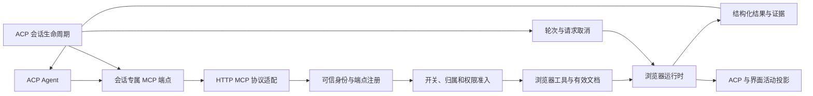
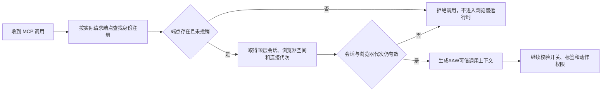
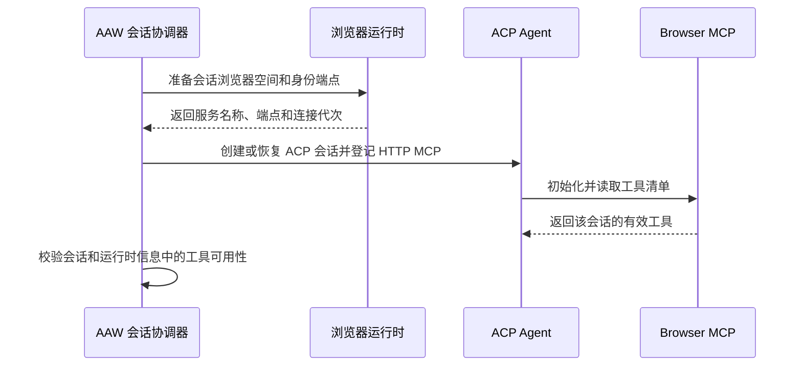
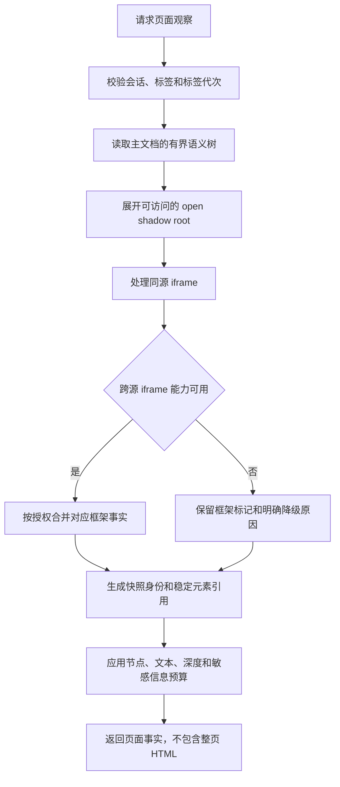
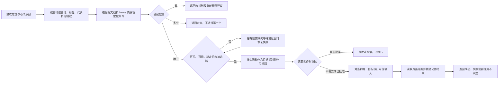
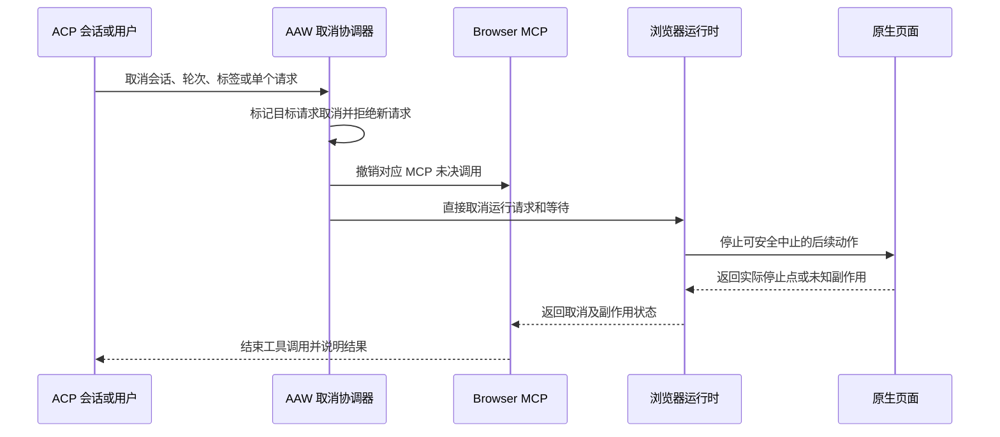

# Browser MCP 与 Agent 集成功能设计

## 文档控制

| 项目 | 内容 |
|---|---|
| 文档编号 | AAW-DSK-BR-FD-002 |
| 版本 | 1.2 |
| 状态 | 待复审 |
| 最近更新 | 2026-11-13 |
| 上游文档 | `00功能设计总览.md`、`01原生宿主与标签页生命周期设计.md` |
| 证据基础 | 穿刺 SP-03～SP-12、SP-30～SP-34、SP-40～SP-42，以及真实双子 Agent 工具可用性验证 |

## 修订记录

| 版本 | 日期 | 修订原因 | 修订内容 |
|---|---|---|---|
| 1.1 | 2026-11-12 | 会话级平权取代父子身份隔离；实测发现复用端点不等于子 Agent 自动获得工具 | 删除子 Agent 登记和独立取消语义，补充会话内工具分发与真实能力验证，保留端点可信归属和跨会话隔离。 |
| 1.2 | 2026-11-13 | 纠正 AAW 主动工具分发的错误倾向，保持通用性 | 将工具分发改为被动开放，不主动适配、探测或修改任何 Agent 的主子配置。 |

## 1. 目的与范围

本文定义 AAW 自建 Browser MCP 的工具面、可信会话身份、有效文档、会话注册、同会话主子 Agent 平权共享与被动开放、调用生命周期、取消、结果和 ACP 展示集成。核心目标是让 Agent 通过通用工具机制操作正确的内嵌浏览器，不为 iCode、Claude、OpenCode 或其他特定 Agent 增加专用适配。

P0 不提供原始 CDP、任意脚本执行或坐标操作。P1 的受限脚本、坐标和文件能力必须继承本文的身份、取消和结果契约。

## 2. 设计原则

1. 模型只表达操作意图，AAW 决定身份、权限和真实目标。
2. 会话身份来自 AAW 分配的 MCP 端点，不来自模型参数或 `_meta`。
3. 工具面以完整任务闭环组织，但只读查询不得被迫执行交互。
4. 所有动作返回真实页面结果、可恢复错误或副作用不确定性。
5. 有效工具和文档按当前 Agent、浏览器实例和运行时能力生成。
6. iCode、OpenCode 或其他 Agent 都通过相同协议语义接入；差异通过能力协商处理。

## 3. 模块组成

| 模块 | 职责 |
|---|---|
| HTTP MCP 协议适配 | 初始化、工具发现、调用、结果、错误和连接生命周期 |
| 端点与身份注册 | 分配不透明端点、映射顶层会话、撤销和轮换 |
| 准入控制 | 校验 Agent 开关、会话状态、标签归属、代次和资源预算 |
| 工具与文档 | 提供真实能力、操作约束、恢复提示和结构化结果 |
| 取消协调 | 接收 ACP 轮次取消、界面停止和运行时取消，终止对应请求 |
| 结果投影 | 向 Agent 返回内容，向界面提供活动和证据，不伪造 ACP 状态 |

## 4. 可信身份与端点设计

### 4.1 分配规则

- 每个顶层 ACP 会话使用独立 MCP 服务名称和独立不透明 HTTP 端点。
- 端点包含足够强度的随机令牌；会话 ID 不作为授权凭证。
- 端点只监听本机回环地址，校验协议来源和 Host，不接受非本机访问。
- AAW 原生身份注册表保存端点令牌到会话、浏览器空间和连接代次的映射。
- 会话关闭、Agent 类型切换或运行时换代后撤销旧端点；重连使用新代次和新令牌。
- 日志、诊断和页面内容不得记录完整端点令牌。

### 4.2 身份路由算法

即使两个 Agent 会话调用同名工具、使用相同参数且 `_meta` 为空，也会因实际端点不同而进入不同浏览器空间。模型修改参数中的会话字段不会改变该映射。

### 4.3 ACP 会话注册

当前 iCode 的 ACP 客户端 stdio 下发不受支持，因此 P0 使用 HTTP MCP。其他 Agent 只有在真实握手和调用验证通过后才标记可用；不支持时保留人工浏览并显示明确原因。

## 5. 会话内 Agent 平权与被动开放

- 顶层 ACP 会话是浏览器授权、归属和审计边界。同一会话的主 Agent 和子 Agent 平权共享 MCP 端点、浏览器空间、标签页、站点数据及动作权限。
- 会话归属只由实际请求端点确定，不要求子 Agent 登记，不依赖模型或运行时提供子身份，也不因子 Agent 结束而撤销会话端点、关闭页面或取消其他同会话请求。
- 同会话所有 Agent 都遵守相同的标签页接管、高风险审批、用户优先和资源预算规则；子 Agent 不能通过浏览器工具突破该会话既有授权。
- 取消只按请求、标签、顶层轮次、会话或全局执行，不提供子 Agent 级选择性取消。审计和诊断只承诺会话级归属；可展示 Agent 提供的来源说明，但该说明不参与授权或安全判定。
- AAW 只通过通用 ACP/MCP 契约被动开放浏览器接口，不主动适配、探测或修改任何 Agent 的主子配置，不为 iCode、Claude、OpenCode 或其他 Agent 增加专用分支。
- Agent 运行时将同会话 MCP 提供给子 Agent 时，子 Agent 即可按相同会话规则操作；不能继承或调用时，只是该运行时的实际能力边界，不影响 AAW 接口开放，也不触发专门适配或降级实现。

## 6. P0 工具面

| 工具族 | 能力 | 关键约束 |
|---|---|---|
| 发现与文档 | 发现可用浏览器、读取能力、读取操作文档 | 只返回已初始化且当前代次可达的实例 |
| 标签管理 | 新建、枚举、选择、激活、复用、关闭 | 使用稳定标签 ID 和已验证页面事实，不使用数组位置 |
| 接管与移交 | 枚举当前会话用户标签、显式接管、释放和交付 | 用户授权与原始会话归属分离，其他会话不可见 |
| 导航 | 导航、前进、后退、刷新、停止、读取状态 | 协议准入；返回最终已提交页面，不以请求发出冒充成功 |
| 页面观察 | 有界 DOM/ARIA 快照、URL、标题、加载和元素状态 | 主文档、open shadow root、同源 iframe；跨源明确降级 |
| 严格定位 | CSS、role、text、label、placeholder、test-id | 零匹配和多匹配均为明确结果，不自动取第一个 |
| 页面交互 | 点击、双击、输入、填充、按键、滚动、勾选、下拉选择 | 目标、可见、可用、稳定、遮挡和副作用校验 |
| 等待 | URL、加载、元素状态和固定时长等待 | 有预算、可取消；超时提供重新观察建议 |
| 截图 | 视口和必要元素截图 | 模型图片与原始产物分离，受尺寸和频率预算约束 |
| 对话框 | 读取类型和文本，接受、取消或输入 prompt | 无对话框返回空态；决定受权限和代次约束 |

P0 工具清单不包含原始 CDP、任意 `evaluate`、文件上传/下载和坐标操作。实际不可用能力不得出现在该实例的有效文档中。

## 7. 有效能力与操作文档

每个浏览器实例提供与真实后端一致的文档，至少包含：

1. 当前可用工具、限制和平台降级。
2. 会话归属、标签选择和用户接管规则。
3. DOM-first 观察、快照身份和严格定位规则。
4. 不可信页面内容、高风险审批和敏感信息规则。
5. 超时、取消、目标漂移和副作用不确定的恢复方式。
6. 截图、证据和模型能力的限制。

Agent 不支持图片时，截图仍可保存产物，但工具必须说明模型不能读取图片；不得把占位文本当作已看图。

## 8. 页面观察与快照边界

快照只代表特定标签代次和观察时刻。页面发生导航、崩溃或实质结构变化后，旧快照和元素引用失效。单个 frame 失败不得拖垮整页观察。

## 9. 严格定位与动作执行算法

动作开始后若目标标签、代次、控制权或审批上下文改变，不得继续把结果提交为当前动作成功。普通填充与最终提交是两个不同副作用级别，不能因为填充已获授权就自动提交。

## 10. 取消与超时

### 10.1 取消来源

- ACP 会话轮次取消。
- 用户点击停止 Agent 或接管页面。
- 关闭标签、会话、项目、窗口或应用。
- Agent 开关关闭、运行时重连和代次失效。
- 请求自身超时或资源预算中止。

### 10.2 取消协调流程

### 10.3 结果语义

| 实际阶段 | 返回语义 |
|---|---|
| 尚未下发到页面 | 已取消，无副作用 |
| 已下发但页面确认未产生目标副作用 | 已取消，并给出可验证证据 |
| 已下发且无法确认最终状态 | 已取消，副作用不确定，建议重新观察 |
| 动作已完成才收到取消 | 取消过晚，返回实际完成结果，不虚假回滚 |

ACP 取消不依赖 iCode 向 MCP 发送通知。AAW 必须持有运行时请求注册表并直接完成取消。

## 11. 工具结果与证据

| 结果类型 | 内容 | 限制 |
|---|---|---|
| 页面事实 | 状态、标题、脱敏 URL、标签和代次 | 默认不包含 Cookie、密码或完整敏感表单值 |
| 定位与动作 | 匹配数量、执行阶段、页面证据和恢复建议 | 不把工具已调用当作页面已成功 |
| 等待与取消 | 等待条件、耗时、取消来源和副作用状态 | 不允许无界等待 |
| 图片 | 可供模型读取的图片、产物引用、尺寸和来源 | 模型图片与原始产物分离，历史不堆叠 Base64 |
| 错误 | 稳定分类、可读说明、恢复动作 | 不泄漏内部凭据、完整令牌或敏感载荷 |

## 12. ACP 与界面集成

- ACP 标准工具调用和更新仍由 Agent 会话层产生，AAW 不伪造另一套工具卡。
- 浏览器运行时向界面提供活动、页面状态、截图引用和错误，用于实时展示和历史恢复。
- 高风险浏览器审批复用 AAW 权限交互，审批内容与真实运行时请求关联。
- Agent 类型切换后旧 MCP 端点、浏览器绑定和请求全部失效，不允许自动漂移。
- 不支持的 Agent 显示能力不可用及原因，人工浏览和其他会话不受影响。

## 13. 错误分类

| 分类 | 典型情况 | 恢复建议 |
|---|---|---|
| 不可用 | 浏览器未就绪、控制通道断开 | 重新发现或检查运行环境 |
| 不支持 | Agent、平台或当前后端无能力 | 使用人工浏览或已支持工具 |
| 导航拒绝 | 协议、目标或权限不允许 | 修改目标或请求明确授权 |
| 未找到 | 浏览器、标签或元素不存在 | 重新枚举或观察 |
| 歧义 | 定位条件多匹配 | 增加约束，不自动选择 |
| 超时 | 页面或条件在预算内未完成 | 重新观察后重试 |
| 取消 | 用户、轮次或生命周期主动取消 | 按副作用状态决定是否复核 |
| 失效 | 代次、快照、端点或绑定过期 | 重新发现和绑定 |
| 执行失败 | 原生动作或结果核验失败 | 查看错误并按实际页面恢复 |
| 副作用不确定 | 已下发后取消或连接中断 | 先读取页面，不盲目重放 |

## 14. 安全与诊断要求

- MCP 仅监听本机回环地址，端点令牌具有足够随机性并可撤销。
- 不把会话令牌、完整 URL 查询、Cookie、密码和页面正文写入普通日志。
- 操作 ID 关联 ACP 会话、MCP 请求、运行时请求和原生动作。
- 页面文本、快照、截图和工具参数始终按不可信输入处理。
- 任何高风险拒绝都不能通过另一工具族绕过。

## 15. 验收与追踪

| 验收场景 | 设计覆盖 |
|---|---|
| AC-002、AC-003 | 真实 Agent 闭环、严格定位、遮挡和动作核验 |
| AC-005、AC-006 | 用户接管、会话归属和跨会话不可见 |
| AC-007、AC-017 | 后台投影、Agent 总开关和未决请求取消 |
| AC-009、AC-023 | 取消副作用、Agent 切换、重连和代次失效 |
| AC-012 | 图片结果、实时展示和历史证据引用 |
| AC-015、AC-016、AC-019 | 只读、对话框和有效文档 |
| AC-018 | 同会话主子 Agent 工具可得性、平权共享、并发控制和子结束后的会话连续性 |
| AC-024 | 其他 ACP Agent 的真实能力与不可用降级 |

真实验收必须至少包含当前 iCode 的端到端对话闭环。其他 Agent 以实际协商结果为准，不使用静态名单冒充支持。
