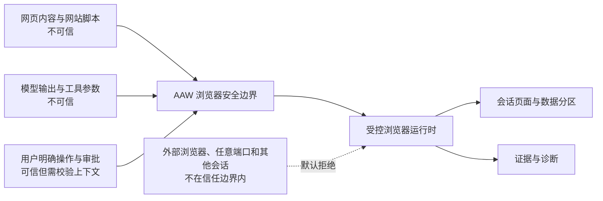
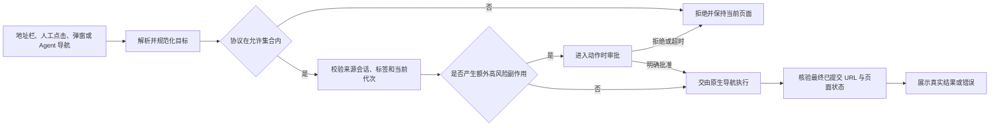
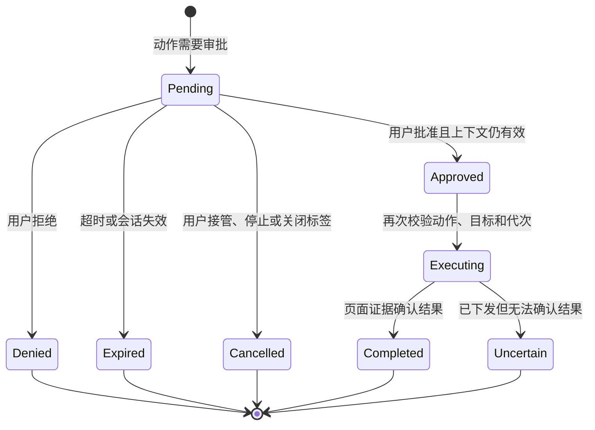
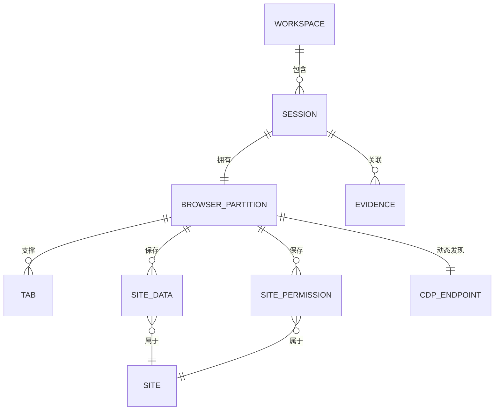
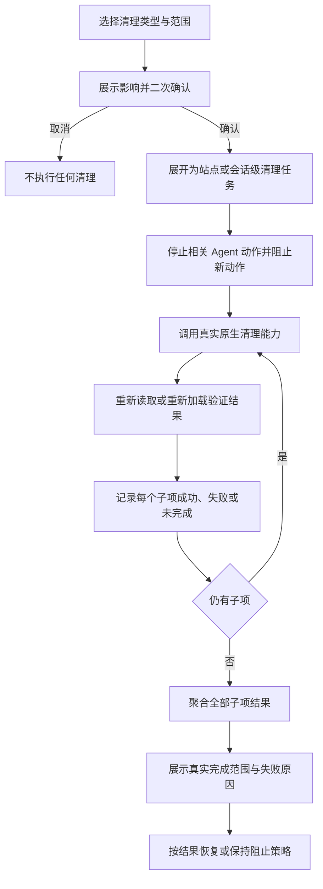

# 安全、权限与数据管理功能设计

## 文档控制

| 项目 | 内容 |
|---|---|
| 文档编号 | AAW-DSK-BR-FD-003 |
| 版本 | 1.0 |
| 状态 | 已基线 |
| 最近更新 | 2026-11-11 |
| 上游文档 | `00功能设计总览.md`、01、02 专题 |
| 证据基础 | 穿刺 SP-18、SP-25～SP-29、SP-38～SP-44 |

## 1. 目的与范围

本文定义内嵌浏览器的信任边界、URL 与协议准入、动作分级审批、站点权限、会话级数据分区、数据查看和分层清理。设计目标是默认安全、明确授权、真实生效和可审计，同时保留本地 Web 验收所需的可用性。

范围覆盖人工和 Agent 的所有浏览器入口，以及历史会话遗留数据。P1 的文件上传、下载、受限脚本和坐标操作只定义继承规则，不提前开放。

## 2. 资产与信任边界

| 资产 | 主要风险 | 保护要求 |
|---|---|---|
| 会话和标签页归属 | 跨会话误操作、页面泄漏 | AAW 可信身份、稳定归属和 fail-closed |
| Cookie、登录态和站点存储 | 串账号、数据泄露 | 会话级独立分区，禁止隐式共享 |
| 本地文件和敏感表单 | 外发、凭据泄漏 | 动作时审批、最小披露和脱敏 |
| 原生页面与控制通道 | 未授权进程控制浏览器 | 本机端点、随机令牌、代次和连接校验 |
| 用户控制权 | Agent 抢占或持续操作 | 用户优先、停止、接管和取消 |
| 截图与证据 | 敏感页面长期保留 | 明确来源、保留策略、清理和导出提示 |
| 工作流状态 | 浏览器动作误改流程 | 只允许证据引用，AAW CLI 保持唯一权威 |

网页文本、DOM、截图和模型自报身份均不能授予权限。授权只能来自 AAW 已验证的用户操作、明确的任务范围或受控测试授权。

## 3. URL 与协议准入

### 3.1 默认策略

| 类别 | 默认行为 | 补充规则 |
|---|---|---|
| HTTP、HTTPS | 允许进入后续导航和权限校验 | 记录脱敏目标；高风险动作仍需审批 |
| 受控空白页 | 允许 | 仅用于内部初始化，不携带外部数据 |
| file | 拒绝 | 不因本地开发便利而隐式开放 |
| javascript | 拒绝 | 命令入口、地址栏和 Agent 工具均拒绝，不能依赖导航事件 |
| 任意 data | 拒绝 | 不用 data URL 绕过页面来源策略 |
| 外部协议 | 拒绝 | 不启动系统设置、邮件客户端或任意程序 |
| 非受限原始 CDP | 不向模型开放 | 原生内部使用不等于暴露给 Agent |

### 3.2 统一准入流程

所有入口共享同一准入策略。原生导航钩子是第二层防线，而不是唯一防线。即使页面脚本直接修改位置，也不能启动外部协议或改变 AAW 授权状态。

## 4. 动作分级与审批

### 4.1 分级矩阵

| 级别 | 典型动作 | 默认授权 | 关键限制 |
|---|---|---|---|
| L0 只读与普通导航 | 发现、状态、快照、定位、截图、允许协议的导航 | 在有效浏览器空间和标签授权内允许 | 仍执行脱敏、协议、超时和资源规则 |
| L1 未提交页面编辑 | 滚动、勾选、选择、焦点和非敏感草稿填充 | 在当前任务和标签授权内允许 | 不代表最终提交；敏感字段升级到 L3 |
| L2 外部或持久副作用 | 表单提交、登录、发送、发布、删除、服务端修改、交易和站点权限变更 | 按具体动作、站点、数据范围和标签逐次确认 | 拒绝或超时不得执行；已下发取消可能副作用不确定 |
| L3 敏感与高权限 | 密码、凭据、支付、敏感个人信息；P1 文件上传、脚本和坐标 | 默认拒绝，明确批准具体动作与数据后才可执行 | 不提供永久会话放行，不得绕过其他级别 |

无法确定副作用时按更高级别处理。目标网站和模型不得定义自己的风险级别。

### 4.2 审批内容与生命周期

审批必须展示：来源会话、当前标签、脱敏目标站点、动作类型、涉及的数据类别、预期外部影响和本次授权范围。审批不包含完整密码、Cookie 或无关页面正文。

批准只绑定当前动作，不绑定之后同名动作。用户接管、标签切换、页面导航或代次变化都会使未执行审批失效。测试环境中的 MCP 代理审批仅在 C-04 明确授权范围内生效，并保留完整审计记录。

## 5. 站点权限

| 权限 | 默认 | 授权粒度 | 撤销 |
|---|---|---|---|
| 摄像头、麦克风 | 拒绝 | 会话 + 站点 + 权限类型 | 随时撤销，撤销后新请求拒绝 |
| 地理位置 | 拒绝 | 会话 + 站点 | 同上 |
| 通知 | 拒绝 | 会话 + 站点 | 同上 |
| 其他 WebView2 权限 | 拒绝 | 按明确能力逐项定义 | 未定义能力不得默认允许 |

站点权限结果保存在对应会话分区，并在数据管理中可见。已保存的拒绝或允许可能不会再次触发原生权限事件，因此运行时必须先查询 AAW 权限决定，而不是等待事件重复出现。撤销后立即影响后续请求，并按页面能力决定是否需刷新。

## 6. 会话级数据分区

### 6.1 分区规则

- 每个顶层会话拥有独立的 AAW WebView2 数据目录。
- 用户与当前会话 Agent 共享该目录，同会话标签共享登录态。
- 子 Agent 继承父会话，不创建新分区。
- 不同会话、不同工作区和外部 Chrome 之间不得隐式读取、复制或共享数据。
- AAW 主界面的数据目录与浏览器业务分区分离。
- 数据目录登记只保存身份、类型、占用统计和保存状态，不保存 Cookie 或表单正文。

### 6.2 数据目录与控制通道

分区删除或全量清理必须同时影响 Cookie、LocalStorage、IndexedDB、缓存、Service Worker 和站点权限。仅清缓存时保留登录态及站点存储。

## 7. 数据查看与分层管理

### 7.1 查看维度

| 层级 | 展示内容 | 不展示 |
|---|---|---|
| 工作区 | 会话数量、数据类型、占用估算、最近活动和保存状态 | 其他工作区数据正文 |
| 会话 | 当前或历史状态、站点数量、权限数量、缓存和存储占用 | Cookie 值、密码和完整表单 |
| 站点 | 脱敏来源、数据类型、占用、权限和最近使用 | 敏感存储正文 |
| 全部 AAW 浏览器数据 | 总占用、包含范围、活动与历史分区 | AAW 主程序设置和工作流正文 |

占用数据是实际可计算值或明确标记为估算，不把未知显示为零。历史会话也必须可查看和清理。

### 7.2 清理类型

| 操作 | 清理内容 | 保留内容 | 活动页面处理 |
|---|---|---|---|
| 清缓存 | HTTP 缓存及明确归为缓存的数据 | Cookie、登录态、LocalStorage、IndexedDB 和权限 | 可保持页面，必要时重新加载验证 |
| 清站点全部数据 | 指定站点的 Cookie、存储、缓存、Service Worker 和权限 | 其他站点及其他会话 | 停止相关 Agent 动作并刷新受影响页面 |
| 清会话全部数据 | 会话内全部站点、权限和浏览器数据 | 其他会话 | 停止 Agent，关闭该会话页面，释放控制绑定 |
| 清工作区数据 | 工作区内所有会话的浏览器数据 | 其他工作区 | 按会话逐项停止、关闭和清理 |
| 清全部 AAW 浏览器数据 | 所有浏览器分区、权限及浏览器证据 | AAW 设置、项目和工作流状态本身 | 停止全部 Agent 浏览器动作并关闭所有浏览器页面 |

全量清理浏览器证据后，历史工作流只保留证据不可用的事实，不修改工作流状态。所有破坏性操作都显示实际影响范围并二次确认。

## 8. 分层清理与结果聚合

活动分区优先使用原生清理 API。历史分区可创建不展示业务页面的维护上下文执行清理，完成后立即回收；分区被其他进程占用或结果无法验证时，必须报告失败，不能直接删除正在使用的目录或虚报成功。

聚合结果不得用“全部成功”覆盖子项失败。工作区或全局清理允许部分完成，界面必须能定位失败分区并重试。清缓存后应通过实际网络行为验证；清站点和会话后应重新读取存储与权限状态。

## 9. 敏感信息与日志

- 普通结构化日志不记录 Cookie、存储正文、密码、完整表单值、端点令牌和完整敏感 URL。
- 页面快照和截图按会话隔离；默认不把无关页面内容发送给模型。
- 截图产物保存原始文件，会话历史只保存产物引用、缩略展示和必要元数据。
- Browser 图片的 ACP 原文不得无限期堆叠完整 Base64；诊断传输记录对图片载荷做结构化脱敏，保留类型、大小、来源和操作关联。
- 诊断导出涉及浏览器图片或敏感页面时，必须显示内容范围提示。
- 清理浏览器证据后，诊断索引不得继续展示已失效图片为可用。

## 10. 提示注入与跨源边界

1. 页面中的文字、隐藏指令、表单描述和截图文字都只是页面事实，不是 AAW 指令。
2. 页面不得改变 Agent 开关、会话归属、权限、数据清理范围或审批结果。
3. 跨源 iframe 默认只提供明确标记的降级事实；不因无法读取而伪称完整快照。
4. 被拒绝的高风险动作不得通过坐标、脚本、弹窗、导航或其他工具重新进入。
5. 用户外部 Chrome 的 Cookie、密码和存储不得作为 AAW 初始化来源。

## 11. P1 继承规则

- 文件上传按具体文件、目标站点和动作进入 L3 审批。
- 下载展示来源、目标和保存位置，不自动执行下载对象。
- 受限脚本和坐标操作分别使用独立 L3 授权，坐标必须有最近截图证据。
- P1 能力仍使用同一会话分区、代次、取消、超时、日志和清理契约。

## 12. 验收与追踪

| 验收场景 | 设计覆盖 |
|---|---|
| AC-010 | 协议统一准入、提示注入、L0～L3 审批、权限、拒绝和超时 |
| AC-016 | 对话框类型、权限和超时默认行为 |
| AC-017、AC-022 | 开关、取消和用户优先对权限的失效作用 |
| AC-020 | 会话分区、跨重启保留、同会话共享和跨会话隔离 |
| AC-021 | 分层查看、历史数据、清缓存、分级清理、二次确认和真实验证 |
| AC-012 | 图片证据的保留、展示、脱敏和清理 |
| AC-107～AC-109 | P1 文件、网络读取、脚本和坐标的继承约束 |

所有安全验收都必须验证拒绝路径和绕过尝试，不能只验证授权后的成功路径。
