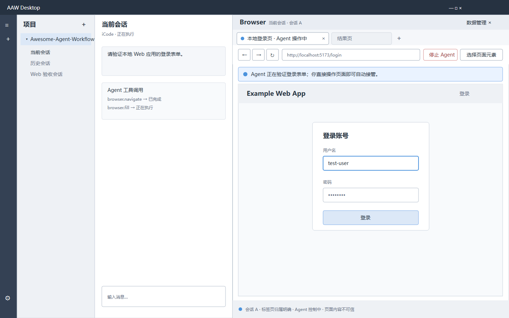
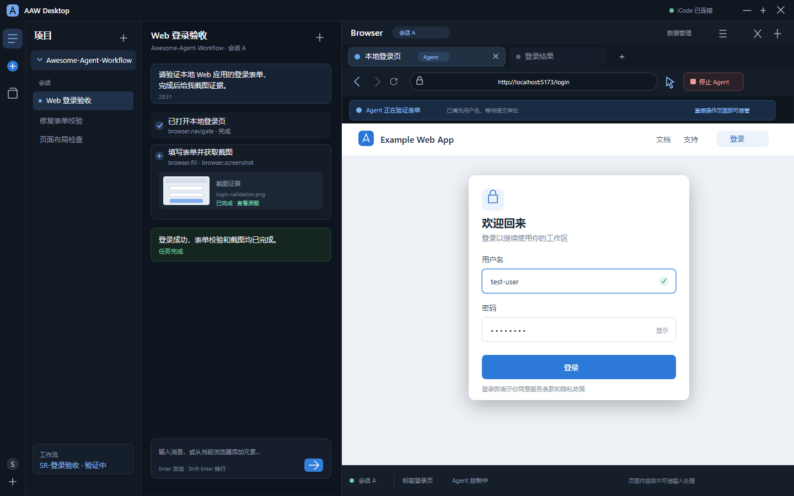
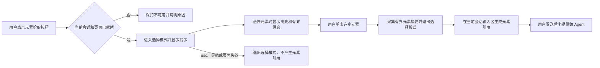
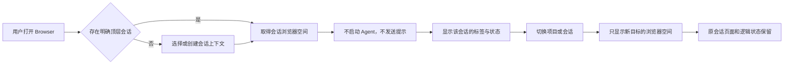
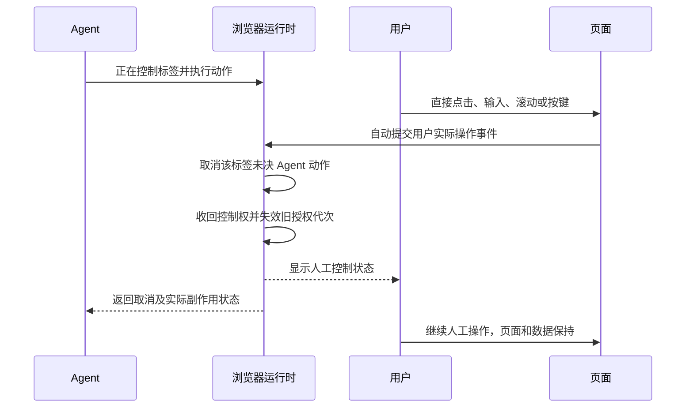
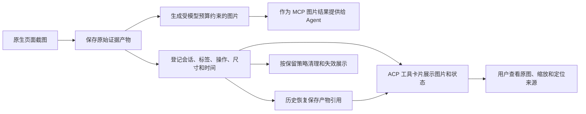
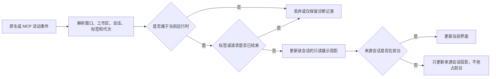

# 界面交互与证据展示功能设计

## 文档控制

| 项目 | 内容 |
|---|---|
| 文档编号 | AAW-DSK-BR-FD-004 |
| 版本 | 1.0 |
| 状态 | 已基线 |
| 最近更新 | 2026-11-11 |
| 上游文档 | `00功能设计总览.md`、01～03 专题 |
| 布局参考 | `desktop/docs/内嵌浏览器/内嵌浏览器低保真布局.svg`，方向已确认；`内嵌浏览器高保真布局.svg` 用于视觉评审 |
| 证据基础 | 穿刺 SP-11、SP-24、SP-33～SP-34、SP-36、SP-42 |

## 1. 目的与范围

本文定义 Browser 在项目右栏中的布局、人工操作、Agent 活动反馈、用户接管、权限交互、数据管理、截图展示和历史恢复。目标是让用户始终知道“当前在看哪个会话的哪个页面、谁正在控制、动作产生了什么结果”。

范围包括 P0 的桌面界面与证据闭环。P1 的元素拾取、当前页面上下文、自由视口和面板显隐只预留入口与状态兼容。元素拾取只响应用户显式选择，不自动监听或识别用户的每次点击。

## 2. 已确认的布局方向

### 2.1 高保真布局

高保真稿展示深色工作台、浅色网页内容区、标准导航图标、胶囊地址栏、Agent 状态和元素拾取入口。用户直接操作页面即可自动收回控制权，因此不提供接管按钮。

浏览器位于项目右栏，中间会话区保留 Agent 对话。右栏内从上到下依次为：

1. Browser 标题、会话归属、数据管理和关闭入口。
2. 标签栏，展示标题、加载、Agent 活动和关闭状态。
3. 前进、后退、刷新、地址栏、P1 元素拾取入口和停止 Agent；不提供用户接管按钮。
4. 当前状态或审批提示。
5. 真实网页内容。
6. 会话归属、控制状态和不可信页面提示。

右栏复用现有开合、宽度、窄窗口覆盖和项目切换规则。Browser 标签的展示内容还必须按会话过滤，不能沿用文件和 Git 的项目级共享语义。

### 2.2 元素拾取器入口（P1）

参考 ZCode 的工具栏方案，使用鼠标指针点击图标作为入口。只有当前会话和页面均已就绪时才可进入选择模式；选择模式不是自动点击识别，也不赋予 Agent 后续操作权限。

采集内容遵循 FR-UI-009：role、文本、selector、XPath、位置和有界样式摘要；不采集密码、Cookie 或输入值。发送失败保留引用，切换会话后不得把引用带入其他会话。

## 3. 打开、切换与关闭

无会话时不能创建全局或工作区共享浏览器。选择或创建会话只是建立归属，不启动 Agent。后台会话的活动不得切换用户当前项目、会话、右栏或标签。

关闭 Browser 内容标签只关闭界面面板，是否关闭原生页面必须有明确区分：默认收起保留逻辑页面；用户显式关闭具体浏览器标签才终止页面。关闭窗口或应用进入统一回收流程。

## 4. 人工浏览

| 区域 | 功能与状态 |
|---|---|
| 标签栏 | 新建、切换、关闭；显示标题、favicon、加载、错误和 Agent 活动 |
| 地址栏 | 显示实际已提交 URL；输入期间保留草稿，导航失败后可恢复 |
| 导航工具 | 前进、后退、刷新、停止；按钮可用性与真实页面状态一致 |
| 页面区域 | 加载、空白、网络错误、崩溃、恢复和不支持状态均有可见说明 |
| 页面菜单 | 数据管理、证据查看和必要恢复动作，不提供未实现的完整浏览器菜单 |

非法或受限 URL 不覆盖当前页面，错误显示在地址栏或状态区。浏览器页面缩放和 P1 自由 CSS 视口必须区分，不能把视觉缩放冒充响应式布局变化。

## 5. Agent 控制状态与开关

### 5.1 状态模型

| 状态 | 用户可见表现 | 允许行为 |
|---|---|---|
| 人工控制 | 无 Agent 活动标记 | 用户正常浏览；可按规则授权 Agent |
| Agent 控制中 | 标签活动标记、状态条和停止入口 | Agent 执行已授权动作；用户直接操作页面即可自动收回控制权 |
| 等待审批 | 显示具体动作、目标和数据范围 | 未批准前不执行动作 |
| 已暂停 | 显示暂停原因和恢复方式 | 不执行新 Agent 动作 |
| 控制失效 | 显示需重新授权或重新绑定 | 旧 Agent 请求不得继续 |
| 能力不可用 | 显示 Agent 或平台不支持原因 | 人工浏览不受影响 |

应用级 Agent 浏览器控制总开关默认关闭。关闭后所有会话取消未决浏览器请求且不能发现或调用工具，人工页面和数据保留。重新开启不自动恢复控制权、审批或旧端点。

## 6. 接管、移交与用户优先

用户无需点击接管按钮。自动感知只用于解决控制权冲突，不识别或向 Agent 上报具体元素。收回控制权不改变标签会话归属，不关闭页面，也不清除站点数据。Agent 不得自动重新接管。任务完成后，Agent 可移交页面；移交同样不改变归属。

“停止 Agent”默认作用于当前标签的未决动作；需要停止整个会话或全部浏览器活动时使用明确的更大范围入口，不混淆影响范围。

## 7. 审批与对话框交互

- 高风险审批使用 AAW 现有权限交互体系，显示动作、目标、数据范围、会话和标签。
- 浏览器 alert/confirm/prompt/beforeunload 由 AAW 对话框协调器接管，不出现 WebView2 默认接受。
- 审批超时、标签关闭、用户接管或代次失效后，弹窗不得继续控制新页面。
- 用户可查看当前待处理浏览器审批的来源；多项审批按实际目标分开，不合并成模糊的批量允许。
- 页面权限与高风险动作分别展示，允许站点摄像头不等于允许外发数据。

## 8. 数据管理界面

### 8.1 入口与层级

数据管理从 Browser 标题区进入，在右栏内提供可返回的管理视图，不启动外部浏览器。层级为“工作区 → 会话 → 站点”，并提供全部 AAW 浏览器数据入口。

### 8.2 列表与操作

| 内容 | 展示与操作 |
|---|---|
| 数据范围 | 工作区、会话、站点、当前或历史状态 |
| 数据类型 | 缓存、Cookie、LocalStorage、IndexedDB、权限和浏览器证据 |
| 占用与保存 | 实际值或明确估算，不用零代替未知 |
| 清理操作 | 清缓存、清站点、清会话、清工作区、清全部 AAW 浏览器数据 |
| 二次确认 | 显示将关闭的页面、影响的登录态、证据和范围 |
| 结果 | 每个子项成功、失败、未完成及可重试入口 |

清理进行时必须阻止范围内的新 Agent 动作。部分失败不得显示全量成功。历史会话与当前会话使用同一真实清理能力。

## 9. 截图与证据展示

### 9.1 证据处理流程

### 9.2 当前产品缺口处理

现有工具内容组件需要新增真实图片分支，不能把图片对象序列化为 JSON。图片展示必须同时支持：

- 实时工具结果中的缩略图、加载失败和状态标识。
- 查看原图、适应区域、缩放和来源信息。
- 历史恢复后重新读取产物，而不是把 Base64 堆入 localStorage。
- 产物被清理或不可读时显示明确不可用，不显示空白或伪造图片。
- 非视觉 Agent 仍可获得产物引用，但界面明确说明模型未读取图片。

普通诊断日志只记录产物 ID、大小、来源和结果。Browser 图片的协议载荷按安全专题进行脱敏，不把完整 Base64 作为常规日志正文。

## 10. 历史恢复与会话切换

| 内容 | 恢复方式 |
|---|---|
| 工具调用状态 | 使用 ACP 和会话快照恢复真实状态 |
| 截图 | 保存产物引用，恢复时重新读取 |
| 标签页运行态 | P0 应用重启不恢复；普通会话切换保留 |
| 地址栏未提交草稿 | 与普通会话草稿隔离，按当前产品偏好处理 |
| 用户接管与审批 | 历史只展示事实，不恢复为可继续执行的有效授权 |
| 浏览器错误 | 保留真实失败，不把历史失败改写为成功 |

历史中的旧审批和旧对话框不得再次自动弹出为可执行操作。恢复只读事实，新的动作必须获得新代次和必要授权。

## 11. 状态投影与迟到事件

界面不得根据本地按钮点击直接假定页面动作成功。加载、导航、截图、审批和清理均等待真实运行时结果。

## 12. 可访问性与键盘规则

- 地址栏、标签、工具栏、停止、接管、审批、数据管理和错误操作均可键盘完成。
- 焦点顺序与视觉顺序一致；模态审批有明确初始焦点和取消键。
- 用户从 AAW 输入框切换到网页后，Agent 输入仍只能作用于经验证的网页目标。
- 活动动画遵守减少动态效果设置；状态不能只靠颜色表达。
- 窄窗口下右栏覆盖会话时提供明确返回入口，不重挂载聊天输入框或丢失草稿。

## 13. 错误与空态

| 场景 | 展示与下一步 |
|---|---|
| 未选择会话 | 引导选择或创建会话，不启动 Agent |
| 无标签页 | 提供新建标签和地址输入 |
| 浏览器未就绪 | 显示初始化状态和有限重试 |
| 网络错误 | 保留目标草稿，提供重试和返回 |
| 页面崩溃 | 提供恢复最后已提交 URL 或关闭 |
| Agent 不支持 | 显示能力原因，保留人工浏览 |
| 截图不可用 | 显示产物状态和重新获取方式 |
| 清理失败 | 显示实际完成范围和失败子项 |
| 目标失效 | 提示重新选择或重新绑定，不自动操作新页面 |

## 14. 验收与追踪

| 验收场景 | 设计覆盖 |
|---|---|
| AC-001、AC-004 | 人工布局、导航、标签和弹窗展示 |
| AC-005、AC-006、AC-007 | 接管、会话过滤、切换保留和后台不抢占 |
| AC-011、AC-013 | 关闭语义、焦点竞争和真实页面状态 |
| AC-012 | 实时图片、原图、历史恢复和证据失效 |
| AC-017、AC-022 | 总开关、用户优先接管和未决动作取消 |
| AC-020、AC-021 | 数据归属展示、分层管理和清理结果 |
| AC-024 | 其他 Agent 的可用与不可用界面 |
| AC-101～AC-104 | P1 上下文、显隐、元素拾取和自检的界面兼容 |

界面验收必须包含真实桌面截图和键盘操作，不能只凭组件渲染或状态单元测试判定完成。
