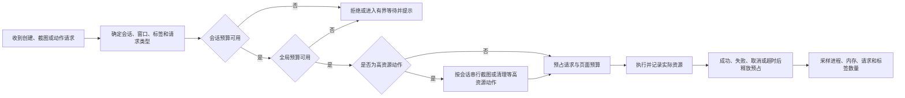

# 可靠性、资源与测试功能设计

## 文档控制

| 项目 | 内容 |
|---|---|
| 文档编号 | AAW-DSK-BR-FD-005 |
| 版本 | 1.4 |
| 状态 | 待复审（032 验收矩阵修订） |
| 最近更新 | 2026-11-19 |
| 上游文档 | `00功能设计总览.md`、01～04 专题 |
| 证据基础 | 穿刺 SP-21～SP-24、SP-32、SP-45～SP-47 |
| 实测基线 | 16 标签突发；两小时 5828 次循环，0 失败 |

## 修订记录

| 版本 | 日期 | 修订原因 | 修订内容 |
|---|---|---|---|
| 1.1 | 2026-11-12 | 验收模型由子 Agent 级身份隔离调整为顶层会话级共享与隔离 | 更新 AC-018 和 M3 验收口径，新增同会话主子并发、共享和轮次取消验证。 |
| 1.2 | 2026-11-13 | 验收不应要求 AAW 为每个 Agent 提供专用工具分发 | AC-018 和 M3 改为运行时实际允许的主子共享与被动开放。 |
| 1.3 | 2026-11-13 | 问题单 012：控制权限只能由显式开关改变 | AC-022 改为人工接管正反向、未决动作取消、无自动切换和跨会话隔离验收。 |
| 1.4 | 2026-11-19 | 问题单 032：默认策略与恢复闭环 | AC-017 覆盖默认注册、关闭撤销、现有会话确认重连和真实工具恢复。 |

## 1. 目的与范围

本文定义浏览器功能的资源预算、性能、取消与超时、错误、诊断、稳定性、测试分层和发布门禁。目标是把“可用”转化为可测量、可重复、可定位的工程质量，而不是仅凭单次演示判定完成。

范围覆盖 P0 的真实桌面验收和 P1 的后续测试接口。企业内网、干净 Windows、macOS 和 Linux 按需求基线单独处理，不用本机结果替代这些环境。

## 2. 实测依据与适用边界

### 2.1 已有实测

| 项目 | 结果 | 可支持的判断 |
|---|---|---|
| 16 个额外内嵌标签 | 创建和加载成功，相关进程由 20 增至 36，工作集约 1.18～2.25 GiB | 多页面资源增长显著，需要硬上限 |
| 标签关闭 | 进程数恢复到基线附近 | 原生关闭路径可以回收页面资源 |
| 两小时循环 | 7200.845 秒、5828 次、0 失败 | 当前穿刺宿主通过长时稳定性验证 |
| 创建与关闭配对 | 6059 次创建均有对应关闭 | 没有未配对的压力标签 |
| 最终资源 | 22 个相关进程、约 1.36 GiB，包含额外验收标签 | 不能把含额外标签的终值误报为纯循环泄漏 |

这些结果来自本机独立穿刺宿主，不代表完整 AAW 产品已经通过同等测试。产品实现后必须重新执行相同或更严格的场景。

### 2.2 测量边界

- 网页内容复杂度、图片、视频、脚本和站点内存会显著改变结果。
- 每会话独立数据分区意味着更多 WebView2 环境，不能按普通浏览器共享进程估算。
- 截图和 Base64 传输会短时增加内存，需要单独测量峰值。
- 测试机器的硬件、WebView2 版本和后台负载必须随结果记录。

## 3. P0 资源预算

以下数值以现有实测为起点，作为本次功能设计评审的建议冻结值；实现后须用产品实测确认或重新评审。

| 资源 | P0 预算 | 达到上限后的行为 |
|---|---|---|
| 单会话逻辑标签 | 8 个 | 拒绝新标签并提示关闭或清理，不覆盖旧页面 |
| 全应用活动标签 | 16 个 | 拒绝新标签；后台挂起只能作为辅助，不能虚报已释放 |
| 单窗口活动标签 | 16 个 | 与全局预算同时校验，取更严格结果 |
| 单会话未决浏览器请求 | 32 个 | 拒绝或排队受控新请求，提供取消入口 |
| 全应用未决浏览器请求 | 128 个 | 拒绝低优先级新请求，保持既有取消和回收 |
| 后台页面挂起候选时间 | 5 分钟无前台活动 | 在平台支持时冻结；不支持时明确只限制资源增长 |
| 单会话截图并发 | 1 个截图动作 | 后续截图排队或返回忙碌，避免内存峰值叠加 |
| 单张原始图片 | 10 MiB 上限 | 超限保存受控派生图并说明，不生成空文件 |
| 浏览器证据总量 | 500 MiB，默认保留 7 天 | 先清理过期及无引用证据，超额拒绝非必要新证据 |
| 诊断日志 | 沿用现有 100 MiB、7 天上限 | 轮转清理，不影响浏览器业务动作 |

## 4. 资源准入算法

预算预占必须覆盖创建中页面和未决请求，不能只统计就绪页面。失败、取消和超时同样释放预占。达到上限时不静默替换最旧标签，因为那会破坏用户页面所有权。

## 5. 时间与性能预算

| 操作 | 默认预算或指标 | 超时后行为 |
|---|---|---|
| 面板显示、标签激活等本地 UI 命令 | 就绪后 P95 不超过 300ms | 保留旧状态并报告原生不可用，不伪称切换成功 |
| 常规 DOM、定位和页面状态操作 | 默认不超过 3s | 取消或返回超时，建议重新观察 |
| 标签创建与控制通道绑定 | 默认 5s | 回收局部资源并返回不可用 |
| 普通导航 | 默认 15s，可区分网络慢和宿主失败 | 停止等待，展示最终已提交页面或实际状态 |
| 显式条件等待 | 默认不超过 30s，必须有界 | 返回未满足条件和恢复建议 |
| 截图 | 默认 5s | 不生成空文件，释放图片预算 |
| 取消确认 | 目标 2s 内返回取消状态 | 无法确认副作用时明确标记不确定 |
| 单站点或单会话清理 | 默认 30s | 标记未完成，支持核验和重试 |
| 工作区或全局清理 | 按子项预算分别计时，不设无界总等待 | 聚合部分成功和失败，不虚报全部完成 |

网页网络时间不计入纯本地 UI 指标，但必须计入导航和等待预算。所有指标都需要记录样本量、分位数和参考环境。

## 6. 可靠性语义

### 6.1 请求结果

| 状态 | 含义 | 界面与 Agent 行为 |
|---|---|---|
| 成功 | 页面证据满足动作后置条件 | 返回真实结果和证据 |
| 失败 | 动作未满足条件且可确认未成功 | 返回稳定错误与恢复建议 |
| 已取消且无副作用 | 动作未下发或已确认未产生副作用 | 明确显示无页面副作用 |
| 已取消但副作用不确定 | 动作已下发，最终状态未知 | 先重新观察，不盲目重放 |
| 目标失效 | 标签、代次、端点或绑定已变化 | 重新发现和绑定 |
| 部分完成 | 聚合任务只有部分子项成功 | 显示每个子项，不宣称全部完成 |
| 不支持 | 当前 Agent 或平台无真实能力 | 隐藏工具或明确不可用，不造假 |

### 6.2 异常恢复顺序

恢复只接纳新请求，不自动重放已取消或副作用不确定的旧动作。用户关闭目标后不再恢复。

## 7. 诊断与可观测性

### 7.1 操作关联

每个浏览器操作使用同一操作 ID 串联：界面入口、ACP 会话、MCP 调用、运行时请求、原生事件、证据产物和清理结果。日志至少包含会话、标签、代次、阶段、耗时和稳定错误码。

### 7.2 日志内容

- 普通结构化日志记录元数据、状态和资源，不记录页面正文、Cookie、密码、完整敏感 URL 或端点令牌。
- Browser 图片在诊断协议记录中使用脱敏后的类型、大小和产物引用，不长期堆叠 Base64。
- 原生页面创建、弹窗、权限、对话框、崩溃、取消和回收均记录开始与结果。
- 资源采样记录进程数、工作集、标签数、未决请求和证据占用。
- 诊断异常不得阻断浏览器业务；写入拥塞和丢失需要可见提示。

### 7.3 现场证据

每次真实验收保留测试环境、需求编号、验收编号、操作 ID、实际结果、截图或日志引用和失败说明。证据不自动进入 Git，不直接改变 `.sdd/` 状态。

## 8. 测试分层

| 层级 | 目标 | 可以使用的替身 | 不足以证明的事项 |
|---|---|---|---|
| 契约测试 | 工具、事件、错误、归属和代次契约一致 | 模拟运行时或协议对端 | 真实页面承载和原生行为 |
| 前端组件测试 | 状态、图片、审批、数据管理和键盘交互 | jsdom 与模拟投影 | 原生焦点、模态和进程回收 |
| 原生单元与集成测试 | 页面创建、关闭、数据目录、事件和清理 | 本地测试页面 | 完整 ACP 模型闭环 |
| MCP 协议测试 | HTTP 初始化、发现、调用、身份、取消和错误 | 脚本化 Agent 或真实引擎 | 模型自主完成真实任务 |
| 真实桌面 E2E | 用户、AAW、Agent、页面和证据完整闭环 | 本地 Web 应用与虚拟账号 | 企业内网或其他平台 |
| 稳定性与压力 | 资源、回收、长时和迟到事件 | 自动测试驱动 | 未测站点和无限资源场景 |

任何层级都不能替代其不覆盖的真实能力。P0 发布必须包含真实桌面 E2E 和长时测试。

## 9. P0 验收矩阵

| 验收 | 测试重点 | 必要证据 |
|---|---|---|
| AC-001 | 会话选择、人工浏览、导航和不启动 Agent | 真实界面与页面状态 |
| AC-002 | iCode 打开本地应用、DOM、输入、点击、验证和截图 | ACP 工具链与页面结果 |
| AC-003 | 多匹配、遮挡和动作可执行性 | 无自动首项点击，错误可恢复 |
| AC-004 | 弹窗进入同会话内部标签 | 原生事件与标签归属 |
| AC-005 | 用户显式授权接管及移交 | 控制权与归属记录 |
| AC-006 | 双会话发现、操作、切换和稳定标签 ID | A/B 隔离证据 |
| AC-007 | 后台会话操作不抢占前台 | 前台与后台投影记录 |
| AC-008 | 页面崩溃、恢复、稳定 ID 和旧代次失效 | 崩溃前后与旧请求结果 |
| AC-009 | 动作下发前后取消和超时 | 无副作用与副作用不确定分支 |
| AC-010 | 协议、提示注入、权限、脱敏和 L0～L3 审批 | 拒绝与绕过尝试证据 |
| AC-011 | 会话、项目、窗口和应用关闭 | 页面、连接和进程回收 |
| AC-012 | 实时与历史工具卡、截图和证据引用 | 图片实际可见及失效行为 |
| AC-013 | 宿主输入框与网页焦点竞争 | 文本只进入正确目标 |
| AC-014 | 两小时创建、导航、切换、截图和关闭 | 循环、失败、内存、进程和配对回收 |
| AC-015 | 只读查询不执行交互 | 工具轨迹无状态变更动作 |
| AC-016 | alert、confirm、prompt、beforeunload 和空态 | 各类型读取、决定、超时与取消 |
| AC-017 | 默认允许的总开关、既有请求和人工页面 | 默认注册、主动关闭、既有会话确认重连及重开行为 |
| AC-018 | 同会话主子 Agent 平权共享、并发和结束 | 运行时实际允许的主子共享、跨会话隔离及子结束不影响会话；不触发专用适配 |
| AC-019 | 有效能力和文档与真实后端一致 | 工具清单和实际行为对照 |
| AC-020 | 数据跨重启、同会话共享和跨会话隔离 | Cookie、存储、缓存和账号证据 |
| AC-021 | 分层数据查看和全范围清理 | 二次确认、范围外不变和失败反馈 |
| AC-022 | 显式人工接管、交还和输入不自动切换 | 会话级未决动作取消、代次与审批失效、控件矩阵及 A/B 隔离 |
| AC-023 | Agent 类型切换和运行时重连 | 旧端点、绑定和请求失效 |
| AC-024 | 其他 ACP Agent 的支持与不支持 | 真实调用或明确降级 |

## 10. 专项故障注入

1. 页面创建中、导航中、截图中和审批中分别取消。
2. 动作已下发但结果未返回时断开导频连接。
3. 页面崩溃、主窗口刷新、Agent 重连和运行时换代同时发生。
4. 用户输入、Agent 输入和宿主输入框竞争焦点。
5. 连续弹窗、重复对话框、权限已保存和审批超时。
6. 数据目录被占用、磁盘不足、清理部分失败和历史分区清理。
7. 标签与请求达到预算，后台页面超过挂起候选时间。
8. 超大 DOM、深层 shadow、同源与跨源 iframe、图片超限和产物已删除。
9. 正常关闭、异常退出和强制终止，检查孤儿进程。
10. 快速项目/会话切换和迟到事件，验证旧结果不回写。

## 11. P1 验收覆盖

| 验收 | 设计覆盖 |
|---|---|
| AC-101 | 当前页面上下文有界、脱敏且不构成接管授权 |
| AC-102 | 面板显隐不创建、恢复或关闭标签，不抢占前台 |
| AC-103 | 元素拾取、Esc、草稿隔离、发送失败保留和敏感输入保护 |
| AC-104 | 原生、控制通道和 Agent 工具自检及修复指引 |
| AC-105 | P0 不恢复标签，P1 仅恢复 URL 与显示偏好 |
| AC-106 | 自由 CSS 视口与预览缩放相互独立 |
| AC-107 | 文件上传逐动作授权，下载可追踪且不自动执行 |
| AC-108 | 控制台和网络错误最小读取与脱敏 |
| AC-109 | 受限脚本和坐标操作的高风险授权、证据和失效 |

## 12. 发布门禁

### M1：人工浏览闭环

- 真实多 WebView、导航、标签、弹窗、错误和基础回收通过。
- 会话归属、协议准入和资源预算已经生效，不允许先交付共享全局浏览器。

### M2：Agent 自动化闭环

- iCode 真实对话完成只读和本地 Web 验证。
- 有效文档、严格定位、动作核验、对话框、取消和截图模型结果通过。

### M3：隔离、安全与生命周期收口

- 双会话隔离、同会话主子 Agent 被动共享与实际调用、并发控制、站点数据、审批、用户接管、焦点、崩溃和回收全部通过；不要求为特定 Agent 增加适配。
- 数据管理和证据实时/历史展示无阻断问题。

### M4：发布验收

- AC-001～AC-024 全部有真实桌面证据。
- 两小时稳定性、性能、资源、诊断和现有桌面回归通过。
- 发布说明明确 Windows 范围、P1/P2 限制和已验证的 Agent 能力。
- 不使用“完整浏览器”“完整 Playwright 兼容”或未经证实的跨平台表述。

## 13. 暂缓与后续验证

| 环境 | 当前处理 |
|---|---|
| 企业内网、VPN、证书和内部系统 | 由用户按既有决策手工验证，不能用本机结果代替 |
| 干净 Windows | 暂缓，后续补充安装与运行验证 |
| macOS、Linux | P1 正式平台验收，不用 Windows 结果推断 |
| 真实外部高风险业务 | 不在真实网站执行；使用本地可控站点验证审批和副作用 |
| 真实第三方验证码或双因素认证 | 不作为绕过目标；仅测试提示和用户接管 |

## 14. 完成判定

功能设计本身只有满足以下条件才可进入开发：

1. 资源预算、时间预算和超限行为已经明确。
2. 所有 P0 验收场景都能映射到具体模块和证据。
3. 所有失败、取消、超时、清理和回收路径都有可见结果。
4. 测试分层没有以 Mock 替代真实浏览器能力的缺口。
5. 实测数据与产品实现后的复测要求已经区分。
6. 企业内网、干净环境和其他平台没有被误报为本机已覆盖。
