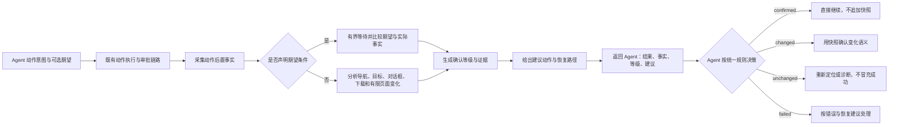
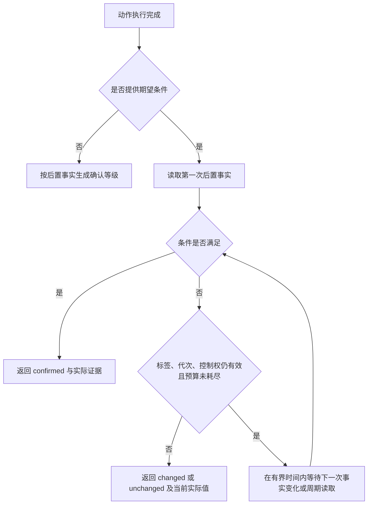
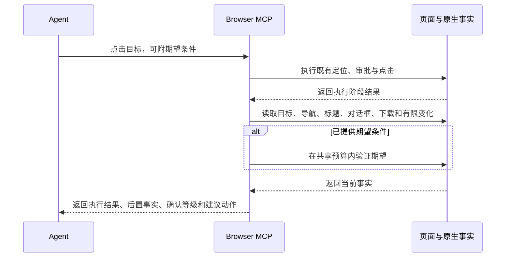

# 浏览器工具操作结果可确认性功能设计

## 文档控制

| 项目     | 内容                                                                                 |
| -------- | ------------------------------------------------------------------------------------ |
| 文档编号 | AAW-DSK-BR-FD-006                                                                    |
| 版本     | 0.2                                                                                  |
| 状态     | 已基线（用户已审核通过，详细设计按本文展开）                                         |
| 最近更新 | 2026-11-24                                                                           |
| 上游文档 | `00功能设计总览.md`、`02BrowserMCP与Agent集成设计.md`、`03安全权限与数据管理设计.md` |
| 需求基线 | `desktop/docs/需求单/001-浏览器工具操作结果可确认性需求.md` 0.3                      |
| 设计范围 | 内嵌浏览器 Agent 工具的后置事实、确认等级、可选期望条件、变化摘要和确认文档          |
| 首发平台 | Windows 10/11 x64                                                                    |

## 修订记录

| 版本 | 日期       | 修订原因             | 修订内容                                                           | 修订人         |
| ---- | ---------- | -------------------- | ------------------------------------------------------------------ | -------------- |
| 0.1  | 2026-11-24 | 首次设计             | 将结果可确认性需求转换为结果模型、确认算法、动作矩阵和验收追踪草案 | AAW 开发 Agent |
| 0.2  | 2026-11-24 | 用户审核通过并基线化 | 功能设计正式基线化，详细设计与测试设计按本文展开                   | AAW 开发 Agent |

本文不定义具体源码实现，不使用伪代码。字段表表达契约语义，流程与算法统一使用 Mermaid 和文字描述；具体模块拆分、函数签名和测试断言在详细设计阶段确定。

## 1. 目的与范围

本文把 SRS 的 A/B/C/D 分层转换为可实施的功能方案，使 Agent 能区分：

1. 工具调用已经执行；
2. 页面动作已经产生可验证效果；
3. 页面效果符合当前业务预期。

设计只扩充工具返回和确认辅助能力，不改变既有 MCP 身份、审批、代次、取消、快照分页和人工接管规则。

### 1.1 非目标

- 不替 Agent 推断订单支付、账号登录最终生效等完整业务结论。
- 不把 DOM 变化本身当成操作成功，不把页面加载完成当成业务正确。
- 不新增第二套快照、截图或页面观察工具。
- 不在本期提供上传网络完成度证明、完整性能追踪平台或视觉语义理解。

## 2. 设计原则

| 原则           | 设计含义                                                                      |
| -------------- | ----------------------------------------------------------------------------- |
| 证据先于判断   | 先返回页面事实，再给出基于事实的确认等级；禁止仅凭 `completed` 推断成功       |
| 默认不追加观察 | 只有事实足以证明预期效果时才允许 Agent 跳过快照，不能以节省调用为由牺牲正确性 |
| 意图显式表达   | 业务预期通过可选期望条件声明，工具返回是否满足与实际证据，不让 Agent 盲猜     |
| 不确定就降级   | 事实不足时返回 `changed` 或 `unchanged`，绝不升级为 `confirmed`               |
| 安全边界不变   | 后置读取与动作一样受会话、标签、代次、审批和敏感信息预算约束                  |
| 观察有界       | 所有提交等待、期望等待和补充读取都有超时、取消与代次检查                      |

## 3. 总体模型

### 3.1 模块职责

| 模块           | 职责                                                              | 不负责                                  |
| -------------- | ----------------------------------------------------------------- | --------------------------------------- |
| 后置事实采集   | 读取动作后的值、元素状态、URL、标题、加载、对话框、下载和标签事实 | 推断业务是否最终成功                    |
| 期望验证       | 接收可选期望，在有界等待内比较实际事实，返回是否满足和实际值      | 无限等待、默认接受任意脚本作为期望      |
| 变化摘要       | 汇总 URL、标题、导航、目标移除、对话框、下载和有限页面变化        | 通过全文档高频监听统计每次 DOM 变动     |
| 确认决策       | 根据事实与期望生成确认等级、建议动作和恢复提示                    | 替 Agent 决定后续完整业务流程           |
| 结果文档与投影 | 在工具描述和能力文档中说明确认规则，向界面保留原有结果与证据      | 新建另一套 ACP 工具卡或绕过既有审批展示 |

后置读取复用动作所属会话、标签和代次。若动作后标签或代次已变化，结果必须明确标记当前事实来源，不能把旧代次事实当成新代次成功。

## 4. 结果契约模型

以下为概念字段，表达契约语义而非具体编码结构。所有字段只增不改；未提供期望条件的旧调用保留原有结果含义。

| 字段组   | 内容                                                                            | 约束                                         |
| -------- | ------------------------------------------------------------------------------- | -------------------------------------------- |
| 执行结果 | 既有 `action`、`requestId`、`result`、`status` 和错误信息                       | 保持原语义，不把执行成功改写为业务成功       |
| 确认等级 | `confirmed`、`changed`、`unchanged`、`failed`                                   | 只表示证据充分程度，不表示最终业务结论       |
| 后置事实 | 与动作相关的值、目标状态、脱敏 URL、标题、加载、标签、对话框和下载信息          | 默认不含密码、Cookie、完整查询、完整页面正文 |
| 变化摘要 | URL/标题是否变化、导航是否发生、目标是否移除、对话框/下载是否出现、有限变化标记 | 只包含判读必需项，不返回大段 DOM             |
| 期望验证 | 是否提供期望、是否满足、实际值、等待是否完成或超时                              | 未提供期望时不出现该语义；超时不得伪装为满足 |
| 建议动作 | `continue`、`snapshot`、`screenshot`、`relocate`、`retry`                       | 仅基于客观证据给出，不强制 Agent 执行        |
| 恢复说明 | 当前不确定性、失效原因和下一步恢复方式                                          | 与既有稳定错误分类一致，不泄露内部凭据       |

### 4.1 确认等级与 Agent 行为

| 等级      | 判定依据                                                 | 建议动作与 Agent 预期行为                           |
| --------- | -------------------------------------------------------- | --------------------------------------------------- |
| confirmed | 后置事实直接证明动作效果，或期望条件已满足               | `continue`；不追加快照                              |
| changed   | 有变化但无法证明变化语义，或提交等待超时且当前状态未落定 | `snapshot`；确认具体变化后再继续                    |
| unchanged | 未导航、目标仍在、页面未变、校验拦截或填后值不符         | `relocate` 或 `retry`；不得当成成功，需要诊断才快照 |
| failed    | 工具执行、审批、权限、代次或结果核验明确失败             | `retry`；按错误码恢复，需要现场确认时才快照         |

建议动作不是新的权限控制，只是恢复引导。Agent 选择继续观察时仍使用既有快照、截图和定位工具。

## 5. 动作分类与后置事实

| 动作              | 默认后置事实                                                    | `confirmed` 条件                                   | 其他等级的主要情况                           |
| ----------------- | --------------------------------------------------------------- | -------------------------------------------------- | -------------------------------------------- |
| fill              | 填后值、焦点、禁用、只读                                        | 填后值与请求一致且目标可用                         | 值不一致、只读或禁用为 `unchanged`           |
| click             | 目标状态、目标是否移除、导航事实、URL、标题、加载、对话框和下载 | 导航提交、目标移除、对话框或下载等客观效果成立     | 有未明变化为 `changed`；无证据为 `unchanged` |
| press             | 按键、焦点元素、填后值或焦点变化                                | 按键已作用于目标焦点元素                           | 无焦点或焦点未变为 `unchanged`               |
| scroll            | 滚动前后位置                                                    | 实际滚动位置发生请求方向的变化                     | 已到边界或无变化为 `unchanged`               |
| navigate          | 提交后的 URL、标题、加载状态                                    | 目标 URL 已提交                                    | 超时未落定视为 `changed`，错误为 `failed`    |
| back/forward      | 提交后的 URL、标题、加载状态与导航位置                          | 导航位置变化并提交                                 | 无可达历史或超时为 `unchanged`               |
| reload/stop       | 提交或停止后的 URL、标题、加载状态                              | 重新加载已提交或加载已停止                         | 超时为 `changed`，标签错误为 `failed`        |
| open/select/close | 标签集合、活动标签、提交后 URL 和标题                           | 标签事实与请求一致                                 | 目标不存在为 `failed`，未达成为 `unchanged`  |
| submit            | 原生校验结果、导航事实、URL、标题、加载状态                     | 表单已提交且发生可验证提交效果                     | 校验拦截为 `unchanged`，未落定视为 `changed` |
| upload            | 绑定文件、接受类型和“仅绑定”的作用域说明                        | 仅证明文件已绑定，等级不代表上传完成               | 上传结果必须另行观察，不给出 `confirmed`     |
| execute_script    | 脚本表达式返回值及可选后置事实                                  | 由返回值直接说明的执行事实；页面效果按证据另行判定 | 页面副作用不明时为 `changed`，不默认成功     |
| wait              | 等待条件、实际状态、耗时与取消信息                              | 等待条件满足                                       | 超时或取消为 `failed`                        |

上传是特例：即使绑定动作成功，也只能返回绑定事实和观察建议，不能据此把等级用于“上传完成”。

## 6. 可选期望条件设计

### 6.1 条件类型与匹配语义

| 条件            | 比较对象             | 满足语义                                 |
| --------------- | -------------------- | ---------------------------------------- |
| urlIncludes     | 当前提交后的脱敏 URL | URL 包含指定片段；脱敏规则与快照一致     |
| textIncludes    | 当前页面有界可见文本 | 指定文本在预算内出现，不把隐藏敏感值纳入 |
| selectorPresent | 当前页面定位条件     | 定位条件存在且可见；多匹配不自动视为失败 |
| valueEquals     | 目标元素填后值       | 填后值与期望值完全一致                   |

本期不开放任意脚本期望、正则表达式期望和跨会话条件。多匹配时返回匹配数量和实际事实，不自动选择第一个；具体歧义处理沿用严格定位规则。

### 6.2 等待与取消

- 默认期望等待预算为 5 秒，调用方可指定更短或更长预算，但不得超过 30 秒。
- 导航提交等待与期望等待共享同一预算，不串联成两个完整等待周期。
- 等待期间标签、会话、代次、控制权或审批上下文失效时，立即结束等待并返回 `failed`。
- 用户停止、轮次取消、关闭页面或会话销毁时立即结束等待，按既有取消语义返回。
- 预算耗尽未满足时返回 `changed` 或 `unchanged`，附当前实际值和超时事实，不返回 `confirmed`。

### 6.3 期望验证流程

## 7. 变化摘要设计

变化摘要用于回答“页面是否发生了可识别变化”，而不是完整描述页面变化内容。

| 摘要项       | 事实来源                       | 成本与限制                                |
| ------------ | ------------------------------ | ----------------------------------------- |
| URL 变化     | 原生导航与提交事实             | 与当前标签代次一致，使用脱敏 URL          |
| 标题变化     | 动作前后标题对比               | 只保留有界标题文本                        |
| 导航发生     | 导航开始与提交事件             | 区分已开始和已提交，不以请求发出冒充成功  |
| 目标移除     | 动作后目标元素连接状态         | 仅针对当前动作目标，不扫描整页            |
| 对话框出现   | 原生对话框注册表               | 不包含对话框中的敏感正文                  |
| 下载出现     | 原生下载注册表                 | 只返回下载事件存在与有限元数据            |
| 有限页面变化 | 有界页面事实采样与目标周边状态 | 不使用全文档高频监听，不承诺完整 DOM 差异 |

若没有上述任何变化证据，摘要明确为“未观察到变化”，而不是“页面没有变化”。SPA 内部局部更新可能未被当前摘要覆盖，此时应引导 Agent 使用快照，而不是误报无效果。

## 8. 关键动作时序

### 8.1 点击

### 8.2 填表

填表后立即读取目标值与可用状态，不进行导航等待。填后值一致且目标可用时返回 `confirmed`；只读、禁用、输入被页面改写或值不一致时返回 `unchanged` 与实际值。若提供 `valueEquals`，使用该条件替代默认的一致性判定。

### 8.3 提交

先读取原生表单校验状态，再观察提交效果。校验拦截时返回 `unchanged` 和可用校验信息，不进入导航等待。已提交时按共享预算观察导航与期望，未在预算内落定时返回 `changed` 和当前事实。

### 8.4 上传

完成文件绑定后返回文件名、接受类型、绑定成功事实和“未证明上传完成”的作用域。需要上传结果时建议 `snapshot`，不把绑定成功升级为业务成功。

## 9. 异常与兼容语义

| 情况                   | 返回处理                                                  |
| ---------------------- | --------------------------------------------------------- |
| 目标不存在或多匹配     | 沿用既有未找到、歧义错误，标记 `failed`，不读取伪后置事实 |
| 动作后标签或代次失效   | 标记 `failed` 和失效原因，不使用新代次事实冒充旧动作成功  |
| 提交或期望等待超时     | 返回 `changed` 或 `unchanged`、当前实际值和超时事实       |
| 动作被取消             | 沿用既有取消语义，不以取消后的页面状态冒充动作成功        |
| 页面未提供所需读取能力 | 明确降级为 `changed` 并建议快照，不伪造事实               |
| 旧 Agent 忽略新增字段  | 原执行结果与错误码不变，既有行为不受影响                  |
| 上传结果未知           | 只说明绑定事实和观察建议，不新增 `failed` 冒充上传失败    |

## 10. 安全、隐私与性能

- 后置读取与动作使用同一会话、标签、代次和权限上下文；不得为了确认结果扩大读取范围。
- URL 与快照采用相同脱敏规则；不返回密码、Cookie、完整查询、完整页面正文和敏感表单值。
- 不引入全文档高频监听；变化摘要只使用原生事件、目标读取和有界采样。
- 所有等待共享预算且可取消；不得因确认结果把原动作变成无界等待。
- 返回内容以判读必需为限，不返回大段 DOM 或重复页面正文；图片仍沿用既有证据产物与模型能力分离规则。
- 确认等级仅辅助决策，不绕过 036 审批统一、040 审批等待化和人工接管规则。

## 11. 有效文档与 Agent 引导

`browser_capabilities` 和相关工具描述必须说明：

1. `completed` 只表示执行完成，不等于页面效果达成。
2. 各确认等级的证据含义和建议动作；`confirmed` 不查快照，`changed` 用快照，`unchanged` 不冒充成功，`failed` 按错误恢复。
3. 期望条件的类型、匹配语义、默认预算、最大预算、取消与超时行为。
4. 布局、样式、画布、复杂组件、反爬弹窗、最终业务语义、证据冲突和上传结果仍需快照或截图。
5. 变化摘要有覆盖边界，局部 SPA 更新可能需要快照补充。

## 12. 验收与追踪

| 需求             | 设计覆盖                                    | 验收场景                   |
| ---------------- | ------------------------------------------- | -------------------------- |
| FR-01            | 填表后置事实与 `valueEquals`                | AC-05、AC-06               |
| FR-02            | 点击后置事实与确认等级                      | AC-01、AC-03、AC-04、AC-09 |
| FR-03            | 导航提交事实与有界等待                      | AC-01、AC-06               |
| FR-04            | 原生校验与提交后置事实                      | AC-02、AC-06               |
| FR-05            | 上传绑定作用域与观察建议                    | AC-07                      |
| FR-06            | 期望条件、实际值、超时与取消                | AC-06、AC-09               |
| FR-07            | 变化摘要及其覆盖边界                        | AC-03、AC-04、AC-09        |
| FR-08、FR-09     | 确认等级、建议动作和有效文档                | AC-09 及文档评审           |
| 性能、隐私、兼容 | 有界采样、脱敏、只增不改、旧 Agent 行为不变 | AC-08、隐私与兼容评审      |

详细测试设计必须先证明：当前点击、填表、提交和上传的返回不能直接支持对应成功判断，再验证新增事实与确认规则。真实验收使用原始 MCP 响应，不以界面展示替代工具证据。

## 13. 评审检查表

1. 是否每个 `confirmed` 都能指出直接页面证据，而不是只依据 `completed`。
2. 是否所有不确定情况都降级为 `changed` 或 `unchanged`，没有过度承诺。
3. 是否明确上传只证明绑定，未证明上传完成。
4. 是否所有等待共享预算、可取消并受代次和会话生命周期约束。
5. 是否没有全文档高频监听、敏感信息泄漏和大段 DOM 返回。
6. 是否未提供期望条件的旧调用保持原语义，旧 Agent 可忽略新增字段。
7. 是否每项 SRS 功能需求都有动作矩阵、确认规则和验收场景对应。

## 14. 后续设计输入

功能设计评审通过后，详细设计应明确后置事实采集与期望验证的模块边界、各动作的事实清单、共享等待与取消机制、结果字段的正式契约，以及单元、装配、黑盒和真实页面用例。实施顺序按 A 类后置事实 → C 类期望条件 → B 类变化摘要 → D 类文档分层执行。
