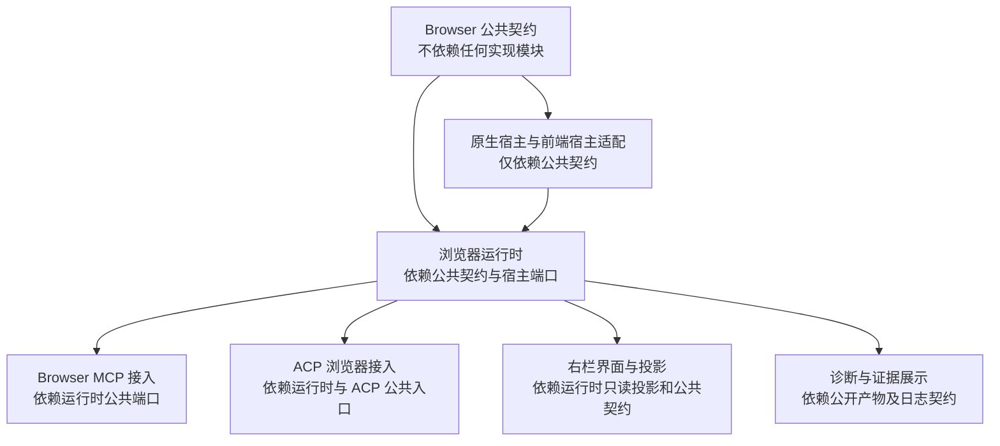
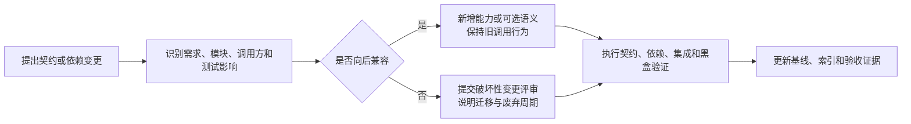

# 内嵌浏览器详细设计总览与契约索引

## 文档控制

| 项目 | 内容 |
|---|---|
| 文档编号 | AAW-DSK-BR-DD-000 |
| 版本 | 1.0 |
| 状态 | 已基线 |
| 最近更新 | 2026-11-11 |
| 需求基线 | `../内嵌浏览器需求分析.md` 1.2 |
| 功能设计基线 | `../功能设计/00功能设计总览.md` 及 01～05 |
| 配套测试设计 | `00总览与契约测试设计.md` |
| 技术证据 | 穿刺报告 SP-01～SP-47 |

## 1. 目的

本文是详细设计的技术入口，规定代码组织、公开契约、依赖方向、模块所有权、扩展点、变更控制和验证追踪。其目标是让后续模块在保持既有 AAW 架构的同时，可独立实施和测试，不形成跨层巨型模块或循环依赖。

## 2. 范围与设计输入

范围覆盖 P0 的浏览器界面、原生页面、Browser MCP、ACP 接入、会话隔离、权限、数据、证据和可靠性。P1 只预留已基线的扩展点，不提前实现完整调试器或通用自动化框架。

设计输入包括需求基线、六份功能设计、穿刺报告、现有 Cordis 插件架构、ACP 适配体系、右栏规则和诊断体系。若实现事实与基线冲突，必须提交偏差并重新评审。

## 3. 代码组织原则

1. 公开契约与实现分离，调用方只依赖公共入口。
2. 原生页面权威位于 Tauri 浏览器运行时；TypeScript 侧只保存展示投影和用户偏好。
3. 浏览器 MCP、ACP、界面和诊断分别通过公共端口访问运行时，不直接访问彼此内部对象。
4. 不新增 Node 浏览器运行时，不引入 ZCode Runtime。
5. 业务工作流、会话草稿和项目状态不进入浏览器原生模块。
6. 模块命名表达业务职责，避免以“管理器”“工具集”承载无边界逻辑。

## 4. 逻辑模块与代码归属

| 逻辑模块 | 建议代码归属 | 类型 | 职责 |
|---|---|---|---|
| Browser 公共契约 | `contracts/browser` | 新增 | 语言无关的对象、命令、结果、错误和事件契约 |
| 原生浏览器宿主 | `src-tauri` 下独立 browser 模块 | 新增 | WebView、CDP、MCP 传输、数据目录和原生事件 |
| 浏览器运行时 | 原生 browser 模块内的运行时子域 | 新增 | 标签、代次、控制、请求、预算和生命周期的唯一权威 |
| 前端宿主适配 | `plugins/host/browser` | 新增 | Tauri 命令和事件的公开 TypeScript 端口 |
| 前端浏览器服务 | `plugins/browser` 或现有 project 的 browser 子域 | 新增 | 只读投影、用户意图和现有工作台适配 |
| ACP 浏览器接入 | `plugins/acpRuntime` 的公开适配边界 | 变更 | 会话创建/恢复时注册 HTTP MCP，不处理页面实现 |
| Agent 能力适配 | `plugins/agents` 的公开能力面 | 变更 | 提供真实 MCP、图片和历史能力，不包含浏览器逻辑 |
| 右栏浏览器界面 | 现有 project/workbench 的 Browser 子域 | 新增 | 标签、地址栏、审批、数据管理和证据展示 |
| 诊断适配 | 现有 diagnostics 的公开日志入口 | 变更 | 操作关联、脱敏和资源采样，不读取浏览器内部对象 |

代码路径是组织约束而非要求一次性建立全部目录。实现时应优先使用最接近现有归属的模块，不为追求目录整齐而复制现有能力。

## 5. 禁止循环依赖

### 5.1 依赖规则

- 公共契约不得导入运行时、MCP、ACP、UI 或具体 Agent。
- 运行时不得导入 MCP、ACP、界面或诊断实现；外部事件通过公共端口进入。
- MCP 不得导入 ACP 或界面实现，也不得把 ACP 会话对象透传到原生层。
- ACP 接入不得导入 MCP 内部实现，只使用会话注册公共入口。
- 界面不得导入 MCP、原生 CDP 或具体 Agent 方言。
- 诊断不得通过浏览器模块反向读取实时页面；只接收公开事件和产物。
- 公共事件订阅只携带契约数据，不携带可变内部对象。

### 5.2 跨语言契约

TypeScript 与 Rust 的字段命名、必填性、枚举和错误语义必须来自同一契约文档。任一语言需要新增字段时，先更新契约和兼容性说明，再修改实现，禁止通过任意扩展字段形成私有旁路。

## 6. 公开契约注册表

| 契约族 | 提供方 | 使用方 | 稳定语义 |
|---|---|---|---|
| BrowserSpace | 浏览器运行时 | MCP、ACP、界面 | 会话空间、浏览器身份和当前代次 |
| Tab | 浏览器运行时 | 全部调用方 | 稳定标签身份、归属、状态和控制权 |
| BrowserCommand | 浏览器运行时 | MCP、界面 | 导航、观察、动作、等待、截图和清理意图 |
| BrowserResult | 浏览器运行时 | 全部调用方 | 真实结果、证据、取消和副作用状态 |
| BrowserEvent | 浏览器运行时 | 界面、诊断 | 加载、活动、权限、崩溃、代次和回收事件 |
| BrowserCapability | 运行时与 Agent 能力适配 | MCP、界面 | 实际可用能力和不可用原因 |
| BrowserApproval | 安全权限模块 | 界面、运行时 | 动作、范围、决定、超时和失效 |
| BrowserEvidence | 证据存储 | 界面、诊断 | 产物引用、来源、保留和不可用状态 |
| BrowserDataTask | 数据管理模块 | 界面、诊断 | 清理范围、子项结果和聚合状态 |

## 7. 数据与状态所有权

| 数据或状态 | 唯一权威 | 允许的副本 |
|---|---|---|
| 页面、标签、代次、请求和控制权 | 浏览器运行时 | 界面只读投影 |
| ACP 会话和轮次 | 现有 ACP 运行时 | 浏览器关联 ID |
| 项目、当前会话和右栏偏好 | 现有工作台 | Browser 展示引用 |
| 登录态和站点数据 | 会话 WebView2 分区 | 分类统计，不复制正文 |
| 证据文件 | 证据存储 | 会话与历史只读引用 |
| 工作流状态 | AAW CLI 与 `.sdd/` | 不允许浏览器写入 |
| 日志 | 现有诊断服务 | 浏览器只提交公开事件 |

## 8. 可扩展性与维护性

### 8.1 已保留的扩展点

- 新 ACP Agent 通过能力适配接入，不修改浏览器核心。
- macOS/Linux 通过原生宿主端口扩展，P0 不为未验证平台构建复杂抽象层。
- P1 文件、脚本、坐标、自由视口和元素拾取复用现有命令、权限和证据契约。
- 新页面观察后端必须实现相同快照与降级语义，不改变 UI。
- 新证据类型通过产物类型和保留规则扩展，不建立独立证据系统。

### 8.2 维护性约束

- 每个公开命令只有一个权限、取消和错误处理入口。
- 状态转换和副作用执行分离，便于单元测试与真实集成验证。
- 异步回调只提交事件，不直接修改界面。
- 同一字段不在多个模块采用不同含义；失败与未知不得混用。
- 模块变更必须能由依赖图和追踪表确定影响范围。

## 9. 过度设计审查

| 不采用的方案 | 原因 |
|---|---|
| 通用事件溯源或通用规则引擎 | 当前需求可由明确状态机和权限矩阵覆盖，通用化会增加不可验证性 |
| 完整 Playwright API 兼容层 | 超出 P0，扩大安全面和维护成本 |
| 为所有平台提前实现统一原生细节 | 当前只有 Windows 已验证，保留端口即可 |
| 独立 Node 浏览器服务或复制 ZCode Runtime | 增加部署和进程治理成本，当前 Tauri 已具备所需能力 |
| 为每种 Agent 新建浏览器实现 | 应由标准 MCP 和能力协商覆盖 |
| 把每次页面变化都持久化到工作流 | 会混淆实时状态与工作流权威 |
| 为所有未来能力预留通用脚本入口 | 形成权限绕过，P1 只开放明确受限能力 |

## 10. 契约变更流程

禁止通过新增隐藏字段、可选身份或默认全局回退来规避评审。所有破坏性变更必须更新需求、功能设计、详设和配套测试。

## 11. 验证与追踪规则

- 每份详设必须有一份同名前缀测试设计，并链接回本详设。
- 每个测试用例必须标明维度、场景、前提、步骤、预期结果、断言规范和 DeskPilot 覆盖。
- 非手工断言值必须由被调公开入口返回值、原始响应正文或持久化数据直接产出；禁止映射、排序、序列化、过滤或聚合后再断言。
- 黑盒测试只从系统外部访问公开界面、MCP、ACP、文件或数据库，不引用业务实现。
- 集成测试只使用公共入口，不 Mock 类或实体，断言落在真实落库、落盘或持久化数据层。
- 真实协作但断言位于运行时、页面或响应的用例必须命名为装配（Assembly），不得添加 integration 标记；有替身的也必须明确断层面。
- 单元测试覆盖纯函数、方法和状态转换，可以使用 Mock。
- 手工测试必须有可观察的验证点，并注明 DeskPilot 是否可执行。
- 每份测试设计必须附交叉面清单，逐一列出触及对象的其他读写者和超时点，并标注覆盖用例或豁免理由。
- 需求、功能、详设和测试发生不一致时，以实现前评审为准，不在代码中静默修正。

## 12. 详设文档索引

| 编号 | 详设 | 配套测试设计 |
|---|---|---|
| DD-01 | `01核心对象状态与代次设计.md` | `01核心对象状态与代次测试设计.md` |
| DD-02 | `02原生宿主与页面生命周期详设.md` | `02原生宿主与页面生命周期测试设计.md` |
| DD-03 | `03BrowserMCP协议与工具契约详设.md` | `03BrowserMCP协议与工具契约测试设计.md` |
| DD-04 | `04ACP接入可信身份与取消详设.md` | `04ACP接入可信身份与取消测试设计.md` |
| DD-05 | `05页面观察定位与动作执行详设.md` | `05页面观察定位与动作执行测试设计.md` |
| DD-06 | `06安全权限与对话框详设.md` | `06安全权限与对话框测试设计.md` |
| DD-07 | `07数据分区持久化与分层清理详设.md` | `07数据分区持久化与分层清理测试设计.md` |
| DD-08 | `08界面状态投影与证据展示详设.md` | `08界面状态投影与证据展示测试设计.md` |
| DD-09 | `09资源诊断与验证体系详设.md` | `09资源诊断与验证体系测试设计.md` |

## 13. 评审检查表

1. 是否存在绕过公共端口的调用关系。
2. 是否存在循环依赖或跨语言字段漂移。
3. 是否有多个模块同时修改标签、代次或控制权。
4. 是否把未来可能性变成当前不必要的通用框架。
5. 是否每份详设都有配套测试和完整断言规范，非手工断言值均有直接出处。
6. 是否所有 P0 验收均能从契约追踪到真实系统证据。
7. 是否每份测试设计都有交叉面清单，且所有交叉组合均有用例或经评审的豁免。
8. 是否所有集成用例都直达真实数据层，其余真实协作用例均正确命名为装配且未添加 integration 标记。

## 14. UML 用例全链路追踪

本节直接以总体图和 Agent 子图中的用例为输入。测试列指向具体用例，而不是仅引用 AC 编号范围。P2 页面录制明确保留为未设计，不因出现在总体图中就视为已承诺。

| UML 用例 | 所属图 | 详设位置 | 具体测试用例 | AC | 状态 |
|---|---|---|---|---|---|
| UC_MANUAL 浏览网页与管理标签页 | 总体 | DD-02、DD-08 | TD-02-M01、M07、M08；TD-08-M01、M09 | AC-001 | 已覆盖 |
| UC_COLLABORATE 授权接管与接收移交 | 总体/Agent | DD-01、DD-04、DD-08 | TD-01-M01；TD-04-M02；TD-01-I02 | AC-005、AC-022 | 已覆盖 |
| UC_VIEW 查看 Agent 活动与证据 | 总体/Agent | DD-03、DD-08、DD-09 | TD-03-M01；TD-08-M05、M06 | AC-012 | 已覆盖 |
| UC_APPROVAL 审批权限与高风险操作 | 总体/Agent | DD-06、DD-08 | TD-06-M01、M02；TD-06-I01～I03 | AC-010 | 已覆盖 |
| UC_STOP 停止 Agent 浏览器操作 | 总体/Agent | DD-04、DD-08 | TD-04-M02、M03；TD-04-B04、B05 | AC-009、AC-017、AC-022 | 已覆盖 |
| UC_CLOSE 关闭并回收资源 | 总体 | DD-02、DD-07、DD-09 | TD-02-M06；TD-02-I06；TD-09-B03 | AC-011 | 已覆盖 |
| UC_TOGGLE 启用或禁用 Agent 控制 | 总体 | DD-04、DD-08 | TD-04-M03；TD-04-B04 | AC-017 | 已覆盖 |
| UC_DATA 查看与清除站点数据 | 总体 | DD-07、DD-08 | TD-07-M01～M08；TD-07-I01～I08 | AC-020、AC-021 | 已覆盖 |
| UC_READ 只读网页信息 | 总体/Agent | DD-03、DD-05 | TD-03-B05；TD-05-B01；TD-05-M02 | AC-015 | 已覆盖 |
| UC_AUTO 自动验证 Web 页面 | 总体/Agent | DD-03～DD-05、DD-09 | TD-03-M01；TD-05-M01；TD-09-M05 | AC-002 | 已覆盖 |
| UC_OPERATE 导航、观察与操作网页 | 总体/Agent | DD-02、DD-03、DD-05 | TD-02-M07；TD-05-I02；TD-05-B02～B08 | AC-002、AC-003 | 已覆盖 |
| UC_EVIDENCE / UC_SCREENSHOT 截图与证据 | 总体/Agent | DD-03、DD-08 | TD-03-B08；TD-08-M05、M06；TD-08-I03 | AC-012 | 已覆盖 |
| UC_SUBAGENT 子 Agent 使用浏览器 | 总体/Agent | DD-01、DD-04 | TD-04-M05；TD-04-I02；TD-04-U03 | AC-018 | 已覆盖 |
| UC_SCOPE 校验会话与标签归属 | 总体/Agent | DD-00、DD-01、DD-04 | TD-00-B02；TD-01-B01、B05；TD-04-B02 | AC-006 | 已覆盖 |
| UC_POPUP 内部弹窗标签 | 总体 | DD-02 | TD-02-M03；TD-02-B02；TD-02-I04 | AC-004 | 已覆盖 |
| UC_DIALOG JavaScript 对话框 | 总体/Agent | DD-02、DD-06 | TD-06-M04；TD-06-B07；TD-06-I05 | AC-016 | 已覆盖 |
| UC_CRASH 页面崩溃恢复 | 总体/Agent | DD-01、DD-02 | TD-02-M05；TD-02-I03；TD-01-I01 | AC-008 | 已覆盖 |
| UC_CONTEXT 当前页面作为会话上下文 | 总体/Agent | DD-08 第 17.1 节 | TD-08-M10；TD-08-B08；TD-08-I08；TD-08-U10 | AC-101 | 已覆盖 |
| UC_VISIBILITY 显示或隐藏浏览器面板 | 总体/Agent | DD-08 第 17.2 节 | TD-08-M11；TD-08-B09；TD-08-I09；TD-08-U11 | AC-102 | 已覆盖 |
| UC_PICKER 选择网页元素加入会话 | 总体 | DD-08 第 7 节 | TD-08-M04；TD-08-B04；TD-08-U06 | AC-103 | 已覆盖 |
| UC_HEALTH 检查浏览器运行环境 | 总体 | DD-09 第 14 节 | TD-09-M07；TD-09-B07；TD-09-I07；TD-09-U08 | AC-104 | 已覆盖 |
| UC_ENHANCE 响应式、文件与高权限增强 | 总体 | DD-02 第 16 节、DD-03 第 15 节、DD-07 第 15 节 | TD-02-M09、B08、I10、U11；TD-03-M05、B09～B12、I06～I09；TD-07-M08、B09、I08、U08 | AC-105～AC-109 | 已覆盖 |
| UC_ENHANCE 页面录制（P2） | 总体 | DD-03 第 16 节，仅边界说明 | 尚未设计，后续单独评审 | 未分配 | 明确未设计 |
| UC_USE 使用内嵌浏览器 | Agent | DD-01～DD-05、DD-08 | TD-00-M01；TD-01-I02；TD-03-I01 | AC-002、AC-015 | 已覆盖 |
| UC_DISCOVER 发现真实可用浏览器 | Agent | DD-03、DD-04 | TD-03-B01；TD-00-B01 | AC-019 | 已覆盖 |
| UC_DOCS 读取有效能力与操作文档 | Agent | DD-03 | TD-03-M04；TD-03-I02；TD-03-U03 | AC-019 | 已覆盖 |
| UC_TARGET 创建、复用或选择标签页 | Agent | DD-01、DD-02、DD-03 | TD-01-I05；TD-02-I01；TD-03-I01 | AC-002、AC-004 | 已覆盖 |
| UC_CLAIM 枚举并显式接管用户标签页 | Agent | DD-01、DD-04、DD-08 | TD-01-M01；TD-01-I02；TD-04-B02 | AC-005 | 已覆盖 |
| UC_NAV 导航并读取页面状态 | Agent | DD-02、DD-03、DD-08 | TD-02-M07；TD-02-B06；TD-02-I08 | AC-001、AC-002 | 已覆盖 |
| UC_DOM 获取语义 DOM/ARIA 快照 | Agent | DD-05 | TD-05-B01、B06；TD-05-I01；TD-05-U06、U07 | AC-015 | 已覆盖 |
| UC_LOCATE 严格定位页面元素 | Agent | DD-05 | TD-05-M02；TD-05-B02；TD-05-U01～U05 | AC-003 | 已覆盖 |
| UC_ACT 点击、输入、按键、滚动等交互 | Agent | DD-05、DD-06 | TD-05-M01；TD-05-I02；TD-05-B04、B05 | AC-002、AC-003 | 已覆盖 |
| UC_WAIT 等待 URL、加载或元素状态 | Agent | DD-03、DD-05、DD-09 | TD-03-B06；TD-09-I03；TD-05-U09 | AC-009 | 已覆盖 |
| UC_RISK 执行高风险操作 | Agent | DD-06、DD-03 | TD-06-B03～B05；TD-06-I01～I03 | AC-010 | 已覆盖 |
| UC_CANCEL 取消或超时并判定副作用 | Agent | DD-04、DD-09 | TD-04-B04、B05；TD-04-U05、U06；TD-09-I03 | AC-009 | 已覆盖 |
| UC_HANDOFF 移交标签页给用户 | Agent | DD-01、DD-04、DD-08 | TD-01-I02；TD-04-M02；TD-04-I04 | AC-005、AC-022 | 已覆盖 |
