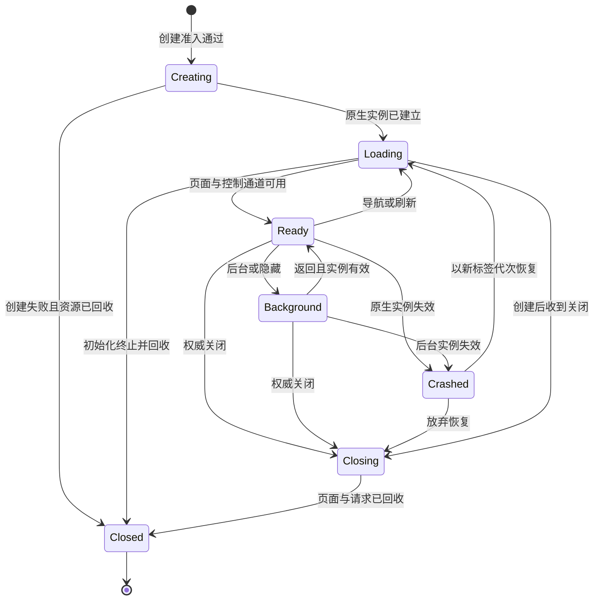
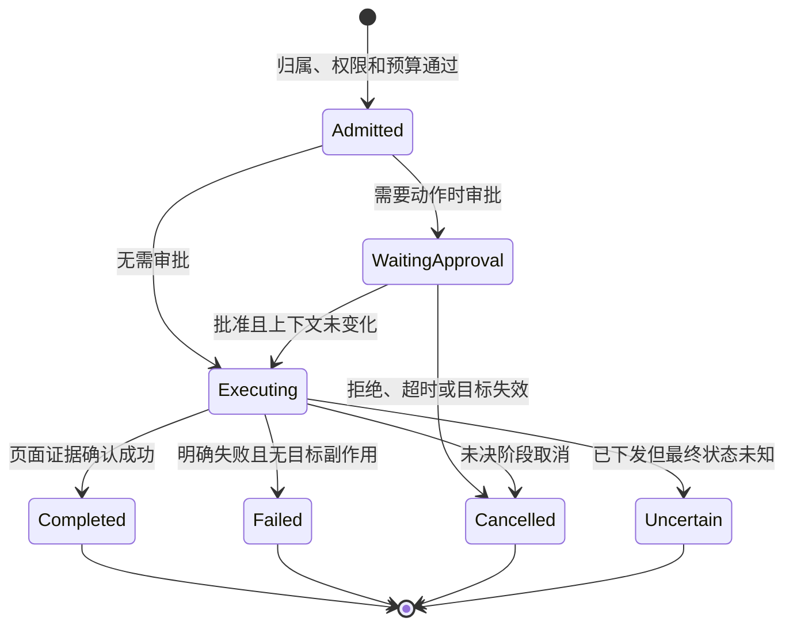
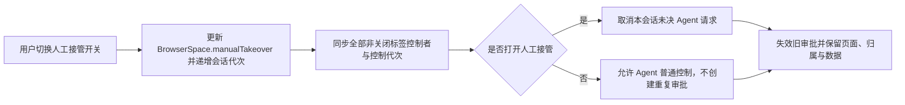

# 核心对象、状态与代次详细设计

## 文档控制

| 项目 | 内容 |
|---|---|
| 文档编号 | AAW-DSK-BR-DD-001 |
| 版本 | 1.2 |
| 状态 | 待复审 |
| 最近更新 | 2026-11-13 |
| 上游文档 | `00详细设计总览与契约索引.md`、功能设计 00～02 |
| 配套测试设计 | `01核心对象状态与代次测试设计.md` |

## 修订记录

| 版本 | 日期 | 修订原因 | 修订内容 |
|---|---|---|---|
| 1.1 | 2026-11-12 | 核心对象只承载顶层会话归属，不再承担父子 Agent 身份继承 | 明确主、子 Agent 不产生独立浏览器空间或数据分区，其他状态与代次不变量不变。 |
| 1.2 | 2026-11-13 | 问题单 012：用户输入不再具有授权语义 | BrowserSpace 持有会话级人工接管状态，显式切换驱动租约、代次和请求迁移，普通控制申请不再改变状态。 |

## 1. 目的与范围

本文定义 BrowserSpace、Tab、ControlLease、BrowserRequest、Generation 和 EvidenceReference 的字段语义、状态不变量、并发规则、公共接口和失效算法。它是所有浏览器模块的共同语义基础。

范围不包含具体 WebView 调用、MCP 报文格式和界面组件，这些分别由 DD-02～DD-08 使用本文契约。

## 2. 代码组织与依赖

- 核心对象及状态转换位于浏览器运行时的领域子域，不依赖 MCP、ACP、UI 或诊断实现。
- 公共契约只暴露不可变数据快照和命令语义，不暴露可变内部对象。
- 原生宿主通过公共命令端口接收已校验意图，通过事件端口提交事实。
- 状态转换函数与原生副作用执行分离；状态函数不直接访问 WebView、文件或网络。
- 所有修改由运行时写侧串行提交，读取方获得一致快照。

依赖方向遵循 DD-00。任何新增字段不得从界面反向注入运行时内部状态。

## 3. 核心对象与字段语义

### 3.1 BrowserSpace

| 字段 | 必填 | 语义与约束 |
|---|---|---|
| windowId | 是 | 现有原生窗口身份，不由模型提供 |
| workspaceKey | 是 | 优先 workspaceIdentity，缺失时使用规范化 workspacePath |
| sessionId | 是 | 顶层 ACP 会话身份；同会话主、子 Agent 平权共享，不产生子 Agent 空间 |
| browserId | 是 | 会话逻辑浏览器空间的稳定身份 |
| browserGeneration | 是 | 当前浏览器代次，单调递增 |
| agentControlEnabled | 是 | 来自应用级总开关，不由页面修改 |
| lifecycle | 是 | 初始化、可用、回收中、已失效之一 |
| createdAt | 是 | 创建时间，仅用于展示与诊断，不参与授权 |

### 3.2 Tab

| 字段 | 必填 | 语义与约束 |
|---|---|---|
| tabId | 是 | 在所属浏览器空间内稳定且唯一 |
| browserId | 是 | 所属空间，不允许独立漂移 |
| tabGeneration | 是 | 原生页面实例代次，单调递增 |
| origin | 是 | 用户创建或 Agent 创建，不随控制权变化 |
| ownerSessionId | 是 | 原始顶层会话，释放控制权不改变 |
| controlLease | 否 | 当前控制租约；无租约表示用户人工控制 |
| lifecycle | 是 | 创建、加载、就绪、后台、崩溃、关闭、已关闭等状态 |
| committedUrl | 否 | 最后已提交且通过准入的 URL |
| displayUrl | 否 | 地址栏展示值，可与 committedUrl 分离 |
| active | 是 | 是否为其空间当前激活标签，不代表前台窗口焦点 |
| snapshotGeneration | 否 | 最近快照对应的标签代次 |

### 3.3 ControlLease

| 字段 | 必填 | 语义与约束 |
|---|---|---|
| controller | 是 | 用户或 Agent |
| sessionId | 是 | 被授权的顶层会话 |
| source | 是 | 用户授权、Agent 创建或系统回收等来源 |
| leaseGeneration | 是 | 控制权代次，随接管和收回递增 |
| createdAt | 是 | 用于展示，不作为超时唯一依据 |
| pendingApprovalId | 否 | 当前关联审批，不代表长期权限 |

### 3.4 BrowserRequest

| 字段 | 必填 | 语义与约束 |
|---|---|---|
| requestId | 是 | 全局唯一请求身份 |
| operationId | 是 | 关联诊断和界面操作 |
| sessionId | 是 | 来自可信身份代理 |
| turnId | 否 | 当前 Agent 轮次；人工请求可为空 |
| tabId | 否 | 目标标签；发现类请求可为空 |
| browserGeneration | 是 | 请求允许使用的浏览器代次 |
| tabGeneration | 否 | 请求允许使用的标签代次 |
| leaseGeneration | 否 | 请求允许使用的控制代次 |
| phase | 是 | 准入、等待审批、执行、完成、失败、取消等阶段 |
| sideEffect | 是 | 无副作用、已确认、可能已发生或不确定 |
| createdAt | 是 | 请求创建时间 |
| deadline | 是 | 有界截止时间 |

### 3.5 EvidenceReference

| 字段 | 必填 | 语义与约束 |
|---|---|---|
| artifactId | 是 | 证据存储分配的产物身份 |
| sessionId | 是 | 来源会话 |
| tabId | 是 | 来源标签 |
| requestId | 是 | 来源操作 |
| artifactType | 是 | 截图或后续明确支持的证据类型 |
| availability | 是 | 可用、清理中、已删除或不可读 |
| contentMetadata | 是 | 类型、大小和尺寸等元数据，不包含敏感正文 |

## 4. 核心不变量

1. 一个标签在任何时刻最多有一个主动 Agent 控制租约。
2. 用户始终可直接操作页面；实际操作发生时，Agent 租约立即失效。
3. 标签关闭后不得因创建、恢复或迟到事件回到非终态。
4. 浏览器代次和标签代次只能递增，不回退、不复用。
5. 旧代次请求和事件不得修改新代次状态。
6. 标签归属与控制权不同，移交、释放和崩溃不改变 ownerSessionId。
7. 同会话主、子 Agent 平权使用顶层会话空间，不产生独立站点数据分区。
8. 请求状态与页面副作用分开记录，取消不等于无副作用。
9. 展示状态不得覆盖运行时的真实状态。
10. 所有等待和请求均有预算，不存在永久挂起状态。

## 5. 标签状态转换

状态转换只允许由运行时提交。Ready 不表示最近一次动作成功，只表示页面可接受进一步操作。

## 6. 代次管理算法

浏览器代次、标签代次和控制代次分别管理，不能用一个计数器混代。代次只比较是否匹配当前值，不使用时间戳代替。运行时崩溃后的持久化计数器可重新分配新逻辑空间，不要求恢复旧计数，但旧端点必须失效。

## 7. 请求状态机

Completed、Failed、Cancelled 和 Uncertain 均为终态。取消请求若晚于完成，不得把 Completed 改成 Cancelled；应记录取消过晚及实际结果。

## 8. 会话级显式人工接管

`BrowserSpace` 是开关唯一事实来源，标签租约是其投影；无标签时状态仍保留，新标签继承。网页输入和空闲不调用状态迁移。两个方向都使旧审批失效，开启时取消未决 Agent 请求，已完成请求和迟到终态不改写。全局 Agent 总开关及高风险审批保持独立。

## 9. 公共接口语义

| 公共入口 | 前置条件 | 结果与错误 | 幂等与取消 |
|---|---|---|---|
| 创建或取得浏览器空间 | 明确窗口、工作区和顶层会话 | 返回当前空间或初始化错误 | 同会话重复取得返回同一有效空间 |
| 创建标签 | 空间有效、预算充足 | 返回稳定标签或预算/创建错误 | 请求 ID 去重；取消后不得出现迟到页面 |
| 选择标签 | 标签属于当前空间 | 返回标签快照 | 只改变当前空间激活态，不抢窗口焦点 |
| 申请控制 | 当前会话人工接管关闭 | 只读返回当前标签租约，不创建普通审批 | 不改变开关、代次或审批；人工接管开启时拒绝 |
| 切换人工接管 | 当前会话存在且由用户显式操作 | 返回含 manualTakeover 的会话快照 | 相同状态幂等；真实切换递增代次，开启时取消未决 Agent 请求 |
| 关闭标签 | 标签未关闭 | 返回真实关闭结果 | 重复关闭不报错且不产生新事件 |
| 提交请求 | 身份、代次和权限有效 | 返回请求状态与结果 | 请求 ID 去重，超时和取消有界 |
| 提交原生事件 | 原生标签和代次可识别 | 更新快照或丢弃迟到事件 | 重复事件不改变语义 |

## 10. 并发、重入与一致读取

- 所有写操作先进入运行时写侧，再执行原生副作用；原生回调重新进入时只提交事实。
- 同一标签的创建、关闭、恢复和控制变更串行；不同会话可在预算内并行。
- 读取方使用同一时刻的快照，不组合来自不同代次的字段。
- 原生执行期间允许读取最后一致状态，但状态必须标明进行中。
- 任何回调都不得持有运行时写锁等待界面或网络响应。

## 11. 错误与恢复

| 错误 | 触发条件 | 恢复方式 |
|---|---|---|
| 归属缺失 | 无法确定窗口、工作区或会话 | 拒绝，不进入全局回退 |
| 目标不存在 | 标签已关闭或从未存在 | 重新枚举 |
| 代次失效 | 任一请求代次与当前不匹配 | 重新发现、观察和绑定 |
| 控制权失效 | 当前开关不允许调用来源 | 由用户显式切换开关；Agent 不得自行恢复或改用普通审批绕过 |
| 请求已取消 | 当前轮次或请求已取消 | 按副作用状态处理 |
| 请求重复 | 相同请求 ID 已存在 | 返回原请求状态，不重复执行 |
| 状态冲突 | 当前状态不允许该转换 | 保留当前状态并报告冲突 |

## 12. 可扩展性、维护性与过度设计

- 新增对象字段必须说明所有权、必填性、兼容性和测试影响。
- 新生命周期状态必须证明存在不可替代的用户或运行时语义，避免为内部实现细节增加状态。
- 不引入通用事件溯源、通用租约框架或分布式锁；当前是单桌面进程内的明确状态机。
- 不预建多窗口同步分布式协议；每个窗口由本机运行时协调。
- 新增 P1 能力复用请求、代次、取消和证据对象，不建立平行状态模型。

## 13. 验证与追踪

| 验收 | 覆盖内容 |
|---|---|
| AC-005、AC-006 | 归属、控制租约、接管、移交和跨会话隔离 |
| AC-008、AC-009 | 标签代次、崩溃、取消和副作用 |
| AC-011、AC-013 | 关闭终态、焦点与输入目标 |
| AC-017、AC-018 | 开关、同会话主子平权共享和跨会话隔离 |
| AC-022、AC-023 | 显式人工接管、Agent 切换和代次失效 |
| AC-014 | 长时下不变量与资源回收 |
