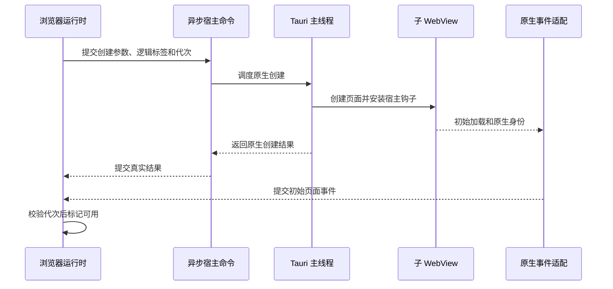
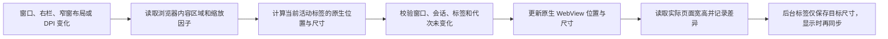
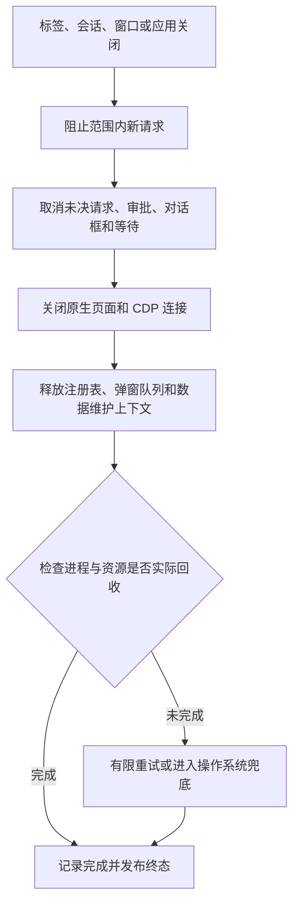

# 原生宿主与页面生命周期详细设计

## 文档控制

| 项目 | 内容 |
|---|---|
| 文档编号 | AAW-DSK-BR-DD-002 |
| 版本 | 1.0 |
| 状态 | 已基线 |
| 最近更新 | 2026-11-11 |
| 上游文档 | `00详细设计总览与契约索引.md`、`01核心对象状态与代次设计.md` |
| 配套测试设计 | `02原生宿主与页面生命周期测试设计.md` |
| 平台范围 | Windows 10/11 x64，Tauri 2 + WebView2 |

## 1. 目的与范围

本文把原生页面承载、动态 CDP、尺寸与显隐、弹窗、对话框、崩溃和回收转换为可实施的模块及接口设计。重点解决 Tauri 主线程重入、原生事件与逻辑代次关联、页面自适应和进程治理。

## 2. 代码组织与依赖

原生 browser 模块按职责拆分：

| 子模块 | 职责 | 允许依赖 |
|---|---|---|
| 契约适配 | 原生命令、事件和公共数据转换 | Browser 公共契约 |
| WebView 工厂 | 子 WebView 构建、数据目录、初始化脚本和原生处理钩子 | 契约、Tauri 公共 API |
| 页面注册与绑定 | 原生标签、逻辑标签、CDP 目标和连接对应 | 契约、运行时公共端口 |
| CDP 通道 | 动态端口发现、页面级连接、命令、事件和失效 | 契约、CDP 客户端适配 |
| 原生事件适配 | 导航、弹窗、权限、对话框、加载和崩溃事件 | 契约、运行时事件端口 |
| 生命周期回收 | 关闭、取消、窗口退出、进程关联和异常清理 | 契约、运行时公共入口 |
| 数据目录与清理 | 会话目录、维护上下文和原生数据清理 | 契约、数据管理公共端口 |

禁止子模块相互调用私有实现。所有跨模块协作通过运行时或公共事件端口。界面和 ACP 不直接访问这些子模块。

## 3. 原生创建与主线程纪律

创建命令必须为异步命令，避免同步命令与原生创建互相等待主线程。原生事件回调只提取事实并登记，不执行需要等待界面的业务操作。创建中收到关闭时，先完成必要的局部回收，再提交最终关闭状态。

## 4. 数据目录与动态 CDP 发现

1. 每个顶层会话使用独立 WebView2 数据目录；主 AAW 界面目录独立。
2. 每个目录通过动态端口启动 CDP，不使用固定公共端口。
3. 端口文件缺失、内容不完整或暂时不可达时，在有限预算内重试读取。
4. 发现目标后，以原生标签绑定关系和实际 URL 双重核对，不仅按列表位置选择。
5. 绑定后执行最小能力校验；失败不改变运行时可用状态。
6. 页面重建、进程异常或代次变化后关闭旧连接，再从同目录重新发现。
7. 不扫描本机端口，不连接非 AAW 分区，不读取外部 Chrome 数据。

## 5. 页面区域、自适应与缩放

### 5.1 尺寸同步

前台页面使用内容区域实际尺寸，后台页面不强行创建原生表面。尺寸计算集中在一个布局适配模块，界面组件不分别计算坐标。用户 Ctrl+滚轮缩放网页时只改变页面缩放，不改变 AAW 布局区域；两者在事件和日志中分别记录。

### 5.2 缩放规则

- 浏览器子 WebView 单独启用页面缩放，主 AAW 界面保持现有禁用设置。
- 支持 Ctrl+滚轮、Ctrl+加减键和 Ctrl+0 重置。
- 缩放比例变化不得被当成窗口尺寸变化或 P1 自由视口变化。
- 截图、元素位置和坐标操作必须记录并使用当前页面缩放与设备缩放信息。

## 6. 显隐与后台页面

- 激活标签显示在当前会话内容区域，其他标签隐藏但逻辑状态保留。
- 后台会话不得改变当前窗口的前台标签或输入焦点。
- 隐藏不等于销毁，销毁不等于关闭；三者在数据和日志中分别表达。
- 后台达到预算候选时间后，只有平台真实支持时才挂起；无法挂起时不得宣称已释放资源。
- 恢复显示前重新校验归属、代次、目标区域和页面有效性。

## 7. 弹窗路由详设

原生回调提取 URL、窗口特征、来源原生标签和当前代次，并阻止默认窗口。回调只登记弹窗请求。运行时队列在回调返回后处理，校验来源仍存在、协议允许且预算充足，再通过异步命令创建同会话页面。

弹窗标签继承来源会话、数据分区和最后控制归属，但不继承高风险审批。来源关闭或目标失效时丢弃请求。弹窗创建失败返回明确错误，不保留空目标。

## 8. 原生对话框适配

| 步骤 | 原生责任 | 运行时责任 |
|---|---|---|
| 捕获 | 取得类型、文本、来源、原生页面和延迟响应对象 | 建立对话框身份并关联标签代次 |
| 暂停提交 | 保持原生延迟响应，不执行默认接受 | 阻止同一目标冲突动作 |
| 展示 | 向 AAW 提供不可变事实 | 按权限策略选择 Agent 处理或用户审批 |
| 决定 | 只接受当前对话框身份对应的决定 | 校验标签、代次、审批和超时 |
| 提交 | 应用接受、取消或 prompt 输入 | 记录结果并恢复页面 |
| 清理 | 释放延迟响应和模态资源 | 移除对话框身份和未决请求 |

Tauri 对话框插件的 alert/confirm 覆盖不能代替该实现。子 WebView 不得把插件 Promise 当作同步页面结果。beforeunload 可由 CDP 事件进入同一协调器，但只有持有对话框身份的连接可以处理。

## 9. 崩溃与原生实例替换

1. 记录崩溃事实、原生原因和当前标签。
2. 递增标签代次，失效旧 CDP 连接、请求、快照和控制租约。
3. 保留逻辑标签和最后已提交 URL，显示可恢复状态。
4. 收到恢复命令后创建替代实例并重新绑定。
5. 替代实例可用后才提交 Ready；失败保持错误并可重试。
6. 已关闭标签不恢复，旧实例事件不进入新代次。

## 10. 关闭与进程回收算法

应用强杀不能只依赖前端事件。原生进程关联与既有 Job Object 机制应覆盖可管理的子进程；WebView2 系统进程的归属和退出以真实验证为准。

## 11. 原生接口契约

| 接口族 | 必要输入语义 | 输出与事件 | 失败要求 |
|---|---|---|---|
| 页面创建 | 会话、逻辑标签、代次、URL、目标区域和数据分区 | 原生身份、加载事件和真实错误 | 无半成品注册或孤儿页面 |
| 页面布局 | 原生标签、位置、尺寸、显示状态和缩放 | 实际页面尺寸或布局错误 | 不作用于其他标签 |
| 页面导航 | 当前代次、目标和导航意图 | 已提交 URL、加载和错误 | 拒绝不改变当前页面 |
| CDP 绑定 | 数据分区、原生标签、目标代次 | 页面级连接或不可用 | 不扫描外部端口 |
| 原生事件 | 原生身份、事件类型和事实数据 | 运行时事件或丢弃迟到事件 | 不直接修改 UI |
| 数据清理 | 分区、站点、清理类型和任务身份 | 实际清理结果和核验状态 | 不以请求发出冒充完成 |
| 回收 | 关闭范围和原因 | 资源终态或未完成原因 | 幂等且不回收范围外资源 |

## 12. 错误、诊断与性能

- 原生错误映射为不可用、不支持、导航拒绝、失效、超时、取消、执行失败和回收未完成。
- 日志记录操作 ID、原生标签、逻辑标签、代次、阶段和耗时，不记录页面正文和完整令牌。
- 页面创建、绑定、布局和关闭分别计时；网络等待与原生时间分开。
- 所有回调和队列有数量上限，迟到事件不得无限积累。

## 13. 可扩展性、维护性与过度设计

- 新平台只需实现同一原生宿主端口，并把不支持能力明确返回；P0 不建立抽象的平台模拟层。
- 新原生事件先经过契约适配，禁止把平台字段直接泄漏到 UI。
- 不建立通用插件脚本系统或任意原生命令执行入口。
- 不复制 Tauri 的通用窗口能力；Browser 只使用所需子页面能力。
- 对话框、弹窗和导航虽共享归属校验，但保留各自原生语义，避免强行合成单一事件。

## 14. 验证与追踪

| 验收 | 覆盖 |
|---|---|
| AC-001、AC-004 | 页面创建、布局、导航和弹窗 |
| AC-006、AC-008 | 会话归属、崩溃和代次 |
| AC-009、AC-011 | 取消、关闭和回收 |
| AC-013、AC-022 | 焦点、页面输入和用户接管 |
| AC-016 | 原生对话框和 beforeunload |
| AC-020、AC-021 | 数据目录和原生清理 |
| AC-014 | 长时生命周期和资源回收 |

## 15. 导航历史、加载停止与异常状态补充设计

### 15.1 导航历史模型

每个标签维护与原生页面一致的导航历史摘要，包含已提交条目、当前条目位置、可后退、可前进和当前加载状态。历史摘要只保存当前标签需要的 URL 引用，展示和日志仍执行脱敏。

| 操作 | 前置校验 | 完成判定 |
|---|---|---|
| 后退 | 当前标签有可用历史且未失效 | 原生页面实际回到目标条目，并更新可前进状态 |
| 前进 | 当前标签存在可前进条目 | 原生页面实际进入目标条目，并更新可后退状态 |
| 刷新 | 当前标签存在已提交页面 | 重新加载当前已提交 URL，不用地址草稿替代 |
| 停止加载 | 当前标签正在加载 | 停止原生加载并保留当前已显示内容或明确空白状态 |

不得仅因用户点击按钮就改变地址栏或历史状态。页面导航失败、目标关闭或代次变化时，按钮状态以真实页面事实为准。

### 15.2 加载与异常状态模型

| 状态 | 触发事实 | 可验证行为 |
|---|---|---|
| 空白 | 受控空白页或尚无已提交内容 | 显示明确空白态和地址输入，不伪装为已加载站点 |
| 网络错误 | DNS、连接、TLS 或 HTTP 导航失败 | 保留地址草稿和当前页面；显示重试、返回或关闭 |
| 不支持 | 当前页面、Agent 或平台能力不支持 | 显示不支持原因和可用替代，不进入假成功 |
| 崩溃 | 原生实例异常退出 | 按第 9 节恢复最后已提交 URL |
| 加载超时 | 超过导航预算且未提交目标 | 返回超时，保留当前页面与恢复入口 |

### 15.3 错误恢复接口

加载异常结果必须包含稳定错误类别、当前已提交 URL、脱敏目标、是否可重试、是否可返回和当前代次。重试使用新请求，不恢复旧请求的审批或控制租约。网络恢复后由用户或有权 Agent 显式重试，不自动无限刷新。

## 16. P1 自由 CSS 视口与预览缩放补充设计（AC-106）

### 16.1 视口对象

| 字段 | 必填 | 语义 |
|---|---|---|
| tabId | 是 | 目标标签 |
| tabGeneration | 是 | 当前页面代次 |
| mode | 是 | 跟随容器或自由 CSS 视口 |
| cssWidth | 自由模式必填 | 真实页面 CSS 宽度，不含预览缩放 |
| cssHeight | 自由模式必填 | 真实页面 CSS 高度 |
| previewScale | 是 | 仅用于界面显示的预览比例 |
| containerBounds | 是 | 当前右栏内容区域 |

自由视口模式与页面缩放、容器尺寸分离。Agent 读取的是 cssWidth/cssHeight 对应的真实 CSS 视口，不是预览缩放后的视觉尺寸。

### 16.2 视口与预览算法

切回跟随容器后恢复当前内容区域尺寸，不保留旧自由视口为隐式状态。页面缩放和预览缩放分别记录。目标失效或尺寸超预算时拒绝，不改变当前页面。

## 17. 多窗口与同工作区交叉语义

- 原生页面同时受窗口、工作区、会话和标签身份约束；共享工作区不代表共享浏览器空间。
- 窗口创建、切换和回收只能读写本窗口所属会话；跨窗口标签发现与操作默认拒绝。
- 关闭一个窗口只回收该窗口拥有的页面、连接和预占，不得回收同工作区其他窗口的页面或请求。
- 窗口关闭后的迟到创建、Ready 和动作事件按原窗口及代次失效，不得写入其他窗口。
- 工作区项目与设置由既有工作台持有，浏览器窗口回收不得删除工作区记录。
