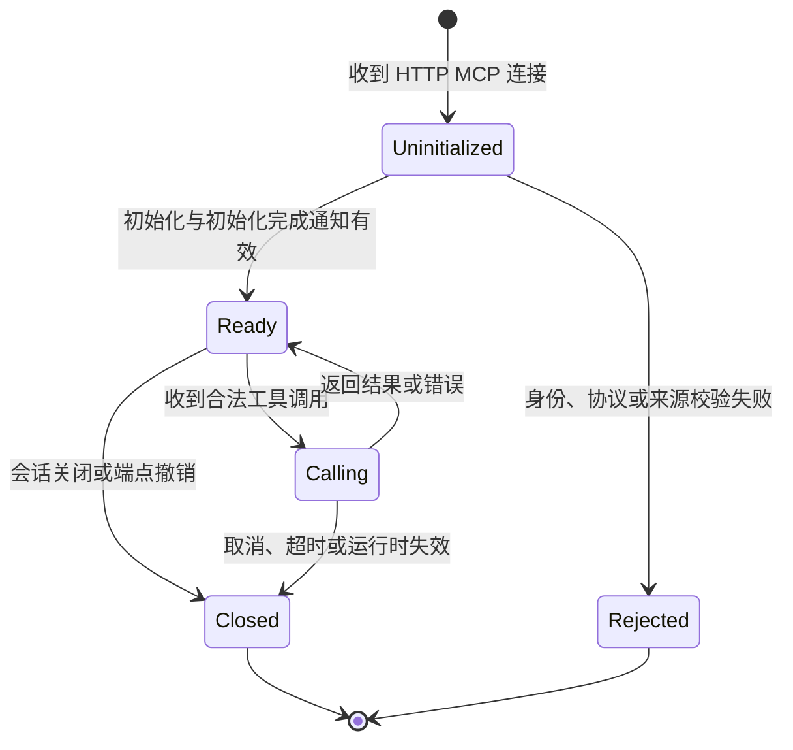

# Browser MCP 协议与工具契约详细设计

## 文档控制

| 项目         | 内容                                    |
| ------------ | --------------------------------------- |
| 文档编号     | AAW-DSK-BR-DD-003                       |
| 版本         | 1.0                                     |
| 状态         | 已基线                                  |
| 最近更新     | 2026-11-11                              |
| 上游文档     | `00详细设计总览与契约索引.md`、01、02   |
| 配套测试设计 | `03BrowserMCP协议与工具契约测试设计.md` |
| 协议范围     | 本机 HTTP MCP、P0 浏览器工具与结果      |

## 1. 目的与范围

本文定义 Browser MCP 的协议生命周期、工具清单、通用字段、结果内容、错误、有效文档、版本兼容和资源限制。目标是让外部 Agent 只通过标准 MCP 即可完成真实浏览器任务，而不需要了解 AAW 内部实现。

ACP 会话注册、端点身份和取消细节由 DD-04 定义；页面动作算法由 DD-05 定义。

## 2. 代码组织与依赖

| 子模块         | 职责                                        | 依赖边界            |
| -------------- | ------------------------------------------- | ------------------- |
| HTTP MCP 传输  | 回环监听、HTTP 语义、请求大小和连接生命周期 | 仅依赖 MCP 协议适配 |
| MCP 协议适配   | 初始化、工具发现、调用和协议错误            | 依赖公共工具契约    |
| 工具参数校验   | 必填、类型、范围、未知字段和目标语义        | 依赖公共契约        |
| 工具路由       | 将工具调用映射到浏览器运行时公共命令        | 依赖运行时公共端口  |
| 结果与错误映射 | 生成结构化内容、图片、错误和恢复建议        | 依赖公共契约        |
| 有效文档生成   | 按真实能力生成工具和操作说明                | 依赖能力公共入口    |

MCP 模块不得导入 ACP、UI、Agent 方言或原生 CDP 实现。运行时不得反向导入 MCP；取消和会话事件通过公共控制端口进入。

## 3. 协议生命周期

未完成初始化时不得调用工具。初始化响应只声明真实支持的 MCP 能力。端点撤销后，旧连接的调用和事件均不得进入新会话。

## 4. HTTP 与访问约束

- 只监听本机回环地址，使用动态端口。
- 请求必须属于已分配的会话端点；未知端点直接拒绝。
- 校验 Host、HTTP 方法、内容类型和请求大小，避免非预期来源和超大载荷。
- 不使用 DNS 名称或公网地址暴露服务。
- 完整端点令牌不得写入普通日志、工具参数或页面内容。
- 协议响应不包含内部堆栈、文件系统秘密或其他会话信息。

## 5. 工具调用通用契约

### 5.1 调用上下文

| 字段             | 必填         | 语义                                 |
| ---------------- | ------------ | ------------------------------------ |
| requestId        | 是           | 协议请求身份，用于响应关联与取消     |
| toolName         | 是           | 当前有效工具清单中的名称             |
| arguments        | 是           | 符合工具输入约束的参数对象           |
| endpointIdentity | 由传输确定   | 不是模型参数；由实际请求端点决定     |
| requestContext   | 由服务端生成 | 会话、浏览器、标签、轮次和代次上下文 |

模型不得通过参数覆盖 endpointIdentity 或服务端生成的 requestContext。未知参数默认拒绝，防止调用方利用未定义字段形成旁路。

### 5.2 通用结果字段

| 字段              | 必填 | 语义                                             |
| ----------------- | ---- | ------------------------------------------------ |
| status            | 是   | 成功、失败、取消、不支持或副作用不确定等公开状态 |
| browserId         | 按需 | 实际操作浏览器空间                               |
| tabId             | 按需 | 实际目标标签                                     |
| browserGeneration | 按需 | 结果对应浏览器代次                               |
| tabGeneration     | 按需 | 结果对应标签代次                                 |
| facts             | 按需 | 页面事实或动作结果，不包含敏感默认字段           |
| evidence          | 否   | 证据产物引用和展示元数据                         |
| error             | 否   | 稳定错误分类、可读说明和恢复建议                 |
| sideEffect        | 是   | 无、已确认、未发生或不确定等真实状态             |
| durationMs        | 是   | 实际执行耗时，不包含无关排队时间需另有标识       |

结果必须来自运行时真实状态。工具调用已接收、已审批或已下发均不能单独构成成功。

## 6. P0 工具契约清单

| 工具域       | 操作语义                                 | 必要输入                       | 主要结果与错误                           |
| ------------ | ---------------------------------------- | ------------------------------ | ---------------------------------------- |
| 浏览器发现   | 列出当前会话可用浏览器                   | 无业务目标参数                 | 浏览器身份、代次和状态；空集合为合法空态 |
| 能力与文档   | 读取当前实例能力和操作文档               | 浏览器身份与代次               | 实际工具、限制和恢复规则；失效需重新发现 |
| 标签枚举     | 列出当前会话可控或可接管标签             | 浏览器身份、列表类型           | 标签事实；不返回其他会话                 |
| 标签创建     | 创建受控页面                             | 浏览器身份、允许 URL、显示意图 | 稳定标签和加载状态；预算不足或导航拒绝   |
| 标签选择     | 选择后续默认目标                         | 标签身份与代次                 | 当前选择；不抢占前台窗口                 |
| 标签激活     | 激活当前会话标签                         | 标签身份、显示意图             | 激活结果；后台不抢用户上下文             |
| 标签关闭     | 关闭受控标签                             | 标签身份和代次                 | 真实关闭；重复关闭幂等                   |
| 用户标签接管 | 接管经用户授权的标签                     | 用户授权、标签和当前代次       | 控制租约；其他会话不可见                 |
| 标签移交     | 释放 Agent 控制并保留页面                | 标签和当前控制代次             | 用户控制；原归属不变                     |
| 导航         | 导航、前进、后退、刷新、停止             | 标签、目标或导航类型           | 最终已提交状态；导航拒绝和超时           |
| 页面状态     | 读取标题、脱敏 URL、加载和对话框状态     | 标签和代次                     | 有界页面事实                             |
| 语义快照     | 读取 DOM/ARIA、frame 和元素引用          | 标签、观察范围和预算           | 快照身份、元素集合和降级信息             |
| 严格定位     | 按指定 Locator 解析唯一元素              | 快照或当前代次、定位条件       | 唯一目标、未找到或歧义                   |
| 页面动作     | 点击、输入、填充、按键、滚动、勾选和选择 | 目标元素、动作参数和权限上下文 | 页面后置证据、取消和副作用状态           |
| 等待         | 等待 URL、加载、元素或固定时长           | 条件、标签和有界预算           | 条件满足或超时；可取消                   |
| 截图         | 获取视口或元素截图                       | 标签、可选元素和证据目的       | 模型图片、原始产物和元数据               |
| 对话框       | 读取和处理当前对话框                     | 标签、对话框身份和决定         | 类型、文本和真实处理结果；空态明确       |

## 7. 输入校验规则

1. 必填字段缺失、类型错误、空字符串、非法枚举和未知字段均返回参数错误。
2. 标签、浏览器和代次必须匹配当前可信会话；不允许只凭 ID 操作其他空间。
3. Locator 必须表达明确策略和值，禁止把多种策略混为模糊匹配。
4. 等待时间、快照范围、截图尺寸和请求参数均受预算限制。
5. 高风险字段不能通过文本描述或页面内容自动获得审批。
6. 所有 P1 专属参数在 P0 返回不支持，不静默忽略。

## 8. 结果内容与图片

- 文本内容用于简洁事实、错误和恢复说明。
- 结构化内容用于浏览器、标签、代次、动作和副作用状态。
- 图片内容使用受预算约束的模型派生图；原始截图保存为证据产物。
- 产物引用包含来源会话、标签、请求和可用状态，不包含本地秘密。
- 模型不支持图片时，结果必须明确“未读取图片”；仍可保留产物供用户查看。
- 历史记录保存产物引用而非持续堆叠 Base64；诊断中的 Browser 图片载荷按安全规则脱敏。

## 9. 有效文档生成

未就绪、已失效或必然失败的能力不得发布。文档更新不自动恢复旧绑定；Agent 必须按新代次重新发现。

## 10. 错误与协议映射

| 公共分类     | MCP 表现                     | 必带恢复信息                     |
| ------------ | ---------------------------- | -------------------------------- |
| 参数错误     | 返回输入不符合契约的可读错误 | 缺失或非法字段类别，不包含秘密值 |
| 未找到       | 工具结果或协议错误的稳定分类 | 重新枚举或观察                   |
| 歧义         | 定位未唯一                   | 增加定位约束                     |
| 不支持       | 当前工具或能力不可用         | 使用支持能力或人工浏览           |
| 导航拒绝     | 目标未通过准入               | 修改目标或请求授权               |
| 失效         | 代次、快照、端点或绑定失效   | 重新发现和绑定                   |
| 超时         | 超出操作预算                 | 重新观察并按条件重试             |
| 取消         | 用户或生命周期取消           | 读取副作用状态                   |
| 执行失败     | 原生动作失败                 | 查看实际页面和诊断               |
| 副作用不确定 | 已下发但结果未知             | 不盲目重放，先观察               |

## 11. 版本与兼容

- 初始化协商只承诺双方共同支持的协议能力。
- 新增可选结果字段须保持旧调用方语义；新增高风险输入不得默认可选绕过。
- 删除工具、改变身份边界或修改副作用语义属于破坏性变更，需要重新评审。
- 未知工具、字段和方法不得被当成成功或静默降级。
- 契约测试必须保留旧版合法调用样本，防止无意破坏兼容性。

## 12. 安全、诊断与资源

- 每个调用记录操作 ID、端点别名、会话、工具、标签、代次、阶段和耗时。
- 普通日志不记录完整端点、Cookie、密码、页面正文和完整图片。
- 参数大小、快照节点、图片、并发和未决请求均受预算。
- 协议失败不影响其他会话或人工浏览。
- 传输关闭、会话结束和运行时换代均释放连接与请求资源。

## 13. 可扩展性、维护性与过度设计

- 新工具通过公共工具契约和运行时端口接入，不修改 HTTP 传输。
- 新 Agent 复用同一 MCP 服务，不创建厂商专用工具分支。
- 新结果类型先评估安全、历史和模型支持，再扩展公共内容契约。
- 不实现通用 MCP 代理框架、完整 Playwright 兼容层或任意方法转发。
- 不为未来工具建立空实现或占位文档；只有真实可用时才发布。

## 14. 验证与追踪

| 验收           | 覆盖                           |
| -------------- | ------------------------------ |
| AC-002、AC-003 | 工具调用、参数、严格定位和结果 |
| AC-012         | 图片、证据、实时与历史语义     |
| AC-015、AC-016 | 只读、对话框和空态             |
| AC-019         | 有效文档与真实能力一致         |
| AC-023、AC-024 | 端点失效、Agent 能力和兼容降级 |
| AC-009         | 超时、取消和副作用结果         |

## 15. P1 文件、诊断读取与高权限工具补充契约

### 15.1 文件上传与受控下载（AC-107）

| 对象     | 必要字段与语义                                                     |
| -------- | ------------------------------------------------------------------ |
| 上传请求 | 会话、标签、具体文件引用、目标元素、目标站点、数据类别、审批和代次 |
| 下载请求 | 会话、标签、来源、文件名、保存位置、审批和代次                     |
| 传输结果 | 实际文件、保存位置、完成/取消/失败状态、证据和副作用               |

上传只对明确文件和动作执行，不接受目录遍历或通配符隐式扩展。下载显示来源、目标和保存位置，不自动执行下载对象。取消或拒绝不得留下未说明的文件副作用。

### 15.2 控制台与网络错误读取（AC-108）

| 字段       | 语义与限制                           |
| ---------- | ------------------------------------ |
| entryType  | 控制台或网络错误                     |
| level      | 控制台级别或网络结果类别             |
| message    | 有界、脱敏的错误摘要                 |
| sourceUrl  | 脱敏来源，不含秘密查询或片段         |
| method     | 网络请求方法；不包含请求正文或敏感头 |
| status     | HTTP 状态或稳定网络错误              |
| capturedAt | 事件时间                             |
| truncated  | 是否按数量或文本预算截断             |

读取只覆盖当前会话和标签，不提供完整网络载荷、Cookie、凭据或敏感头。数量、文本和时间范围有界；不支持的读取明确降级。

### 15.3 受限脚本与坐标操作（AC-109）

| 对象       | 必要字段与语义                                               |
| ---------- | ------------------------------------------------------------ |
| 脚本请求   | 会话、标签、代次、受限脚本能力、目的、独立 L3 审批和超时     |
| 坐标请求   | 会话、标签、代次、最近截图身份、目标区域、坐标和独立 L3 审批 |
| 高权限结果 | 实际执行状态、页面证据、取消、副作用和审批关联               |

受限脚本不是原始 CDP 透传，也不提供任意 Node.js 执行。坐标操作必须有当前标签的最近截图证据，标签、缩放或代次变化后旧坐标失效。两者不得绕过既有动作审批或会话隔离。

### 15.4 高权限执行流程

## 16. P2 页面录制边界

页面录制属于 P2，当前详设不冻结录制接口。后续设计必须另行定义录制授权、文件体积、敏感内容、取消、产物和回收，不得在 P1 通过截图循环暗中实现页面录制。
