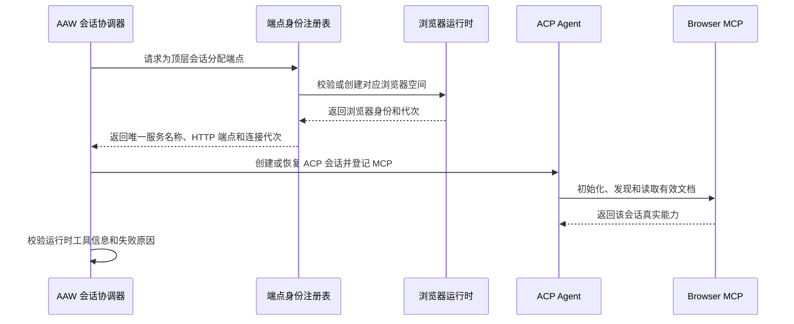
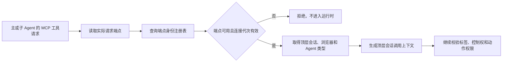
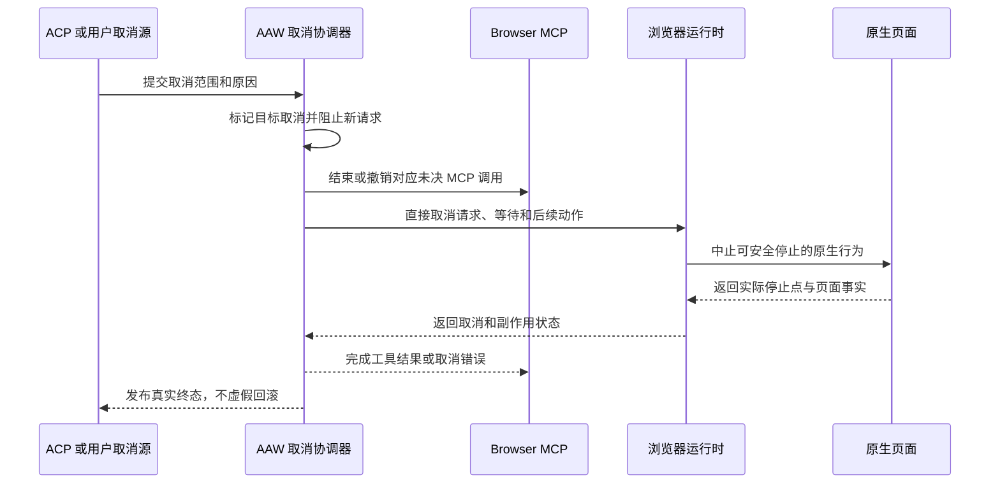

# ACP 接入、可信身份与取消详细设计

## 文档控制

| 项目         | 内容                                                               |
| ------------ | ------------------------------------------------------------------ |
| 文档编号     | AAW-DSK-BR-DD-004                                                  |
| 版本         | 1.3                                                                |
| 状态         | 待复审                                                             |
| 最近更新     | 2026-11-13                                                         |
| 上游文档     | `00详细设计总览与契约索引.md`、01～03                              |
| 配套测试设计 | `04ACP接入可信身份与取消测试设计.md`                               |
| 证据基础     | 穿刺 SP-31、SP-32、SP-40、SP-41，以及真实双子 Agent 工具可用性验证 |

## 修订记录

| 版本 | 日期       | 修订原因                                                             | 修订内容                                                                                                  |
| ---- | ---------- | -------------------------------------------------------------------- | --------------------------------------------------------------------------------------------------------- |
| 1.1  | 2026-11-12 | 采用顶层会话级平权模型，并避免修改 iCode 或依赖其子 Agent 运行时身份 | 删除父子登记和子 Agent 选择性取消；端点直接映射顶层会话；补充同会话工具分发、并发、会话级审计与取消规则。 |
| 1.2  | 2026-11-13 | 明确通用被动接口边界，消除逐 Agent 适配设计                          | 删除主动工具分发入口；AAW 不修改 Agent 主子配置，只按端点处理实际调用。                                   |
| 1.3  | 2026-11-13 | 问题单 012：普通控制不再通过审批或 Agent 移交改变                    | 取消原因改为显式人工接管，切换作用于会话全部未决动作并保留高风险审批独立性。                              |

## 1. 目的与范围

本文定义 AAW 在 ACP 会话创建、恢复和关闭时如何注册 Browser MCP，如何以每会话端点提供可信顶层会话身份，如何让同会话主、子 Agent 平权共享工具与页面，以及如何在 ACP 不传播 MCP 取消的情况下主动取消浏览器请求。

## 2. 代码组织与依赖

| 模块             | 职责                                         | 依赖规则                      |
| ---------------- | -------------------------------------------- | ----------------------------- |
| ACP 浏览器注册器 | 在会话创建/恢复时提供 HTTP MCP 配置          | 依赖 ACP 与浏览器身份公共入口 |
| 端点身份注册表   | 分配、映射、撤销和轮换端点令牌               | 不依赖 ACP 或 MCP 实现        |
| Agent 能力桥     | 提供真实 HTTP MCP、图片和历史能力            | 依赖 Agent 公共适配入口       |
| 轮次关联器       | 关联 ACP 会话、轮次和浏览器请求              | 依赖公共身份与请求契约        |
| 取消协调器       | 接收 ACP、界面和生命周期取消并直接调用运行时 | 依赖运行时公共取消端口        |
| 端点清理器       | 会话关闭、Agent 切换和重连时撤销旧端点       | 依赖身份与生命周期公共入口    |

浏览器运行时不得导入 ACP；MCP 不得导入 ACP；ACP 注册器不得读取 MCP 内部连接或页面对象。所有身份由原生身份注册表持有，前端只使用不透明引用。

## 3. 端点身份注册表

| 字段                 | 必填 | 语义                                           |
| -------------------- | ---- | ---------------------------------------------- |
| endpointId           | 是   | 对外配置引用的不透明身份                       |
| endpointToken        | 是   | 高随机性令牌，仅用于实际端点认证，禁止日志记录 |
| sessionId            | 是   | AAW 已验证的顶层 ACP 会话                      |
| browserId            | 是   | 对应逻辑浏览器空间                             |
| connectionGeneration | 是   | 当前连接代次，重连和切换时递增                 |
| agentKey             | 是   | 当前 Agent 类型，仅用于能力与清理              |
| lifecycle            | 是   | 准备、可用、撤销中、已撤销                     |
| createdAt            | 是   | 用于诊断和保留，不作为授权依据                 |

端点配置中的服务名称也需按会话唯一，避免 Agent 的 MCP 缓存把不同会话配置合并。相同会话恢复时必须明确选择保留当前有效代次或换代，不允许静默复用旧绑定。

## 4. ACP 会话注册流程

注册失败时，人工浏览仍可使用；界面明确显示 Agent 浏览器不可用。不得因为 MCP 注册失败而回退到全局共享端点或客户端 stdio 私有实现。

## 5. 可信会话身份路由

模型提交的 sessionId、子 Agent 名称、角色或 `_meta` 均不参与身份判定。同一端点下的主、子 Agent 调用都映射到同一个顶层会话。端点被撤销后不得因缓存中存在连接而继续接受调用。

## 6. 会话内平权与被动开放规则

- 同会话主、子 Agent 平权共享会话端点、浏览器空间、标签页、站点数据和动作权限，不建立父子身份注册表。
- 子 Agent 创建的标签归属顶层会话；子 Agent 结束不关闭页面、不撤销会话端点，也不取消其他同会话请求。
- 同会话所有 Agent 都不能访问其他会话标签或扩大高风险权限；审批、用户接管和资源预算对主、子 Agent 一致生效。
- AAW 只通过通用 ACP/MCP 契约提供浏览器能力，不主动适配、探测或修改任何 Agent 的主子配置，不为特定 Agent 增加工具分发或身份分支。
- 运行时支持子 Agent 使用同会话 MCP 时，AAW 按相同会话处理；运行时不支持时，接口仍保持开放，AAW 不主动补齐、不修改 Agent 配置，也不制造专用降级路径。
- 审计与诊断只记录可信的顶层会话归属。Agent 来源说明可用于展示，但不作为授权、取消或安全判定依据。

## 7. 轮次与请求关联

| 数据                 | 来源                 | 用途                 |
| -------------------- | -------------------- | -------------------- |
| sessionId            | AAW 当前 ACP 会话    | 归属与取消范围       |
| turnId               | ACP 轮次生命周期     | 取消本轮未决请求     |
| requestId            | Browser MCP 或运行时 | 取消单个调用         |
| operationId          | AAW 操作关联         | 日志和界面证据       |
| connectionGeneration | 端点注册表           | 防止重连后旧请求生效 |
| browserGeneration    | 浏览器运行时         | 防止旧浏览器实例生效 |
| tabGeneration        | 标签运行时           | 防止旧页面实例生效   |

轮次结束只取消本轮未决请求，不自动关闭页面。会话结束释放控制和身份，标签与数据按基线规则保留或回收。

## 8. 主动取消设计

### 8.1 取消注册表

| 字段          | 语义                                               |
| ------------- | -------------------------------------------------- |
| cancelScope   | 请求、标签、轮次、会话、浏览器或全局               |
| targetId      | 对应目标身份                                       |
| reason        | 用户停止、显式人工接管、轮次取消、开关、关闭或超时 |
| requestedAt   | 取消发起时间                                       |
| requestPhase  | 未下发、审批中、执行中或已完成                     |
| sideEffect    | 无、已确认、未发生或不确定                         |
| terminalState | 取消中、已取消、完成过晚或取消失败                 |

### 8.2 取消流程

AAW 不等待 Agent 转发 MCP 取消。MCP 传输、运行时请求和原生动作分别处理，不能因其中一层未响应而让其他层无限等待。

## 9. 取消结果规则

| 取消时阶段             | 工具结果                   | 后续建议             |
| ---------------------- | -------------------------- | -------------------- |
| 未进入运行时           | 已取消、无副作用           | 无需页面复核         |
| 等待审批               | 已取消、无副作用           | 审批失效，不执行     |
| 已下发但原生确认未执行 | 已取消、无副作用           | 保留页面证据         |
| 已执行一部分           | 已取消、副作用不确定       | 重新观察，不自动重放 |
| 已完成                 | 取消过晚，保留实际完成结果 | 不修改历史成功事实   |
| 无法连接运行时         | 取消结果未知               | 标记不确定并保留诊断 |

## 10. Agent 切换与重连

- Agent 类型切换使旧端点、连接代次、浏览器绑定和未决请求失效。
- 新 Agent 不继承旧 Agent 的 MCP 连接或授权；如产品允许继续使用同一会话页面，必须重新发现并重新获得必要授权。
- 重连后创建新连接代次，旧请求和迟到事件失效。
- 人工页面不因为 Agent 不支持或重连而关闭。
- 旧会话关闭与新会话启动并行时，清理必须按各自身份，不按 cwd 误回收其他会话。

## 11. 接口契约

| 公共入口          | 语义                                          | 失败与取消                                                         |
| ----------------- | --------------------------------------------- | ------------------------------------------------------------------ |
| 分配会话端点      | 为有效顶层会话创建唯一 MCP 配置               | 失败不进入全局回退                                                 |
| 恢复会话端点      | 恢复或换代当前会话身份                        | 旧端点失效规则明确                                                 |
| 撤销会话端点      | 停止接受新调用并清理连接                      | 幂等；未决调用按取消规则处理                                       |
| 提供会话 MCP 配置 | 通过通用 ACP 契约被动开放同一会话的浏览器能力 | 不主动适配或修改 Agent 主子配置；不支持时不影响主 Agent 与人工浏览 |
| 关联轮次          | 将同会话主子浏览器请求绑定到当前顶层轮次      | 无轮次时人工请求不被误关联                                         |
| 取消浏览器请求    | 按请求、轮次、标签或会话直接取消              | 返回真实副作用状态                                                 |
| 查询能力          | 返回当前 Agent 的 MCP、图片和历史能力         | 不支持不影响人工浏览                                               |

## 12. 安全与诊断

- 日志只记录端点别名和身份映射结果，不记录完整令牌。
- 每个取消记录来源、范围、请求阶段、停止点和副作用。
- 外部诊断不能通过完整端点配置读取其他会话页面。
- 会话配置中的端点属于敏感信息，诊断导出需脱敏。
- 身份、取消和清理操作都需有操作 ID 和耗时。

## 13. 可扩展性、维护性与过度设计

- 新 Agent 只增加能力适配，不增加身份算法分支。
- 新取消来源复用取消协调器，不在每个工具中分别实现。
- 不引入分布式身份系统、通用权限服务或持久化令牌数据库；当前为单桌面的原生注册表。
- 不为未来多设备共享会话设计令牌同步；当前端点只在本机有效。
- 不通过自定义 ACP 反向请求控制浏览器，使用标准 HTTP MCP 与 AAW 公共控制端口。

## 14. 验证与追踪

| 验收           | 覆盖                                             |
| -------------- | ------------------------------------------------ |
| AC-006、AC-018 | 跨会话身份隔离、同会话主子被动共享与实际调用结果 |
| AC-009、AC-022 | 主动取消、副作用和用户接管                       |
| AC-017         | 开关关闭后的请求和身份行为                       |
| AC-023         | Agent 切换、重连和旧绑定失效                     |
| AC-024         | 其他 Agent 的能力协商和降级                      |
| AC-011         | 会话关闭与身份资源回收                           |
