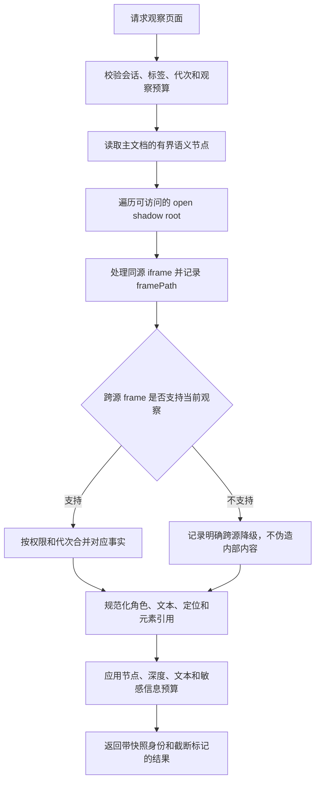
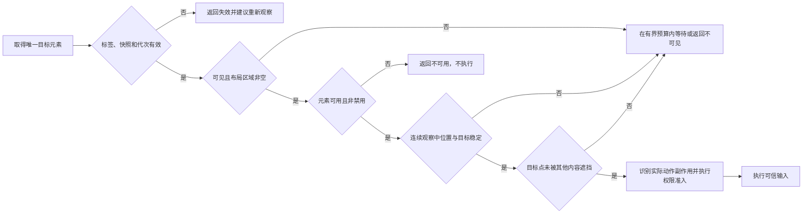

# 页面观察、定位与动作执行详细设计

## 文档控制

| 项目 | 内容 |
|---|---|
| 文档编号 | AAW-DSK-BR-DD-005 |
| 版本 | 1.1 |
| 状态 | 待复审 |
| 最近更新 | 2026-11-13 |
| 上游文档 | `00详细设计总览与契约索引.md`、01～04 |
| 配套测试设计 | `05页面观察定位与动作执行测试设计.md` |
| 证据基础 | 穿刺 SP-15～SP-17、SP-25～SP-26、SP-36；问题单 012 |

## 修订记录

| 版本 | 日期 | 修订原因 | 修订内容 |
|---|---|---|---|
| 1.1 | 2026-11-13 | 问题单 012：输入不能同时承担操作和授权语义 | 真实用户与 Agent 合成事件均不切换控制；人工接管关闭时阻止用户输入，开启时拒绝 Agent。 |

## 1. 目的与范围

本文定义有界 DOM/ARIA 快照、frame 和 shadow DOM 处理、稳定元素引用、严格 Locator、动作可执行性、可信输入、焦点竞争、后置验证和重试边界。目标是让 Agent 以可解释、可恢复的方式操作真实页面，避免多匹配、遮挡、目标漂移和假成功。

## 2. 代码组织与依赖

| 模块 | 职责 | 依赖规则 |
|---|---|---|
| 页面观察器 | 读取主文档、shadow、iframe 和语义节点 | 依赖 CDP 公共端口和观察契约 |
| 快照规范化 | 节点预算、文本截断、敏感信息处理和稳定引用 | 依赖公共契约，不依赖界面 |
| Locator 解析器 | 解析策略、归一化条件、目标 frame 和匹配集合 | 纯函数，可独立单测 |
| 动作可执行性 | 可见、可用、稳定、遮挡和目标代次检查 | 依赖页面公共读取端口 |
| 动作执行器 | 可信输入、点击、滚动、选择和按键 | 依赖 CDP 公共动作端口 |
| 后置验证器 | 读取页面证据并判断动作结果 | 依赖公共页面事实 |
| 动作协调器 | 归属、权限、取消、超时和结果组织 | 依赖运行时公共入口 |

模块依赖不得反向从 CDP 或 Locator 进入 UI、MCP 或 ACP。动作协调器是页面动作唯一编排入口，其他工具不得绕过。

## 3. 快照对象与字段

| 字段 | 必填 | 语义 |
|---|---|---|
| snapshotId | 是 | 一次观察的身份，不跨代次复用 |
| tabId | 是 | 来源标签 |
| tabGeneration | 是 | 快照对应的页面代次 |
| capturedAt | 是 | 观察时间，仅用于展示与诊断 |
| nodes | 是 | 有界语义节点集合 |
| elements | 是 | 可定位元素的引用集合 |
| truncated | 是 | 是否被节点、文本或深度预算截断 |
| frameDegradations | 是 | 跨源或失败 frame 的明确降级信息 |
| sensitiveFieldsExcluded | 是 | 敏感字段是否按规则排除 |

### 3.1 元素引用

| 字段 | 语义 |
|---|---|
| ref | 当前快照内稳定的元素引用 |
| tag | 标签类型 |
| role | 显式或推导的语义角色 |
| name | 有界可访问名称 |
| text | 有界可见文本 |
| selector | 用于复核的 CSS 定位信息 |
| xpath | 辅助定位信息 |
| framePath | 目标 frame 路径 |
| rect | 当前页面坐标与尺寸 |
| inViewport | 是否在当前视口内 |
| disabled | 是否不可用 |
| checked | 勾选类元素的真实状态 |

默认不包含输入值、Cookie、存储、隐藏敏感属性或完整 HTML。密码字段和敏感输入只保留必要类型与状态。

## 4. 页面观察算法

单个 frame 失败只产生降级项，不拖垮其他 frame。节点超过预算时保留可操作元素和主要结构，并明确截断；不得把截断快照宣称为完整页面。

## 5. Locator 语义

| 策略 | 匹配规则 | 特殊约束 |
|---|---|---|
| CSS | 在目标文档和 frame 内按 CSS 语义匹配 | 非法选择器返回参数错误 |
| role | 按语义角色匹配，可选名称约束 | 角色推导规则固定，不模糊匹配多个角色 |
| text | 按规范化可见文本匹配 | 明确精确或包含语义，不默认模糊猜测 |
| label | 按关联 label 或可访问名称匹配 | 不读取输入值 |
| placeholder | 按 placeholder 属性匹配 | 空条件拒绝 |
| test-id | 按约定的测试标识属性匹配 | 不自动兼容多个未声明属性 |
| ref | 使用当前快照的元素引用 | 必须同时匹配快照、标签和页面代次 |

所有策略先得到匹配集合。零匹配返回未找到，多匹配返回歧义；禁止自动选择第一个。

## 6. 动作可执行性算法

稳定性检查使用短间隔的连续页面事实，不使用固定长时间盲等。遮挡检查以实际动作目标点为准。页面在检查与执行之间变化时，执行后仍需通过后置验证确认，不得仅凭前置检查宣称成功。

## 7. 动作语义

| 动作 | 执行语义 | 后置验证 |
|---|---|---|
| 点击 | 对唯一目标执行可信鼠标按下与释放 | 页面状态、导航、对话框或目标状态发生预期变化 |
| 双击 | 对唯一目标执行明确双击 | 页面证据符合目标行为 |
| 输入 | 在目标焦点内逐步输入文本 | 读取目标值或输入计数；不进入宿主输入框 |
| 填充 | 清空并设置目标值，派发必要输入事件 | 目标值等于预期；与最终提交分离 |
| 按键 | 对当前经验证目标发送按键 | 页面焦点和按键效果符合预期 |
| 滚动 | 滚动页面或目标容器到明确条件 | 滚动位置或目标可见性变化 |
| 勾选 | 将勾选状态设置为目标值 | checked 状态等于目标值 |
| 下拉选择 | 按明确 value 或可见文本选择 | 选中值与目标一致 |

普通填充和勾选可以属于 L1；提交、登录、发送、删除等最终副作用按 DD-06 进入 L2/L3。

## 8. 焦点、frame 与缩放

- 每次输入前重新确认目标页面、frame 和元素焦点，不使用宿主当前焦点推断。
- AAW 输入框重新聚焦后，网页输入仍只进入目标页面或明确失败。
- 同源 iframe 使用 framePath 定位；跨源不可达时明确降级，不通过宿主全局坐标绕过。
- 页面缩放、设备缩放和容器尺寸变化后，元素坐标需要重新读取，不能复用旧坐标。
- Agent 合成事件与真实用户输入必须可区分；二者都不具有切换权限的语义。人工接管关闭时真实用户输入被阻止，开启时 Agent 动作被拒绝，只有显式开关能改变控制归属。

## 9. 后置验证与结果

| 结果 | 判定依据 |
|---|---|
| 成功 | 后置证据满足该动作的预期条件 |
| 未找到 | 当前目标没有匹配 |
| 歧义 | 当前目标多匹配 |
| 不可执行 | 不可见、禁用、不稳定或被遮挡且预算耗尽 |
| 失效 | 标签、快照、代次或控制租约变化 |
| 超时 | 条件未在有界预算内满足 |
| 取消 | 请求被主动取消，并附副作用状态 |
| 执行失败 | 原生执行或后置读取失败 |
| 副作用不确定 | 动作已下发但无法确认最终页面状态 |

没有可证明后置条件时，工具应返回“动作已执行，结果未确认”，不能等同于业务成功。调用方需提供页面状态或新的观察来确认。

## 10. 等待与重试

- 等待只针对明确条件，如 URL、加载、元素状态或固定时长。
- 可执行性等待与动作执行共用总预算，不允许无限重复。
- 目标失效时停止旧等待并重新观察，不在新页面盲重试。
- 已取消或副作用不确定的动作不得自动重放。
- 页面提示注入不能触发额外重试或权限提升。

## 11. 接口契约

| 公共入口 | 输入语义 | 输出与错误 |
|---|---|---|
| 创建快照 | 标签、代次、观察范围和预算 | 快照、元素引用、截断与降级 |
| 解析 Locator | 策略、条件、快照或当前代次 | 唯一目标、未找到、歧义或参数错误 |
| 检查可执行性 | 唯一目标和动作类型 | 可执行、等待原因或失败 |
| 执行动作 | 目标、动作、权限和请求上下文 | 真实动作结果、后置证据和副作用 |
| 等待条件 | 标签、条件、预算和取消上下文 | 满足、超时、取消或失效 |
| 获取元素截图 | 当前唯一元素和证据目的 | 图片、原始产物和缩放元数据 |

## 12. 安全、诊断与资源

- 记录定位策略、匹配数量、可执行性阶段、动作和结果，不记录敏感输入正文。
- 快照节点、文本、深度、frame 和等待预算均有上限。
- 动作执行与后置验证使用同一操作 ID。
- 被拒绝动作不得通过另一 Locator、坐标或脚本入口绕过。
- 截图与证据遵守会话归属和保留规则。

## 13. 可扩展性、维护性与过度设计

- 新 Locator 策略必须定义唯一性、frame 和敏感信息语义，不能只增加字符串匹配。
- 新动作通过统一可执行性和后置验证入口，不复制权限与取消逻辑。
- 不追求完整 Playwright API；只实现已基线且有真实场景的能力。
- 不建立通用计算机视觉定位系统；P1 坐标只作为明确受限的兜底。
- 不把页面自动修复、自动等待和自动重试组合成不可控的智能循环。

## 14. 验证与追踪

| 验收 | 覆盖 |
|---|---|
| AC-002、AC-003 | 真实动作闭环、严格定位和可执行性 |
| AC-008、AC-009 | 代次、取消和后置结果 |
| AC-013 | 宿主与网页焦点竞争 |
| AC-015 | 只读观察无交互 |
| AC-016 | 对话框作为动作后置事实 |
| AC-019 | 有效文档与真实页面能力一致 |
| AC-022 | Agent 与用户输入区分及显式人工接管 |
