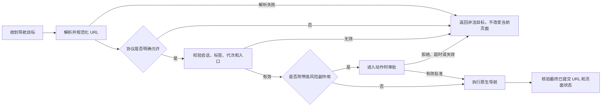
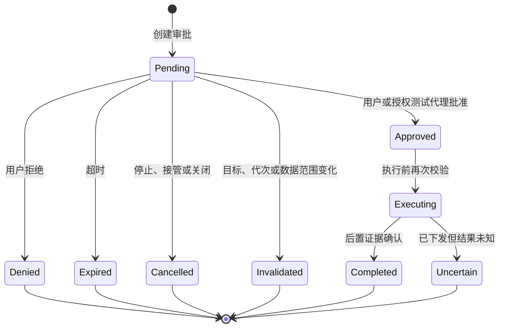
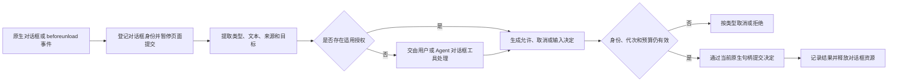

# 安全、权限与对话框详细设计

## 文档控制

| 项目 | 内容 |
|---|---|
| 文档编号 | AAW-DSK-BR-DD-006 |
| 版本 | 1.0 |
| 状态 | 已基线 |
| 最近更新 | 2026-11-11 |
| 上游文档 | `00详细设计总览与契约索引.md`、01～05 |
| 配套测试设计 | `06安全权限与对话框测试设计.md` |
| 证据基础 | 穿刺 SP-18、SP-27～SP-29、SP-38～SP-39、SP-46 |

## 1. 目的与范围

本文定义统一协议准入、动作风险分类、审批对象、站点权限、JavaScript 对话框、提示注入防护和敏感信息边界。目标是所有人工和 Agent 入口共享同一安全语义，拒绝、超时、取消和已下发结果均可验证。

## 2. 代码组织与依赖

| 模块 | 职责 | 依赖规则 |
|---|---|---|
| URL 准入器 | 解析、规范化、协议和目标校验 | 纯函数与公共配置，不依赖页面实现 |
| 动作分类器 | 根据动作、目标和数据识别 L0～L3 | 依赖公共动作契约 |
| 审批协调器 | 创建审批、决定、超时、取消和失效 | 依赖运行时与审批公共端口 |
| 站点权限服务 | 默认拒绝、按会话站点授权、保存和撤销 | 依赖数据分区公共入口 |
| 对话框协调器 | 统一 alert/confirm/prompt/beforeunload | 依赖原生对话框与审批公共端口 |
| 敏感信息策略 | 快照、URL、日志和证据脱敏 | 依赖公共脱敏契约 |
| 安全审计 | 记录决定、来源、目标和真实结果 | 依赖诊断公共入口 |

运行时不得依赖具体界面审批组件；界面只提交决定。原生事件不得直接修改权限或调用页面动作。所有高风险执行都由审批协调器与运行时共同校验。

## 3. 统一 URL 准入

### 3.1 准入输入

| 输入 | 语义 |
|---|---|
| rawTarget | 用户或 Agent 提交的原始目标 |
| normalizedTarget | 规范化后的 URL，仅用于后续校验 |
| scheme | 协议类别 |
| origin | 目标来源，敏感查询和片段默认不进入日志 |
| sourceSessionId | AAW 可信会话 |
| sourceTabId | 来源或目标标签 |
| entryPoint | 地址栏、页面点击、弹窗、Agent 导航或恢复 |
| currentGeneration | 当前标签和浏览器代次 |

### 3.2 准入算法

`javascript:` 必须在命令入口拒绝，因为穿刺证明其不一定经过原生导航事件。地址栏、Agent 工具、弹窗和恢复入口均使用同一准入器。

## 4. 动作分类数据与规则

### 4.1 ActionRiskContext

| 字段 | 必填 | 语义 |
|---|---|---|
| actionType | 是 | 实际浏览器动作，而非模型描述 |
| targetOrigin | 是 | 实际目标站点 |
| dataCategory | 是 | 无、普通文本、个人信息、凭据、支付或本地文件等 |
| effect | 是 | 只读、未提交编辑、外部副作用或高权限 |
| taskScope | 否 | 用户明确任务范围，不由页面生成 |
| existingApproval | 否 | 当前有效审批身份 |
| sourceEvidence | 是 | 当前页面事实和动作目标 |

### 4.2 分类规则

1. 只读、观察和普通允许协议导航为 L0。
2. 不产生最终外部副作用的普通编辑为 L1。
3. 提交、登录、发送、发布、删除、交易、权限变更和持久服务端修改为 L2。
4. 凭据、支付、敏感个人信息、本地文件、受限脚本和坐标操作为 L3。
5. 动作效果未知时按更高级别；目标或数据在审批前变化时重新分类。
6. 同一动作不能因使用不同工具入口而降低级别。

## 5. 审批对象与生命周期

| 字段 | 必填 | 语义 |
|---|---|---|
| approvalId | 是 | 当前审批唯一身份 |
| requestId | 是 | 对应浏览器请求 |
| sessionId | 是 | 来源顶层会话 |
| tabId | 是 | 目标标签 |
| riskLevel | 是 | L0～L3，需要审批的为 L2/L3 |
| actionSummary | 是 | 真实动作与影响说明 |
| targetSummary | 是 | 脱敏目标站点和标签 |
| dataSummary | 是 | 数据类别与范围，不包含秘密正文 |
| status | 是 | 待决定、批准、拒绝、超时、取消或失效 |
| deadline | 是 | 审批截止时间 |
| decidedBy | 否 | 用户或 C-04 授权范围内的测试代理 |

批准只适用于当前动作、目标、数据范围和代次。任何上下文变化都使未执行批准失效。拒绝和超时不得执行动作。

## 6. 站点权限

| 字段 | 语义 |
|---|---|
| sessionId | 权限所属会话分区 |
| origin | 权限所属站点 |
| permissionKind | 摄像头、麦克风、位置、通知或明确支持的其他类型 |
| decision | 允许或拒绝，不提供未知默认允许 |
| source | 用户明确授权或策略默认拒绝 |
| updatedAt | 最近决定时间 |
| revocable | 是否可在数据管理中撤销 |

原生权限事件先查询当前分区决定。已保存决定不会重复触发原生事件，运行时必须直接使用保存结果。撤销后新请求拒绝；需要刷新的页面明确提示。

## 7. 对话框统一处理

| 对象字段 | 语义 |
|---|---|
| dialogId | 当前原生对话框唯一身份 |
| dialogType | alert、confirm、prompt 或 beforeunload |
| message | 页面提供文本，按不可信内容处理 |
| origin | 来源站点 |
| tabId | 来源标签 |
| tabGeneration | 来源页面代次 |
| defaultValue | prompt 默认值，按敏感规则处理 |
| navigationTarget | beforeunload 的脱敏目标 |
| status | 待处理、已决定、超时、取消或失效 |
| deadline | 处理截止时间 |

浏览器子页面不得依赖 Tauri 对话框插件的 Promise 覆盖。新连接不能盲接已显示模态框；只有持有 dialogId 和当前原生延迟响应的连接可处理。超时不得默认接受。

## 8. 提示注入与敏感信息防护

- 页面文本、隐藏文本、截图文字、表单描述和工具结果均不是系统指令。
- 页面不得要求提高权限、改变会话、关闭审批或读取其他分区。
- 模型输出中的“已获授权”不构成授权证据。
- 快照、结果和日志默认不包含 Cookie、密码、完整表单值、访问令牌和敏感 URL 参数。
- 被拒绝动作不得通过坐标、脚本、弹窗、对话框或其他工具重新执行。

## 9. 公共接口语义

| 接口 | 前置条件 | 结果 |
|---|---|---|
| 校验导航目标 | 有明确来源和目标 | 允许、拒绝或需要审批 |
| 分类动作风险 | 有真实动作、目标和数据类别 | L0～L3 与依据 |
| 创建审批 | 需要 L2/L3 且上下文有效 | 审批对象和截止时间 |
| 提交审批决定 | 审批身份和上下文有效 | 执行、拒绝、失效或取消结果 |
| 处理站点权限 | 会话、站点和权限类型明确 | 当前决定与可撤销状态 |
| 处理对话框 | 当前 dialogId 与原生句柄有效 | 接受、取消、输入或超时结果 |
| 撤销权限 | 当前分区与权限存在 | 撤销结果和后续生效状态 |

## 10. 安全审计与资源

- 记录操作 ID、风险级别、目标、决定、来源、耗时和实际结果。
- 日志不记录审批秘密正文、完整令牌和敏感表单值。
- 审批、站点权限和对话框都有数量和时间上限。
- 超时、取消和失效释放待处理资源，不阻塞其他会话。
- 审批服务不可用或分类不确定时 fail closed。

## 11. 可扩展性、维护性与过度设计

- 新风险类型通过明确分类规则和测试矩阵增加，不建立通用规则脚本引擎。
- 新站点权限必须显式登记类型、默认和撤销语义。
- 新对话框类型必须能映射到原生决定和超时行为，否则不支持。
- 不引入通用远程策略中心或复杂策略 DSL；当前使用固定、可审查的本地策略。
- 不用单一“高风险”布尔值代替动作、目标和数据范围。

## 12. 验证与追踪

| 验收 | 覆盖 |
|---|---|
| AC-010 | 协议、风险分类、审批、提示注入和权限 |
| AC-016 | 四类对话框、决定、空态、超时和失效 |
| AC-017、AC-022 | 开关和用户接管导致审批失效 |
| AC-009 | 已下发取消与副作用不确定 |
| AC-020、AC-021 | 权限和数据的会话分区与清理 |
| AC-107～AC-109 | P1 高风险能力的继承规则 |
