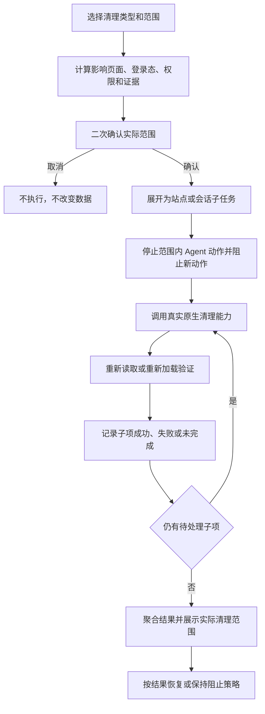
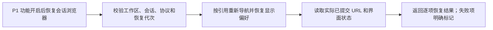

# 数据分区、持久化与分层清理详细设计

## 文档控制

| 项目 | 内容 |
|---|---|
| 文档编号 | AAW-DSK-BR-DD-007 |
| 版本 | 1.1 |
| 状态 | 待复审 |
| 最近更新 | 2026-11-12 |
| 上游文档 | `00详细设计总览与契约索引.md`、01～06 |
| 配套测试设计 | `07数据分区持久化与分层清理测试设计.md` |
| 证据基础 | 穿刺 SP-22～SP-23、SP-43～SP-44 |

## 修订记录

| 版本 | 日期 | 修订原因 | 修订内容 |
|---|---|---|---|
| 1.1 | 2026-11-12 | 统一数据分区的会话级平权语义 | 明确同会话主、子 Agent 共享分区且不新建子分区；清理和持久化算法不变。 |

## 1. 目的与范围

本文定义会话级 WebView2 数据目录、数据目录登记、占用统计、活动与历史分区、缓存/站点/会话/工作区/全量清理、结果核验和部分失败。目标是让登录态可持久化，同时用户能真正查看和清除全部声明范围内的数据。

## 2. 代码组织与依赖

| 模块 | 职责 | 依赖规则 |
|---|---|---|
| 分区注册表 | 分区身份、会话归属、目录、活动和历史状态 | 依赖公共契约，不依赖界面 |
| 数据目录服务 | 创建、检查、占用和目录安全 | 依赖原生文件与 WebView 公共端口 |
| 数据目录索引 | 工作区/会话/站点分类、类型、占用和保存状态 | 只保存元数据，不保存站点秘密正文 |
| 清理任务规划器 | 把清理范围展开为站点或会话子任务 | 依赖公共数据管理契约 |
| 清理执行器 | 清缓存、按站点和按分区调用真实原生能力 | 依赖原生宿主公共端口 |
| 结果核验器 | 重新读取、重新加载和检查清理结果 | 依赖公共页面与数据事实 |
| 结果聚合器 | 生成全部成功、部分完成或失败结果 | 纯函数，可独立测试 |

运行时、MCP、界面和诊断不得直接修改分区目录。所有清理通过数据管理公共入口；数据管理不读取工作流状态实现。

## 3. 分区注册表字段

| 字段 | 必填 | 语义与约束 |
|---|---|---|
| partitionId | 是 | AAW 分配的稳定分区身份 |
| workspaceKey | 是 | 所属工作区，用于分层管理 |
| sessionId | 是 | 所属顶层会话；同会话主、子 Agent 平权共享，不新建子 Agent 分区 |
| directory | 是 | AAW 自有目录，不能指向外部浏览器目录 |
| lifecycle | 是 | 活动、空闲、维护中、清理中、已清理或失败 |
| activeTabCount | 是 | 当前活动标签数量 |
| createdAt | 是 | 创建时间 |
| lastUsedAt | 是 | 最近使用时间，用于展示和保留 |
| dataSummary | 是 | 类型、占用和估算标记，不包含数据正文 |
| operationGeneration | 是 | 分区维护代次，防止旧清理结果覆盖新状态 |

目录路径必须规范化并限制在 AAW 浏览器数据根目录内。路径中的会话别名不得直接作为未校验文件路径使用。

## 4. 数据目录索引

| 层级 | 必要数据 | 允许行为 |
|---|---|---|
| 工作区 | 分区数量、会话列表、总占用、活动状态 | 查看和按工作区清理 |
| 会话 | 分区状态、站点列表、权限数量、数据类型和占用 | 查看和按会话清理 |
| 站点 | 脱敏来源、数据类型、权限、占用和最近使用 | 清缓存或清站点全部数据 |
| 全部 AAW 浏览器数据 | 全部分区、证据和清理范围 | 二次确认后全量清理 |

占用值可来自实际统计或明确估算；未知不得显示为零。索引失败不能阻止人工浏览，但数据管理必须显示不可用原因。

## 5. 持久化与共享语义

- 会话分区在应用重启后继续保留声明范围内的站点数据。
- 同会话用户、主 Agent、子 Agent 和标签平权共享该分区。
- 不同会话和工作区之间不共享 Cookie、LocalStorage、IndexedDB、缓存或权限。
- P0 重启不恢复标签页；数据保留不等于恢复页面运行态。
- 外部 Chrome 和其他浏览器的数据不得作为隐式初始化来源。
- 分区清理与 AAW 设置、项目和工作流状态分离。

## 6. 清理任务对象

| 字段 | 必填 | 语义 |
|---|---|---|
| taskId | 是 | 清理任务身份 |
| taskType | 是 | 清缓存、站点、会话、工作区或全量 |
| scope | 是 | 实际工作区、会话、站点或全局范围 |
| sourceOperationId | 是 | 关联界面操作和诊断 |
| status | 是 | 待确认、执行中、部分完成、完成、失败或取消 |
| items | 是 | 每个站点或会话子项的真实状态 |
| affectedTabs | 是 | 将被刷新或关闭的标签集合 |
| createdAt | 是 | 创建时间 |
| confirmedBy | 否 | 二次确认来源，不包含秘密 |

## 7. 清理执行总流程

清理请求发出不等于成功。活动页面内存状态必须通过刷新或关闭处理，否则原生数据已删但页面仍可能继续显示旧登录态。

## 8. 各清理类型设计

### 8.1 清缓存

- 使用真实浏览器缓存清理能力，不删除 Cookie、LocalStorage、IndexedDB 或权限。
- 通过缓存资源请求计数或实际网络行为验证。
- 页面可保持打开，必要时刷新以验证后续资源行为。
- 失败只影响缓存清理结果，不伪称其他数据已清理。

### 8.2 清站点全部数据

- 按当前分区和站点清理 Cookie、存储、缓存、Service Worker 和权限。
- 停止该站点相关 Agent 动作，刷新受影响页面。
- 其他站点和其他会话数据保持不变。
- 站点无法匹配或清理结果不可验证时返回明确失败。

### 8.3 清会话全部数据

- 停止该会话所有 Agent 动作并关闭其浏览器页面。
- 清理该分区全部站点、权限、缓存和浏览器证据。
- 撤销控制绑定和对话框，不删除 ACP 会话正文或工作流状态。
- 重新读取或重建维护上下文验证分区无声明范围内残留。

### 8.4 清工作区数据

- 展开为该工作区全部会话子任务，包括历史分区。
- 每个会话独立停止、关闭、清理和核验。
- 单个会话失败不阻止其他会话继续，但整体结果必须为部分完成。
- 其他工作区的页面、数据和权限不变。

### 8.5 清全部 AAW 浏览器数据

- 停止全部 Agent 浏览器动作并关闭全部浏览器页面。
- 清理全部活动与历史分区、权限和浏览器证据。
- 不清理 AAW 主界面设置、项目、会话正文和 `.sdd/` 状态。
- 历史工具卡中的证据引用保留不可用事实，不显示空图冒充证据。

## 9. 历史分区维护

历史分区没有活动页面时，可以创建不承载业务站点的维护上下文，调用原生清理后立即回收。分区被占用、维护上下文创建失败或清理结果不可验证时返回失败。禁止在分区仍被使用时直接删除目录。

维护上下文不进入标签集合，不被 Agent 发现，不继承任务授权，也不产生业务页面历史。

## 10. 并发与结果聚合

- 同一分区同时只允许一个清理或维护任务。
- 清理期间的新页面和 Agent 动作在范围内被拒绝，防止清后重新写入。
- 取消清理只停止尚未执行的子项；已执行子项保留真实结果。
- 每个子项状态独立，聚合器不得把未知或失败转换为成功。
- 清理完成后新数据属于新的使用事实，不得被旧任务迟到事件删除。

## 11. 公共接口语义

| 接口 | 输入语义 | 输出与错误 |
|---|---|---|
| 查看数据目录 | 工作区、会话、站点或全局范围 | 分类、占用、状态和可用性 |
| 预览清理 | 清理类型和范围 | 影响页面、登录态、权限、证据和子项 |
| 执行清理 | 已确认任务和当前分区代次 | 子项与聚合真实结果 |
| 取消清理 | 当前任务身份 | 未执行项取消，已执行项不回滚 |
| 核验分区 | 分区和当前维护代次 | 实际残留、不可验证或占用错误 |
| 重试失败子项 | 原任务及失败子项 | 新任务身份和重试结果，不覆盖历史 |

## 12. 安全、诊断与资源

- 普通日志只记录任务范围、分区别名、子项状态和耗时。
- 不记录 Cookie、存储正文、密码和完整站点秘密 URL。
- 目录访问必须限制在 AAW 浏览器数据根目录，禁止符号链接逃逸。
- 清理任务、维护上下文和核验均有时间与数量预算。
- 结果证据包含实际数据读取，不以界面“已点击清理”作为完成依据。

## 13. 可扩展性、维护性与过度设计

- 新数据类型必须声明所属清理类型、核验方式和敏感级别。
- 新清理范围通过任务规划器展开，不复制执行和聚合逻辑。
- 不建立通用文件删除框架或数据库迁移系统；当前使用 WebView2 数据能力。
- 不为了占用统计而读取站点正文或建立第二份 Cookie 数据库。
- 不在 P0 引入远程同步、跨设备分区或复杂保留策略编辑器。

## 14. 验证与追踪

| 验收 | 覆盖 |
|---|---|
| AC-020 | 分区、持久化、同会话共享和跨会话隔离 |
| AC-021 | 数据查看、历史分区和全范围清理 |
| AC-011 | 会话、窗口和应用关闭时的数据与页面处理 |
| AC-012 | 证据引用、清理和不可用状态 |
| AC-017、AC-022 | 清理期间 Agent 停止和用户优先 |
| AC-014 | 清理与维护资源的长期回收 |

## 15. P1 标签 URL 与显示偏好恢复补充设计（AC-105）

### 15.1 恢复对象

| 字段 | 必填 | 语义 |
|---|---|---|
| workspaceKey | 是 | 原工作区 |
| sessionId | 是 | 原顶层会话 |
| browserId | 是 | 原逻辑浏览器空间 |
| tabs | 是 | 需要恢复的标签 URL 引用集合 |
| activeTabId | 否 | 原激活标签引用 |
| displayPreferences | 是 | 右栏开合、宽度和其他已声明显示偏好 |
| savedAt | 是 | 保存时间，不参与授权 |
| restoreGeneration | 是 | 本次恢复代次，旧恢复结果不得覆盖新状态 |

恢复集合不包含 DOM、脚本状态、滚动位置、表单草稿、页面任务、审批或控制租约。站点数据仍由原分区提供，不把旧页面运行态当作已恢复。

### 15.2 恢复流程

P0 不执行该流程。恢复时重新执行 URL 准入，不允许过期或受限 URL 借恢复绕过。失败项不影响其他合法标签，但结果必须标记部分完成；审批、控制权和未决请求不恢复。
