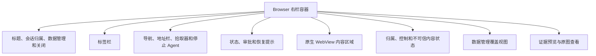
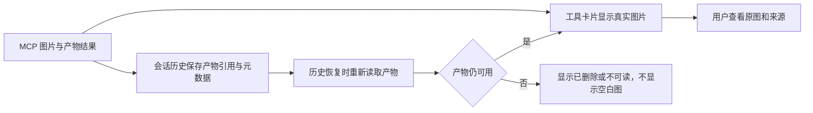
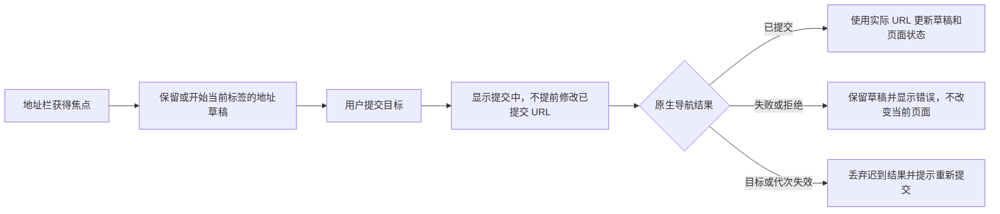
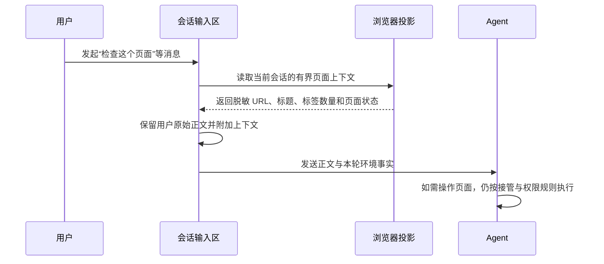

# 界面状态投影与证据展示详细设计

## 文档控制

| 项目 | 内容 |
|---|---|
| 文档编号 | AAW-DSK-BR-DD-008 |
| 版本 | 1.0 |
| 状态 | 已基线 |
| 最近更新 | 2026-11-11 |
| 上游文档 | `00详细设计总览与契约索引.md`、01～07 |
| 配套测试设计 | `08界面状态投影与证据展示测试设计.md` |
| 视觉基线 | `../内嵌浏览器低保真布局.png`、`../内嵌浏览器高保真布局.png` |

## 1. 目的与范围

本文定义 Browser 右栏组件、状态投影、窗口自适应、页面缩放、自动接管、元素拾取、审批、数据管理、截图证据和历史恢复的详细结构。目标是保持现有工作台体验，同时确保所有可见状态都来自真实运行时。

## 2. 代码组织与依赖

| 模块 | 职责 | 依赖规则 |
|---|---|---|
| Browser 右栏容器 | 布局、开合、宽度、窄窗和标签容器 | 依赖现有右栏公共入口 |
| Browser 工具栏 | 导航图标、地址栏、拾取器、缩放和停止 | 依赖界面命令公共入口 |
| 标签与状态视图 | 展示标签、加载、错误、控制和审批状态 | 依赖只读投影 |
| 控制协调界面 | 用户操作、自动接管、移交和 Agent 开关 | 依赖运行时公共命令，不直接调用 MCP |
| 数据管理视图 | 分层数据、清理预览、确认和结果 | 依赖数据管理公共入口 |
| 证据展示组件 | 图片、原图、产物状态、历史和来源 | 依赖证据公共入口 |
| 投影存储 | 保存当前会话只读投影、界面偏好和草稿引用 | 不持有页面写状态 |
| 可访问性适配 | 键盘、焦点、减少动态效果和状态文本 | 依赖组件公共属性 |

界面不得导入 Browser MCP、CDP、Agent 方言或原生模块内部实现。运行时通过事件更新投影，界面不得反向依赖原生事件适配器。诊断与证据展示只读取公开产物契约。

## 3. 布局与组件结构

组件按职责拆分，但不为每个按钮建立独立状态存储。标签、地址、控制和页面状态共享同一只读投影；编辑中的地址草稿和拾取器状态属于局部界面状态。

## 4. 界面投影模型

| 字段 | 必填 | 语义 |
|---|---|---|
| windowId | 是 | 当前窗口 |
| workspaceKey | 是 | 当前工作区 |
| sessionId | 是 | 当前顶层会话 |
| browserId | 是 | 当前浏览器空间 |
| browserGeneration | 是 | 当前浏览器代次 |
| tabs | 是 | 当前会话标签只读集合 |
| activeTabId | 否 | 当前激活标签 |
| pageState | 是 | 加载、就绪、错误、崩溃或不支持 |
| controlState | 是 | 用户、Agent、等待审批、暂停或失效 |
| pendingApprovals | 是 | 当前会话待审批集合 |
| evidence | 是 | 当前可见证据引用集合 |
| dataTask | 否 | 当前清理任务投影 |
| stale | 是 | 投影是否因连接或代次问题过期 |

投影更新必须校验窗口、工作区、会话、浏览器和标签代次。后台会话只更新自己的投影，不修改当前前台选择。

## 5. 自适应与页面缩放

### 5.1 容器跟随

窗口尺寸、右栏宽度、窄窗覆盖和 DPI 变化统一由布局协调器处理。前台页面使用内容区域实际尺寸；后台页面只记录目标尺寸。缩放与布局分别记录，页面缩放不得触发 AAW 主界面缩放。

### 5.2 缩放交互

- 浏览器子 WebView 启用 Ctrl+滚轮、Ctrl+加减键和 Ctrl+0。
- 地址栏附近显示当前缩放比例和重置入口。
- 默认只影响当前标签；如后续支持按站点保存，必须作为单独偏好设计。
- 截图和元素坐标读取必须包含当前页面缩放信息。
- P1 自由视口预览缩放与页面缩放使用不同状态和标签，不共用一个百分比字段。

## 6. 用户自动接管与停止

不提供接管按钮。页面收到真实用户点击、输入、滚动或按键后，界面显示用户控制状态，运行时取消该标签未决 Agent 动作。Agent 注入输入不得触发该界面路径。

“停止 Agent”只作用于当前标签；全局开关作用于所有会话并取消全部未决浏览器请求。两者在文案和影响范围上明确区分。

## 7. 元素拾取器

P1 工具栏使用鼠标指针点击图标，只有当前会话和页面就绪时可用。选择模式支持 hover 高亮、单击选定、Esc 取消、导航或失效自动退出。选择结果在当前会话输入区生成元素引用，发送失败保留，切换会话不带出。

不自动监听用户点击，不向 Agent 上报每次操作目标。元素引用只包含 FR-UI-009 允许的有界摘要，不包含密码、Cookie 或输入值。

## 8. 审批、错误与恢复界面

- 审批内容包含动作、目标、数据、会话、标签和影响范围。
- 多审批按目标分别展示，不提供不明确的批量允许。
- 页面错误显示重试、恢复、关闭或其他真实可用动作。
- 已失效审批和对话框历史只读，不恢复为可执行状态。
- 清理部分失败显示每个子项，不用全局成功颜色掩盖。
- 能力不支持显示原因，不影响人工浏览。

## 9. 证据数据与图片展示

### 9.1 证据展示对象

| 字段 | 必填 | 语义 |
|---|---|---|
| artifactId | 是 | 证据产物身份 |
| sessionId | 是 | 来源会话 |
| tabId | 是 | 来源标签 |
| requestId | 是 | 来源请求 |
| thumbnail | 否 | 受预算约束的展示图 |
| originalArtifact | 是 | 原始产物引用 |
| metadata | 是 | 类型、大小、尺寸、时间和缩放信息 |
| availability | 是 | 可用、清理中、已删除或不可读 |
| modelReadStatus | 是 | 模型已读取、不支持或读取失败，不从图片存在推断 |

### 9.2 图片与历史流程

禁止把图片对象 JSON 序列化为文本作为主要展示。禁止把 Base64 持续堆入 localStorage。模型未读图时必须显示该事实。

## 10. 历史与草稿边界

- 普通会话切换保留逻辑页面和投影；应用重启不恢复 P0 标签。
- 截图历史保存引用，重启后重新读取产物。
- 地址草稿、元素引用和会话草稿按会话隔离，不跨会话恢复。
- 历史审批、控制租约和对话框不恢复为有效授权。
- 工作流只保存必要证据引用，不保存页面实时状态。

## 11. 界面命令契约

| 命令 | 前置条件 | 结果 |
|---|---|---|
| 打开 Browser | 选择或创建顶层会话 | 显示对应空间，不启动 Agent |
| 新建/切换/关闭标签 | 目标属于当前会话 | 返回真实标签状态 |
| 导航与地址编辑 | 目标通过协议准入 | 显示最终已提交页面或错误 |
| 调整布局 | 当前窗口和内容区域有效 | 原生页面尺寸同步 |
| 调整页面缩放 | 当前标签支持缩放 | 显示比例并更新页面内容 |
| 停止或自动接管 | 当前标签与请求可识别 | 取消未决动作并显示真实副作用 |
| 拾取元素 | P1 且页面就绪 | 当前会话元素引用或取消 |
| 清理数据 | 二次确认与范围有效 | 真实子项和聚合结果 |
| 查看证据 | 产物属于当前会话且可用 | 原图或明确不可用 |

## 12. 可访问性与键盘

- 所有工具按钮具有名称、状态和键盘焦点。
- 后退、前进和刷新根据真实状态禁用。
- 审批和对话框支持明确取消键，焦点不逃逸到背后页面。
- 窄窗覆盖提供返回会话入口，不丢失聊天草稿。
- 状态使用文本和图标共同表达，不仅靠颜色。
- 减少动态效果设置生效时，加载和状态变化不使用非必要动画。

## 13. 性能、诊断与资源

- 本地界面命令在运行时就绪后满足 P95 300ms 指标。
- 图片按区域和预算渲染，不在列表中重复加载原图。
- 界面日志只记录操作和产物元数据，不记录秘密正文。
- 关闭组件时取消订阅、图片读取和局部等待，不残留监听器。
- 投影过期时显示失效，不用旧状态冒充实时状态。

## 14. 可扩展性、维护性与过度设计

- 新工具按钮必须对应真实能力和键盘行为，不为未来能力放占位图标。
- 新证据类型复用产物引用和不可用状态，不新建历史系统。
- 不建立通用低代码界面编排、通用对话框框架或第二套右栏状态机。
- 不为 P1 自由视口提前实现完整响应式测试台。
- 不把每个界面状态拆成独立存储；围绕同一 Browser 投影维护。

## 15. 验证与追踪

| 验收 | 覆盖 |
|---|---|
| AC-001、AC-004 | 布局、人工浏览、导航和弹窗 |
| AC-005～AC-007 | 接管、会话隔离和后台投影 |
| AC-011～AC-013 | 关闭、图片历史、证据引用和焦点 |
| AC-017、AC-022 | 总开关和自动接管 |
| AC-020、AC-021 | 数据管理和清理结果 |
| AC-024 | Agent 能力不支持界面 |
| AC-101～AC-109 | P1 界面、证据和测试能力扩展 |

## 16. 地址栏与导航状态一致性补充设计

### 16.1 地址栏对象

| 字段 | 必填 | 语义 |
|---|---|---|
| draft | 是 | 用户正在编辑的地址草稿 |
| committedUrl | 否 | 原生页面最后已提交 URL |
| focused | 是 | 地址栏是否处于编辑焦点 |
| sourceTabId | 是 | 草稿所属标签 |
| sourceGeneration | 是 | 草稿对应的标签代次 |
| navigationState | 是 | 空闲、提交中、失败或失效 |
| error | 否 | 最近一次可见导航错误 |

### 16.2 地址栏算法

标签切换时使用目标标签自己的草稿和已提交 URL，不能把来源标签草稿带过去。页面自行导航或恢复时更新已提交 URL；只有地址栏未处于编辑状态时才同步覆盖显示。后退、前进、刷新和停止后的按钮状态必须来自真实导航历史与加载状态。

## 17. 当前页面上下文与 Agent 面板显隐补充设计

### 17.1 当前页面上下文（AC-101）

用户在当前页面发起消息时，可以显式选择附带当前页面上下文。上下文只是本轮环境事实，不修改用户可见正文，不构成标签接管授权。

| 字段 | 必填 | 语义 |
|---|---|---|
| contextId | 是 | 本轮上下文身份 |
| sessionId | 是 | 当前顶层会话 |
| tabId | 是 | 当前标签 |
| tabGeneration | 是 | 当前页面代次 |
| tabCount | 是 | 当前会话标签数量 |
| currentUrl | 否 | 脱敏后的当前 URL，不包含凭据、秘密查询或片段 |
| title | 否 | 有界页面标题 |
| pageState | 是 | 当前页面加载或错误状态 |
| capturedAt | 是 | 本轮采集时间 |

读取失败不阻断发送；界面只提示上下文不可用。上下文不包含 Cookie、密码、存储或完整表单值，也不把旧代次页面事实用于新页面。

### 17.2 Agent 显示或隐藏既有面板（AC-102）

Agent 的显隐命令只改变当前会话既有 Browser 面板的可见性，不创建、恢复或关闭标签，不改变站点数据和控制权。

| 字段 | 必填 | 语义 |
|---|---|---|
| sessionId | 是 | 来源会话，由可信身份确定 |
| browserId | 是 | 当前既有浏览器空间 |
| visible | 是 | 请求显示或隐藏 |
| browserGeneration | 是 | 当前浏览器代次 |
| requestId | 是 | 调用与取消关联身份 |

来源会话在后台时只更新其显示偏好，不抢占用户前台。面板不存在时返回明确不可用，不创建新面板。显隐失败不得改变标签或页面状态。

## 18. 主窗口刷新与重连交叉语义

- 主窗口刷新属于界面宿主重建，不等于用户清理浏览器数据，也不得把另一会话页面回收到当前会话。
- 卸载旧界面组件时，取消其事件订阅、图片读取和局部等待；旧组件的迟到回写一律忽略。
- ACP 重连后使用新的连接代次；重连前未决浏览器请求按取消或失效规则终止，迟到响应不得写入新代次。
- 界面根据原生运行时与当前 ACP 身份重新建立只读投影，不从刷新前的本地组件快照伪造页面或控制状态。
- 新命令只接受恢复后的当前会话、当前连接和当前页面代次；其他会话的投影、页面和请求保持不变。
