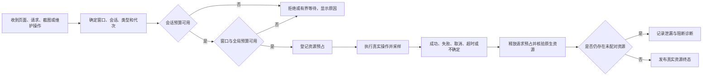

# 资源、诊断与验证体系详细设计

## 文档控制

| 项目         | 内容                                            |
| ------------ | ----------------------------------------------- |
| 文档编号     | AAW-DSK-BR-DD-009                               |
| 版本         | 1.0                                             |
| 状态         | 已基线                                          |
| 最近更新     | 2026-11-11                                      |
| 上游文档     | `00详细设计总览与契约索引.md`、01～08           |
| 配套测试设计 | `09资源诊断与验证体系测试设计.md`               |
| 实测依据     | 穿刺 SP-45～SP-47；本机两小时结果不等于产品验收 |

## 1. 目的与范围

本文定义资源预算的数据模型、准入与回收、性能采样、操作关联、日志脱敏、测试证据和发布门禁。目标是使浏览器功能在长时、并发、异常和受限环境中保持可预测，并能从外部证据证明结果。

## 2. 代码组织与依赖

| 模块             | 职责                                       | 依赖规则                     |
| ---------------- | ------------------------------------------ | ---------------------------- |
| 资源注册表       | 标签、请求、截图、维护上下文和证据预算占用 | 依赖公共资源契约             |
| 预算准入器       | 会话、窗口、全局和动作类型预算判断         | 纯策略与资源公共入口         |
| 生命周期回收核验 | 检查预占释放、页面关闭和进程回收           | 依赖运行时和系统公共事实     |
| 性能采样器       | 本地 UI、DOM、导航、截图、取消和清理耗时   | 依赖公开操作事件             |
| 诊断适配器       | 操作 ID、错误、资源和脱敏日志              | 依赖现有诊断公共入口         |
| 证据记录器       | 测试环境、操作、结果、截图和数据快照       | 依赖公开证据存储             |
| 发布门禁评估     | 汇总验收、阻断问题和覆盖缺口               | 依赖追踪清单，不读取业务实现 |

运行时不得依赖发布门禁或测试模块；诊断和测试不得反向修改运行时状态。资源准入只通过运行时公共端口执行，界面和 MCP 不自行计数。

## 3. 资源对象与不变量

| 对象                 | 必要字段                                                 | 不变量                       |
| -------------------- | -------------------------------------------------------- | ---------------------------- |
| ResourceReservation  | reservationId、会话、窗口、类型、数量、状态、代次        | 预占必须有释放或明确泄漏结果 |
| ResourceUsage        | 标签、未决请求、截图、维护上下文、进程、工作集和证据占用 | 未知值不得当成零             |
| BudgetPolicy         | 会话、窗口、全局、动作类型和时间预算                     | 不接受无界值或负数           |
| ResourceSample       | 时间、环境、用量、进程和操作关联                         | 采样不修改业务状态           |
| OperationRecord      | 操作 ID、请求、会话、标签、代次、阶段、耗时和结果        | 各阶段使用同一操作 ID        |
| VerificationEvidence | 验收编号、环境、步骤、结果、断言和证据引用               | 无实际数据不能标记通过       |

资源预占覆盖创建中和执行中对象。失败、取消、超时和成功均需释放预占；实际原生资源释放与预占释放分别记录。

## 4. 预算准入与回收算法

不得通过删除最旧标签为新标签让位。预占达到上限时的等待也有界，取消后不进入执行。

## 5. 预算与指标配置

| 类别            | 基线值或指标                         | 验证方式                       |
| --------------- | ------------------------------------ | ------------------------------ |
| 单会话标签      | 8                                    | 第 9 个被拒绝，既有页面不变    |
| 全局活动标签    | 16                                   | 第 17 个被拒绝，范围外页面不变 |
| 单会话未决请求  | 32                                   | 超限请求明确拒绝，旧请求可取消 |
| 全局未决请求    | 128                                  | 全局背压生效，其他功能不受影响 |
| 后台挂起候选    | 5 分钟                               | 只有真实挂起才记录已挂起       |
| 本地 UI 命令    | 就绪后 P95 300ms                     | 记录样本量和参考环境           |
| DOM/定位/状态   | 默认 3s                              | 超时返回恢复建议               |
| 页面创建与绑定  | 默认 5s                              | 局部资源回收                   |
| 普通导航        | 默认 15s                             | 网络与宿主时间分开             |
| 截图            | 默认 5s                              | 无空图片，释放图片预算         |
| 取消确认        | 目标 2s                              | 超时标记副作用不确定           |
| 单站点/会话清理 | 默认 30s                             | 未完成可见，可核验重试         |
| 证据            | 单张 10 MiB、总量 500 MiB、默认 7 天 | 超限和过期行为可验证           |
| 诊断            | 沿用现有 100 MiB、7 天               | 不影响业务，拥塞可见           |

实现后若产品实测与穿刺不同，必须重新评审预算，不得静默修改。

## 6. 性能采样

- 本地 UI、原生创建、CDP 绑定、DOM、定位、动作、导航、截图、取消和清理分别计时。
- 排队、等待审批、网络和执行时间分开，避免把用户等待算作系统执行。
- 记录平均值、P95、最大值和样本量，不只展示单次最好结果。
- 内存记录进程数和工作集，并标注额外验收标签与测试工具影响。
- 资源采样失败显示未知，不填零。

## 7. 错误与恢复语义

| 分类           | 语义                                   | 恢复                     |
| -------------- | -------------------------------------- | ------------------------ |
| 预算不足       | 当前会话、窗口或全局达到上限           | 关闭、取消或等待资源释放 |
| 资源回收未完成 | 原生资源与预占未完全释放               | 进入重试或操作系统兜底   |
| 采样不可用     | 当前环境无法提供指标                   | 显示未知，不阻止业务     |
| 证据缺失       | 产物已删除、不可读或越界               | 显示不可用并保留历史事实 |
| 验证覆盖不足   | 有用例未执行或缺证据                   | 不得发布                 |
| 阻断失败       | 隔离、权限、取消、回收或数据正确性失败 | 停止对应发布门禁         |

## 8. 诊断与隐私

- 普通日志记录元数据、状态、资源和错误，不包含 Cookie、密码、完整表单值和完整端点令牌。
- Browser 图片协议载荷按 DD-06 脱敏，诊断只保留产物引用、类型和大小。
- 日志异常不中断浏览器操作；队列拥塞、磁盘失败和未保存记录需要可见。
- 操作 ID 串联界面、ACP、MCP、运行时、原生和证据，不创建第二套关联规则。
- 诊断导出只包含当前筛选和允许内容，浏览器图片与秘密载荷按规则脱敏。

## 9. 验证证据模型

| 字段                   | 必填       | 语义                                |
| ---------------------- | ---------- | ----------------------------------- |
| verificationId         | 是         | 一次验证执行身份                    |
| acceptanceId           | 是         | 对应 AC 编号                        |
| testCaseId             | 是         | 对应测试设计用例                    |
| environment            | 是         | OS、WebView2、Agent、参考机器和版本 |
| preconditions          | 是         | 实际验证的前提                      |
| executedSteps          | 是         | 实际执行步骤及时间                  |
| expectedResult         | 是         | 来自测试设计，不在执行时改写        |
| assertionCodeReference | 非手工必填 | 测试设计中已确定的断言代码位置      |
| actualResult           | 是         | 实际响应、状态和数据                |
| evidence               | 是         | 截图、日志、文件、数据库或进程证据  |
| verdict                | 是         | 通过、失败、阻塞或未执行            |
| deskPilotCoverage      | 手工必填   | 是、部分或否及原因                  |

测试执行不得修改既定预期来适配实现。实现与预期冲突时记录失败并评审。

## 10. 验证流程

测试实现阶段只需把已确定的步骤、数据绑定和断言代码落入对应框架，不允许重新解释预期结果。

## 11. 发布门禁

1. AC-001～AC-024 全部执行并有真实桌面证据。
2. 所有黑盒用例无业务实现引用；所有集成与装配用例无 Mock；集成用例断言位于真实数据层，装配用例不得添加 integration 标记；手工用例 DeskPilot 覆盖已标注；每份测试设计的交叉面清单逐行有覆盖或豁免理由。
3. 两小时稳定性无失败、无未配对标签和失控进程。
4. 性能与资源达到冻结预算，采样环境明确。
5. 现有类型检查、Lint、前端测试、构建和 Rust 测试通过。
6. 阻断安全、隔离、数据、取消、回收和历史展示问题为零。
7. 企业内网、干净 Windows 和其他平台按基线明确未覆盖或另行验收。
8. 发布说明不宣称未经验证的完整浏览器、完整兼容或跨平台能力。

## 12. 可扩展性、维护性与过度设计

- 新资源类型必须定义预占、释放、采样和超限行为。
- 新验收场景必须同时定义步骤、预期、断言代码和证据，不在执行阶段补写。
- 不建立通用性能分析平台或远程遥测系统；复用现有诊断。
- 不为未来需求建立通用门禁规则脚本；当前使用明确检查清单。
- 不把测试工具数据混入业务运行指标；采样必须标识测试负载。

## 13. 验证与追踪

| 验收                   | 覆盖                               |
| ---------------------- | ---------------------------------- |
| AC-014                 | 两小时、资源、进程、监听器和回收   |
| AC-009                 | 取消、超时和副作用不确定           |
| AC-010、AC-020、AC-021 | 安全、数据和诊断证据               |
| AC-001～AC-024         | 发布覆盖与证据完整性               |
| AC-101～AC-109         | P1 交付时的预算与验证扩展          |
| 全部需求               | 公共契约、依赖、测试维度和发布门禁 |

## 14. 浏览器运行环境自检补充设计（AC-104）

### 14.1 自检模型

自检由用户显式发起，不创建 Agent 会话，不读取外部浏览器，不执行真实高风险动作。每项检查有真实探测证据和修复指引。

| 字段           | 必填 | 语义                                              |
| -------------- | ---- | ------------------------------------------------- |
| checkId        | 是   | 本次自检身份                                      |
| nativePage     | 是   | 原生页面承载状态、实际结果和修复指引              |
| controlChannel | 是   | CDP 动态发现、绑定和最小读取结果                  |
| agentTools     | 是   | 当前 Agent 的 HTTP MCP 能力、工具发现和不可用原因 |
| checkedAt      | 是   | 检查时间                                          |
| overall        | 是   | 通过、部分通过或失败，不使用未知冒充通过          |
| operationId    | 是   | 关联诊断日志和证据                                |

### 14.2 自检流程

原生检查失败时仍执行其他独立检查，并明确哪些后续结果因此不可判定。自检页面和连接在完成后立即回收，不出现在用户标签集合中。Agent 不支持时返回真实能力原因，不创建临时私有协议通道。

## 15. 更新、客户端超时与诊断故障交叉语义

### 15.1 应用更新与活动浏览器操作

- 更新已就绪不代表可以立即终止进程；公开安装入口发现活动浏览器操作时返回明确的等待状态。
- 等待期间页面动作、取消和截图仍按真实生命周期完成，不强制回收活动标签或伪报证据丢失。
- 活动操作结束并释放预占后，更新可以进入既有安装流程；任何强制退出选择仍由既有更新确认界面处理。
- 更新重启后的会话和证据展示以真实持久化状态为准，不恢复未决请求、控制租约或旧连接代次。

### 15.2 客户端超时、预算与迟到结果

- 外部客户端超时后，对应运行时请求进入超时或取消终态，并释放其请求与页面预占。
- 完成与超时/取消竞态按实际事件先后决定唯一终态；资源预占只能释放一次。
- 迟到完成不得覆盖既有终态、重复扣减预算或写入新连接代次；处置结果为忽略并保留诊断事实。
- 其他会话和全局范围外预算不得因目标请求清理而变化。

### 15.3 诊断故障与截图证据

- 诊断队列拥塞或日志磁盘失败不阻断真实截图和页面动作，也不得把成功业务结果改写成空图片。
- 截图证据文件与产物元数据仍按既有证据契约落盘；诊断未保存、拥塞和磁盘失败必须单独显式可见。
- 普通诊断状态与错误正文不包含秘密、完整端点或图片 Base64。
- 证据删除后，实际文件与公开读取结果均为不可用；诊断故障不得阻止清理或伪造文件仍存在。
