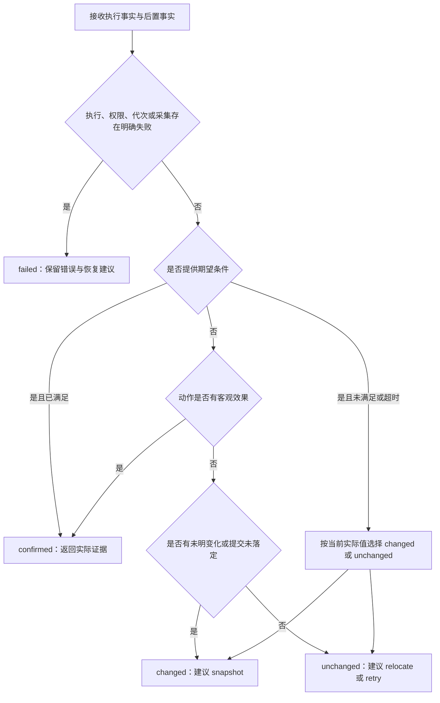
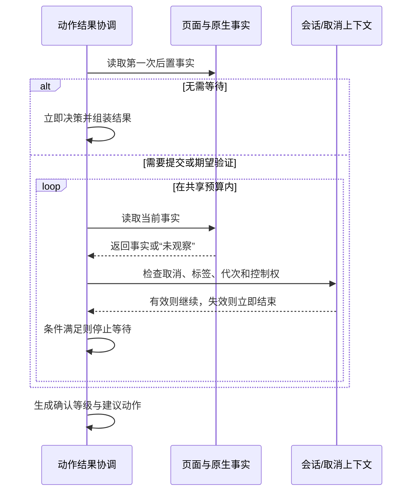

# 操作结果可确认性详细设计

## 文档控制

| 项目         | 内容                                                                       |
| ------------ | -------------------------------------------------------------------------- |
| 文档编号     | AAW-DSK-BR-DD-010                                                          |
| 版本         | 0.1                                                                        |
| 状态         | 待复审（功能设计已通过，详设与测试设计待用户评审）                         |
| 最近更新     | 2026-11-24                                                                 |
| 上游文档     | `00详细设计总览与契约索引.md`、`../功能设计/06操作结果可确认性功能设计.md` |
| 配套测试设计 | `10操作结果可确认性测试设计.md`                                            |
| 需求基线     | `desktop/docs/需求单/001-浏览器工具操作结果可确认性需求.md` 0.4            |

## 修订记录

| 版本 | 日期       | 修订原因 | 修订内容                                                       | 修订人         |
| ---- | ---------- | -------- | -------------------------------------------------------------- | -------------- |
| 0.1  | 2026-11-24 | 首次详设 | 明确模块边界、公开入口、事实模型、确认算法、结果契约与异常语义 | AAW 开发 Agent |

本文不使用业务代码或伪代码。公开入口以名称、输入、输出和语义约束表达，具体函数签名以实现时的类型定义为准，但不得改变本文的调用边界和返回语义。

## 1. 目的与范围

本文把 FD-006 的结果模型落实为原生浏览器模块内的公开契约与协作流程，覆盖后置事实采集、期望解析与匹配、变化摘要、确认等级决策、结果组装、共享等待和异常处理。

实施顺序保持 A 类后置事实 → C 类期望条件 → B 类变化摘要 → D 类文档分层。各阶段只新增语义，不改变既有工具执行、审批、快照、取消和错误码。

## 2. 代码组织与依赖

| 模块           | 归属建议                       | 职责                                                         | 依赖约束                                     |
| -------------- | ------------------------------ | ------------------------------------------------------------ | -------------------------------------------- |
| 结果契约模型   | 原生 browser 的结果契约子域    | 动作类型、确认等级、建议动作、事实、期望、变化摘要和结果分组 | 不依赖 MCP、ACP、界面或具体 Agent            |
| 期望解析与匹配 | 原生 browser 的期望子域        | 解析可选条件、校验预算、比较事实并返回实际值                 | 只依赖公共事实模型，为公开纯函数             |
| 后置事实采集   | 原生 browser 的事实子域        | 读取目标、页面、标签、对话框、下载和有限变化事实             | 复用既有页面与原生公共读取端口，不读取敏感值 |
| 确认决策       | 原生 browser 的确认子域        | 根据动作、执行状态、事实和期望结果生成等级与建议动作         | 公开纯函数，不访问 WebView 或运行时锁        |
| 动作结果协调   | 原生 browser 的动作协调子域    | 调用执行、共享等待、采集事实、组装结果和处理失效             | 是结果组装的唯一编排入口，不绕过既有动作链路 |
| MCP 结果适配   | `src-tauri/src/browser/mcp.rs` | 将协调结果合并进既有 `content` 与 `structuredContent`        | 不自行实现另一套确认规则                     |
| 有效文档       | 工具描述与 capabilities        | 说明确认等级、期望类型、预算、超时和必须观察的场景           | 不改变工具身份、审批和参数校验               |

确认决策与期望匹配不得导入 MCP、ACP、界面或原生锁。事实采集失败只能按本文降级，不得由 MCP 分支各自修补。

## 3. 核心对象模型

### 3.1 动作与执行事实

| 对象          | 语义                                                                       |
| ------------- | -------------------------------------------------------------------------- |
| ActionKind    | 填表、点击、按键、滚动、导航、历史、刷新停止、标签、提交、上传、脚本、等待 |
| ExecutionFact | 既有执行状态、请求 ID、动作参数、目标信息、错误码和取消状态                |
| PageFacts     | 当前脱敏 URL、标题、加载状态、标签事实、可见文本预算内内容和定位结果       |
| TargetFacts   | 填后值、焦点、禁用、只读、目标连接状态和滚动位置                           |
| EffectFacts   | 导航开始与提交、对话框、下载、目标移除和有限页面变化证据                   |
| ActionFacts   | 上述事实按动作组成的后置集合，附事实来源标签与代次                         |

事实必须带来源标签与代次。无法读取某项时标记为“未观察”，不得按否定事实处理。

### 3.2 期望对象

| 对象                  | 语义                                                           |
| --------------------- | -------------------------------------------------------------- |
| Expectation           | 可选条件类型、期望值和共享等待预算                             |
| ExpectationEvaluation | 是否满足、实际值、匹配数量、是否超时、实际等待时间和未满足原因 |
| ChangeSummary         | URL/标题变化、导航、目标移除、对话框、下载和有限页面变化       |
| Confirmation          | 确认等级、建议动作、判定理由、事实来源和必要降级说明           |
| ActionOutcome         | 既有执行结果、后置事实、期望验证、变化摘要、确认等级和建议动作 |

确认等级只允许 `confirmed`、`changed`、`unchanged`、`failed`；建议动作只允许 `continue`、`snapshot`、`screenshot`、`relocate`、`retry`。

## 4. 公开入口契约

### 4.1 期望解析 `parse_expectation`

| 项目     | 内容                                                                    |
| -------- | ----------------------------------------------------------------------- |
| 输入     | 工具参数中的可选 `expect` 对象及可选 `timeoutMs`                        |
| 输出     | 无期望时返回空；合法时返回 `Expectation`；非法时返回 `INVALID_ARGUMENT` |
| 支持条件 | `urlIncludes`、`textIncludes`、`selectorPresent`、`valueEquals`         |
| 预算     | 缺省 5000ms；允许显式指定，必须为正数且不超过 30000ms                   |
| 拒绝项   | 未知条件、空值、非字符串条件值、任意脚本、正则、负数或超预算等待        |

同一 `expect` 对象本期只允许一个条件，避免组合语义不清；多条件返回 `INVALID_ARGUMENT`，不静默选择其中一个。

### 4.2 期望匹配 `evaluate_expectation`

| 项目     | 内容                                                                 |
| -------- | -------------------------------------------------------------------- |
| 输入     | `Expectation`、`ActionFacts`                                         |
| 输出     | `ExpectationEvaluation`，包含是否满足、实际值、匹配数量和未满足原因  |
| 匹配规则 | 按条件类型直接比较，不转换事实、不自动选第一个、不把未观察当成不满足 |

`selectorPresent` 多匹配时返回匹配数量；是否满足仅按“存在且可见”判定，多匹配本身不构成失败。定位非法仍返回 `INVALID_ARGUMENT`。

### 4.3 确认决策 `decide_confirmation`

| 项目 | 内容                                                                       |
| ---- | -------------------------------------------------------------------------- |
| 输入 | `ActionKind`、`ExecutionFact`、`ActionFacts`、可选 `ExpectationEvaluation` |
| 输出 | `Confirmation`，包含等级、建议动作、判定理由和降级说明                     |
| 约束 | 纯函数；只依据输入事实，不读取运行时、不补猜缺失事实                       |

判定优先级：明确执行/权限/代次失败 → 期望已满足 → 动作自身客观效果 → 未明变化 → 无变化。上传的作用域判定独立于该优先级，永不把绑定结果表述为上传完成。

### 4.4 动作结果协调 `complete_action`

| 项目 | 内容                                                                |
| ---- | ------------------------------------------------------------------- |
| 输入 | 动作上下文、已执行动作结果、可选期望、事实采集端口和取消上下文      |
| 输出 | `ActionOutcome` 或既有稳定错误                                      |
| 职责 | 共享等待、事实采集、期望验证、确认决策和结果组装                    |
| 约束 | 不持有运行时锁等待；标签/代次失效立即结束；不改变动作执行和审批本身 |

事实采集端口由原生公共读取能力提供。单元测试只测上述纯函数；协调 wiring 通过真实 MCP 黑盒验证，不用私有函数替代公开动作入口。

## 5. 确认算法

动作自身客观效果按 FD-006 的动作矩阵判定，不使用统一的“执行完成即成功”。填表必须值一致；提交必须通过原生校验且有提交效果；上传只返回绑定事实与观察建议。

## 6. 共享等待与事实采集

- 导航提交和期望验证共享一个预算，不串联等待。
- 事实采集使用原生导航事件、目标读取、对话框/下载注册表和有界页面采样；不使用全文档 MutationObserver。
- 读取失败标为“未观察”，确认等级降级为 `changed` 并建议快照，不伪造成功。
- 等待期间锁只用于瞬时读取，不跨等待持有；取消、会话销毁和代次变化优先于条件满足。

## 7. 结果组装与兼容

| 结果组     | 生成时机                 | 兼容规则                                            |
| ---------- | ------------------------ | --------------------------------------------------- |
| 执行结果   | 动作执行完成             | 保留原有 `action`、`requestId`、`result` 和错误结构 |
| 后置事实   | 每次支持的动作完成       | 新附加组，不替换原 `result`                         |
| 变化摘要   | 有对应事实来源时         | 未观察项明确标注，不用 `false` 冒充未观察           |
| 期望验证   | 仅调用方提供 `expect` 时 | 未提供时不附加期望语义，旧 Agent 可忽略             |
| 确认与建议 | 每次支持的动作完成       | 新附加 `level` 与 `suggestedAction`，不影响原错误码 |

MCP 文本内容仍保留原执行结果；新增事实进入 `structuredContent`，避免把大段事实复制进文本导致上下文膨胀。

## 8. 异常语义

| 情况                  | 等级与返回                                       |
| --------------------- | ------------------------------------------------ |
| 非法期望或预算        | `INVALID_ARGUMENT`，动作不进入结果协调           |
| 未找到/多匹配/禁用    | 既有错误不变，`failed`，不生成伪后置事实         |
| 填后值不符            | `unchanged`，返回实际值与目标状态                |
| 原生校验拦截          | `unchanged`，返回校验信息和未提交事实            |
| 提交或期望超时        | `changed` 或 `unchanged`，附超时事实和当前实际值 |
| 标签/代次/控制权失效  | `failed`，附失效原因，不使用新代次事实冒充成功   |
| 事实采集不可用        | `changed`，附“未观察”和快照建议                  |
| 上传绑定成功          | 返回绑定事实与观察建议，不生成上传完成结论       |
| 旧 Agent 忽略新增字段 | 原执行结果与错误码不变                           |

## 8.1 补充边界场景规则

| 场景                       | 补充规则                                                                     |
| -------------------------- | ---------------------------------------------------------------------------- |
| 局部 SPA 变化              | 有有限变化证据但语义未明时为 `changed` 并建议 `snapshot`，不得按无变化处理   |
| 仅视觉或布局变化           | 语义事实不足以确认时仍为 `changed`，建议动作为 `screenshot`，不伪造 DOM 语义 |
| 导航协议拒绝或目标错误     | 沿用既有导航错误并标记 `failed`，不返回 `changed` 冒充导航中                 |
| 历史、刷新、停止与标签操作 | 以运行时标签和导航提交事实判定，无历史或目标不存在不得判为 `confirmed`       |
| 按键与滚动边界             | 按键看目标焦点与实际作用，滚动看位置差；到边界或无焦点为 `unchanged`         |
| 脚本与等待                 | 脚本以表达式返回值为主，页面副作用按证据降级；等待超时/取消为 `failed`       |
| 对话框与下载               | 只证明事件发生，不证明用户已接受或下载已完成                                 |
| 上传参数与类型失败         | 文件不存在、非文件或不符合控件约束时按既有错误失败，不进入绑定成功语义       |
| 多会话与多标签             | 事实只来自当前会话当前标签，其他会话或标签事实不得混入确认结果               |
| 隐私敏感页面               | URL 脱敏一致；密码和敏感输入值不进入后置事实或期望实际值                     |
| 跨源与采集不可用           | 无法读取的 frame 或事实按“未观察”降级为 `changed` 并建议快照                 |
| 慢网络与提交超时           | 超时只表示未落定，返回当前事实，不以超时冒充导航失败或成功                   |

## 9. 性能、隐私与安全

- 事实采集仅使用当前动作所需页面与目标读取，不引入全文档高频监听。
- 文本比较只使用有界可见文本，URL 使用快照一致的脱敏规则。
- 不读取密码、Cookie、完整查询、完整页面正文和敏感表单值。
- 结果协调不得改变 040 的审批等待、036 的审批桥和既有取消语义。
- 结果字段与类型必须在 Rust 与 TypeScript 展示侧保持同一契约，不允许私有旁路字段。

## 10. 验收与追踪

| 设计点          | 验证方式                                     | 对应需求与场景      |
| --------------- | -------------------------------------------- | ------------------- |
| 期望解析与匹配  | 单元：合法、非法、预算、各条件匹配和实际值   | FR-06、AC-06        |
| 确认决策矩阵    | 单元：各动作成功、变化、无效、失败和降级     | FR-01～FR-05、FR-09 |
| 共享等待与失效  | 黑盒：超时、取消、代次失效、采集不可用       | FR-06、AC-09        |
| MCP 结果接线    | 黑盒：搜索、必填、无效按钮、下载、只读、上传 | AC-01～AC-05、AC-07 |
| 性能与兼容      | 重元素连续操作、无期望旧调用、全量回归       | AC-08、兼容评审     |
| 真实 Agent 行为 | 直接继续与快照辅助两条路径                   | M01、M02            |

## 11. 评审检查表

1. 是否所有确认规则都集中在公开纯函数，而非 MCP 分支各写一套。
2. 是否期望匹配只比较事实，不把未观察当成不满足，不自动选择第一个。
3. 是否共享等待不持锁、可取消、受代次控制，且不与审批等待重复叠加。
4. 是否上传只有绑定语义，SPA 未明变化没有被误报为无效果。
5. 是否所有新字段只增不改，文本结果没有膨胀为大段页面正文。
6. 是否每项动作、异常和结果组都有对应测试与直接证据出处。
