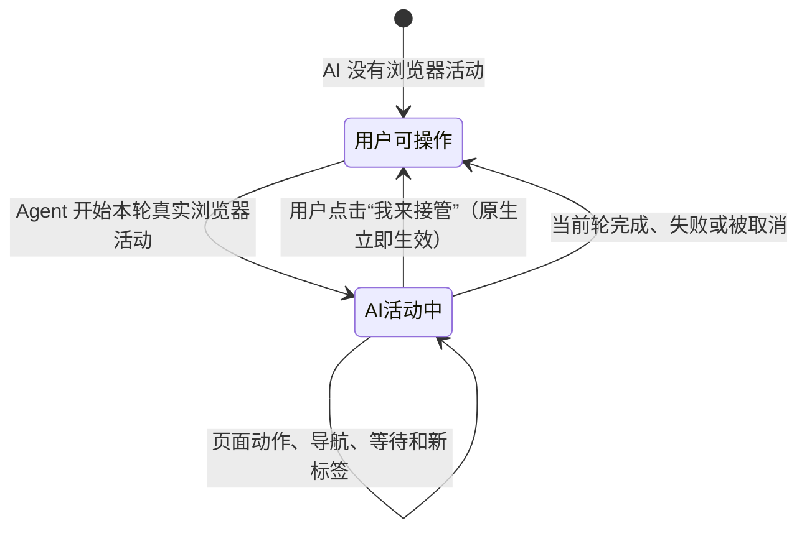

# AI 活动中用户打断与结束自动交还需求

## 文档控制

| 项目     | 内容                                                               |
| -------- | ------------------------------------------------------------------ |
| 编号     | 024                                                                |
| 类型     | 需求变更与交互/权限模型重构建议，不是已确认缺陷                    |
| 状态     | 已闭环：P1/P2/P3、全量回归与 DeskPilot 真实接管/自动交还验收均通过 |
| 提出日期 | 2026-11-16                                                         |
| 关联事项 | 012 静态显式接管模型、021 图层、022 显隐、023 渐变玻璃与提示       |
| 参考     | 用户提供的 Kimi Code 浏览器玻璃层截图                              |

## 1. 参考行为与目标

参考截图中的蓝色玻璃包含“Agent 正在操作”和显眼的“我来接管”按钮。AI 工作时隔绝页面交互；用户点击接管后终止当前 AI 活动；AI 完成活动后玻璃自动移除，用户可直接操作页面。

目标不是单纯美化 023，而是把用户的“我要打断”变成玻璃上的直接动作，并消除静态开关带来的理解和操作成本。

## 2. 为什么现有静态开关模型不等价

当前 012 模型只有人工接管开/关：

- 关闭代表 AI 控制，当前实现会一直显示玻璃。
- 开启代表人工控制，用户需主动寻找并切换开关。
- AI 完成工作后没有自动撤去玻璃的事件驱动语义。
- 用户需要理解两个方向的权限归属，而不是只识别“我来接管”这一主动作。

因此不能仅把玻璃提示改成“请打开开关”就声称达到参考体验。需要改成活动驱动模型。

## 3. 推荐状态机

| 状态       | 玻璃                               | 用户页面操作         | Agent 浏览器操作                     |
| ---------- | ---------------------------------- | -------------------- | ------------------------------------ |
| 用户可操作 | 无                                 | 允许                 | 无当前活动；新轮次开始后才可重新进入 |
| AI 活动中  | 蓝色渐变玻璃、状态与“我来接管”按钮 | 除接管按钮外全部隔离 | 允许当前授权活动                     |

用户接管不设置“正在打断”权限中间态：原生控制权与玻璃先立即切换，ACP 取消在后台执行；取消结果不得反转用户控制。

## 4. 取消语义是核心设计点

“我来接管”终止**当前整个 ACP 轮次**，而不是只取消当前一条 Browser MCP 调用。否则当前调用结束后，Agent 可能立即发出下一动作，导致玻璃反复出现、用户无法稳定操作。

AAW 复用公开 `ProjectConversation.cancel` 与 `sessionStore.requestCancel`，底层使用 `session/cancel`；浏览器立即取消会话内未决请求并使旧审批失效。原生接管与玻璃移除不等待 ACP 响应，后台取消结果只用于呈现真实轮次终态，不能夺回浏览器权限。

后续用户需要 AI 继续时，通过新的用户指令启动新一轮；不需要再设置一个静态“交还”开关。

## 5. 活动判定不能只看单次请求

Browser MCP 请求之间存在思考、生成和事件间隔。如果只根据 pending 请求显示玻璃，玻璃会在相邻工具调用之间闪烁，并短暂放行用户输入。

需要以“当前轮首次真实浏览器活动 → 当前轮终态”为玻璃周期，而不是单次请求开始/结束。Agent 轮次活跃但没有浏览器活动时，不应提前遮挡页面。

## 6. 原生桥与安全边界

- 玻璃位于原生 WebView 内部，继续承担页面命中、动效和焦点隔离。
- “我来接管”按钮需要经原生消息桥进入 AAW 主窗口，再调用公开取消入口。
- 请求必须校验当前会话、标签、代次和活动状态；旧页面、旧代次和后台会话不能取消当前工作。
- 页面脚本可能伪造消息，原生侧不能只凭消息文本信任身份；接管按钮应只响应真实用户事件，原生桥仍需执行归属校验。
- 全局 Agent 总开关、高风险审批、跨会话隔离和现有 fail-closed 规则保持独立。
- 玻璃本身不是权限边界，原生运行时和 ACP 取消结果才是最终事实。

## 7. 对现有工作的复用与影响

| 模块                                 | 复用或变化                                  |
| ------------------------------------ | ------------------------------------------- |
| 023 蓝色渐变玻璃、焦点清理和尺寸跟随 | 可复用，但文案改为状态和“我来接管”          |
| 023 静态红蓝滑动开关                 | 若 024 获批，将被移除，不再保留双重控制入口 |
| 012 静态开关、控制代次和测试         | 需要按新模型修订；取消/失效规则尽量复用     |
| 021 全局浮层遮挡仲裁                 | 保留                                        |
| 022 原生页面唯一显隐                 | 保留                                        |
| 全局 Agent 控制总开关                | 保留，不等于接管按钮                        |
| 高风险审批                           | 保留独立审批                                |

## 8. 成本与主要风险

- 成本高于静态开关：新增活动周期、原生接管消息、ACP 取消确认和迟到结果处理。
- 最大风险是只取消单次 MCP 调用，导致 Agent 后续动作反复抢回浏览器；必须取消当前轮。
- 第二风险是用 pending 请求判定活动，导致工具调用间隙玻璃闪烁；必须按轮次管理。
- 第三风险是伪造接管消息或旧会话取消；必须执行可信事件、归属和代次校验。

这些都有现有模块可复用，技术上可实现，但需要完整 SDD，而不是视觉小改。

## 9. 必须覆盖的验收场景

1. Agent 尚未操作页面时无玻璃，用户可直接操作。
2. Agent 开始真实浏览器活动后玻璃出现，页面动效、焦点、点击、输入、滚动均被隔离。
3. 点击“我来接管”后原生控制权与玻璃立即切换，不等待 ACP；旧请求、旧审批和旧代次立即失效。
4. 当前整个 ACP 轮次在后台真实取消；无论取消结果如何都不反转用户控制，用户可直接操作且无需切换开关。
5. Agent 正常完成、失败或被其他安全路径终止时玻璃自动移除。
6. 新一轮浏览器活动重新出现玻璃；工具调用间隙不闪烁。
7. A/B 会话、多标签、后台页面、旧代次和迟到事件不能误取消或误显示。
8. 全局开关、高风险审批、021/022 和 017 证据链路不回归。

## 10. 决策结果

- 用户已批准用 024 的活动驱动模型替代 012 的静态人工接管开关。
- 用户已确认“我来接管”取消当前整个 ACP 轮次，并采用原生即时接管、后台取消。

023 的静态开关入口随 024 移除；玻璃隔离、尺寸跟随、021/022 与 017 的回归证据继续保留。

## 11. 用户决策与即时接管修订（2026-11-16）

### 已批准

用户明确批准用 024 的活动驱动模型替代 012 的静态人工接管开关。

### 即时接管要求

用户明确否决“点击后等待取消完成才能接管”。修订为：

1. 真实用户点击“我来接管”后，立即把浏览器控制权改为用户，并立即移除玻璃，不等待 ACP 响应。
2. 当前会话未决浏览器请求和旧审批立即失效，旧轮次的后续浏览器动作必须被新控制代次拒绝。
3. ACP 轮次取消在后台执行，取消结果不得阻塞或反转本次用户接管。
4. 即使后台取消失败，也保持用户控制并给出非阻断错误提示，不得自动把权限交回旧轮次。
5. 已经产生的页面副作用不能虚假回滚；即时接管表示立即阻止新的权限使用，不承诺撤销已执行动作。

### 已确认的取消范围

“取消整个 ACP 轮次”是停止当前这一条用户任务对应的模型规划与工具调用链，不是删除会话、清空历史、关闭浏览器或取消未来任务。后续需要 AI 时，用户发送新指令即可开始新轮次。

如果只取消当前浏览器动作，Agent 收到失败结果后可能重试、换标签或选择其他动作，重新争夺浏览器；如果只收回浏览器权限而不取消 ACP 轮次，模型仍可能在后台运行并调用其他非浏览器工具。用户已确认采用即时收回浏览器权限，同时在后台取消当前整个 ACP 轮次。
