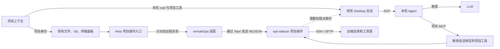

# AAW 远程项目适配方案与实施计划

**状态**　交互与架构已复核。Windows 调试工作台已验证真实 Agent 远程读改跑和桌面审批，发布配对打包待验收。详见[技术穿刺记录](remote-project-spike-results.md)。

## 1. 目标与首版范围

用户添加项目时选择 SSH 连接和远端 Linux 目录。之后通过普通项目入口新建会话、浏览和编辑文件、查看 Git 变更、打开终端。用户在会话中可以直接说「修改这个文件并跑测试」，AAW 根据项目记录为 Agent 准备工具，并将文件、Git 和命令路由到远端。操作与本地项目共用会话权限、审批界面和使用路径。

**选型是复用 OpsCopilot 的 Go 运维内核及 `ops-sidecar`。** Desktop 和 ACP Agent 在本机运行，Agent 在本机调用 LLM。文件、Git 和命令通过本机 sidecar 访问远端。远端继续使用已有的 SSH/SFTP 服务和项目工具链。支持范围以本机可通过 SSH 访问、远端无外发网络的 Linux 环境为准。

项目文件和 Git 工作区以远端为准。会话历史、面板状态以及待提交的编辑草稿留在本机。读取后交给 Agent 的文件内容与命令结果可能进入 LLM 请求，目标环境需要允许这条数据路径。

首版覆盖项目入口、会话、文件树与文本编辑、Git 状态与 diff、交互终端。工作流节点、技能安装、定时任务及实时远端文件监听放在后续批次。

## 2. 架构和职责

| 所有者                                               | 职责                                                                                                 |
| ---------------------------------------------------- | ---------------------------------------------------------------------------------------------------- |
| AAW `project` 与 `workbench`                         | 保存项目身份，负责选择项目、会话归属、草稿和面板状态。                                               |
| AAW `remoteOps` 与 `host`                            | 复用 sidecar 启停、请求与事件桥。把项目、文件、Git、终端操作转给 sidecar，并把授权请求送回发起会话。 |
| OpsCopilot `opssidecar`                              | 提供项目操作接口和项目 MCP 工具。解析项目绑定，校验调用权限，调度操作并回传结果。                    |
| OpsCopilot `sshclient`、`filetransfer` 和 `core/ops` | 提供 SSH 认证与通道、SFTP 读写和命令运行。项目所需的通用改动在原仓维护。                             |

**插件依赖。** `project` 沿用对 `acpRuntime` 和 `remoteOps` 的依赖。文件、Git、终端继续依赖 `host` 提供的能力，调用时传入项目上下文。`remoteOps` 在装配时向 `host` 注册远程实现，`host` 按项目类型选择实现，Tauri 管理本机 sidecar 进程。上图箭头表示运行时调用，插件依赖方向以上述装配关系为准。 [现有插件依赖图](D:/dev/workspace-ai/Awesome-Agent-Workflow/desktop/docs/architecture/cordis-plugin-dependencies.mmd:49)

**实施基线。** AAW 主仓 `4b88d480` 提供 `remoteOps`、Tauri 宿主与回环 HTTP MCP，工作流分支 `ee6bbe98` 提供普通会话的工具注册入口。批次 0 先在实施分支汇合并验证两套能力。OpsCopilot 参考提交为 `1e49e3c`。开发和 CI 使用固定的 OpsCopilot 源码提交，通过 `OPSCOPILOT_REPO` 构建并随 AAW 分发配对的 sidecar。 [AAW 接入设计](D:/dev/workspace-ai/Awesome-Agent-Workflow/desktop/src/plugins/remoteOps/docs/design.md:9) · [会话工具入口](D:/dev/workspace-ai/Awesome-Agent-Workflow-flow/desktop/src/plugins/project/sessions/sessionTools.ts:30) · [sidecar 构建入口](D:/dev/workspace-ai/Awesome-Agent-Workflow/desktop/scripts/build-ops-sidecar.mjs:2)

## 3. 项目与连接

每个远程项目保存以下信息。

| 字段           | 用途                                                                                  |
| -------------- | ------------------------------------------------------------------------------------- |
| `projectId`    | AAW 项目身份，用于会话、草稿、标签页、缓存和导航。                                    |
| `connectionId` | 用户选定的 SSH 连接配置，决定登录身份、端口和跳板链。凭据由连接配置的宿主侧服务持有。 |
| `remoteRoot`   | 由远端解析的项目根目录，作为相对文件路径和远程命令工作目录的基准。                    |
| `agentCwd`     | 每个远程项目派生的稳定本机工作目录，供 ACP 新建、列表筛选和恢复会话。                 |

本地项目继续通过原有路径键读取项目记录、会话历史和面板状态。远程项目用 `projectId` 隔离会话、文件标签和 Git 缓存。相关 API 承载项目上下文，文件引用使用项目身份和相对路径。新增入口时同步验收旧本地项目打开及历史恢复。

### 添加远程项目和管理连接

1. **选择 SSH 连接。** 「添加项目 → SSH 远程目录」左侧显示可搜索的连接列表，每项展示名称、账号、主机、端口和测试状态。可就地新建连接，或进入连接管理测试、编辑和删除。新连接表单保存名称、主机、端口、账号、认证方式和可选跳板，测试连接与保存可以分别执行。保存后回到添加项目并选中新连接。
2. **浏览并选根目录。** 选中连接后在右侧加载远端家目录。使用目录项、面包屑、上一级或绝对路径定位目标，也可从该连接的最近目录进入。目录打开成功后展示选中路径并启用「添加项目」。路径不存在、权限不足和连接失败在当前界面提示。切换连接时目录结果随连接切换，上一条连接的迟到响应仅归属原请求。
3. **维护已有绑定。** 改名通过连接 ID 更新展示。连接仍被项目或跳板链引用时，删除入口展示引用对象并保留记录。修改主机、端口、账号或跳板时，保存前显示受影响项目，保存后按新配置重新校验身份和项目目录，才恢复该项目的远程操作。

在 sidecar 将文件、命令和终端的配置查找统一到 `connectionId`。通过连接配置和配置修订复用 SSH，配置变化后重新建立连接。相同服务器地址下的不同账号、端口或跳板独立处理，同一条配置下的多个项目可以共用连接。连接失效后，文件和命令只在同一项目配置上恢复。

远程项目连接使用固定主机密钥或可信的 `known_hosts` 条目。首次连接展示指纹供确认，指纹变化后要求重新校验。项目拨号将主机密钥配置传到目标和每一跳的 SSH 握手。最小闭环先使用现有密码或键盘交互方式。私钥和 `ssh-agent` 认证在连接兼容批次补齐。 [当前 SSH 拨号](D:/dev/workspace-go/OpsCopilot/pkg/sshclient/client.go:71) · [当前拨号配置装配](D:/dev/workspace-go/OpsCopilot/pkg/core/ops/exec.go:79)

## 4. 项目操作

以下是逻辑操作，实际 RPC 命名在两仓契约测试中固定。Desktop 项目接口及 MCP 工具复用这些操作。

首版项目 MCP 暴露四个通用工具。与当前会话绑定的远端项目根目录决定操作目标。

| 工具 | 职责 |
| --- | --- |
| `read_file` | 按项目相对路径读取文本和版本。 |
| `edit_file` | 按读取版本替换唯一匹配文本。 |
| `write_file` | 新建文本文件，或按读取版本保存完整内容。 |
| `run_command` | 在远端项目目录执行命令，返回输出和退出码。项目搜索、Git 查询和测试可以使用该工具。 |

文件树使用 Desktop 项目接口列目录。Agent 的审批以同一 Agent、同一会话设置下的本地行为为基准。实际需要审批的操作交给 AAW 会话处理。

| 操作               | 实现约定                                                                                                                                                                                        |
| ------------------ | ----------------------------------------------------------------------------------------------------------------------------------------------------------------------------------------------- |
| 列目录、搜索和预览 | 目录请求直接返回已有元数据。项目短文件操作复用 SFTP 通道，按需展开目录并限制遍历和预览大小。保存成功后刷新受影响的目录、文件和 Git 结果。其他进程造成的变化由手动刷新和可见页面的有界轮询发现。 |
| 读取、保存文本     | 读取返回内容与原始字节的版本标识。保存接收期望版本，在同目录创建临时文件，完整写入并保留必要权限，提交前再次检查目标版本。冲突时允许用户重新加载并比较。提交使用服务器支持的同目录替换能力。    |
| 运行命令           | 复用 `RunCommand`，将当前项目根目录传给远端命令。用操作 ID 关联有界输出、真实退出码、超时和取消，保留 stdout 与 stderr 的区别。Git、文件请求和交互终端可与长命令并发。                          |
| 查询 Git           | 在远端仓库获取状态和 diff，转换为现有 Git 面板的数据结构。单独限制 Git 输出并标明截断。Git 变更条目保留项目身份和相对路径，支持跳到远端文件。                                                   |
| 打开终端           | 通过同一连接配置在远端根目录启动 SSH PTY，接入 AAW 的终端视图。单独传递终端输出、用户输入和窗口尺寸。断线后回放历史输出，重新拨号后的终端展示为新的 Shell。                                     |

**保存与恢复语义。** AAW 内对同一路径的写入串行化。版本检查可以识别检查时已发生的外部修改，同目录替换可以保护原文件免受部分写入。这两步之间仍可能发生其他程序的写入，首版按这一语义测试。缺少安全替换能力的远端目录保持浏览和预览能力，并在编辑入口提示原因。提交发送后回执丢失时标记结果未知，重连后核对文件版本或命令结果，由用户决定是否再次执行。 [当前 SFTP 写入](D:/dev/workspace-go/OpsCopilot/pkg/filetransfer/sftp_transport.go:307) · [命令结果契约](D:/dev/workspace-go/OpsCopilot/pkg/remote/command.go:10) · [SFTP 文件替换接口](https://pkg.go.dev/github.com/pkg/sftp@v1.13.10#Client.PosixRename)

**并发与流量。** sidecar 的同步请求循环和命令持锁路径需要拆开。请求按 ID 关联，通过有界并发调度，配置锁只覆盖读写共享状态。目录与预览共用短操作的 SFTP 通道，需通过关闭通道来取消的文件操作使用独立通道。长命令、PTY 和传输各自管理生命周期。收到远端结束证据后才确认命令已停止，关闭本机通道时可以结束等待并报告远端状态未知。 [当前执行入口](D:/dev/workspace-go/OpsCopilot/pkg/opssidecar/service.go:638) · [当前请求循环](D:/dev/workspace-go/OpsCopilot/pkg/opssidecar/service.go:1098)

## 5. 配置、数据与授权

### 项目权限和运维限制

Ops 运维面板的 `exec` 与 `ft/*` 调用适用原有运维策略。项目文件和命令通过项目入口，采用 AAW 会话的权限规则，复用同一 SSH/SFTP 执行层。 [现有运维执行入口](D:/dev/workspace-go/OpsCopilot/pkg/opssidecar/service.go:638) · [默认文件传输规则](D:/dev/workspace-go/OpsCopilot/pkg/core/security/file_access.go:431)

1. **确定执行位置。** sidecar 根据已绑定的项目取得连接和根目录。文件操作校验路径及字节上限后调用 SFTP。命令在项目目录调用 `RunCommand`，返回输出和真实退出码。用户主动保存使用现有编辑器的交互。 [底层命令执行](D:/dev/workspace-go/OpsCopilot/pkg/sshclient/command.go:61)
2. **复用现有会话权限。** 项目 MCP 将操作意图交给 Desktop 按发起会话的有效权限判定。ACP 的 `session/request_permission` 只在 Agent 发出请求时进入 AAW 的默认应答，MCP 调用需接入同一权限面并验证每种 Agent 模式对读、写、执行的映射。支持的模式下，行为应与本地一致，包括直接执行和出现原会话审批卡两种情况。无法确定权限映射的 Agent 或模式需在预验证中补齐，达到条件后开放相应工具。 [当前会话审批策略](D:/dev/workspace-ai/Awesome-Agent-Workflow-flow/desktop/src/plugins/project/interactions/permissionPolicy.ts:1)
3. **提交原操作。** sidecar 持有原请求并绑定项目、会话、连接修订及参数，按 Desktop 对该请求的决定执行一次。审批中途切换连接、关闭会话或取消操作时，待执行请求失效。管理员已为连接明确设置的强制规则继续在 sidecar 执行前校验。

项目接口的超时、输出和预览上限由 sidecar 管理，界面显示执行结果和截断状态。命令在项目目录起步，实际执行权限由远端 SSH 账号决定。

### 数据归属

数据位置沿用 AAW 的 sidecar 存储模式。工作流宿主通过 Tauri 的 `app_data_dir()` 创建自己的子目录，并把数据库路径传给引擎。Ops 采用同样的目录管理方式，文件内容继续由 Go 侧按 Ops 原格式读写。 [工作流宿主](D:/dev/workspace-ai/Awesome-Agent-Workflow/desktop/src-tauri/src/workflow_service.rs:117)

1. AAW 启动 sidecar 时计算并创建 `app_data_dir()/ops-sidecar`，把它作为 `OPSCOPILOT_DATA_DIR` 传给 Go 进程。现有代码已创建该目录来存日志，传环境变量的分支要补上这个默认值。旧安装显式配置的数据源在迁移确认前继续可用。 [Tauri sidecar 启动](D:/dev/workspace-ai/Awesome-Agent-Workflow/desktop/src-tauri/src/ops_service.rs:121)
2. Go sidecar 的 `resolveDataDir()` 已优先读取该环境变量，再从该目录加载 `sessions.json`、`command_whitelist.json`、`file_access.json` 和 `config.json`。AAW 运维面板与项目添加页通过同一进程读取和更新连接。 [Ops 数据目录解析](D:/dev/workspace-go/OpsCopilot/pkg/opssidecar/service.go:1149) · [Ops 配置加载](D:/dev/workspace-go/OpsCopilot/pkg/opssidecar/service.go:95)
3. AAW 的运维面板按默认数据根直接启动，新用户首次使用可以新增连接。将现有的选目录入口用于显式导入或旧配置迁移。项目 MCP 挂载依据功能是否启用和项目上下文，去掉必须先选择共享目录的条件。独立运行的 OpsCopilot 桌面继续从自己的配置目录启动。 [现有目录选择入口](D:/dev/workspace-ai/Awesome-Agent-Workflow/desktop/src/plugins/remoteOps/ui/OpsPanel.tsx:319) · [现有 MCP 挂载条件](D:/dev/workspace-ai/Awesome-Agent-Workflow/desktop/src/plugins/remoteOps/ops/remoteOps.ts:165)

| 数据                 | 保存位置和方式                                                                                                                                                                   |
| -------------------- | -------------------------------------------------------------------------------------------------------------------------------------------------------------------------------- |
| 服务器连接与运维配置 | AAW 数据根中的 sidecar 配置。复用 `sessions.json`、命令和文件策略的序列化实现。连接记录保存地址、端口、账号、跳板、主机指纹和凭据引用。                                          |
| SSH 凭据             | 系统凭据库，以 AAW 的命名空间、连接配置 ID 和连接跳数区分。私钥方式保存引用，密钥内容由本机 SSH 认证组件读用。新链路需改造当前以主机和账号查密码、且可从连接配置回读密码的实现。 |
| 项目及会话           | AAW 现有项目存储记录 `projectId`、`connectionId`、目录和会话关联，以及草稿、面板状态。Agent 的会话历史沿用 Agent 本机存储。                                                      |
| 审计和运行状态       | 操作日志归 AAW 的 sidecar 数据目录，记录目标项目、调用来源、操作、结果和必要的脱敏信息。连接、PTY、审批请求、项目 MCP 凭据随进程或会话按生命周期管理。                           |

已有目录可由用户选择导入连接配置，密码或私钥口令在 AAW 补录或重新验证。导入时保留来源连接 ID，发生冲突时为导入项生成新 ID，随导入更新关联。每个 sidecar 进程使用一个数据根，旧共享目录在导入和核验后，以 AAW 管理的数据根重启 sidecar。迁移验收检查原连接记录、项目关联和凭据恢复，失败时可以切回旧路径。 [Tauri sidecar 启动](D:/dev/workspace-ai/Awesome-Agent-Workflow/desktop/src-tauri/src/ops_service.rs:121) · [Ops 凭据读取](D:/dev/workspace-go/OpsCopilot/pkg/core/ops/exec.go:79)

## 6. 新建和恢复会话

用户在远程项目上点现有的「新建会话」。项目总览和项目树沿用普通会话入口，点击后先打开一条该项目的空白草稿，供用户选模型和编辑首条消息。流程如下。 [普通新建会话入口](D:/dev/workspace-ai/Awesome-Agent-Workflow-flow/desktop/src/plugins/project/sessions/sessionStart.ts:31)

1. Desktop 根据 `projectId` 取得项目绑定与本机 `agentCwd`，准备本机 Agent 的 ACP 连接。
2. 首次发送消息时，Desktop 通过会话工具入口取得项目 MCP 配置。sidecar 为该草稿的运行实例签发凭据，从凭据解析已有的 `connectionId` 和 `remoteRoot`。
3. Desktop 调用 ACP `session/new`，传入本机 `agentCwd` 和项目 MCP 配置。Agent 返回 `sessionId` 后，Desktop 将草稿转正并登记项目归属，然后发送首条消息。创建失败时保留草稿和输入。
4. Agent 进行远程操作时调用项目 MCP。sidecar 按固定绑定连接 SSH，已有连接可继续复用。用户打开终端时再创建一个远端 PTY。

打开历史会话沿用 ACP `session/load`，按原项目重新挂载 MCP。切换项目后的操作仍归属发起会话。活跃项目会话持有 sidecar，关闭后释放，避免空闲回收使正在使用的工具失效。异常退出后由会话恢复重新签发工具凭据，已提交的操作按第 4 节核对结果。聊天中的文件链接、`@文件` 和 Git 差异跳转使用同一个项目身份。 [会话创建与 MCP 注入](D:/dev/workspace-ai/Awesome-Agent-Workflow-flow/desktop/src/plugins/project/conversation/SessionFactory.ts:51) · [sidecar 空闲判断](D:/dev/workspace-go/OpsCopilot/pkg/opssidecar/service.go:298)

**项目工具绑定。** 现有运维 MCP 组合令牌的 `hint` 用于事件路由。项目工具使用另一种服务端登记的会话凭据，校验项目、真实连接修订和 sidecar 实例。项目工具清单针对绑定项目提供目录、读取、写入、Git 和命令操作。 [现有回环 MCP 接入](D:/dev/workspace-ai/Awesome-Agent-Workflow/desktop/src/plugins/remoteOps/ops/remoteOps.ts:165) · [现有令牌解析](D:/dev/workspace-go/OpsCopilot/pkg/opssidecar/mcpbridge.go:58)

**Agent 适配门槛。** MCP 注入提供远程工具，实际工具路由和审批仍取决于 Agent 及会话模式。用同一个 Agent、同一句普通任务、同一个权限设置分别运行本地和远程项目。记录实际 MCP/本机工具调用、文件写入位置、远端退出码和审批决策，确认远程任务使用的是绑定项目，且本机验证文件保持原样。持续使用本机文件或 Shell 的 Agent 先补齐工具路由适配，验证通过后开放项目操作。

## 7. 实施计划

**批次 0 先做最小技术验证。** 选一个目标 Agent，使用标准 ACP 和最小项目 MCP，在禁止外发的测试 SSH 主机上验证读取、修改和运行测试。验证普通任务描述、直接执行和需要确认两种权限行为。取得可核对的调用记录后，进入完整项目适配。

| 批次                  | OpsCopilot 交付                                                                | AAW 交付                                                                               | 进入下一批的条件                                                                           |
| --------------------- | ------------------------------------------------------------------------------ | -------------------------------------------------------------------------------------- | ------------------------------------------------------------------------------------------ |
| 0. 基线与预验证       | 准备最小项目工具、接口版本、错误码和测试 SSH 环境。                            | 汇合 `remoteOps` 和普通会话工具入口，固定 sidecar 源码版本及 AAW 数据根。              | 目标 Agent 的工具路由与权限一致性有实测记录，Windows 构建能启动配对 sidecar。              |
| 1. 项目连接与只读浏览 | 接入配置 ID、主机密钥校验、凭据引用和项目目录读取。                            | 增加「添加远程项目」，选择连接和目录。接好项目身份、恢复记录、文件树和预览。           | 同地址不同账号可以独立浏览。同路径项目的标签页和缓存独立。本地项目历史及布局可以恢复。     |
| 2. 读改跑闭环         | 实现版本检查、文件安全提交、命令并发、Git 查询与项目 MCP 工具。                | 将新建和恢复会话、文件编辑、Git 接入项目宿主。完成授权回传和文件跳转。                 | 本机 Agent 能读、改、跑，右侧显示同一份远端 diff。保存冲突、断线及结果未知场景有明确反馈。 |
| 3. 终端与交付         | 接入项目 PTY，验证私钥、`ssh-agent` 和跳板链。补生命周期、负载和资源回收测试。 | 接入项目终端，检查连接状态、用户取消和重连，完成安装包验证。                           | 断开外发网络的 Linux 能完成读改跑。长命令与其他面板操作并行。Windows 安装包可复现构建。    |
| 4. 扩展项目能力       | 根据实测决定文件监听和长任务恢复方式。                                         | 让工作流节点复用远程项目会话，明确脚本、MCP 服务和运行记录的归属，再接技能与定时任务。 | 工作流预检能识别远端项目，单独验收节点、脚本和结果工具。                                   |

同一批次先稳定 OpsCopilot 契约及测试，再合入 AAW 适配和对应的 sidecar 版本。跨仓联合验证记录两仓提交、安装包版本、Agent 类型和远端环境。

## 8. 验收与验证

| 场景                      | 可核对的结果                                                                                                                                                |
| ------------------------- | ----------------------------------------------------------------------------------------------------------------------------------------------------------- |
| 两条 SSH 配置连接同一主机 | 两个项目各自看到对应账号的权限，执行命令所得身份与配置一致。两个项目即使目录同名，标签、草稿、文件链接和会话仍独立。                                        |
| 连接和目录选择            | 新建、测试、确认主机指纹、保存并直接选择连接。同一项目可从目录浏览或最近目录打开。测试失败、主机指纹变化和目录拒绝都有明确提示，切换账号时目录不会串。      |
| 配置与授权                | 重启后根据连接 ID 找回配置和凭据。使用相同 Agent 和权限模式对比本地与远端。直接放行的操作完成执行，需要确认的操作使用同一审批交互，拒绝后目标状态保持原样。 |
| 新建会话                  | 点击后显示空白草稿。首条消息创建独立会话并挂载当前项目工具。创建失败后可用原输入重试。                                                                      |
| 同文件竞争写入            | Agent 保存前由其他端先修改，保存返回冲突。传临时文件途中断线，目标文件内容完整。提交回执丢失可按项目核对正确文件。                                          |
| 长命令和并发              | 长时间测试期间能展开目录、预览文件、刷新 Git 和使用终端。记录冷、热请求延迟及 SSH/SFTP 建连次数。取消长命令后验证同连接的其他操作。                         |
| 会话恢复和授权            | 应用重启或 sidecar 退出后，恢复会话并重新挂载原项目工具。旧审批不能用于新连接，项目操作在断线时明确失败或返回结果未知。                                     |
| 真实 Agent 与离线远端     | 使用普通任务描述让 Agent 读取、修改并跑测试。工具调用、远端文件内容、退出码和 Git diff 相互对应。远端网络策略阻断外发。                                     |

OpsCopilot 运行 `go test ./pkg/opssidecar ./pkg/core/ops ./pkg/filetransfer ./pkg/sshclient` 及新增契约用例。AAW 前端运行 `typecheck`、`lint`、`format:check`、`test` 和涉及界面时的 `test:visual`。插件依赖变化同步架构图和依赖文档。修改 Tauri 或工作流引擎时执行相应 Rust 测试和构建门禁。联调分别记录自动化证据、真实 Agent 操作和安装包验收。

## 9. 技术取舍

- **现有 Go sidecar**是实施方案。底层已经使用开源 `golang.org/x/crypto/ssh` 和 `github.com/pkg/sftp`，项目补齐集中在调度、路径、保存和会话绑定。 [OpsCopilot 依赖](D:/dev/workspace-go/OpsCopilot/go.mod:10)
- **系统 OpenSSH**适用于客户强依赖现有 SSH 配置、证书或代理链的环境。若实际接入遇到这些要求，按真实连接配置评估兼容入口。 [OpenSSH 客户端配置](https://man.openbsd.org/ssh_config) · [Win32 OpenSSH 功能范围](https://github.com/PowerShell/Win32-OpenSSH/wiki/Project-Scope)
- **Rust SSH 库和远端 IDE 服务**是不同层的替代选项。Rust 库适合有单语言交付要求时评估，连接及通道生命周期需要重新集成。远端 IDE 服务适合允许在远端部署专用组件的环境。 [russh 客户端](https://docs.rs/russh/latest/russh/client/) · [Zed 远程开发架构](https://zed.dev/docs/remote-development)
