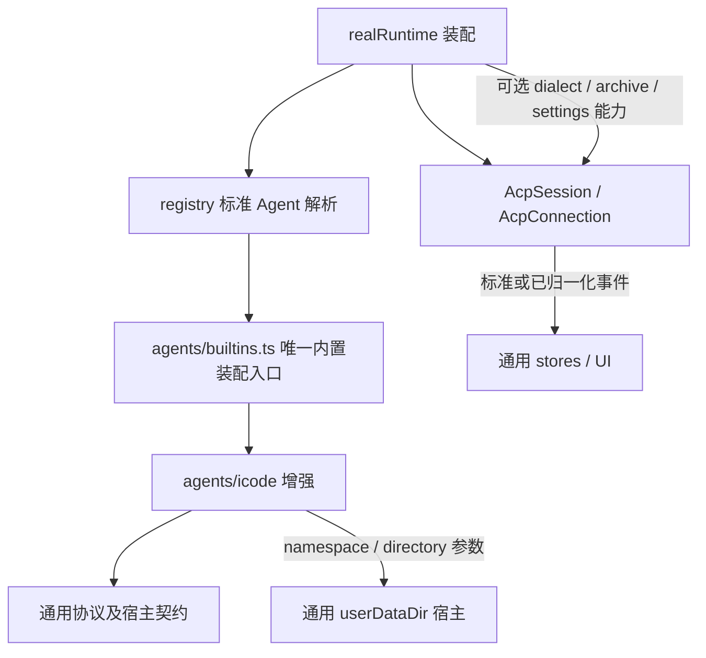

# ACP 功能覆盖与严格解耦验收

核验日期：2026-11-05。范围：当前 Desktop ACP v1 实现、ICode 增强及其共享 UI/状态边界。Q1–Q5 均已确认：本地自动化、测试证实后修复、不新增协议能力、不使用真实模型，不设行覆盖率阈值。

**结论须分层理解**：已有下表列出的正常与异常用例；新增了禁止加载 ICode 的标准协议组合测试及架构守卫。这不等于所有异常排列均已覆盖，也不等于实际 Agent/WebView/操作系统行为已经验收。表中的“单层”不能当作完整端到端证据。

## 实际架构与本轮修复

| 测试证实的问题 | 修复 | 回归证据 |
| --- | --- | --- |
| 共享层经 registry 直接加载 ICode | 专属 import 移至唯一 `builtins.ts`；空注册时仍解析原生/自定义 Agent | `enhancementDependencies` 先失败；`standardWithoutEnhancement` 禁载所有增强源码，导入实际 runtime/settings/workspace 并完成对话 |
| healthChecks 和 workspaceStore 引用 ICode 默认值及迁移 | 通用工具路径保留未知字符串键；只有增强 `launch.ts` 解释旧 `chrysCommand`，处理旧默认值并保持显式路径优先 | 依赖守卫先失败；`workspaceStore` 与 `legacyExecutableBoundary` 验证持久化和迁移 |
| aaw/skills、UI skillCatalog 转导出增强实现 | 删除共享目录转导出；专属测试直接引用增强目录 | 依赖守卫包含转导出负例；技能安装、候选测试继续运行 |
| HostRuntime 强制所有 Agent 宿主实现两个 Chrys 目录方法 | 改为通用 `userDataDir(namespace,directory)`，增强自行传目录名；Tauri/dev bridge/demo 全部同步 | `hostNamespace` 先失败；命名空间隔离、重置、非法片段拒绝；Rust 验证原目录兼容与安全片段 |
| 通用翻译表仍有无人使用的 ICode 专属条目 | 删除死条目；增强自身的设置标签保留在增强内 | AST 字段/字面量守卫先失败再通过 |

新接口保持 Windows `%APPDATA%/chrys/{skills,sessions}`、其他平台 `~/.chrys/{skills,sessions}` 的实际目录，不搬迁用户数据。原生 IPC 与 dev bridge 接口同时替换，旧前端与新后端混搭不属于兼容目标。

## 逐功能证据矩阵

“协议组合”使用真实 AcpSession/AcpConnection 和内存 wire 对端；“单层”指解析器、store 或组件测试。取消/超时不适用于纯解析/同步本地显示功能，不能人为凑成通过项。下列路径均为可运行测试文件；测试报告保留精确用例名称。

| 功能 | 正常场景 | 错误、取消/超时、恢复、隔离 | 证据与界限 |
| --- | --- | --- | --- |
| UTF-8 / 行分帧 | 完整/分段/多字节消息 | 超限、非对象、坏 JSON、重置 | [framing](../desktop/tests/acp/framing.test.ts)，解析层 |
| JSON-RPC 关联与连接 | 并行请求、乱序响应、反向请求 | error.data、超时、迟到响应、写失败、对端退出清空 pending、handler 抛错、未知方法 | [connection](../desktop/tests/acp/connection.test.ts)，真实连接层 |
| Tauri / Node stdio | spawn、stdout/stderr、句柄分流 | 早期事件回放、spawn/write 失败、关闭超时、强杀/子进程回收、dispose 失败 | [Tauri](../desktop/tests/acp/tauriStdioTransport.test.ts)、[Node](../desktop/tests/acp/nodeStdioTransport.test.ts)；Tauri invoke 为宿主替身，Rust 另测 |
| 初始化与版本协商 | protocolVersion 1、agentInfo | 非法/过高版本、超时、无效结果 | [session](../desktop/tests/acp/session.test.ts)；标准禁载链路也实际握手 |
| new/list/load/close | 建会话、分页/历史、加载、关闭 | 响应形状错误、不支持可选历史、关闭超时/连接失败 | [session](../desktop/tests/acp/session.test.ts)、[realRuntime](../desktop/tests/ui/realRuntime.test.ts)；后者 ACP Session 是替身 |
| 标准文本与思考流、计划、未知内容 | 通知归约、流合并、标准工具内容 | 未知通知保留、畸形内容降级、历史重复与迟到事件 | [session](../desktop/tests/acp/session.test.ts)、[sessionStore](../desktop/tests/stores/sessionStore.test.ts)、[ToolContent](../desktop/tests/ui/session/ToolContent.test.tsx) |
| 图片输入与消息 | 能力检查、序列化、消息/队列附件保留 | 无能力时拒发、跨 Agent 草稿/队列恢复 | [standardWithoutEnhancement](../desktop/tests/acp/standardWithoutEnhancement.test.tsx)、[sessionStore](../desktop/tests/stores/sessionStore.test.ts)、[agentStorageIsolation](../desktop/tests/stores/agentStorageIsolation.test.ts)、[imageDrafts](../desktop/tests/ui/session/imageDrafts.test.ts)；不代表模型成功理解图片 |
| 工具调用与编辑差异 | 标准 content diff 经 wire→store→展开 UI | 无 rawOutput 可显示、未知 content 回退、畸形/缺字段 rawInput、超限截断 | [standardWithoutEnhancement](../desktop/tests/acp/standardWithoutEnhancement.test.tsx)、[ToolContent](../desktop/tests/ui/session/ToolContent.test.tsx)、[editDiff](../desktop/tests/ui/session/editDiff.test.ts)；私有 edit 推断单独做有/无方言对照 |
| Prompt 完成/错误 | end_turn 与文本输出 | 缺 stopReason 拒绝、超时后可用、连接断开标 unknown/暂停队列 | [standardWithoutEnhancement](../desktop/tests/acp/standardWithoutEnhancement.test.tsx)、[session](../desktop/tests/acp/session.test.ts) |
| 取消与恢复 | cancel 通知等待最终响应；新连接 load 原会话 | 未完成 prompt 自动重发一次；再次失败不重发；用户取消不自动恢复执行；旧 requestId 不污染新轮次 | [standardWithoutEnhancement](../desktop/tests/acp/standardWithoutEnhancement.test.tsx)、[acpRecovery](../desktop/tests/stores/acpRecovery.test.ts)、[realRuntime](../desktop/tests/ui/realRuntime.test.ts)；新组合用例实际更换内存连接，未启动 OS Agent |
| 权限审批 | 选项/返回值、UI 显示 | 无 responder 默认 cancelled、未知 kind、回调失败；相同 cancelled 只由 ICode 映射 reject | [session](../desktop/tests/acp/session.test.ts)、[ApprovalModal](../desktop/tests/ui/ApprovalModal.test.tsx)、[dialectWireIsolation](../desktop/tests/agents/dialectWireIsolation.test.ts) |
| 标准表单 | 表单解析、校验、答复；等待时暂停请求超时 | 非法 schema、URL decline、跨会话 cancel、断线取消、错误后继续使用 | [elicitation](../desktop/tests/acp/elicitation.test.ts)、[standardWithoutEnhancement](../desktop/tests/acp/standardWithoutEnhancement.test.tsx)、[ElicitationModal](../desktop/tests/ui/ElicitationModal.test.tsx) |
| 模型/模式/配置 | 标准 select configOptions 与旧模型/模式接口 | 未知配置类型忽略、更新失败/旧结果回滚隔离 | [configOptions](../desktop/tests/acp/configOptions.test.ts)、[session](../desktop/tests/acp/session.test.ts)、[sessionStore](../desktop/tests/stores/sessionStore.test.ts)；任意配置项 UI 不在本轮新增范围 |
| 标准用量与增强明细 | 标准上下文优先、增强补充累计量；同 wire 标准事件一致 | 累计 10M 不当成 200k 窗口占用、缺字段保留、异常采样与恢复、畸形私有通知后仍可对话 | [runtimeStatusStore](../desktop/tests/stores/runtimeStatusStore.test.ts)、[usageDiagnostics](../desktop/tests/core/usageDiagnostics.test.ts)、[dialectWireIsolation](../desktop/tests/agents/dialectWireIsolation.test.ts)；不是所有数值/乱序组合的穷举 |
| 标题/会话信息 | session_info_update、手动名优先 | 只更新时间不抹标题、同 sessionId 跨 Agent、旧标题不误迁移 | [sessionStore](../desktop/tests/stores/sessionStore.test.ts)、[sessionTitleIsolation](../desktop/tests/stores/sessionTitleIsolation.test.ts)、[dialectWireIsolation](../desktop/tests/agents/dialectWireIsolation.test.ts) |
| 运行、未读、置顶及通知 | running/waiting/completed 标记、置顶、通知条件 | 相同 ID 隔离、mark-read、流式更新不重复通知 | [sessionScope](../desktop/tests/stores/sessionScope.test.ts)、[sessionNotifications](../desktop/tests/ui/sessionNotifications.test.ts)；通知用例只验证触发条件，不验证 OS 送达/点击 |
| 多 Agent 输入输出与队列 | 独立 store/binding，标准流输出 | 同 ID 一侧取消/崩溃不影响另一侧；草稿、历史、队列隔离 | [standardWithoutEnhancement](../desktop/tests/acp/standardWithoutEnhancement.test.tsx)、[agentStorageIsolation](../desktop/tests/stores/agentStorageIsolation.test.ts)、[realRuntime](../desktop/tests/ui/realRuntime.test.ts) |
| ICode 子代理 | 父任务/子运行合并、摘要、流式遥测 | 无关联保留、增量去重、压缩、未知/失败、跨会话不串；普通 Agent 不推断 explore_agent | [subagentLifecycle](../desktop/tests/agents/subagentLifecycle.test.ts)、[subagentTelemetry](../desktop/tests/agents/subagentTelemetry.test.ts)、[SubagentProgressView](../desktop/tests/ui/session/SubagentProgressView.test.tsx)、[dialectWireIsolation](../desktop/tests/agents/dialectWireIsolation.test.ts) |
| 技能候选与调用文本 | 增强产出技能名/调用提示，通用面板消费归一化候选 | 非 ICode 不获得安装能力/私有提示；候选过滤与扫描旧结果隔离 | [icodeBoundary](../desktop/tests/agents/icodeBoundary.test.ts)、[skillCatalog](../desktop/tests/ui/session/skillCatalog.test.ts)、[skillsStore](../desktop/tests/stores/skillsStore.test.ts) |
| 技能安装 | 扫描目标、复制、更新、标记 | 源缺失/空源、复制失败状态复位、扫描竞争 | [skills](../desktop/tests/aaw/skills.test.ts)、[skillsStore](../desktop/tests/stores/skillsStore.test.ts)；没有证明中途复制失败的事务回滚，当前功能不承诺事务安装 |
| 设置与路径 | Agent 分区持久化/瞬时态；显式路径优先 | 非 ICode 不探测、损坏数据回落、新空值优先旧值、探测失败/旧默认迁移 | [settingsStore](../desktop/tests/stores/settingsStore.test.ts)、[legacyExecutableBoundary](../desktop/tests/agents/legacyExecutableBoundary.test.ts)、禁载组合测试 |
| 宿主数据目录 | 平台解析、增强指定 namespace | 跨命名空间隔离、路径片段拒绝、demo reset、原路径兼容 | [hostNamespace](../desktop/tests/core/hostNamespace.test.ts)、[bridgeClient](../desktop/tests/dev/bridgeClient.test.ts)、`src-tauri/src/commands.rs` 的目录测试 |
| 私有压缩历史 | 增强读取并归一化工具/子代理事件 | 项目/会话不匹配、损坏归档、路径穿越拒绝；读取失败回标准历史 | [chrysArchive](../desktop/tests/agents/chrysArchive.test.ts)、[realRuntime](../desktop/tests/ui/realRuntime.test.ts)；通用层不解析文件格式 |
| 本地归档与旧数据 | 归档覆盖层、迁移后走当前 reader 回读 | 不复活旧会话、幂等、非法时间戳；不覆盖新数据、来源变更拒迁 | [sessionArchive](../desktop/tests/stores/sessionArchive.test.ts)、[legacyAgentData](../desktop/tests/core/legacyAgentData.test.ts)；未证明多键存储中途失败的事务原子性 |
| 协议诊断 | 按 adapter 能力分类、标准/增强事件画像 | 模型失败不误判协议缺失、链路失败、可选能力缺失降级 | [protocolChecks](../desktop/tests/ui/protocolChecks.test.ts)、[protocolProbeStore](../desktop/tests/stores/protocolProbeStore.test.ts)；未发真实模型探查 |
| 尚未实现的 ACP 能力 | 不虚报 fs/terminal/URL | fs/terminal/未知请求 `-32601`，URL decline，后续 prompt 可用；未误发 authenticate/fork/resume/delete | [standardWithoutEnhancement](../desktop/tests/acp/standardWithoutEnhancement.test.tsx)；完整缺口见 [能力清单](acp-capability-gaps.md)，不新增功能 |

## 防止再次耦合

1. [依赖守卫](../desktop/tests/agents/enhancementDependencies.test.ts) 从共享 ACP/core/stores/UI/aaw/dev 出发，沿相对 import/re-export/dynamic import/import type/require 追踪。唯一停止点是 `agents/builtins.ts`。五类故意违规负例证明不是只匹配直接引用。
2. AST 检查共享代码中的厂商标识符/字符串，忽略注释和历史 `acp/mock` 测试对端，禁止专属宿主字段与私有协议名回流。该规则是仓库约束，不是对任意混淆或计算 import 的静态证明。
3. [禁载组合](../desktop/tests/acp/standardWithoutEnhancement.test.tsx) 动态导入每个 ICode 文件时抛错，只替换装配列表；不 mock registry、session、connection、store、UI。专门的负例主动加载 adapter，验证禁载机制真的有效。
4. [同 wire 对照](../desktop/tests/agents/dialectWireIsolation.test.ts) 固定相同标准/私有消息，断言标准输出一致，私有用量/警告、子代理与编辑推断、取消转换只在增强侧发生。
5. 这些文件随现有 `npm test` 自动执行；不靠人工记得单独运行守卫。

## 运行记录与未验证项

- 全量本地 Vitest 报告：`desktop/out-acp-strict-boundary.json`，1306/1306 通过；随后新增的换连接恢复用例包含在单独运行的标准禁载套件 7/7 中。测试总数只作运行记录。
- Rust `cargo test --lib commands::tests -- --nocapture`：12/12 通过，包括目录隔离/拒绝非法片段及旧 ICode 路径兼容。
- 最终边界/协议/宿主定向回归：6 个文件、39/39 通过；本轮修改文件的 ESLint 通过，`npm run build`（含 TypeScript 检查）通过。
- 全量输出有 jsdom 的 canvas 未实现提示；通过结果不能当作 canvas 视觉验收。
- 未调用真实模型，未验证真实 Agent 协议差异、WebView 完整交互、OS 通知送达/点击、真实客户端 fs/terminal（本来未实现）。
- 除上述明确局限，仍没有“所有输入/故障排列已穷举”的证据。图片数据库存储、安装中断、旧数据多键写入等额外存储故障要按各自模块的保证另设专项，不能用协议测试替代。
